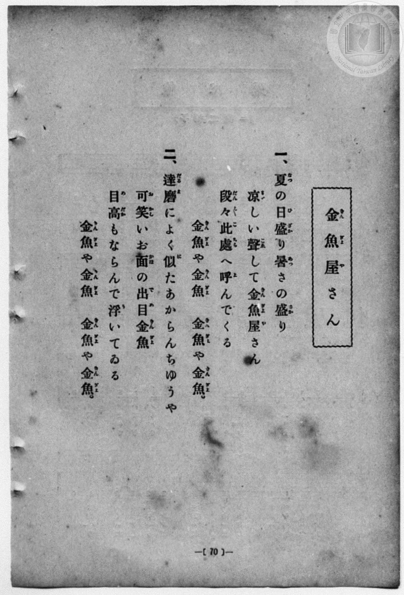
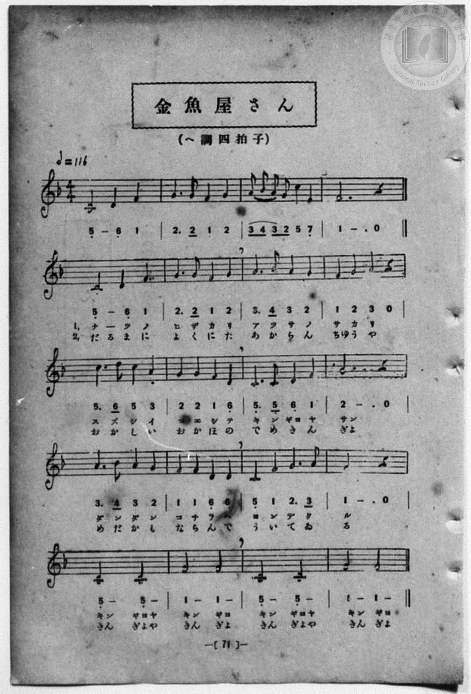

# 金魚屋さん

> Re:Shōka 使用 AI 協助辨識與重建樂譜，可能會有錯誤。歡迎回報。

- **NEUTRINO 歌聲合成版**：<br><audio controls src="kingyoyasan_neutrino.mp3"></audio>
- **鋼琴伴奏版**：<br><audio controls src="kingyoyasan.mp3"></audio>


- 一條慎三郎 編《新編 小學校・公學校 唱歌教材集》（大正十二年十二月，索書號 0725-41）

## 說明

原書資訊與歌詞全文（對應 P078.jpg–P079.jpg，原書 p. 70–71，第 35 首）：
調性與拍號：ヘ調四拍子（F 大調 4/4 拍），♩=116
說明：第一行（第 1–4 小節）為無歌詞前奏，第 5 小節起進入齊唱。


## 歌詞

```text
一、
夏（なつ）の日盛（ひざか）り　暑（あつ）さの盛（さか）り
涼（すず）しい聲（こゑ）して　金魚屋（きんぎよや）さん
段々（だんだん）此處（こちら）へ　呼（よ）んでくる
金魚（きんぎよ）や金魚（きんぎよ）　金魚（きんぎよ）や金魚（きんぎよ）。

二、
達磨（だるま）によく似（に）た　あからんちゆうや
可笑（おかし）いお面（かほ）の　出目金魚（でめきんぎよ）
目高（めだか）もならんで　浮（う）いてゐる
金魚（きんぎよ）や金魚（きんぎよ）　金魚（きんぎよ）や金魚（きんぎよ）。
```

## ABC

```abc
X:1
T:金魚屋さん
M:4/4
L:1/16
Q:1/4=116
K:F
V:V1 name="Piano" snm="Pia"
V:V2 name="Vocal" snm="Voc"
[V:V1]
C8 D4 F4 | G6 G2 F4 G4 | A2 B2 A2 G2 c4 E4 | F12 z4 |
z16 | z16 | z16 | z16 |
z16 | z16 | z16 | z16 |
z16 | z16 | z16 | z16 |
z16 | z16 | z16 | z16 |
[V:V2]
z16 | z16 | z16 | z16 |
C4 C4 D4 F4 | G6 G2 F4 G4 | A6 B2 A4 G4 | F4 G4 A4 z4 |
w: 1.~な _ つ の | ひ ざ か り | あ つ さ の | さ か り
w: 2.~だ る ま に | よ く に た | あ か ら ん | ちゆ う や
c6 d2 c4 A4 | G4 G4 F4 D4 | C6 C2 D4 F4 | G12 z4 |
w: 1.~す ず し い | こ ゑ し て | き ん ぎよ や | さん
w: 2.~お か し い | お か ほ の | で め き ん | ぎよ
A6 B2 A4 G4 | F4 F4 D4 D4 | C4 F4 G6 A2 | F12 z4 |
w: 1.~だ ん だ ん | こ ち ら へ | よ ん で く | る
w: 2.~め だ か も | な ら ん で | う い て ゐ | る
C8 C8 | F8 F8 | C8 C8 | F8 F8 |
w: 1.~きん ぎよや | きん ぎよ | きん ぎよや | きん ぎよ
w: 2.~きん ぎよや | きん ぎよ | きん ぎよや | きん ぎよ
```

## TMD 檔案連結

- [主旋律 TMD 檔案](kingyoyasan.tmd) [[在 TMD Studio 編輯](https://tmdlang.github.io/Tmd-TS/#tmd=s7IKdvYPcrWy4qpTUCpJTLdSSM7PyUlNLsnMz7MqzsjPTozPrsyvSsyML84ojTe0NDJWgqssy88pzU21Si9KTEmNN4w3QsgU55cWJadaFSdn5OfnxJekVpQk5edno8vHFySmp1oFGJhbIGQKivLLUvMS84C6C4oy80pSU8DaEQpSyzJTUkHSxcmJefFlqUWZaZmpKUiOSi0qBrsdYkVJUWJecXJRZgHIQwhV-UUlGflAhxdkVFplZBaX5BdlJifmxGcn5iUiFJVkpAK9l5KYmVMZn5OZloouk5iXmZuYU6zEpaWl8LJ94su1s55u7H7cOPVx02QFLS0uRVsFQ0MzLntbBTcuGxN9EzuQ9ic7Gp4tmvuste_Jjs6XzX0Kz7eveNzQ9WzaBiBD4emG_qdrdzxbsPBx8-6nrWsgbIWnUzY-W9vzbOrMZ3MnvJzd9rih-_2ejqdLlj9bu_hpb-OTXT1Pd26BMJ7N6Xi_p-f5lkXPZu94MXO-goG5kamuieH7PZ1KXFz6Wgq21AJcCgoKT_vmg6zZ3P5iRdeLjnagE1-snPe0dcWzae0g923ofdbeqQCKXL2sgvRHDZOBTEsQE-hCiFaFAj0FcwOgjDnQhT3P16xRMDZVeLlsGtC57_fMAlnxYtX-Zw3LQYZ39wL9AxR93DwDKPh09mygyNO1E4AWuSkAgwIopgAMYQWgKFh3z6OZK21BgQ82ZNWzGX1AvUAbgKH_YmEPUBfINkOg1SagMH--vgGo63nTructC6He6Ox9urQf6ipTqJoXW7e_bNj0tHXpy71dwDh53NDEBTIfaObjhkZwiCwBaul43LjqceMSoIGPG9c9m770-ezZYMFNjxunPW4ERl3n46auxw0Nz2ZNBIs3wRRPBaqHKQayoSpB5j7btgcsOvNx4yyw0umPG1teNG4CC05-3AQ0CCK4DGguPCGCZXuBafFxY9_jpo7HTS1Qa5omgw1dt_VxQytY0QKwIhAJVPFs7ZIXM6dCjW5c-LgJGJxAbTuARj-dCHZHEzCRAZ0GlF3-uLH_cVM3yDiItWh2gtW14JSCOZZEXdBg39UDDfaXjVOeL14B8wkwA-4Du3g1yNON_U_2QAJvNVhwPtBScJh3Az0GNhbow7bHjW1AG8FR2L_--RpIxHSBFDVOB2trAXJfzl0EFgcK7obELihI2nc9n70Oya3LHzc1orkYZC5I0eoZ4NADSi-ARS_QIatgDlkOShRb14FNaYPZuuxx04SBCGGgfZSXElCgoKXPxeWZV1KUbxWQmZiX71BjUFMNskHBxkLLDszAVjYpIOXXWZAMqaABy686oJIFXJxoYtEJtBBkao2CabyCLhiagRiGQFyjYAQWMALzQOwaBWMFEyA2AmZ0XQVzkMIasCQMGoBEuGq5uLwz89Ir8ysTixPzrMLygfUFKT7Z1QP0CXkeABMEfAASAfkCJgKTA4lAPAAy0MewRgGY5KAeA5Y8YHIdWAewiIKKTgPibhCrqQsq0wRXDyxAUPRAeAjV4OCD2GUEkl8AlgHLN-4Dk6shOps6oGb2Q8WAmRPNtm6gqk6w_slQGVBmBUuByaYWuIUEUlEnWWEPdoYZmAYFIyTgQRgUuOD4gKcwIIURQcipBxH4M6GemwXE08EskC9AMiBPAgtzsBhEZhlUpheiBxgMkEwK9zw4BiDBA4PoEQCKFGhgotkHkoFGXeNulEhdDrWvEWo3IgKgtqNahjfwgXU1OYGPPUXDAx459GFJHRRL2HIuIuxBiREWjpCECfMXOOwbF4LFwEmucQdEBhrYEHlouACTLEgGFHI4Qh0YchCVC-CZA5SoYZkPOVlDTAXJQFI2KHYgMQ9SMQGHTQTKmilklzXQxAxhIEITRhOpCinMQVULVBjeEIFrxCKNT45IrUipfyBsB9YUunYK4ApPAchAqjVAXGUuAA)]
- [鋼琴伴奏 TMD 檔案](kingyoyasan_piano.tmd) [[在 TMD Studio 編輯](https://tmdlang.github.io/Tmd-TS/#tmd=s7IKdvYPcrWy4qpTUCpJTLdSSM7PyUlNLsnMz7MqzsjPTozPrsyvSsyML84ojTe0NDJWgqssy88pzU21Si9KTEmNN4w3QsgU55cWJadaFSdn5OfnxJekVpQk5edno8vHFySmp1oFGJhbIGQKivLLUvMS84C6C4oy80pSU8DaEQpSyzJTUkHSxcmJefFlqUWZaZmpKUiOSi0qBrsdYkVJUWJecXJRZgHIQwhViUVA8fTU3NS8EquCzMS8_PjE5OT83ILEvEyQmBKXlpbCy_aJL9fOerqx-3Hj1MdNk9_v6Xg5e-azzu6X3XueT9jyZM-Wp0v73-_pVNDS4lK0VTA0NOOyt1Vw47Ix0TexA1n0ZEfDs0Vzn7X2PdnR-bK5T-H59hWPG7qeTdsAZCg83dD_dO2OZwsWPm7e_bR1DYSt8HTKxmdre55Nnfls7oSXs9seN3QDbX26ZPmztYuf9jY-2dXzdOcWCOPZnI73e3qeb1n0bPaOFzPnKxiYG5nqmhgC3aPExeWZV1KUbxUA8leQh0ONQU01lwIQ2Fho2YEZ-loKtuhA4fmaNUAXv1jY837PrKedvUDPKWiYgNz5fH2DjgIwliz1sgrSNbHo1NIHm1qjYBqvoAuGZiCGIRDXKJjHaxuBxcAMkBhUpEbBUNtYwUjbBEyDBY21TYESpvHa5iD9QAVQ40DQACTCVYviOR9kz5lAPQfUFg9yiUk8iAFyFJgLFgTxIbKoXDDfAGK-d2ZeemV-ZWJxYh45QbirBxiE5IUcmCA-6EAysOBDlkJwIDKQkAPZ42NYo_C4cRU0RB83LgGT68DaHjdugopOA-JuEKupCyrTBFcPzAooeiA8hGpwvEHsMgLJLwDLgOUb94HJ1RCdTR1QM_uhYo8b56PZ1g1U1QnWPxkqs_BxUxtYCkw2tcAtJJCqO8mJEkhi1FUw0TaDsiHBCY8XWCDDIg2e_oEUtlhETseI2JgJ9e0sIJ4OZoG8BZIB-fpx00SwGERmGVSmF6IHGC6PG_sgQQkJDXCUQMILBtFjBBRL0NBFsw8kA43Lxt0osbwcal8j1G5EjEBtR7UMb2w8nT2bnNggkODhkYAcE0g5ARJ52EoUREyA0iosVCHpFuZLcEw0LgSLgVNk4w6IDDToIfLQUAKmaJAMKBxxxAEwHCEqF8DzDijNw_ImcqqHmAqSgSR8UFxB0gFIxQQcNhEooaaQXUJBUzeEUQMMbG1YgCIxSVKLFP69iIQLSViQNA3RjkUanxyRWpHyxUDYjq22IbdOg0hhq9PgBkCUGCMZABQxQtKAZjyIwmIA3A6gSUgGAJlQPTgdABVDNgDiL6yyqNWyrp0CuOZXADKQAi3axzAWQ8gILKTMBQA)]

## 分析

```text
================================================================================
📊 TMD Song Profile: [ 金魚屋さん ]
================================================================================
⏱  Duration:       0:41 (41.4s), 20 measures total
🎼 Key & Tempo:    首調基準 F, != 116.0 BPM, <4/4>
   - 分析範圍：      由實際發聲的音符與和弦推測調性；播放脈絡另行呈現
🎤 人聲音域:    C4 (MIDI 60) – D5 (MIDI 74) [跨度: 14 個半音 / 1.2 個八度, 難度: moderate]
   - 最低音:  C4 in [Intro #1 @ m.5, 0:08]
   - 最高音: D5 in [Kingyoyasan #1 @ m.9, 0:17]
   - 適合: soprano, mezzo-soprano, contralto, tenor, baritone, bass
🏛  結構:      Intro (8.3s) -> Kingyoyasan (33.1s)
⚡ 編曲密度:        Peak 1 軌道同時演奏
🗝  調性診斷：       F 大調（純淨自然大調，未偵測到可信轉調）
   - 風格氣質:    純淨自然大調（陽光明朗、易唱易記，無明顯調外色彩）
   - 轉調歷程:    全曲維持單一推測調性（未偵測到可信轉調）
   - 核心骨幹音:  F, C, G, A, D
   - 調性數值:    F 大調 [相關度: 0.88, 穩定度: Moderate, 自然音純度: 100.0%]
   - 候選調性 (K-S): F 大調 (0.88), C 大調 (0.77), F 小調 (0.55)
   - 五度圈歷程:   -1 -> -1
   - 各段落調性細節:
     • [Intro #1]: F 大調 (r: 0.83, 自然音純度: 100.0%)
     • [Kingyoyasan #1]: F 大調 (r: 0.88, 自然音純度: 100.0%)

  [ 五度圈游移軌跡 ]
               C  
        [F ]*          G  
      Bb               D  
      Eb               A  
         Ab           E  
            Db       B  
               F# 
     (* = active key center)

  [ 十二半音累積音高分佈 ]
     C  : ███████████████████       24.3%
     C# :                            0.0%
     D  : ███████                    8.6%
     D# :                            0.0%
     E  : █                          1.3%
     F  : ████████████████████████  31.6%
     F# :                            0.0%
     G  : ████████████████          21.1%
     G# :                            0.0%
     A  : █████████                 11.2%
     A# : ██                         2.0%
     B  :                            0.0%
--------------------------------------------------------------------------------
Assignment 軌道音域：
  - Piano         : C4 – C5 (12 個半音 / 1.0 個八度, 14 個音符)
  - Vocal         : C4 – D5 (14 個半音 / 1.2 個八度, 49 個音符)
================================================================================
```


## 原書掃描頁






