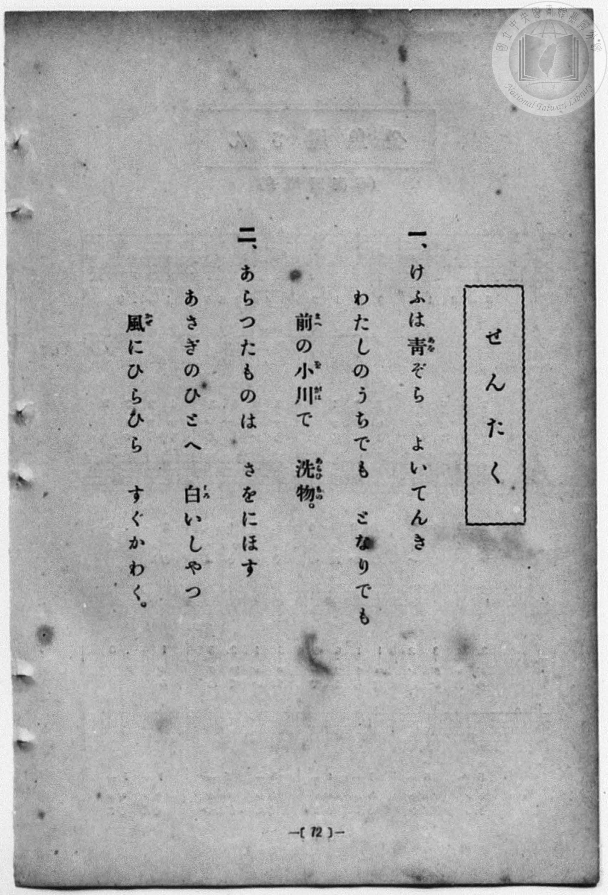
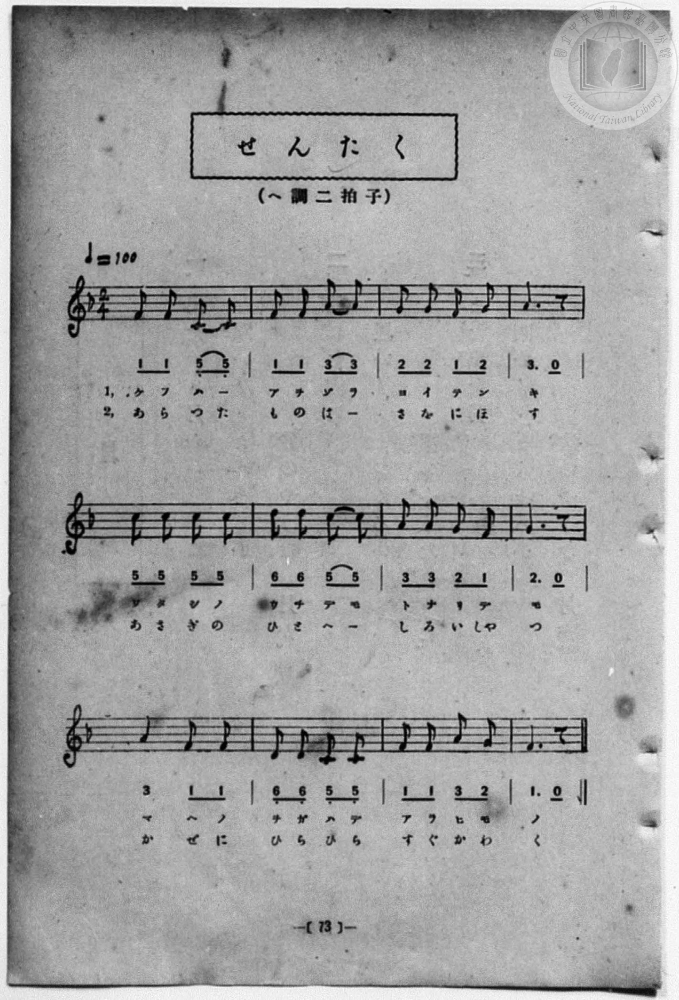

# せんたく

> Re:Shōka 使用 AI 協助辨識與重建樂譜，可能會有錯誤。歡迎回報。

- **NEUTRINO 歌聲合成版**：<br><audio controls src="sentaku_neutrino.mp3"></audio>
- **鋼琴伴奏版**：<br><audio controls src="sentaku.mp3"></audio>


- 詞：公學校用國民讀本
- 曲：宮島慎三郎
- 一條慎三郎 編《新編 小學校・公學校 唱歌教材集》（大正十二年十二月，索書號 0725-41）
- 臺灣總督府《公學校唱歌集》（大正四年三月，索書號 0725 26）

## 說明

原書資訊與歌詞全文（對應 P080.jpg–P081.jpg，原書 p. 72–73，第 36 首）：
調性與拍號：ヘ調二拍子（F 大調 2/4 拍），♩=100
作曲：臺灣總督府國語學校助教授 宮島慎三郎


## 歌詞

```text
一、けふは青（あを）ぞら　よいてんき
わたしのうちでも　となりでも
前（まへ）の小川（をがは）で　洗物（あらひもの）。

二、あらつたものは　さをにほす
あさぎのひとへ　白（しろ）いしやつ
風（かぜ）にひらひら　すぐかわく。
```

## ABC

```abc
X:1
T:せんたく
C:曲：宮島慎三郎
M:2/4
L:1/16
Q:1/4=100
K:F
V:V1 name="Piano" snm="Pia"
[V:V1]
F2 F2 C2 C2 | F2 F2 A2 A2 | G2 G2 F2 G2 | A6 z2 |
w: 1.~け ふ は _ | あ を ぞ ら | よ い て ん | き
w: 2.~あ ら っ た | も の は _ | さ を に ほ | す
c2 c2 c2 c2 | d2 d2 c2 c2 | A2 A2 G2 F2 | G6 z2 |
w: 1.~わ た し の | う ち で も | と な り で | も
w: 2.~あ さ ぎ の | ひ と へ _ | し ろ い しゃ | つ
A4 F2 F2 | D2 D2 C2 C2 | F2 F2 A2 G2 | F6 z2 |
w: 1.~ま へ の | を が は で | あ ら ひ も | の
w: 2.~か ぜ に | ひ ら ひ ら | す ぐ か わ | く
F2 F2 C2 C2 | F2 F2 A2 A2 | G2 G2 F2 G2 | A6 z2 |
w: 1.~け ふ は _ | あ を ぞ ら | よ い て ん | き
w: 2.~あ ら っ た | も の は _ | さ を に ほ | す
c2 c2 c2 c2 | d2 d2 c2 c2 | A2 A2 G2 F2 | G6 z2 |
w: 1.~わ た し の | う ち で も | と な り で | も
w: 2.~あ さ ぎ の | ひ と へ _ | し ろ い しゃ | つ
A4 F2 F2 | D2 D2 C2 C2 | F2 F2 A2 G2 | F6 z2 |
w: 1.~ま へ の | を が は で | あ ら ひ も | の
w: 2.~か ぜ に | ひ ら ひ ら | す ぐ か わ | く
```

## TMD 檔案連結

- [主旋律 TMD 檔案](sentaku.tmd) [[在 TMD Studio 編輯](https://tmdlang.github.io/Tmd-TS/#tmd=s7IKdvYPcrWy4qpTUCpJTLdSSM7PyUlNLsnMz7MqzsjPTozPrsyvSsyML84ojTe0NDJWgqssy88pzU21Si9KTEmNN4w3QsgU55cWJadaFSdn5OfnxJekVpQk5edno8vHFySmp1oFGFgYIGQKivLLUvMS84C6C4oy80pSU8DaEQpSyzJTUkHSxcmJefFlqUWZaZmpKUiOSi0qBrsdYkVJUWJecXJRZgHIQwhV-UUlGflAhxdkVFplZBaX5BdlJifmxGcn5iUiFJVkpAK9l5KYmVMZn5OZloqsPTM9M8-qJDGzHOiI_LS0zOTMxBwlLi0thceNsx83TX7cOP9xY7-ClhaXoq2CoYEBl72tghuXjZG-iR3IkCc7Gp4tmvuste_Jjs6XzX0Kz7eveNzQ9WzaBiBD4emG_qdrdzxbsPBx8-6nrWsgbIWnUzY-W9vzbOrMZ3MnvJzd9rih-_2ejqdLlj9bu_hpb-OTXT1Pd26BMJ7N6Xi_p-f5lkXPZu94MXO-goG5kamuieH7PZ1gD7xYOe_9nllwg59PWfF0TvezDRNfrGt4NmcNWMmz2ZtAState7p5G9yREM3tu543Ln6-Y-_zuYuf7poDdDTcIIgD0Z02ezbQXUADsDlKwcgM7CgufS0FW2oBLgUFhad980HWbG5_saLrRUc70FlATz9tXfFsWjvIZRt6n7V3KoDSnV5WQfqjhslApiGICXQhRKtCgZ6CuRFQxtwY5Oo1axSMzRReLpsGdC4wYEBWvFi1_1nDcpDh3b1A_wBFHzfPAAqCwr-79-naCUCL3BSAgQAUUwBGuwJQFKy759HMlbagFAE05MneOZCgRgtWYIS8WDUPGqxdK0GR3tehgBYfXGATdjQ8bmh83DjxcePWx43rX86dBLT3cWPT4yYgo_Nx47zHTZ2PGxoeNwEFWx43LgMnzV6QzsdN_eBEOv1x47rHjW2PGxc-blz-uKkJpLpxxePGVY-buiAi4BDtBLoeaMa-x407wAavA6XS7XNBgk2THjf2AC0Hiy8H6n-2ZfrzzpUwhwAFN4HMbVwHUtDQBHH3rh6wuyHyS0AuASsBGgN2wFSwqasfN-5-3DgT7FygUqBoYx9Y0SawE3cAlT6fuRds0fTHTaDwBfsSyAaSS0DaXi5aAZbuftw4BywNNBLoGoibwCHTOPNx4wSQAlB49IPcB9RGeTKEAgUtfS6u4NS8ksTsUquAzMS8fIcag5pqkB0KNhZadmAGtuSvAEx0wMh9sbBHQcMEVCQ8X9-gA0qz4ISqiUUD0CaQYTUKhkBoGg9CELYxENYoGAGhIRDXAHm6QGigUANW72NYAwzciUC8FYjXA2VA_CZg-pgEpOcB6U6QSFMHkNcCxMuA7MlgNb1gc4C2QMwxgunrBNKLgXg-WB9QpHEdkslToSavBuLdYJGZcHPwh8auHnJCwxQKaxTMgBDCAoUIKDRAoYIRFk39YLcDkxHY5SAXtgHxQiBeDvYPSGQFEK8C8rrAohB_Yg0NkH8b--AmbYLq3QENDaAdTb3QkAUm22aw4BIiA2RHJzkBAop-ULIABkg8CKEmFVACMcSSQPYBRUDOhnoEHIU94GiFBgA86oFehAbSOixB0g02Zw44AUADBK4LnNCAyQGYIcEqQVEBEumHm1PLxaVrpwDNTwqoTGUuAA)]
- [鋼琴伴奏 TMD 檔案](sentaku_piano.tmd) [[在 TMD Studio 編輯](https://tmdlang.github.io/Tmd-TS/#tmd=s7IKdvYPcrWy4qpTUCpJTLdSSM7PyUlNLsnMz7MqzsjPTozPrsyvSsyML84ojTe0NDJWgqssy88pzU21Si9KTEmNN4w3QsgU55cWJadaFSdn5OfnxJekVpQk5edno8vHFySmp1oFGFgYIGQKivLLUvMS84C6C4oy80pSU8DaEQpSyzJTUkHSxcmJefFlqUWZaZmpKUiOSi0qBrsdYkVJUWJecXJRZgHIQ0pcWloKjxtnP26a_Lhx_uPG_vd7Ol7Onvmss_tl957nE7Y82bPl6VKgYKeClhaXoq2CoYEBl72tghuXjZG-iR3Iiic7Gp4tmvuste_Jjs6XzX0Kz7eveNzQ9WzaBiBD4emG_qdrdzxbsPBx8-6nrWsgbIWnUzY-W9vzbOrMZ3MnvJzd9rihG2jr0yXLn61d_LS38cmunqc7t0AYz-Z0vN_T83zLomezd7yYOV_BwNzIVNfEEOgesPderJz3fs8suMHPp6x4Oqf72YaJL9Y1PJuzBqzk2exNICXr1j3dvA3uSIjm9l3PGxc_37H3-dzFT3fNAToabhDEgehOmz0b6C6gAdgcpWBkBnYUV3BqXklidqlVQGZiXn6Qh0ONQU01lwIQ2Fho2YEZ-loKtuhA4fmaNcCAfLGwR0HDBBRqz9c36CgA04GhXlZBuiYWDVr6YMNqFAyB0DQehCBsYyCsUTACQkMgrgHydIHQQKEGrN7HsAYY3ROBeCsQrwfKgPhNCo-bJgHpeUC6EyTS1AHktQDxMiB7MlhNL9gcoC0Qc4xg-jqB9GIgng_WBxRpXIdk8lSoyauBeDdYZCbcHPyhsauHnNAwhcIaBTMghLBAIQIKDVCoYIRFUz_Y7Y8bp4NdDnJhGxAvBOLlYP-ARFYA8SogrwssCvEn1tAA-bexD27SJqjeHdDQANrR1AsN2emPm5rBgkuIDJAdneQECCj6QckCGCDxIISaVEAJxBBLAtkHFAE5G-oRcBT2gKMVGgDwqAd6ERpI67AESTfYnDngBAANELgucEIDJofHjRPAKkFRARLph5tTi5adfLBlJ6AH4hWiDWPBlGl8LKoAkAIminioFDYlMI9jajMBMkyQ-FAG2DRDsClwg0EMfAaBTMJhP1YHAX2ua6cA9Xy0D1ACmWsE5ipzAQA)]

## 分析

```text
================================================================================
📊 TMD Song Profile: [ せんたく ]
================================================================================
⏱  Duration:       0:28 (28.8s), 24 measures total
🎼 Key & Tempo:    首調基準 F, != 100.0 BPM, <2/4>
   - 分析範圍：      由實際發聲的音符與和弦推測調性；播放脈絡另行呈現
🎤 人聲音域:    C4 (MIDI 60) – D5 (MIDI 74) [跨度: 14 個半音 / 1.2 個八度, 難度: moderate]
   - 最低音:  C4 in [Sentaku #1 @ m.1, 0:00]
   - 最高音: D5 in [Sentaku #1 @ m.6, 0:06]
   - 適合: soprano, mezzo-soprano, contralto, tenor, baritone, bass
🏛  結構:      Sentaku (14.4s) -> Sentaku (14.4s)
⚡ 編曲密度:        Peak 1 軌道同時演奏
🗝  調性診斷：       F 大調（純淨自然大調，未偵測到可信轉調）
   - 風格氣質:    純淨自然大調（陽光明朗、易唱易記，無明顯調外色彩）
   - 轉調歷程:    全曲維持單一推測調性（未偵測到可信轉調）
   - 核心骨幹音:  F, C, A, G, D
   - 調性數值:    F 大調 [相關度: 0.87, 穩定度: High, 自然音純度: 100.0%]
   - 候選調性 (K-S): F 大調 (0.87), C 大調 (0.71), A 小調 (0.64)
   - 五度圈歷程:   -1 -> -1
   - 各段落調性細節:
     • [Sentaku #1]: F 大調 (r: 0.87, 自然音純度: 100.0%)
     • [Sentaku #2]: F 大調 (r: 0.87, 自然音純度: 100.0%)

  [ 五度圈游移軌跡 ]
               C  
        [F ]*          G  
      Bb               D  
      Eb               A  
         Ab           E  
            Db       B  
               F# 
     (* = active key center)

  [ 十二半音累積音高分佈 ]
     C  : ██████████████████        22.2%
     C# :                            0.0%
     D  : ███████                    8.9%
     D# :                            0.0%
     E  :                            0.0%
     F  : ████████████████████████  28.9%
     F# :                            0.0%
     G  : ███████████████           17.8%
     G# :                            0.0%
     A  : ██████████████████        22.2%
     A# :                            0.0%
     B  :                            0.0%
--------------------------------------------------------------------------------
Assignment 軌道音域：
  - Piano         : C4 – D5 (14 個半音 / 1.2 個八度, 76 個音符)
================================================================================
```


## 原書掃描頁






