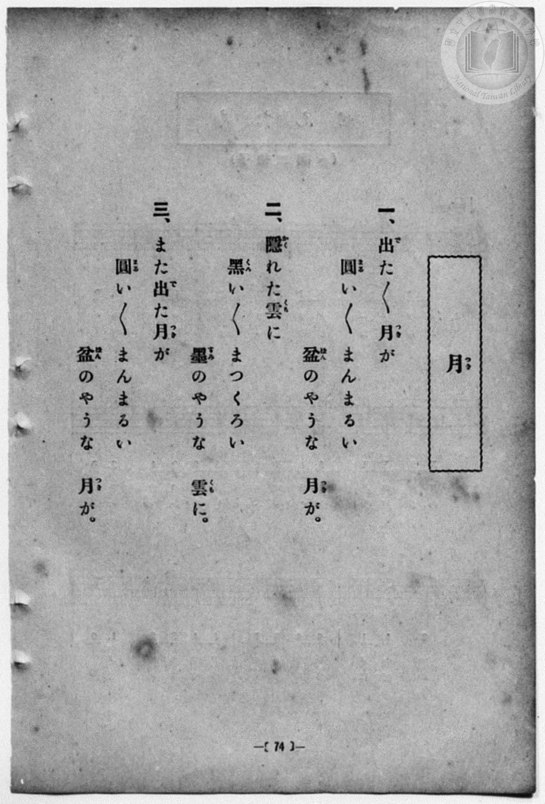
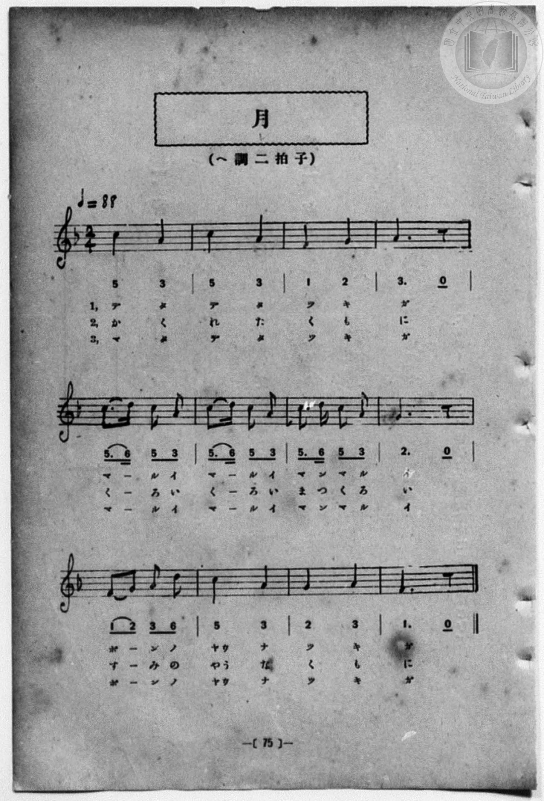

# 月

> Re:Shōka 使用 AI 協助辨識與重建樂譜，可能會有錯誤。歡迎回報。

- **鋼琴伴奏版**：<br><audio controls src="tsuki.mp3"></audio>
- **NEUTRINO 歌聲合成版**：<br><audio controls src="tsuki_neutrino.mp3"></audio>

- 詞：文部省《尋常小學唱歌》
- 曲：文部省《尋常小學唱歌》
- 一條慎三郎 編《新編 小學校・公學校 唱歌教材集》（大正十二年十二月，索書號 0725-41）
- 臺灣總督府《公學校唱歌集》（大正四年三月，索書號 0725 26）

## 說明

原書資訊與歌詞全文（對應 P082.jpg–P083.jpg，原書 p. 74–75，第 37 首）：
調性與拍號：ヘ調二拍子（F 大調 2/4 拍），♩=88


## 歌詞

```text
一、出（で）た〱月（つき）が
圓（まる）い〱　まんまるい
盆（ぼん）のやうな　月（つき）が。

二、隱（かく）れた雲（くも）に
黑（くろ）い〱　まつくろい
墨（すみ）のやうな　雲（くも）に。

三、また出（で）た月（つき）が
圓（まる）い〱　まんまるい
盆（ぼん）のやうな　月（つき）が。
```

## ABC

```abc
X:1
T:月
C:曲：文部省《尋常小學唱歌》
M:2/4
L:1/16
Q:1/4=88
K:F
V:V1 name="Piano" snm="Pia"
[V:V1]
c4 A4 | c4 A4 | F4 G4 | A6 z2 |
w: 1.~で た | で た | つ き | が
w: 2.~か く | れ た | く も | に
w: 3.~ま た | で た | つ き | が
c3 d c2 A2 | c3 d c2 A2 | c3 d c2 A2 | G6 z2 |
w: 1.~ま _ る い | ま _ る い | ま ん ま る | い
w: 2.~く _ ろ い | く _ ろ い | ま っ く ろ | い
w: 3.~ま _ る い | ま _ る い | ま ん ま る | い
F2 G2 A2 d2 | c4 A4 | G4 A4 | F6 z2 |
w: 1.~ぼ _ ん の | やう な | つ き | が
w: 2.~す _ み の | やう な | く も | に
w: 3.~ぼ _ ん の | やう な | つ き | が
c4 A4 | c4 A4 | F4 G4 | A6 z2 |
w: 1.~で た | で た | つ き | が
w: 2.~か く | れ た | く も | に
w: 3.~ま た | で た | つ き | が
c3 d c2 A2 | c3 d c2 A2 | c3 d c2 A2 | G6 z2 |
w: 1.~ま _ る い | ま _ る い | ま ん ま る | い
w: 2.~く _ ろ い | く _ ろ い | ま っ く ろ | い
w: 3.~ま _ る い | ま _ る い | ま ん ま る | い
F2 G2 A2 d2 | c4 A4 | G4 A4 | F6 z2 |
w: 1.~ぼ _ ん の | やう な | つ き | が
w: 2.~す _ み の | やう な | く も | に
w: 3.~ぼ _ ん の | やう な | つ き | が
```

## TMD 檔案連結

- [主旋律 TMD 檔案](tsuki.tmd) [[在 TMD Studio 編輯](https://tmdlang.github.io/Tmd-TS/#tmd=s7IKdvYPcrWy4qpTUCpJTLdSSM7PyUlNLsnMz7MqzsjPTozPrsyvSsyML84ojTe0NDJWgqssy88pzU21Si9KTEmNN4w3QsgU55cWJadaFSdn5OfnxJekVpQk5edno8vHFySmp1oFGFgg6Swoyi9LzUvMA-ouKMrMK0lNAWtHKEgty0xJBUkXJyfmxZelFmWmZaamIDkqtagY7HaIFSVFiXnFyUWZBSAPIVTlF5Vk5AMdXpBRaZWRWVySX5SZnJgTn52Yl4hQVJKRCvReXmJJaVEqstbM9Mw8q9z8vKRSYAApcWlpKTyb06GgpcWlaKtgYcFlb6vgxmVjpG9iB9LzZEfDs0Vzn7X2PdnR-bK5T-H59hWPG7qeTdsAZCg83dD_dO2OZwsWPm7e_bR1DYSt8HTKxmdre55Nnfls7oSXs9seN3S_39PxdMnyZ2sXP-1tfLKr5-nOLRAG0N73e3qeb1n0bPaOFzPnKxiYG5nqmhi-39MJdu-LlfPe75n1bFr7y-YVz-c0Au19uqH76Y4dEGsh1gBNB6t9NnsT0WpftO963rj4-Y69z-cufrprDkgtzPEQheiunj0b6GRgAGBzr4KRGdi9XPpaCrbUAlwKCgpP--aDrNnc_mJF14uOdqCzgOHxtHUF0I8gl23ofdbeqQBKfXpZBemPGiYDmcYgJtCFEK0KBXoK5iZAGXNTkKvXrFEwNld4uWwa0LnAoAJZ8WLV_mcNy0GGd_cC_QMUfdw8AygIipru3qdrJwAtclMABgJQTAGYIhSAomDdPY9mrrQFphWQIcAU8rih8Wn7LqDix43LgfKPG-c_btgIDiygyJLHjSBNjxt7wL6aMxksuu9xEzCAgaItQKWPGxrAIpMh4kBBkNLns9vASvcAJcBK1z1uannc2Pa4cRVQA6bxjxuaIA7aBWQ2vpy1ESwPNK0fJN_UA3TWS1AqAQr2P25qAmtaDdLwcvdEmCjEKCQ3gcwHiUPd9HTRCrDSmY8b92O6CdN4uJt2dALdBDZwPlpQDUg4AbVRnkqhQEFLn4srpLg0O9MqIDMxL9-hxqCmGmSDgo2hmZYdmIUtcygAkyQw8bxY2KOgYQIqS56vb9ABpWhwMtbEogFoEciwGgVTBV0wNIbS2EQMoSwjuAhMDgQNQCJg03wMaxSAkQEVB0YIXD0u0SVw0V4k0R4k0-MRphuB5LrhOvoROppgOlBNh6kApiEk0dXYTTcGye2jgdvxx9quHvJjzQxMg-KCOBFY_GGLNbjPm0AhDMwPUP_gFwfmEygbIg-SAanAFXuIGAGFGcI0XOJQWxoXQ9VA5PHYghqLNPALgTzYSU5sgvIXKG5AsWQGthkzD8LiDjNXYovNPXCfTgb7dB3EP-DCDCbVuApuFDkZcSZcx37irCA9N9LMF7VcXLp2CuCCVgGZocwFAA)]
- [鋼琴伴奏 TMD 檔案](tsuki_piano.tmd) [[在 TMD Studio 編輯](https://tmdlang.github.io/Tmd-TS/#tmd=s7IKdvYPcrWy4qpTUCpJTLdSSM7PyUlNLsnMz7MqzsjPTozPrsyvSsyML84ojTe0NDJWgqssy88pzU21Si9KTEmNN4w3QsgU55cWJadaFSdn5OfnxJekVpQk5edno8vHFySmp1oFGFgg6Swoyi9LzUvMA-ouKMrMK0lNAWtHKEgty0xJBUkXJyfmxZelFmWmZaamIDkqtagY7HaIFSVFiXnFyUWZBSAPKXFpaSk8m9Pxfk_Hy9kzn3V2v-ze83zClid7tjxd2v9-T6eClhaXoq2ChQWXva2CG5eNkb6JHcjgJzsani2a-6y178mOzpfNfQrPt6943ND1bNoGIEPh6Yb-p2t3PFuw8HHz7qetayBshadTNj5b2_Ns6sxncye8nN32uKEbaOnTJcufrV38tLfxya6epzu3QBhg9_Q837Lo2ewdL2bOVzAwNzLVNTEEOgfsqRcr573fM-vZtPaXzSuez2kE2vt0Q_fTHTsg1kKsAZoOVvts9iai1b5o3_W8cfHzHXufz138dNcckFqY4yEK0V09ezbQycAAwOZeBSMzsHu5QopLszOtAjIT8_KDPBxqDGqquRSAwMbQTMsOzNLXUrBFBwrP16wBBvGLhT0KGiag8Hy-vkFHAZgujPWyCtI1sWjQ0gcbVqNgqqALhsZQGpuIIZRlBBeByYGgAUgEbJqPYY3C48blUPHHjfPh6nGJLoGL9iKJ9iCZHo8w3Qgk1w3X0Y_Q0QTTgWo6TMXjpiYk0dXYTTcGye2jgdvxx9quHvJjzQxMg-KCOBFY_GGLNbjPm0Ah_LixBeof_OKPmyZD2RB5kAxIBa7YQ8QIKMwQpuESh9rSuBiqBiKPxxbUWKSBXwjkwU5yYhOUv0BxA4olM7DNmHkQFneYuRJbbO6B-3Qy2KfrIP5pannc2AaTalwFN4qcjDgTrmM_cVaQnhtp5otalHLWB7mctYAWszUK0YaxQMUQEgfPNB6ZC4oGiPOJ0gzjQQwhWjNEOVargd7StVMA-yzaByQO5xghc4zBHGUuAA)]

## 分析

```text
================================================================================
📊 TMD Song Profile: [ 月 ]
================================================================================
⏱  Duration:       0:32 (32.7s), 24 measures total
🎼 Key & Tempo:    首調基準 F, != 88.0 BPM, <2/4>
   - 分析範圍：      由實際發聲的音符與和弦推測調性；播放脈絡另行呈現
🎤 人聲音域:    F4 (MIDI 65) – D5 (MIDI 74) [跨度: 9 個半音 / 0.8 個八度, 難度: easy]
   - 最低音:  F4 in [Tsuki #1 @ m.3, 0:02]
   - 最高音: D5 in [Tsuki #1 @ m.5, 0:05]
   - 適合: soprano, mezzo-soprano, contralto, tenor, baritone, bass
🏛  結構:      Tsuki (16.4s) -> Tsuki (16.4s)
⚡ 編曲密度:        Peak 1 軌道同時演奏
🗝  調性診斷：       A 小調（純淨自然小調，未偵測到可信轉調）
   - 風格氣質:    純淨自然小調（陰鬱抒情、旋律集中，無明顯調外色彩）
   - 轉調歷程:    全曲維持單一推測調性（未偵測到可信轉調）
   - 核心骨幹音:  A, C, G, F, D
   - 調性數值:    A 小調 [相關度: 0.81, 穩定度: Moderate, 自然音純度: 100.0%]
   - 候選調性 (K-S): A 小調 (0.81), C 大調 (0.72), F 大調 (0.67)
   - 五度圈歷程:   +3 -> +3
   - 各段落調性細節:
     • [Tsuki #1]: A 小調 (r: 0.81, 自然音純度: 100.0%)
     • [Tsuki #2]: A 小調 (r: 0.81, 自然音純度: 100.0%)

  [ 五度圈游移軌跡 ]
               C  
         F            G  
      Bb               D  
      Eb              [A ]*
         Ab           E  
            Db       B  
               F# 
     (* = active key center)

  [ 十二半音累積音高分佈 ]
     C  : ██████████████████████    30.0%
     C# :                            0.0%
     D  : ████                       5.6%
     D# :                            0.0%
     E  :                            0.0%
     F  : ██████████                13.3%
     F# :                            0.0%
     G  : █████████████             17.8%
     G# :                            0.0%
     A  : ████████████████████████  33.3%
     A# :                            0.0%
     B  :                            0.0%
--------------------------------------------------------------------------------
Assignment 軌道音域：
  - Piano         : F4 – D5 (9 個半音 / 0.8 個八度, 58 個音符)
================================================================================
```


## 原書掃描頁






