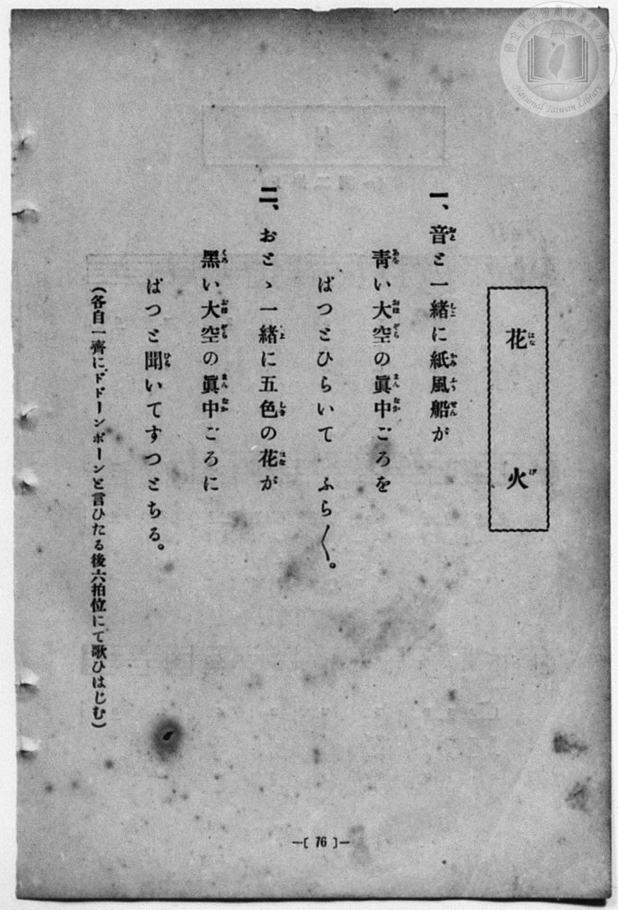
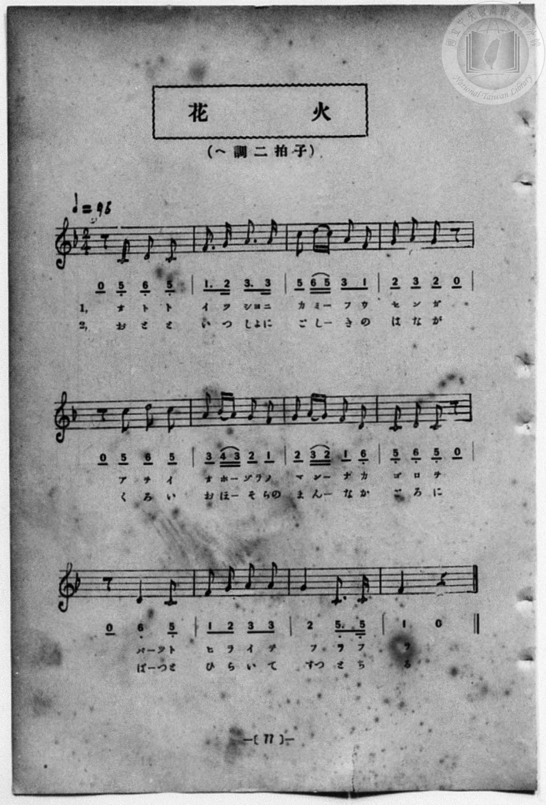

# 花火

> Re:Shōka 使用 AI 協助辨識與重建樂譜，可能會有錯誤。歡迎回報。

- **鋼琴伴奏版**：<br><audio controls src="hanabi.mp3"></audio>
- **NEUTRINO 歌聲合成版**：<br><audio controls src="hanabi_neutrino.mp3"></audio>

- 一條慎三郎 編《新編 小學校・公學校 唱歌教材集》（大正十二年十二月，索書號 0725-41）

## 說明

原書資訊與歌詞全文（對應 P084.jpg–P085.jpg，原書 p. 76–77，第 38 首）：
調性與拍號：ヘ調二拍子（F 大調 2/4 拍），♩=96


## 歌詞

```text
一、
音（おと）と一緒（しよ）に　紙風船（かみふうせん）が
青（あを）い大空（おほぞら）の　眞中（まんなか）ごろを
ぱつとひらいて　ふら〱。

二、
おとゝ一緒（しよ）に　五色（しき）の花（はな）が
黑（くろ）い大空（おほぞら）の　眞中（まんなか）ごろに
ぱつと開（ひら）いて　すつとちる。

（各自一齊にドーンポーンと言ひたる後六拍位にて歌ひはじむ）
```

## ABC

<div class="abc-score" data-abc-src="hanabi.abc" aria-label="五線譜載入中"></div>

[下載 ABC 原始檔](hanabi.abc)

## TMD 檔案連結

- [主旋律 TMD 檔案](hanabi.tmd) [[在 TMD Studio 編輯](https://tmdlang.github.io/Tmd-TS/#tmd=s7IKdvYPcrWy4qpTUCpJTLdSSM7PyUlNLsnMz7MqzsjPTozPrsyvSsyML84ojTe0NDJWgqssy88pzU21Si9KTEmNN4w3QsgU55cWJadaFSdn5OfnxJekVpQk5edno8vHFySmp1oFGFiYIGQKivLLUvMS84C6C4oy80pSU8DaEQpSyzJTUkHSxcmJefFlqUWZaZmpKUiOSi0qBrsdYkVJUWJecXJRZgHIQwhV-UUlGflAhxdkVFplZBaX5BdlJifmxGcn5iUiFJVkpAK9V5CTWIkuVpyaWJyfF19cmpubWoRsamZ6Zp5Vbn5eUikw7JS4tLQUXnRtfN64WkFLi0vRVsHSjMveVsGNy8ZI38QOpO3JjoZni-Y-a-17sqPzZXOfwvPtKx43dD2btgHIUHi6of_p2h3PFix83Lz7aesaCFvh6ZSNz9b2PJs689ncCS9ntz1u6H6_p-PpkuXP1i5-2tv4ZFfP051bIIxnczre7-l5vmXRs9k7Xsycr2BgbmSqa2L4fk-nEheXvpaCLbUAl4KCwtO--SBrNre_WNH1oqMd6MQXK-c9bV3xbFo7yH0bep-1dyqA4lovqyD9UcNkINMUxAS6EKJVoUBPwdwMKGNuDnL1mjUKxhYKL5dNAzr3_Z5ZICterNr_rGE5yPDuXqB_gKKPm2cABUFe7e59unYC0CI3BWBQAMUUgCGsABQF6-55NHOlLTDsQYYAQ_xxQyOI9XL-ZqCGx41djxtXAJUBSaDc8-2TwILTHzcBAw8ouPpxQ8PzLTNfLlrxomMnWKr7ceP-x41bHze2PW6c_bhpMlhZD9jEuRDNTY-bgAygaAvQMc9X7oJZs_tx47zHTUAHAaXWgcydM-_JjrVg2X1Agx43rgKaDpad8ripF2gIyNDHjRsfNy4Buu5x4yagZqChjxuXATWDnADkNmx83NAE8dmuHqjPIH563DQXl4ee7JryonMTVLwRFEhABwFTKlhkPdAdSH7aPREs2g90ERX81LgaxU8vp4FSL8RnENNhnpsJ8_TCx03dMC-CUtKElhftq4Aee7kXaPvqx82dj5v3PG7e_Lh5LpTRuOLFCqABmx43zgdqfbqv52nrWmBKeLIXZDvQeGDSBMsC_TnjcVMD0FqQ0ZTnAihQ0NLn4vIAFiRJmVZh-cBSxaHGoKYaZIWCjaGZlh2YhS33KQDTPNBfLxb2KGiYgDL_8_UNOqAsA84nmlg0AG0CGVajYKCgq2AaDyTMQASYVaNgCCR1FYwUjMG0MVDEFKQCSIJEQLI1QFmQDEiVLtiQGrCBPoY1CiAzgBEMJlfAyRog3QI2Dxg9QAxKVVDuarBkN5i9H0xuBZNtUG2zQbymyWCxHiAJdiTEOiOyrZsCZk8Hk71gch1U23owbxWadfgDf1cP2YEPDlkIXQMOURMgCQpV5HA2AvPAcQSMDNT4whb6TeAgmwRmg4IB5C9IEO0Gk6CMh-LpfUhhDPE6KD7gAdUEDiKwgdhCvx-hhorWAWOKuNDf0Ulu6INDEQSRUj4sZYMwJPzhCsAULH9AQh4E0UMfWEQthkohUuMmsMcgwQAKI2B5ApUBpXawWrAsJP0DxaE8SBAgWQMPdRKtAZaLqMpB9EKwTaDAR7WplotL104BUhgpoLCUuQA)]
- [鋼琴伴奏 TMD 檔案](hanabi_piano.tmd) [[在 TMD Studio 編輯](https://tmdlang.github.io/Tmd-TS/#tmd=s7IKdvYPcrWy4qpTUCpJTLdSSM7PyUlNLsnMz7MqzsjPTozPrsyvSsyML84ojTe0NDJWgqssy88pzU21Si9KTEmNN4w3QsgU55cWJadaFSdn5OfnxJekVpQk5edno8vHFySmp1oFGFiYIGQKivLLUvMS84C6C4oy80pSU8DaEQpSyzJTUkHSxcmJefFlqUWZaZmpKUiOSi0qBrsdYkVJUWJecXJRZgHIQwhViUVA8fTU3NS8EquCzMS8_PjE5OT83ILEvEyQmBKXlpbCi66NzxtXv9_T8XL2zGed3S-79zyfsOXJni1Pl_a_39OpoKXFpWirYGnGZW-r4MZlY6RvYgcy_smOhmeL5j5r7Xuyo_Nlc5_C8-0rHjd0PZu2AchQeLqh_-naHc8WLHzcvPtp6xoIW-HplI3P1vY8mzrz2dwJL2e3PW7oBlr6dMnyZ2sXP-1tfLKr5-nOLRDGszkd7_f0PN-y6NnsHS9mzlcwMDcy1TUxBDpHiYvLIzEvMSnTKgDknSAPhxqDmmouBSCwMTTTsgOz9LUUbNGBwvM1a4BufrGwR0HDBOTA5-sbdBSAkWKql1WQrolFg5Y-2LAaBQMFXQXTeCBhBiLArBoFQyCpq2Aer22kYKhtDOaA6BoFY21TINtE2wzMgsiBFNdAFEOUQXXqgs2uAdvjY1ijADL6cWMXmFwBJ2uAdAvYhseNS4B4-uOmDih3NViyG8zeDya3gsk2qLbZIF7TZLBYD5AEux1inRHZ1k0Bs6eDyV4wuQ6qbT2YtwrNOvxxsquH3DhBhDSMDYwWcOAaaZuAWbAQRw9-SLTBYrQGPXaxRUoTOCQngdmg0AF5FxJyu8HkvMdNnShhsQ8p6CEhAoomePg1gUMObCC2SOlHqKGidcAIJC5SdnSSGyngUARBpHyCkvAhJDw64ErBFCxfQeIABNHjYePjxsVQKURy3QT2IiRAQKH1uHEZVAaUHcBqwbKQDAIUh_IggYFkDTz8SbRmJrpyEL0QbBMoGlBtqkUtw3yQyzALaBEGDIh4UICYgEkYD0KCeUAJIGkM4pnGQ2XigaEG8QiSdiADpgFiAkQDRNIIxTSEbogUkm6IVrh1QC6UgsrC9QM9p2unAPFftI9hrAISzwjMU-YCAA)]

## 分析

```text
================================================================================
📊 TMD Song Profile: [ 花火 ]
================================================================================
⏱  Duration:       0:30 (30.0s), 24 measures total
🎼 Key & Tempo:    首調基準 F, != 96.0 BPM, <2/4>
   - 分析範圍：      由實際發聲的音符與和弦推測調性；播放脈絡另行呈現
🎤 人聲音域:    C4 (MIDI 60) – D5 (MIDI 74) [跨度: 14 個半音 / 1.2 個八度, 難度: moderate]
   - 最低音:  C4 in [Hanabi #1 @ m.1, 0:00]
   - 最高音: D5 in [Hanabi #1 @ m.3, 0:02]
   - 適合: soprano, mezzo-soprano, contralto, tenor, baritone, bass
🏛  結構:      Hanabi (15.0s) -> Hanabi (15.0s)
⚡ 編曲密度:        Peak 1 軌道同時演奏
🗝  調性診斷：       C 調性不明確（純淨自然大調，未偵測到可信轉調）
   - 風格氣質:    純淨自然大調（陽光明朗、易唱易記，無明顯調外色彩）
   - 轉調歷程:    全曲維持單一推測調性（未偵測到可信轉調）
   - 核心骨幹音:  C, G, A, F, D
   - 調性數值:    C 調性不明確 [相關度: 0.80, 穩定度: Ambiguous, 自然音純度: 98.8%]
   - 候選調性 (K-S): C 大調 (0.80), F 大調 (0.78), A 小調 (0.64)
   - 五度圈歷程:   +0 -> +0
   - 各段落調性細節:
     • [Hanabi #1]: C 調性不明確 (r: 0.80, 自然音純度: 98.8%, 調外音: A#)
     • [Hanabi #2]: C 調性不明確 (r: 0.80, 自然音純度: 98.8%, 調外音: A#)

  [ 五度圈游移軌跡 ]
              [C ]*
         F            G  
      Bb               D  
      Eb               A  
         Ab           E  
            Db       B  
               F# 
     (* = active key center)

  [ 十二半音累積音高分佈 ]
     C  : ████████████████████████  25.6%
     C# :                            0.0%
     D  : ███████████████           15.9%
     D# :                            0.0%
     E  :                            0.0%
     F  : █████████████████         18.3%
     F# :                            0.0%
     G  : ██████████████████        19.5%
     G# :                            0.0%
     A  : ██████████████████        19.5%
     A# : █                          1.2%
     B  :                            0.0%
--------------------------------------------------------------------------------
Assignment 軌道音域：
  - Vocal         : C4 – D5 (14 個半音 / 1.2 個八度, 82 個音符)
================================================================================
```


## 原書掃描頁






