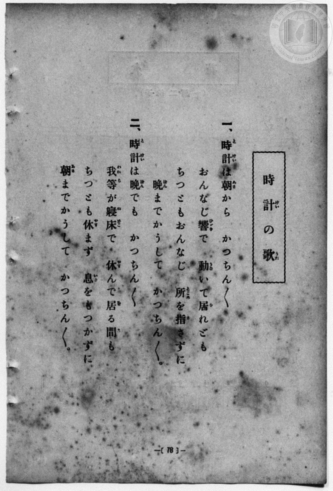
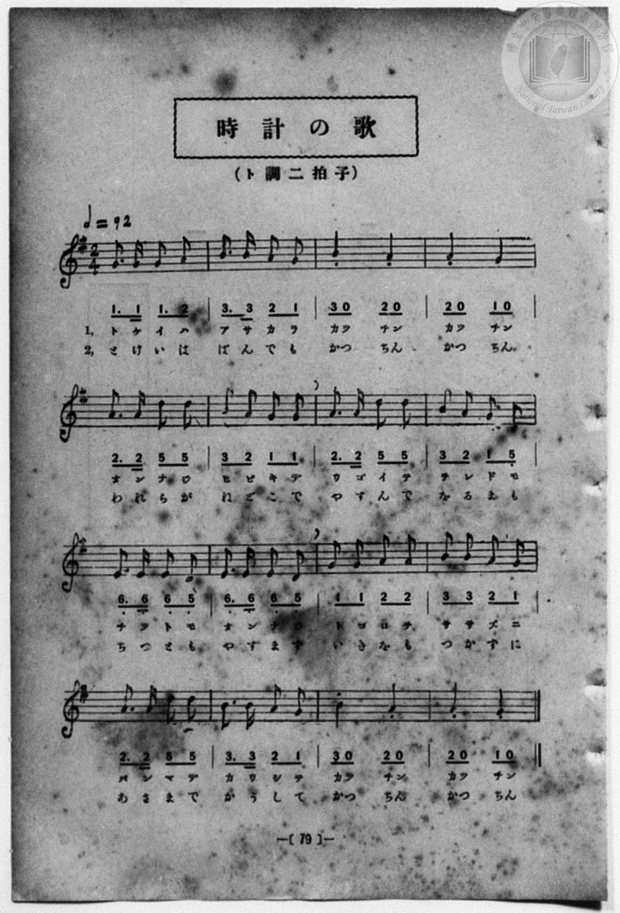

# 時計の歌

> Re:Shōka 使用 AI 協助辨識與重建樂譜，可能會有錯誤。歡迎回報。

<audio controls src="tokei_no_uta.mp3"></audio>

- 詞：文部省《尋常小學唱歌》
- 曲：文部省《尋常小學唱歌》
- 一條慎三郎 編《新編 小學校・公學校 唱歌教材集》（大正十二年十二月，索書號 0725-41）
- 臺灣總督府《公學校唱歌集》（大正四年三月，索書號 0725 26）

## 說明

原書資訊與歌詞全文（對應 P086.jpg–P087.jpg，原書 p. 78–79，第 39 首）：
調性與拍號：ト調二拍子（G 大調 2/4 拍），♩=92


## 歌詞

```text
一、時計（とけい）は朝（あさ）から　かつちん〱
おんなじ響（ひびき）で　動（うご）いて居（を）れども
ちつともおんなじ　所（ところ）を指（さ）さずに
晩（ばん）までかうして　かつちん〱。

二、時計（とけい）は晩（ばん）でも　かつちん〱
我等（われら）が寢床（ねどこ）で　休（やす）んで居（を）る間（ま）も
ちつとも休（やす）まず　息（いき）をもつかずに
朝（あさ）までかうして　かつちん〱。
```

## ABC

```abc
X:1
T:時計の歌
C:曲：文部省《尋常小學唱歌》
M:2/4
L:1/16
Q:1/4=92
K:G
V:V1 name="Piano" snm="Pia"
[V:V1]
G3 G G3 A | B3 B A2 G2 | B4 A4 | A4 G4 |
w: 1.~と け い は | あ さ か ら | かっ ちん | かっ ちん
w: 2.~と け い は | ば ん で も | かっ ちん | かっ ちん
A3 A d2 d2 | B2 A2 G2 G2 | A3 A d2 d2 | B2 A2 G2 D2 |
w: 1.~お ん な じ | ひ び き で | う ご い て | を れ ど も
w: 2.~わ れ ら が | ね ど こ で | や す ん で | を る ま も
E3 E E2 D2 | E3 E E2 D2 | G2 G2 A2 A2 | B2 B2 A2 G2 |
w: 1.~ち っ と も | お ん な じ | と こ ろ を | さ さ ず に
w: 2.~ち っ と も | や す ま ず | い き を も | つ か ず に
A3 A d2 d2 | B3 B A2 G2 | B4 A4 | A4 G4 |
w: 1.~ば ん ま で | か う し て | かっ ちん | かっ ちん
w: 2.~あ さ ま で | か う し て | かっ ちん | かっ ちん
G3 G G3 A | B3 B A2 G2 | B4 A4 | A4 G4 |
w: 1.~と け い は | あ さ か ら | かっ ちん | かっ ちん
w: 2.~と け い は | ば ん で も | かっ ちん | かっ ちん
A3 A d2 d2 | B2 A2 G2 G2 | A3 A d2 d2 | B2 A2 G2 D2 |
w: 1.~お ん な じ | ひ び き で | う ご い て | を れ ど も
w: 2.~わ れ ら が | ね ど こ で | や す ん で | を る ま も
E3 E E2 D2 | E3 E E2 D2 | G2 G2 A2 A2 | B2 B2 A2 G2 |
w: 1.~ち っ と も | お ん な じ | と こ ろ を | さ さ ず に
w: 2.~ち っ と も | や す ま ず | い き を も | つ か ず に
A3 A d2 d2 | B3 B A2 G2 | B4 A4 | A4 G4 |
w: 1.~ば ん ま で | か う し て | かっ ちん | かっ ちん
w: 2.~あ さ ま で | か う し て | かっ ちん | かっ ちん
```

## TMD 檔案連結

- [主旋律 TMD 檔案](tokei_no_uta.tmd) [[在 TMD Studio 編輯](https://tmdlang.github.io/Tmd-TS/#tmd=s7IKdvYPcrWy4qpTUCpJTLdSSM7PyUlNLsnMz7MqzsjPTozPrsyvSsyML84ojTe0NDJWgqssy88pzU21Si9KTEmNN4w3QsgU55cWJadaFSdn5OfnxJekVpQk5edno8vHFySmp1oFGFiYIWQKivLLUvMS84C6C4oy80pSU8DaEQpSyzJTUkHSxcmJefFlqUWZaZmpKUiOSi0qBrsdYkVJUWJecXJRZgHIQwhV-UUlGflAhxdkVFplZBaX5BdlJifmxGcn5iUiFJVkpAK9l5KYmVMZn5OZlqrEpaWl8Gxm04sVHY8b1z1b26OgpcWlaKtgacRlb6vgzmVjpG9iB9L9ZEfDs0Vzn7X2PdnR-bK5T-H59hWPG7qeTdsAZCg83dD_dO2OZwsWPm7e_bR1DYSt8HTKRqCBz6bOfDZ3wsvZbY8but_v6Xi6ZPmztYuf9jY-2dXzdOcWCOPZnI73e3qeb1n0bPaOFzPnKxiYG5nqmhi-39MJdvmLlfPe75n1bFr7y-YVz-c0Au19uqH76Y4dEGsh1gBNB6t9NnsT0WpftO963rj4-Y69z-cufrprDkgtzPEQheiunj0b6GRgAGBzr4KRGdi9XPpaCrbUAlwKCgpP--aDrNnc_mJF14uOdqCzgOHxtHUF0I8gl23ofdbeqQBKcXpZBemPGiYDmeYgJtCFEK0KBXoK5hZAGXNLkKvXrFEwtlR4uWwa0LnAoAJZ8WLV_mcNy0GGd_cC_QMUfdzcARQERU1379O1E4AWuSsAAwEopgBMEQpAUbDunkczV9oC0wrIEGAKedzQCElLQPWPG1c8bpz4uLEFqPBx4_pnc-aCBZseN04Fi3Q_bup83NAAYjQuedy48HHT5McNG0EGPW7sAnEaVz1unPFy_n6wtk2PGzc_bgRZ-rhxOVDb026gKUDxtseNU8CCLY8blz3d2AoSbJoEEmnqedy48nFTE8TEhWBLVgD5yKYDDXrW2QBz7OTHTWALmiY96wEFLcylUx83znrcuBpk0LOZK8ESG4BGgOX2gZwD8gLQIdOBTsD00eOGJkjw7AKmO9zBg27wcpBTsQbPs46Jz9cCwx7o0X6QL5uAbKCGnqfrFz3d1QU2ZS3I640wgxoanuyZCFYPDKSZYB8C_b8cNbS6X04Dqgfq3QfmYgQbuhEgn88ChV_jerA2oDg08MBhDNQFdDg82NAjn7hgA-qkPAtBgYKWPhdXSH52aqZVQGZiXr5DjUFNNcgGBRtDMy07MAtbzlUA5hdgyn6xsEdBwwRU0D1f36ADym7gPKaJRQPQIpBhNQqGCrpAaAiljYAixmCWMZANEteFi4BkIXQNnAXRBRQBm-ZjWAOMjhVgEWC6AeIWKHs9UA8wZKG8qUDcDWI1dYJNA4fqYqhRkMCF24RHDmKnEX47N0B4QF3A2ASzQK4g3078cbCrh5w4gISmkYIpkARhSIjDwh8SB_jVmMajRUIXkrdXgX0xA-q1TWDeZjDZCyZBwQKSaYP6dwo0EIFJHiLTNAlsVg9YbCUiEBER0NQPta8HGqnArA41dS1CVyMoGOH2NcEiaibYncgyEPvASaRxH5J9BDJAJzmBbwYKOl0QBWZBQhKHKCw6QMEOwpBIQI4I5DhYCPXfYmgCRSQ93LEDVgcJpyZw7IDDAiQzFSwDIWeBydWocYDbPuSQhoQn2ASQHkg8I2xCuHEJWAYSB8j24Y0DYOODehmAkkIIOdtDfAxL5SAfgfhtQDwdzIKmcooLIeTijbZ21nJx6dopgCsKBWSGMhcA)]
- [鋼琴伴奏 TMD 檔案](tokei_no_uta_piano.tmd) [[在 TMD Studio 編輯](https://tmdlang.github.io/Tmd-TS/#tmd=s7IKdvYPcrWy4qpTUCpJTLdSSM7PyUlNLsnMz7MqzsjPTozPrsyvSsyML84ojTe0NDJWgqssy88pzU21Si9KTEmNN4w3QsgU55cWJadaFSdn5OfnxJekVpQk5edno8vHFySmp1oFGFiYIWQKivLLUvMS84C6C4oy80pSU8DaEQpSyzJTUkHSxcmJefFlqUWZaZmpKUiOSi0qBrsdYkVJUWJecXJRZgHIQ0pcWloKz2Y2vVjR8bhx3bO1Pe_3dLycPfNZZ_fL7j3PJ2x5smfL06X97_d0KmhpcSnaKlgacdnbKrhz2Rjpm9iBbHiyo-HZornPWvue7Oh82dyn8Hz7iscNXc-mbQAyFJ5u6H-6dsezBQsfN-9-2roGwlZ4OmUj0KJnU2c-mzvh5ey2xw3dQEufLln-bO3ip72NT3b1PN25BcJ4Nqfj_Z6e51sWPZu948XM-QoG5kamuiaGQOeAffdi5bz3e2Y9m9b-snnF8zmNQHufbuh-umMHxFqINUDTwWqfzd5EtNoX7bueNy5-vmPv87mLn-6aA1ILczxEIbqrZ88GOhkYANjcq2BkBnYvV0h-dmqmVUBmYl5-kIdDjUFNNZcCENgYmmnZgVn6Wgq26EDh-Zo1wCB-sbBHQcMEFJ7P1zfoKAATiLleVkG6JhYNWvpgw2oUDBV0gdAQShsBRYzBLGMgGySuCxcByULoGjgLogsoAjbNx7BG4XHjCrDI48aJQNwCZa8H6nnc2ATlTQXibhCrqRNsGpD3uHEx1KjHjQsfN02G24RHDmKnEX47N0B4QF2PG5eDWSBXkG8n_jjY1UNOHEBC00jBFEiCMCTEYeEPiQP8akzj0SKhC8nbq8C-mAH12iYwbzOY7AWToGABybRB_TsFGoiPG5dBZJomgc3qAYutRAQiIgKa-qH29UAj9XEjSDXI1LUIXY2gYITb1wSLqJlgdyLLQOwDJ5HGfUj2EcgAneQEvhko6HRBFJgFCUkcorDoAAU7CEMiATkikONgIdR_i6EJFJH0cMcOWB0knJrAsQMOC5DMVLAMhJwFJlejxgFu-5BDGhKeYBNAeiDxjLAJ4cYlYBlIHCDbhzcOgGUc9TIAJYUQcraH-BiWykE-AvHbgHg6mAVN5RQXQsjFG23trEWpJ3yQ6wkTaDUBTKzxCtGGsegM03gQyzQeKgZVC-ZDpOCqsYhBVZuAZEzAMkhMJPXEGI_NMUB_6dopgL0W7QMUQXCMwBxlLgA)]

## 分析

```text
================================================================================
📊 TMD Song Profile: [ 時計の歌 ]
================================================================================
⏱  Duration:       0:41 (41.7s), 32 measures total
🎼 Key & Tempo:    首調基準 G, != 92.0 BPM, <2/4>
   - 分析範圍：      由實際發聲的音符與和弦推測調性；播放脈絡另行呈現
🎤 人聲音域:    D4 (MIDI 62) – D5 (MIDI 74) [跨度: 12 個半音 / 1.0 個八度, 難度: easy]
   - 最低音:  D4 in [Tokei #1 @ m.8, 0:10]
   - 最高音: D5 in [Tokei #1 @ m.5, 0:05]
   - 適合: soprano, mezzo-soprano, contralto, tenor, baritone, bass
🏛  結構:      Tokei (20.9s) -> Tokei (20.9s)
⚡ 編曲密度:        Peak 1 軌道同時演奏
🗝  調性診斷：       D 調性不明確（純淨自然大調，未偵測到可信轉調）
   - 風格氣質:    純淨自然大調（陽光明朗、易唱易記，無明顯調外色彩）
   - 轉調歷程:    全曲維持單一推測調性（未偵測到可信轉調）
   - 核心骨幹音:  A, G, B, D, E
   - 調性數值:    D 調性不明確 [相關度: 0.68, 穩定度: Ambiguous, 自然音純度: 100.0%]
   - 候選調性 (K-S): D 大調 (0.68), G 大調 (0.66), A 大調 (0.54)
   - 五度圈歷程:   +2 -> +2
   - 各段落調性細節:
     • [Tokei #1]: D 調性不明確 (r: 0.68, 自然音純度: 100.0%)
     • [Tokei #2]: D 調性不明確 (r: 0.68, 自然音純度: 100.0%)

  [ 五度圈游移軌跡 ]
               C  
         F            G  
      Bb              [D ]*
      Eb               A  
         Ab           E  
            Db       B  
               F# 
     (* = active key center)

  [ 十二半音累積音高分佈 ]
     C  :                            0.0%
     C# :                            0.0%
     D  : ██████████                14.1%
     D# :                            0.0%
     E  : ███████                    9.4%
     F  :                            0.0%
     F# :                            0.0%
     G  : █████████████████         24.2%
     G# :                            0.0%
     A  : ████████████████████████  33.6%
     A# :                            0.0%
     B  : █████████████             18.7%
--------------------------------------------------------------------------------
Assignment 軌道音域：
  - Piano         : D4 – D5 (12 個半音 / 1.0 個八度, 112 個音符)
================================================================================
```


## 原書掃描頁






