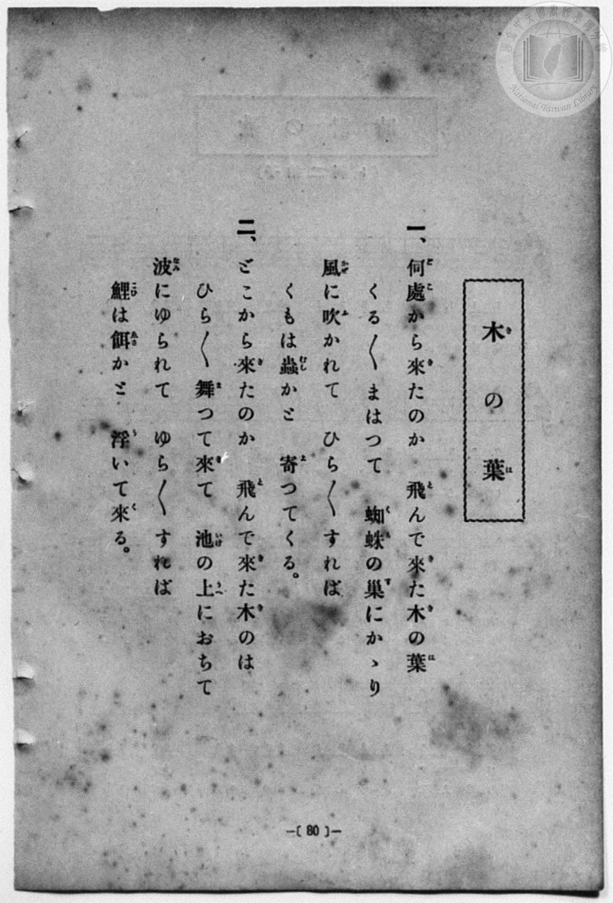
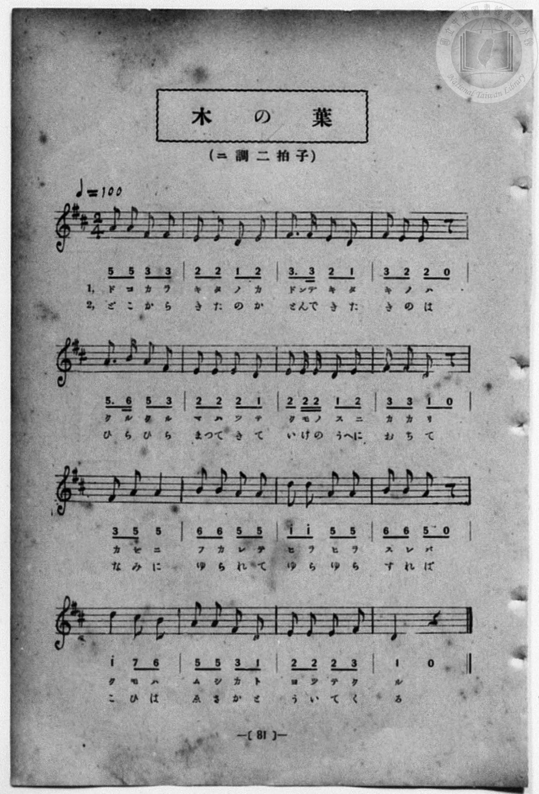

# 木の葉

> Re:Shōka 使用 AI 協助辨識與重建樂譜，可能會有錯誤。歡迎回報。

- **鋼琴伴奏版**：<br><audio controls src="ki_no_ha.mp3"></audio>
- **NEUTRINO 歌聲合成版**：<br><audio controls src="ki_no_ha_neutrino.mp3"></audio>

- 詞：文部省
- 曲：文部省
- 一條慎三郎 編《新編 小學校・公學校 唱歌教材集》（大正十二年十二月，索書號 0725-41）
- 臺灣總督府《公學校唱歌》第一學年用（昭和九年三月第一版、昭和十一年二月第四版，索書號 0729 73）

## 說明

原書資訊與歌詞全文（對應 P088.jpg–P089.jpg，原書 p. 80–81，第 40 首）：
調性與拍號：ニ調二拍子（D 大調 2/4 拍），♩=100


## 歌詞

```text
一、何處（どこ）から來（き）たのか　飛（と）んで來（き）た木（き）の葉（は）
くる〱まはつて　蜘蛛（くも）の巣（す）にかゝり
風（かぜ）に吹（ふ）かれて　ひら〱すれば
くもは蟲（むし）かと　寄（よ）つてくる。

二、どこから來（き）たのか　飛（と）んで來（き）た木（き）のは
ひら〱舞（ま）つて來（き）て　池（いけ）の上（うへ）におちて
波（なみ）にゆられて　ゆら〱すれば
鯉（こひ）は餌（ゑさ）かと　浮（う）いて來（く）る。
```

## ABC

```abc
X:1
T:木の葉
C:曲：文部省
M:2/4
L:1/16
Q:1/4=100
K:D
V:V1 name="Piano" snm="Pia"
[V:V1]
A2 A2 F2 F2 | E2 E2 D2 E2 | F3 F E2 D2 | F2 E2 E2 z2 |
w: 1.~ど こ か ら | き た の か | とん で き た | き の は
w: 2.~ど こ か ら | き た の か | とん で き た | き の は
A3 B A2 F2 | E2 E2 E2 D2 | E2 E E D2 E2 | F2 F2 D2 z2 |
w: 1.~く る く る | ま は つ て | く も の す に | か か り
w: 2.~ひ ら ひ ら | ま つ き て | い け の うへ に | お ち て
F2 A2 A4 | B2 B2 A2 A2 | d2 d2 A2 A2 | B2 B2 A2 z2 |
w: 1.~か ぜ に | ふ か れ て | ひ ら ひ ら | す れ ば
w: 2.~な み に | ゆ ら れ て | ゆ ら ゆ ら | す れ ば
d4 c2 B2 | A2 A2 F2 D2 | E2 E2 E2 F2 | D4 z4 |
w: 1.~く も は | む し か と | よ つ て く | る
w: 2.~こ ひ は | ゑ さ か と | う い て く | る
A2 A2 F2 F2 | E2 E2 D2 E2 | F3 F E2 D2 | F2 E2 E2 z2 |
w: 1.~ど こ か ら | き た の か | とん で き た | き の は
w: 2.~ど こ か ら | き た の か | とん で き た | き の は
A3 B A2 F2 | E2 E2 E2 D2 | E2 E E D2 E2 | F2 F2 D2 z2 |
w: 1.~く る く る | ま は つ て | く も の す に | か か り
w: 2.~ひ ら ひ ら | ま つ き て | い け の うへ に | お ち て
F2 A2 A4 | B2 B2 A2 A2 | d2 d2 A2 A2 | B2 B2 A2 z2 |
w: 1.~か ぜ に | ふ か れ て | ひ ら ひ ら | す れ ば
w: 2.~な み に | ゆ ら れ て | ゆ ら ゆ ら | す れ ば
d4 c2 B2 | A2 A2 F2 D2 | E2 E2 E2 F2 | D4 z4 |
w: 1.~く も は | む し か と | よ つ て く | る
w: 2.~こ ひ は | ゑ さ か と | う い て く | る
```

## TMD 檔案連結

- [主旋律 TMD 檔案](ki_no_ha.tmd) [[在 TMD Studio 編輯](https://tmdlang.github.io/Tmd-TS/#tmd=s7IKdvYPcrWy4qpTUCpJTLdSSM7PyUlNLsnMz7MqzsjPTozPrsyvSsyML84ojTe0NDJWgqssy88pzU21Si9KTEmNN4w3QsgU55cWJadaFSdn5OfnxJekVpQk5edno8vHFySmp1oFGFhYIGQKivLLUvMS84C6C4oy80pSU8DaEQpSyzJTUkHSxcmJefFlqUWZaZmpKUiOSi0qBrsdYkVJUWJecXJRZgHIQwhV-UUlGflAhxdkVFplZBaX5BdlJifmxGcn5iUiFJVkpAK9V5CTmIdkP1BlemaeVW5-XlIpMHyUuLS0FJ7NWfG4cd2LiZ0KWlpcirYKhgYGXPa2Ci5cNkb6JnYgrU92NDxbNPdZa9-THZ0vm_sUnm9f8bih69m0DUCGwtMN_U_X7ni2YOHj5t1PW9dA2ApPp2x8trbn2dSZz-ZOeDm77XFD9_s9HU-XLH-2dvHT3sYnu3qe7twCYTyb0_F-T8_zLYuezd7xYuZ8BQNzI1NdE8P3ezrBzn6xct77PbOeTWt_2bzi-ZxGsNiz2ZswxF6073reuPj5jr3P5y5-umsO0H1wx0DcAnTC8zVrgF4BCgItfz5lBdBFz2asfTqp58nOuUARoOeAboGoed7Z8bihESILciZQF1AB2LFABU9nzwYqQHe1pYK5MdjVXPpaCrbUAlwKCgpP--aDrNnc_mJF14uOdqBngKHytHUFMARAobqh91l7pwIoJeplFaQ_apgMZFqCmEAXQrQqFOgpWBgAZSyA4doD9IGCiYHCy2XTgM4FBiTIiher9j9rWA4yvLsX6B-g6OPmbqAgyM_dvU_XTgBa5KIAjECgmAIwXSgARcG6ex7NXGkLSjIgU4DhBAy2J3unvpg5FajhcePKx42TgcoeN3Y_bup8sq8NLAjS-LhxPjDRgcQbGl4ung0WB0ZI5-OmyY8bl6OpBKZQJC4oqYK564FckK2PG_sfNwEN2vi4cR9Q9HHjkseNy4Dmvpgz48VsiNFABU0QzU-3LwaLzARzV4NdNvdxUxfIoJeLIPZ0P26cA5F-OmEnWGQrzBM9EKMfN24Ceghs5Uyw4Aa4Q5qATngxH5hAOx43AdVNh-psBGaZhqfrW8DiwLQDFAQ7E-r2Jkj47QIm00ZIsFE3zICOgrgQ6u4XHcBsBZTeB3cJqn6QJ59tXAAWaXncOBFiypMdXWCRtseNO2Dh1_W4cSFQPcj0Z5sXgaVXPW7cD5VuagPZBw82CBct2F6uh8Qn0BfAYANqW_9ySQ84nCY-bgSmI0T4Pdu6DmI_WBDoLrir-8HhAA5IoImUZzsoUNDS5-LyzvTL90i0CshMzMt3qDGoqQZZoWBjaKZlB2Zhy-4KkHLkxcIeBQ0TUBn5fH2DDiiPgjOmJhYNQJtAhtUomCrogrExFNcoGAFJEDaE0jVgcZAsTBQiAlNnABIBm-ZjWAOM85VAPjB4wWQ3iGzqBOsBRjZYbD6YXAeXB8msAKYqsCXApIWiEKENomE9kIxHWGhERwvxh_6uHnJDX1fBDB4DiNBHhDWEZ4QWHyAMEkEP_X6Ir5q6oWwQC-KrfXD_ALMgmFwGlYGoawL7GZhXwHKroXLgAIUGaxeWwN8Eta8TykYEPsS-JWB7YGEKs7EFzJsItRGUwVEsBVkEzOhwLcREwI5OciIAFIywLACCNcDIAEUIQrRGwTAOFNYgAiGGrAo9CiBBNgfuI4i5wGIdKSh7UIIDEXDogQiODKjqDViCfxVYZj-6XU1tCBNR7UKRQbBx24U31IFtE3JCHRyYIGgODUbUcgg53UMwJG-AxEEQFOBgj2Kke0g6hqVzkHcbwLzpiKBvXAGV6QDzEDkBYgZIBqQOBEEBgGQPOMAhpQY8ouD2TATzpmLa0wgOZGiKJ2RPLReXrp0CpApQQGEpcwEA)]
- [鋼琴伴奏 TMD 檔案](ki_no_ha_piano.tmd) [[在 TMD Studio 編輯](https://tmdlang.github.io/Tmd-TS/#tmd=s7IKdvYPcrWy4qpTUCpJTLdSSM7PyUlNLsnMz7MqzsjPTozPrsyvSsyML84ojTe0NDJWgqssy88pzU21Si9KTEmNN4w3QsgU55cWJadaFSdn5OfnxJekVpQk5edno8vHFySmp1oFGFhYIGQKivLLUvMS84C6C4oy80pSU8DaEQpSyzJTUkHSxcmJefFlqUWZaZmpKUiOSi0qBrsdYkVJUWJecXJRZgHIQ0pcWloKz-aseNy47sXEzvd7Ol7Onvmss_tl957nE7Y82bPl6dL-93s6FbS0uBRtFQwNDLjsbRVcuGyM9E3sQOY_2dHwbNHcZ619T3Z0vmzuU3i-fcXjhq5n0zYAGQpPN_Q_Xbvj2YKFj5t3P21dA2ErPJ2y8dnanmdTZz6bO-Hl7LbHDd1AW58uWf5s7eKnvY1PdvU83bkFwng2p-P9np7nWxY9m73jxcz5CgbmRqa6JoZA94D99mLlvPd7Zj2b1v6yecXzOY1gsWezN2GIvWjf9bxx8fMde5_PXfx01xyg--COgbgF6ITna9YAvQIUBFr-fMoKoIuezVj7dFLPk51zgSJAzwHdAlHzvLPjcUMjRBbkTKAuoAKwY4EKns6eDVSA7mpLBXNjsKu5vDP98j0SrQIyE_PygzwcagxqqrkUgMDG0EzLDszS11KwRQcKEKtfLOxR0DABBevz9Q06CsBUYqmXVZCuiUWDlj7YsBoFUwVdMDaG4hoFIyAJwoZQugYsDpKFiUJEYOoMQCJg03wMaxQeN64E8h83TgaT3SCyqROs53FjL1hsPphcB5cHyax43ATSABJajqIQoQ2iYT2QjEdYaERHC_GH_q4eckNfV8EMHgOI0EeENYRnhBYfIAwSQQ_9foivmrqhbBAL4qt9cP88blwCJpdBZSDqmsB-ftw4Eyy3GioHDlBosHZhCfxNUPs6oWxE4EPsWwK2BxamMBtbwLyJUBvbHjfuQLEUZNHjxoVwLcREwI5OciIAFIywLACCNcDIAEUIQrRGwTAOFNYgAiGGrAo9CiBBNgfuI4i5jxu3IgVlD0pwIAIOPRDBkQFVvQFL8K8Cy-xHt6upDWEiql0oMgg2brvwhjqwOCMn1MGBCYLm0GBELYeQ0z0EQ_IGSBwEQQEO9ihGuoekY1g6B3m3Acybjgj6xhVQmQ4wD5ETIGaAZEDqQBAUAEj2gAMcUmrAIwpuz0QwbyqmPY3gQIameEL21KLWAD7INYAJtAIAhkO8QrRhLCjQ4mEskJBpPAoLq2KIGiQmUNoAU60JsrlwhgnCVJACUxQFmGYCPaNrpwDxT7QPUBESzwjMU-YCAA)]

## 分析

```text
================================================================================
📊 TMD Song Profile: [ 木の葉 ]
================================================================================
⏱  Duration:       0:38 (38.4s), 32 measures total
🎼 Key & Tempo:    首調基準 D, != 100.0 BPM, <2/4>
   - 分析範圍：      由實際發聲的音符與和弦推測調性；播放脈絡另行呈現
🎤 人聲音域:    D4 (MIDI 62) – D5 (MIDI 74) [跨度: 12 個半音 / 1.0 個八度, 難度: easy]
   - 最低音:  D4 in [KiNoHa #1 @ m.2, 0:01]
   - 最高音: D5 in [KiNoHa #1 @ m.11, 0:12]
   - 適合: soprano, mezzo-soprano, contralto, tenor, baritone, bass
🏛  結構:      KiNoHa (19.2s) -> KiNoHa (19.2s)
⚡ 編曲密度:        Peak 1 軌道同時演奏
🗝  調性診斷：       A 大調（純淨自然大調，未偵測到可信轉調）
   - 風格氣質:    純淨自然大調（陽光明朗、易唱易記，無明顯調外色彩）
   - 轉調歷程:    全曲維持單一推測調性（未偵測到可信轉調）
   - 核心骨幹音:  E, A, D, F#, B
   - 調性數值:    A 大調 [相關度: 0.84, 穩定度: Moderate, 自然音純度: 100.0%]
   - 候選調性 (K-S): A 大調 (0.84), D 大調 (0.75), F# 小調 (0.60)
   - 五度圈歷程:   +3 -> +3
   - 各段落調性細節:
     • [KiNoHa #1]: A 大調 (r: 0.84, 自然音純度: 100.0%)
     • [KiNoHa #2]: A 大調 (r: 0.84, 自然音純度: 100.0%)

  [ 五度圈游移軌跡 ]
               C  
         F            G  
      Bb               D  
      Eb              [A ]*
         Ab           E  
            Db       B  
               F# 
     (* = active key center)

  [ 十二半音累積音高分佈 ]
     C  :                            0.0%
     C# : ██                         1.7%
     D  : ███████████████████       20.3%
     D# :                            0.0%
     E  : ████████████████████████  25.4%
     F  :                            0.0%
     F# : ██████████████████        18.6%
     G  :                            0.0%
     G# :                            0.0%
     A  : ███████████████████████   24.6%
     A# :                            0.0%
     B  : █████████                  9.3%
--------------------------------------------------------------------------------
Assignment 軌道音域：
  - Piano         : D4 – D5 (12 個半音 / 1.0 個八度, 114 個音符)
================================================================================
```


## 原書掃描頁






