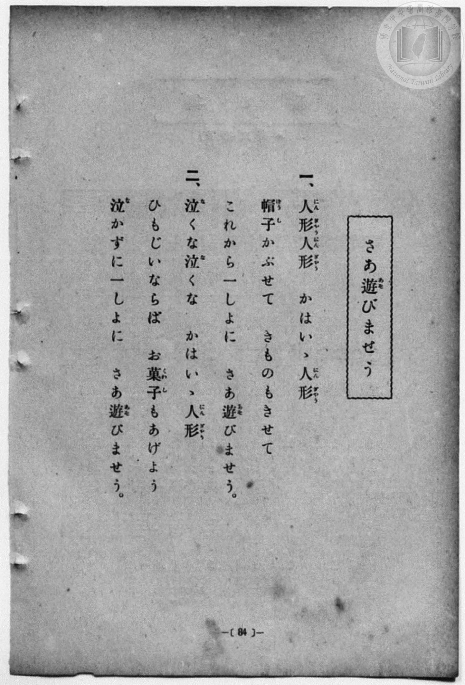
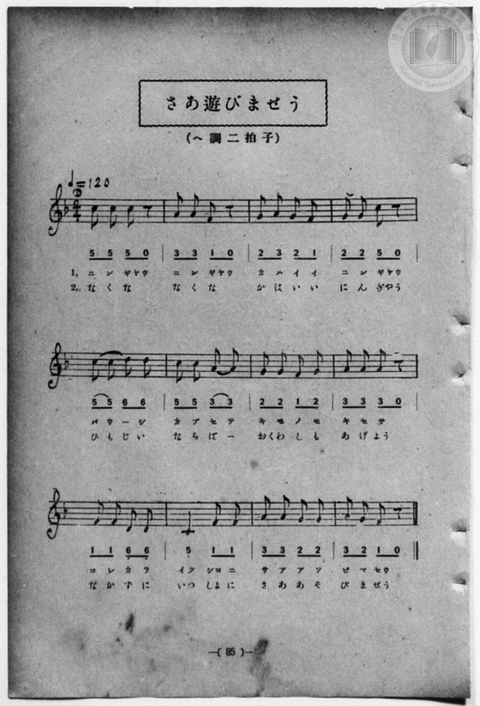

# さあ遊びませう

> Re:Shōka 使用 AI 協助辨識與重建樂譜，可能會有錯誤。歡迎回報。

<audio controls src="saa_asobimasho.mp3"></audio>

- 詞：公學校用國民讀本
- 曲：宮島慎三郎
- 一條慎三郎 編《新編 小學校・公學校 唱歌教材集》（大正十二年十二月，索書號 0725-41）
- 臺灣總督府《公學校唱歌集》（大正四年三月，索書號 0725 26）

## 說明

原書資訊與歌詞全文（對應 P092.jpg–P093.jpg，原書 p. 84–85，第 42 首）：
調性與拍號：ヘ調二拍子（F 大調 2/4 拍），♩=120
作曲：臺灣總督府國語學校助教授 宮島慎三郎


## 歌詞

```text
一、人形（にんぎやう）人形（にんぎやう）　かはいゝ人形（にんぎやう）
帽子（ばうし）かぶせて　きものもきせて
これから一しよに　さあ遊（あそ）びませう。

二、泣（な）くな泣（な）くな　かはいゝ人形（にんぎやう）
ひもじいならば　お菓子（くわし）もあげよう
泣（な）かずに一しよに　さあ遊（あそ）びませう。
```

## ABC

```abc
X:1
T:さあ遊びませう
C:曲：宮島慎三郎
M:2/4
L:1/16
Q:1/4=120
K:F
V:V1 name="Piano" snm="Pia"
[V:V1]
c2 c2 c2 z2 | A2 A2 F2 z2 | G2 A2 G2 F2 | G2 G2 c2 z2 |
w: に ん ぎゃう | に ん ぎゃう | か は い い | に ん ぎゃう
c2 c2 d2 d2 | c2 c2 A2 A2 | G2 G2 F2 G2 | A2 A2 A2 z2 |
w: ばう _ _ し | か ぶ せ て | き も の も | き せ て
F2 F2 D2 D2 | C4 F2 F2 | A2 A2 G2 G2 | A2 G2 F2 z2 |
w: こ れ か ら | いっ しょ に | さ あ あ そ | び ま せう
c2 c2 c2 z2 | A2 A2 F2 z2 | G2 A2 G2 F2 | G2 G2 c2 z2 |
w: な く な | な く な | か は い い | に ん ぎゃう
c2 c2 d2 d2 | c2 c2 A2 A2 | G2 G2 F2 G2 | A2 A2 A2 z2 |
w: ひ も じ い | な ら ば _ | お くゎ し も | あ げ よう
F2 F2 D2 D2 | C4 F2 F2 | A2 A2 G2 G2 | A2 G2 F2 z2 |
w: な か ず に | いっ しょ に | さ あ あ そ | び ま せう
```

## TMD 檔案連結

- [主旋律 TMD 檔案](saa_asobimasho.tmd) [[在 TMD Studio 編輯](https://tmdlang.github.io/Tmd-TS/#tmd=s7IKdvYPcrWy4qpTUCpJTLdSSM7PyUlNLsnMz7MqzsjPTozPrsyvSsyML84ojTe0NDJWgqssy88pzU21Si9KTEmNN4w3QsgU55cWJadaFSdn5OfnxJekVpQk5edno8vHFySmp1oFGFgi6Swoyi9LzUvMA-ouKMrMK0lNAWtHKEgty0xJBUkXJyfmxZelFmWmZaamIDkqtagY7HaIFSVFiXnFyUWZBSAPIVTlF5Vk5AMdXpBRaZWRWVySX5SZnJgTn52Yl4hQVJKRCvReQU5ipRKXlpbC48apjxubXjZ2PW7c_Lhx3-PG2Y8b2xS0tLgUbRUMjQy47G0V3LhsjPRN7EAmPNnR8GzR3GetfU92dL5s7lN4vn3F44auZ9M2ABkKTzf0P12749mChY-bdz9tXQNhKzydsvHZ2p5nU2c-mzvh5ey2xw3d7_d0PF2y_NnaxU97G5_s6nm6cwuE8WxOx_s9Pc-3LHo2e8eLmfMVDMyNTHVNDN_v6QS7_sXKee_3zIIb_HzKiqdzup9tmPhiXcOzOWvASp7N3gRSsm7d083b4I6EaG7f9bxx8fMde5_PXfx01xygo-EGQRyI7rTZs4HuAhqAzVEKRmZgR3HpaynYUgtwKSgoPO2bD7Jmc_uLFV0vOtqBzgJ6-mnrimfT2kEu29D7rL1TAZS09LIK0h81TAYyjUFMoAshWhUK9BQsTIAyFqYgV69Zo2BipPBy2TSgc4EBA7Lixar9zxqWgwzv7gX6Byj6uHkGUBAU_t29T9dOAFrkpgAMBKCYAjDaFYCiYN09j2autAWlCKAhT_bOgQQ1WrACI-TFqnnQYO1aCYr0vg4FtPjgApuwo-FxAzDSdz3duwho4-PG1Y-bJj9u7Hvc1AJMf0AL8Ug9bmh43Nj9uHH948aWx01z8agEh-mOvRBfPW7cABR93DgdZARI_zZwYl8GNq73cVPT48Z1YLIXIg7S_Lhx8uOmHpDqpk6QkxunP24C2wPSA804YKOB2uaCzUVkoscNTRCv7uoBevXZ5sVghavAqvqBDEwR0jz2uHET2LkzQKqBmpuApmwAG9H1on8yzM_9j5uARoP9DFIMRJPAXmgDGYHqBKDNs4BWkeNPoFmU5wAoUNDS5-IKTkx0LM5PysxNBBbXVgGZiXn5DjUGNdUgmxRsLLTswAxs-U8BmOqBXnixsEdBwwRUJj1f36ADyjTgnKKJRQPQPpBhNQqmYGgAZBkDoSGYZQRkGQHZIJYRRBas2sewBhgDqxWAEQOkgTHTDCo344HqcIl2A_F6IG4BYxzqIGYbgWRXAXE_mIboR-cTZx7-cNrVQ244mQEhhAUKK0joGAIxJOyM0cIJlPMUdIEQmLLgjt8GxLOBeBlYpBfo-CYgvQ5MQ0Wg8qgBswmqcgbc48CgaeoEWQO0AcTvAgXV46Y-sHUw40BaJgF5oMRPRNDs6CQnaAyB0CwehICBEw90DkgAEiagEAKxQOGEGjrAOGvqgQQK0BsgEWCGXgwJrcdN7eCYBYlOhfoChOeCRTYD8T5QMGFPPqBQngXXTrahtVxcunYKKFky2scwVgFT0AgsqMwFAA)]
- [鋼琴伴奏 TMD 檔案](saa_asobimasho_piano.tmd) [[在 TMD Studio 編輯](https://tmdlang.github.io/Tmd-TS/#tmd=s7IKdvYPcrWy4qpTUCpJTLdSSM7PyUlNLsnMz7MqzsjPTozPrsyvSsyML84ojTe0NDJWgqssy88pzU21Si9KTEmNN4w3QsgU55cWJadaFSdn5OfnxJekVpQk5edno8vHFySmp1oFGFgi6Swoyi9LzUvMA-ouKMrMK0lNAWtHKEgty0xJBUkXJyfmxZelFmWmZaamIDkqtagY7HaIFSVFiXnFyUWZBSAPKXFpaSk8bpz6uLHpZWPX48bNjxv3PW6c_bix7f2ejpezZz7r7H7Zvef5hC1P9mx5urT__Z5OBS0tLkVbBUMjAy57WwU3LhsjfRM7kF1PdjQ8WzT3WWvfkx2dL5v7FJ5vX_G4oevZtA1AhsLTDf1P1-54tmDh4-bdT1vXQNgKT6dsfLa259nUmc_mTng5u-1xQzfQ1qdLlj9bu_hpb-OTXT1Pd26BMJ7N6Xi_p-f5lkXPZu94MXO-goG5kamuiSHQPWB_vlg57_2eWXCDn09Z8XRO97MNE1-sa3g2Zw1YybPZm0BK1q17unkb3JEQze27njcufr5j7_O5i5_umgN0NNwgiAPRnTZ7NtBdQAOwOUrByAzsKK7gxETH4vykzNxEYJqxCshMzMsP8nCoMaip5lIAAhsLLTswQ19LwRYdKDxfswYYnC8W9ihomIDC7vn6Bh0FYLIw1ssqSNfEokFLH2xYjYIpGBoAWcZAaAhmGQFZRkA2iGUEkQWr9jGsAcb9aoXHTZOBdN_jpmZgvCvEA9XhEu0G4vVA3ALGONRBzDYCya4C4n4wDdGPzifOPPzhtKuH3HAyA0IICxRWkNAxBGJI2BmjhdMGkHN0gfBx43S447cB8WwgXgYW6QU6vglIrwPTUBGoPGrAbIKqnAH3ODBomjpB1gBtAPG7QEH1uKkPbB3MOJCWSUBeB3FBs6OTnKAxBEKzeBACBk480DkgAUiYgEIIxAKFE2roAOOsqQcSKEBvgERaHjcuhoTW46Z2cMyCRKdCfQHCc8Eim4F4HyiYsCcfUCjPgmsn29BarDnSBzlHmkBzJDAE4hWiDWORGabxKCzTeCATSbEJhmIQBgvBggmqEKQR1XywWTCVQGfq2imguDTaB6gUU9AILKjMBQA)]

## 分析

```text
================================================================================
📊 TMD Song Profile: [ さあ遊びませう ]
================================================================================
⏱  Duration:       0:24 (24.0s), 24 measures total
🎼 Key & Tempo:    首調基準 F, != 120.0 BPM, <2/4>
   - 分析範圍：      由實際發聲的音符與和弦推測調性；播放脈絡另行呈現
🎤 人聲音域:    C4 (MIDI 60) – D5 (MIDI 74) [跨度: 14 個半音 / 1.2 個八度, 難度: moderate]
   - 最低音:  C4 in [SaaAsobimasho[L1] #1 @ m.10, 0:09]
   - 最高音: D5 in [SaaAsobimasho[L1] #1 @ m.5, 0:04]
   - 適合: soprano, mezzo-soprano, contralto, tenor, baritone, bass
🏛  結構:      SaaAsobimasho[L1] (12.0s) -> SaaAsobimasho[L2] (12.0s)
⚡ 編曲密度:        Peak 1 軌道同時演奏
🗝  調性診斷：       C 調性不明確（純淨自然大調，未偵測到可信轉調）
   - 風格氣質:    純淨自然大調（陽光明朗、易唱易記，無明顯調外色彩）
   - 轉調歷程:    全曲維持單一推測調性（未偵測到可信轉調）
   - 核心骨幹音:  A, C, G, F, D
   - 調性數值:    C 調性不明確 [相關度: 0.76, 穩定度: Ambiguous, 自然音純度: 100.0%]
   - 候選調性 (K-S): C 大調 (0.76), F 大調 (0.74), A 小調 (0.69)
   - 五度圈歷程:   +0 -> +0
   - 各段落調性細節:
     • [SaaAsobimasho[L1] #1]: C 調性不明確 (r: 0.76, 自然音純度: 100.0%)
     • [SaaAsobimasho[L2] #1]: C 調性不明確 (r: 0.76, 自然音純度: 100.0%)

  [ 五度圈游移軌跡 ]
              [C ]*
         F            G  
      Bb               D  
      Eb               A  
         Ab           E  
            Db       B  
               F# 
     (* = active key center)

  [ 十二半音累積音高分佈 ]
     C  : ██████████████████████    23.3%
     C# :                            0.0%
     D  : █████████                  9.3%
     D# :                            0.0%
     E  :                            0.0%
     F  : █████████████████         18.6%
     F# :                            0.0%
     G  : ██████████████████████    23.3%
     G# :                            0.0%
     A  : ████████████████████████  25.6%
     A# :                            0.0%
     B  :                            0.0%
--------------------------------------------------------------------------------
Assignment 軌道音域：
  - Piano         : C4 – D5 (14 個半音 / 1.2 個八度, 84 個音符)
================================================================================
```


## 原書掃描頁






