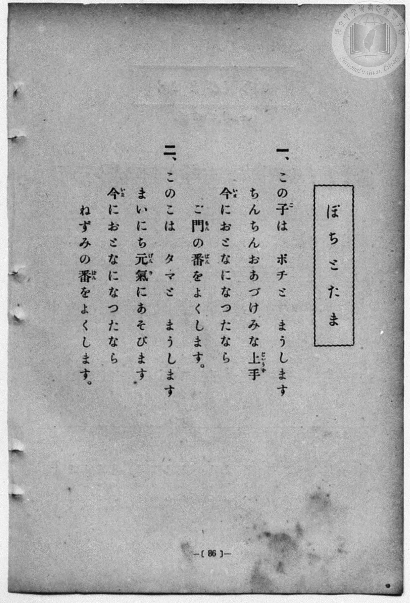
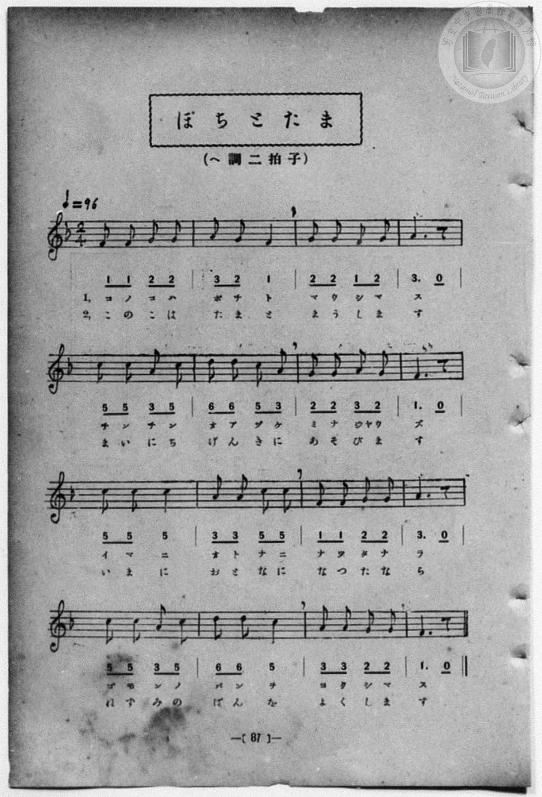

# ぽちとたま

> Re:Shōka 使用 AI 協助辨識與重建樂譜，可能會有錯誤。歡迎回報。

- **鋼琴伴奏版**：<br><audio controls src="pochi_to_tama.mp3"></audio>
- **NEUTRINO 歌聲合成版**：<br><audio controls src="pochi_to_tama_neutrino.mp3"></audio>

- 一條慎三郎 編《新編 小學校・公學校 唱歌教材集》（大正十二年十二月，索書號 0725-41）

## 說明

原書資訊與歌詞全文（對應 P094.jpg–P095.jpg，原書 p. 86–87，第 43 首）：
調性與拍號：ヘ調二拍子（F 大調 2/4 拍），♩=96


## 歌詞

```text
一、
この子（こ）はポチと　まうします
ちんちんおあづけ　みな上手（じやうず）
今（いま）におとなに　なつたなら
ご門（もん）の番（ばん）を　よくします。

二、
このこはタマと　まうします
まいにち元氣（げんき）に　あそびます
今（いま）におとなに　なつたなら
ねずみの番（ばん）を　よくします。
```

## ABC

```abc
X:1
T:ぽちとたま
M:2/4
L:1/16
Q:1/4=96
K:F
V:V1 name="Vocal" snm="Voc"
[V:V1]
F2 F2 G2 G2 | A2 G2 F4 | G2 G2 F2 G2 | A6 z2 |
w: 1.~こ の こ は | ぽ ち と | ま う し ま | す
w: 2.~こ の こ は | た ま と | ま う し ま | す
c2 c2 A2 c2 | d2 d2 c2 A2 | G2 G2 A2 G2 | F6 z2 |
w: 1.~ち ん ち ん | お あ づ け | み な じや う | ず
w: 2.~ま い に ち | げ ん き に | あ そ び ま | す
c2 c2 c4 | A2 A2 c2 c2 | F2 F2 G2 G2 | A6 z2 |
w: 1.~い ま に | お と な に | な つ た な | ら
w: 2.~い ま に | お と な に | な つ た な | ら
c2 c2 A2 c2 | d2 d2 c4 | A2 A2 G2 G2 | F6 z2 |
w: 1.~ご も ん の | ば ん を | よ く し ま | す
w: 2.~ね ず み の | ば ん を | よ く し ま | す
F2 F2 G2 G2 | A2 G2 F4 | G2 G2 F2 G2 | A6 z2 |
w: 1.~こ の こ は | ぽ ち と | ま う し ま | す
w: 2.~こ の こ は | た ま と | ま う し ま | す
c2 c2 A2 c2 | d2 d2 c2 A2 | G2 G2 A2 G2 | F6 z2 |
w: 1.~ち ん ち ん | お あ づ け | み な じや う | ず
w: 2.~ま い に ち | げ ん き に | あ そ び ま | す
c2 c2 c4 | A2 A2 c2 c2 | F2 F2 G2 G2 | A6 z2 |
w: 1.~い ま に | お と な に | な つ た な | ら
w: 2.~い ま に | お と な に | な つ た な | ら
c2 c2 A2 c2 | d2 d2 c4 | A2 A2 G2 G2 | F6 z2 |
w: 1.~ご も ん の | ば ん を | よ く し ま | す
w: 2.~ね ず み の | ば ん を | よ く し ま | す
```

## TMD 檔案連結

- [主旋律 TMD 檔案](pochi_to_tama.tmd) [[在 TMD Studio 編輯](https://tmdlang.github.io/Tmd-TS/#tmd=s7IKdvYPcrWy4qpTUCpJTLdSSM7PyUlNLsnMz7MqzsjPTozPrsyvSsyML84ojTe0NDJWgqssy88pzU21Si9KTEmNN4w3QsgU55cWJadaFSdn5OfnxJekVpQk5edno8vHFySmp1oFGFiaIGQKivLLUvMS84C6C4oy80pSU8DaEQpSyzJTUkHSxcmJefFlqUWZaZmpKUiOSi0qBrsdYkVJUWJecXJRZgHIQwhV-UUlGflAhxdkVFplZBaX5BdlJifmxGcn5iUiFJVkpAK9l5iXmZuYU4wunJKYmVMZn5OZlopsamZ6Zp5VaR7IiSVQh2lpKTxu3Pu4ceHjxhWPG-c_btynoKXFpWirYGnGZW-r4MZlY6RvYgcy48mOhmeL5j5r7Xuyo_Nlc5_C8-0rHjd0PZu2AchQeLqh_-naHc8WLHzcvPtp6xoIW-HplI3P1vY8mzrz2dwJL2e3PW7ofr-n4-mS5c_WLn7a2_hkV8_TnVsgjGdzOt7v6Xm-ZdGz2TtezJyvYGBuZKprYvh-T6cSF5e-loIttQCXgoLC0775IGs2t79Y0fWiox3oxBcr5z1tXfFsWjvIfRt6n7V3KoAiXi-rIP1Rw2Qg0xTEBLoQolWhQE_BwgwoY2EOcvWaNQomxgovl00DOvf9nlkgK16s2v-sYTnI8O5eoH-Aoo-bZwAFQV7t7n26dgLQIjcFYFAAxRSAIawAFAXr7nk0c6UtMOxBhgBD_HFDI4j1uHHy48Z1EG1ANlDl48b1j5vnPm5uBMVbQwMw3h43tj1unA5mzIToWfi4CagNQnY9bmx63Lj0ceNEsOr9jxtXPdnR9awTFCOPG2c8bmoB658FNBps9e4usARQdB_YttVgI4BJZBWIDTICyFgCTjGrHjeB9TxunPJyWgNIW1MT0E6wtnXPp64CG7QBKtI0CaS5CSjSD3ft44YmiH939aD4F0yuf9y0_3HzPDzeBLKAzgQ6cOHT1uZnGxaD7ZsE9jUoTGHuBXp_7uPGzQid5PlxLTCQwOFHtNeA2ihPt1CgoKXPxRWQn5yRGZIfkpibaBWWDywZHGoMaqpB9ijYWGjZgRnY8owCMKUC09SLhT0KGiagLPt8fYMOKKGDU7cmFg1A20CG1SgYAqERENYoGANJQwVdIAvEB4mCxHSB0EChBqzax7AGFIFAvA5KrweqAZYyoCQJxCvAukElDTAugXg6mA0SmQk2Jx5mjhF2c-ZD9RJjDv6w2NVDTliYAqExENcomAEhiA0JC1DIgEIKMyyAvm4CuR9Cg0S6gLgJiJcC8USwyH4gXgXEoKwI9hBIcBaWAAF5F6RiNdhAkMgkqPG9YFGQCMjouUC8meQg2dFJbpCYgqPDGBw0oMBBTjKYQQLyAcgnq6GRCAqQFdAggPgBxFoCje5VIJGmTiyhQZk5eMPi6ezZ1EgesFCBhAW25DEF6CZgjIHjcB3YzRsgvKZJEF81dQDF-glmlbXgFANJSqSbU8vFpWungFS2KGBylbkA)]
- [鋼琴伴奏 TMD 檔案](pochi_to_tama_piano.tmd) [[在 TMD Studio 編輯](https://tmdlang.github.io/Tmd-TS/#tmd=s7IKdvYPcrWy4qpTUCpJTLdSSM7PyUlNLsnMz7MqzsjPTozPrsyvSsyML84ojTe0NDJWgqssy88pzU21Si9KTEmNN4w3QsgU55cWJadaFSdn5OfnxJekVpQk5edno8vHFySmp1oFGFiaIGQKivLLUvMS84C6C4oy80pSU8DaEQpSyzJTUkHSxcmJefFlqUWZaZmpKUiOSi0qBrsdYkVJUWJecXJRZgHIQwhViUVA8fTU3NS8EquCzMS8_PjE5OT83ILEvEyQmBKXlpbC48a9jxsXPm5c8bhx_uPGfe_3dLycPfNZZ_fL7j3PJ2x5smfL06X97_d0KmhpcSnaKliacdnbKrhx2Rjpm9iB7Hmyo-HZornPWvue7Oh82dyn8Hz7iscNXc-mbQAyFJ5u6H-6dsezBQsfN-9-2roGwlZ4OmXjs7U9z6bOfDZ3wsvZbY8buoGWPl2y_NnaxU97G5_s6nm6cwuE8WxOx_s9Pc-3LHo2e8eLmfMVDMyNTHVNDIHOUeLiCshPzsgMyQ9JzE20CgB5LsjDocagpppLAQhsLLTswAx9LQVbdKDwfM0aoLtfLOxR0DABOfL5-gYdBWAMmeplFaRrYtGgpQ82rEbBEAjN47WNIASQr20MYRoq6AK5CCmoMogKXSA0UKgBm-FjWAMM88lAvA5KrweqAsYCEC8E4hVgg4AxAcRtQDwdzAaJzASbEw8zxwi7OfOheokxB38I7eohJ4SMtU3BGORvEF2jYKJtBsYwUZRggoUfKGgxgwkYIE0gr0FokEgXEDcB8VIgnggW2Q_Eq4B4xuOmFrBfQYKzsIQVKCRAKlaDDQSJTIIa3wsWBYmAjJ4LxJtJDq0dnZSEFgiD4gsUHrCQg4QethSHGVAgf4H8txoa66BgWgENGIjPQKwl0PSxCiTS1IkljCgzB28IPZ09m_rpCTnMUEIJSxhNAboVGL_gGF8H9ssGCK9pEsS3TR1AsX6CeW4tOH1BEh7p5tRiKbl8kEsuE2jJBfREvIJpPFAPiAFENWAeXATmOYS0CUFlpsimIRuP2zB0VUD369opIHkh2scwVgFdyAgspMwFAA)]

## 分析

```text
================================================================================
📊 TMD Song Profile: [ ぽちとたま ]
================================================================================
⏱  Duration:       0:40 (40.0s), 32 measures total
🎼 Key & Tempo:    首調基準 F, != 96.0 BPM, <2/4>
   - 分析範圍：      由實際發聲的音符與和弦推測調性；播放脈絡另行呈現
🎤 人聲音域:    F4 (MIDI 65) – D5 (MIDI 74) [跨度: 9 個半音 / 0.8 個八度, 難度: easy]
   - 最低音:  F4 in [PochiToTama #1 @ m.1, 0:00]
   - 最高音: D5 in [PochiToTama #1 @ m.6, 0:06]
   - 適合: soprano, mezzo-soprano, contralto, tenor, baritone, bass
🏛  結構:      PochiToTama (20.0s) -> PochiToTama (20.0s)
⚡ 編曲密度:        Peak 1 軌道同時演奏
🗝  調性診斷：       F 調性不明確（純淨自然大調，未偵測到可信轉調）
   - 風格氣質:    純淨自然大調（陽光明朗、易唱易記，無明顯調外色彩）
   - 轉調歷程:    全曲維持單一推測調性（未偵測到可信轉調）
   - 核心骨幹音:  C, A, F, G, D
   - 調性數值:    F 調性不明確 [相關度: 0.78, 穩定度: Ambiguous, 自然音純度: 100.0%]
   - 候選調性 (K-S): F 大調 (0.78), C 大調 (0.77), A 小調 (0.69)
   - 五度圈歷程:   -1 -> -1
   - 各段落調性細節:
     • [PochiToTama #1]: F 調性不明確 (r: 0.78, 自然音純度: 100.0%)
     • [PochiToTama #2]: F 調性不明確 (r: 0.78, 自然音純度: 100.0%)

  [ 五度圈游移軌跡 ]
               C  
        [F ]*          G  
      Bb               D  
      Eb               A  
         Ab           E  
            Db       B  
               F# 
     (* = active key center)

  [ 十二半音累積音高分佈 ]
     C  : ████████████████████████  25.0%
     C# :                            0.0%
     D  : ██████                     6.7%
     D# :                            0.0%
     E  :                            0.0%
     F  : █████████████████████     21.7%
     F# :                            0.0%
     G  : █████████████████████     21.7%
     G# :                            0.0%
     A  : ████████████████████████  25.0%
     A# :                            0.0%
     B  :                            0.0%
--------------------------------------------------------------------------------
Assignment 軌道音域：
  - Vocal         : F4 – D5 (9 個半音 / 0.8 個八度, 98 個音符)
================================================================================
```


## 原書掃描頁






