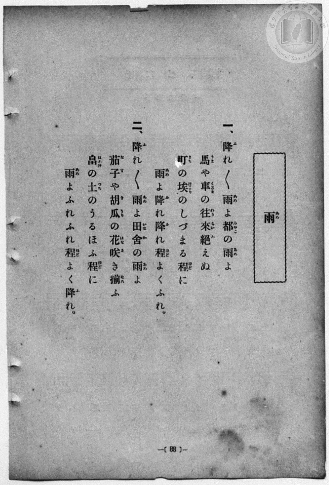
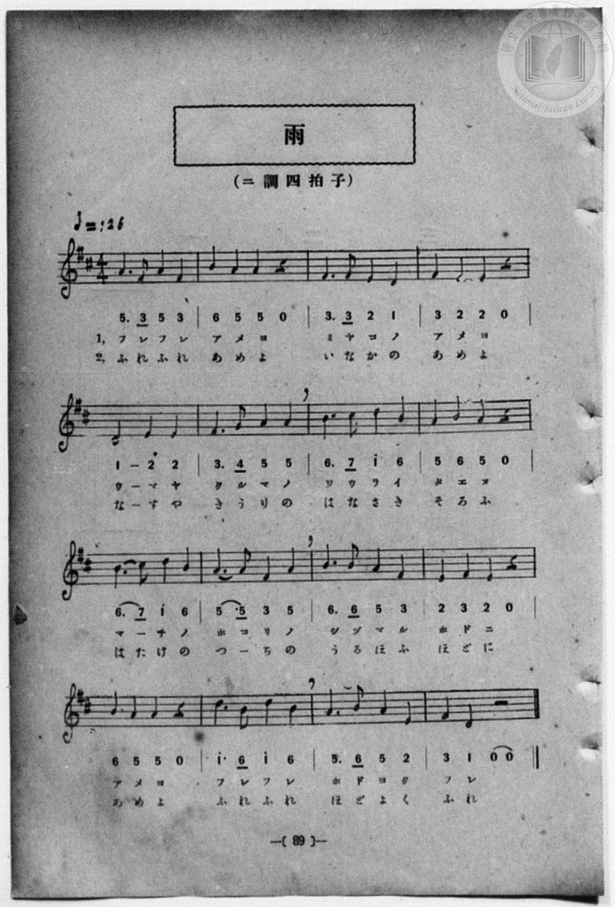

# 雨

> Re:Shōka 使用 AI 協助辨識與重建樂譜，可能會有錯誤。歡迎回報。

- **鋼琴伴奏版**：<br><audio controls src="ame.mp3"></audio>
- **NEUTRINO 歌聲合成版**：<br><audio controls src="ame_neutrino.mp3"></audio>

- 一條慎三郎 編《新編 小學校・公學校 唱歌教材集》（大正十二年十二月，索書號 0725-41）

## 說明

原書資訊與歌詞全文（對應 P096.jpg–P097.jpg，原書 p. 88–89，第 44 首）：
調性與拍號：ニ調四拍子（D 大調 4/4 拍），♩=126


## 歌詞

```text
一、
降（ふ）れ〱雨（あめ）よ　都（みやこ）の雨（あめ）よ
馬（うま）や車（くるま）の　往來（わうらい）絶（た）えぬ
町（まち）の埃（ほこり）の　しづまる程（ほど）に
雨（あめ）よ降（ふ）れ降（ふ）れ　程（ほど）よくふれ。

二、
降（ふ）れ〱雨（あめ）よ　田舍（いなか）の雨（あめ）よ
茄子（なす）や胡瓜（きうり）の　花（はな）咲（さ）き揃（そろ）ふ
畠（はたけ）の土（つち）の　うるほふ程（ほど）に
雨（あめ）よふれふれ　程（ほど）よく降（ふ）れ。
```

## ABC

```abc
X:1
T:雨
M:4/4
L:1/16
Q:1/4=126
K:D
V:V1 name="Vocal" snm="Voc"
[V:V1]
A6 F2 A4 F4 | B4 A4 A4 z4 | F6 F2 E4 D4 | F4 E4 E4 z4 |
w: 1.~ふ れ ふ れ | あ め よ | み や こ の | あ め よ
w: 2.~ふ れ ふ れ | あ め よ | い な か の | あ め よ
D8 E4 E4 | F6 G2 A4 A4 | B6 c2 d4 B4 | A4 B4 A4 z4 |
w: 1.~う ま や | く る ま の | わ う ら い | た え ぬ
w: 2.~な す や | き う り の | は な さ き | そ ろ ふ
B6 c2 d4 B4 | A6 A2 F4 A4 | B6 B2 A4 F4 | E4 F4 E4 z4 |
w: 1.~ま _ ち の | ほ こ り の | し づ ま る | ほ ど に
w: 2.~は た け の | つ _ ち の | う る ほ ふ | ほ ど に
B4 A4 A4 z4 | d6 B2 d4 B4 | A6 B2 A4 E4 | F4 D4 z4 z4 |
w: 1.~あ め よ | ふ れ ふ れ | ほ ど よ く | ふ れ
w: 2.~あ め よ | ふ れ ふ れ | ほ ど よ く | ふ れ
A6 F2 A4 F4 | B4 A4 A4 z4 | F6 F2 E4 D4 | F4 E4 E4 z4 |
w: 1.~ふ れ ふ れ | あ め よ | み や こ の | あ め よ
w: 2.~ふ れ ふ れ | あ め よ | い な か の | あ め よ
D8 E4 E4 | F6 G2 A4 A4 | B6 c2 d4 B4 | A4 B4 A4 z4 |
w: 1.~う ま や | く る ま の | わ う ら い | た え ぬ
w: 2.~な す や | き う り の | は な さ き | そ ろ ふ
B6 c2 d4 B4 | A6 A2 F4 A4 | B6 B2 A4 F4 | E4 F4 E4 z4 |
w: 1.~ま _ ち の | ほ こ り の | し づ ま る | ほ ど に
w: 2.~は た け の | つ _ ち の | う る ほ ふ | ほ ど に
B4 A4 A4 z4 | d6 B2 d4 B4 | A6 B2 A4 E4 | F4 D4 z4 z4 |
w: 1.~あ め よ | ふ れ ふ れ | ほ ど よ く | ふ れ
w: 2.~あ め よ | ふ れ ふ れ | ほ ど よ く | ふ れ
```

## TMD 檔案連結

- [主旋律 TMD 檔案](ame.tmd) [[在 TMD Studio 編輯](https://tmdlang.github.io/Tmd-TS/#tmd=s7IKdvYPcrWy4qpTUCpJTLdSSM7PyUlNLsnMz7MqzsjPTozPrsyvSsyML84ojTe0NDJWgqssy88pzU21Si9KTEmNN4w3QsgU55cWJadaFSdn5OfnxJekVpQk5edno8vHFySmp1oFGFiaIWQKivLLUvMS84C6C4oy80pSU8DaEQpSyzJTUkHSxcmJefFlqUWZaZmpKUiOSi0qBrsdYkVJUWJecXJRZgHIQwhV-UUlGflAhxdkVFplZBaX5BdlJifmxGcn5iUiFJVkpAK9l5dYUlqUiqw1Mz0zz6o0D-SOEqjtWloKL2evUNDS4lK0VTA0MuOyt1Vw4bIx0TexA2l8sqPh2aK5z1r7nuzofNncp_B8-4rHDV3Ppm0AMhSebuh_unbHswULHzfvftq6BsJWeDpl47O1Pc-mznw2d8LL2W2PG7rf7-l4umT5s7WLn_Y2PtnV83TnFgjj2ZyO93t6nm9Z9Gz2jhcz5ysYmBuZ6poYvt_TqcTFpa-lYEstwKWgoPC0bz7Ims3tL1Z0vehoBzrxxcp5T1tXPJvWDnLfht5n7Z0KoCjVyypIf9QwGcg0BzGBLoRoVSjQU7CwAMpYWIJcvWaNgomJwstl04DOfb9nFsiKF6v2P2tYDjK8uxfoH6Do4-ZuoODT2bOBIk_XTgBa5KIADAqgmAIwhBWAomDdPY9mrrQFBT7IFGCQP25oBLFezgRKdzxu3ApU9Lip53HDRmBUgUWaHjc1ggU7Hjc0vGzeCxbc_7ip5XHjZJB44zpMlWATl60Bi7Y9btwHFm15sbsLLNL_uKkbKti4Dmjo030NT_a1gaSa-kHqm4DiLUDZ51u3gdUDfQcUATLWgMx9PmUXWHTf48aFECOezm8Gi-wGuuhxE9AOqLmPG6c_blwKUtnU_XwFKGmA1awEK1gNdiOGy9HCASNYGtANAgYL0EONW8GyTZBQ3QVkkhKqz6dseNEBUQkM1VWPG4FW4A7YFz0tkPgFK50JDdvmhc8nzwEL9oLDEBEML7o2gsXXA9UDBZ9O2gTmTgUr6H3WDwm8uY-bQAkE6FZwIE9dANMz_3HjRGg4zwHGBFBwCTzkwYEMtAwYncDw2EpsIEODCxpo2IMUI-iaQGZRnj-hQEFLn4vLEVhyheUDyzSHGoOaapD5CjYWWnZgBrYyQQGYE4FZ5sXCHgUNE1CR9Hx9gw4oI4NzryYWDUBbQIbVKJgq6AKhMZg2BuIaBTMgCeKBsAFYBCQOkjUCkoZwERAPhMFqwKb5GNYoAAMGrBoYNFA2iAXSAwxoMK8RTHYAyXio-H6ojhYgezKI1bgOnw6IXUbk2dUC0dG4Coi7ibALf5jv6iEnzEFhCIKwEISFsAk83CGxoKtgrmAYB6RAHEhUwSIHPdDboEYCCxVoUEI81Q8NoG6YDMy7TVAZoE5guQZmwfTMB_NAQQAs2bAE-iq4XTNR7OpFMrELJWjXIwX6VDALpBYkMxdsAogHiUBiAn1HJzmBjiNAQcEJCn3kUDdDyg2g-IGldvRABwUoxGMLUby7Gyo6GSMgpkNllsIjCpQGYXqAxQyYXI0l0GFBOB-IJ6KYuQSHKyBJAhL1ENNBAYzbLryBDqy-yQ101LIEHPygIMaIB0ioI_IDKJeA9KCHOq6cjbssgMXHSqgOSLaA6YGoA5mCHua0tqmWi0vXTgFY2CsgKGUuAA)]
- [鋼琴伴奏 TMD 檔案](ame_piano.tmd) [[在 TMD Studio 編輯](https://tmdlang.github.io/Tmd-TS/#tmd=s7IKdvYPcrWy4qpTUCpJTLdSSM7PyUlNLsnMz7MqzsjPTozPrsyvSsyML84ojTe0NDJWgqssy88pzU21Si9KTEmNN4w3QsgU55cWJadaFSdn5OfnxJekVpQk5edno8vHFySmp1oFGFiaIWQKivLLUvMS84C6C4oy80pSU8DaEQpSyzJTUkHSxcmJefFlqUWZaZmpKUiOSi0qBrsdYkVJUWJecXJRZgHIQwhViUVA8fTU3NS8EquCzMS8_PjE5OT83ILEvEyQmBKXlpbCy9kr3u_peDl75rPO7pfde55P2PJkz5anS_vf7-lU0NLiUrRVMDQy47K3VXDhsjHRN7EDGf5kR8OzRXOftfY92dH5srlP4fn2FY8bup5N2wBkKDzd0P907Y5nCxY-bt79tHUNhK3wdMrGZ2t7nk2d-WzuhJez2x43dANtfbpk-bO1i5_2Nj7Z1fN05xYI49mcjvd7ep5vWfRs9o4XM-crGJgbmeqaGALdo8TF5QiMiQCQT4I8HGoMaqq5FIDAxkLLDszQ11KwRQcKz9esAbr3xcIeBQ0TkOOer2_QUQBGh7leVkG6JhYNWvpgw2oUjLVNFXSB0FDbGMoGsXSBMibaZkAaIgYhDcDiEHmIOvN4bSMQE0kCKgSlwFrAVvkY1ig8btwK1vq4qQfKBrFAeh83NoF5jWCyA0jGQ8X3Q3W0ANmTQazGdfh0QOwyIs-uFoiOxlVA3E2EXfgjZFcPORECCksQRA1HRLAbaZugRAosonQVTLXNFcy0DeOATIgQLHaRYxI9Qtqg1j1u3AcNZoiH-6GB1w2TgQVFE1QGqPNxUyeYBdMzH8wDBc_jxjVYImQV3K6ZKHb1IpnYhRLs65EiZCqYBVILkpkLNgHEg0QuMRGyo5OcCCEYvJCghcQPepyAaNRsBcsyyJkFPVJAAQ7x-EKU4NgNFZ2MEVDToTJL4REJSr8wPY8bV4LJ1VgiBRbE84F4IoqZS3C4ApJkIEkDYjooAnDbhTdSns6eTX6kYBZO0AiCBDyO2ELECVrmAmU9kDHo0YGruMBdwMAiaiVUByQ_wfRA1IFMQY8MWttUi1S7-CDXLibQ2gUYFPEKpvFQEhjOYCYQGcClTOPBAjVgBpQPlEXRDpXCYhqQBpJABJaDGI_QjaEAVTNEuTHMcrAMmnaEayEcCAmzDOo0MBesDKQXGCi6dgrAcIn2MYxVgDGNwExlLgA)]

## 分析

```text
================================================================================
📊 TMD Song Profile: [ 雨 ]
================================================================================
⏱  Duration:       1:00 (61.0s), 32 measures total
🎼 Key & Tempo:    首調基準 D, != 126.0 BPM, <4/4>
   - 分析範圍：      由實際發聲的音符與和弦推測調性；播放脈絡另行呈現
🎤 人聲音域:    D4 (MIDI 62) – D5 (MIDI 74) [跨度: 12 個半音 / 1.0 個八度, 難度: easy]
   - 最低音:  D4 in [Ame #1 @ m.3, 0:05]
   - 最高音: D5 in [Ame #1 @ m.7, 0:12]
   - 適合: soprano, mezzo-soprano, contralto, tenor, baritone, bass
🏛  結構:      Ame (30.5s) -> Ame (30.5s)
⚡ 編曲密度:        Peak 1 軌道同時演奏
🗝  調性診斷：       A 大調（純淨自然大調，未偵測到可信轉調）
   - 風格氣質:    純淨自然大調（陽光明朗、易唱易記，無明顯調外色彩）
   - 轉調歷程:    全曲維持單一推測調性（未偵測到可信轉調）
   - 核心骨幹音:  A, B, F#, D, E
   - 調性數值:    A 大調 [相關度: 0.80, 穩定度: Moderate, 自然音純度: 99.1%]
   - 候選調性 (K-S): A 大調 (0.80), D 大調 (0.73), F# 小調 (0.65)
   - 五度圈歷程:   +3 -> +3
   - 各段落調性細節:
     • [Ame #1]: A 大調 (r: 0.80, 自然音純度: 99.1%, 調外音: G)
     • [Ame #2]: A 大調 (r: 0.80, 自然音純度: 99.1%, 調外音: G)

  [ 五度圈游移軌跡 ]
               C  
         F            G  
      Bb               D  
      Eb              [A ]*
         Ab           E  
            Db       B  
               F# 
     (* = active key center)

  [ 十二半音累積音高分佈 ]
     C  :                            0.0%
     C# : █                          1.8%
     D  : ████████████              14.9%
     D# :                            0.0%
     E  : ███████████               14.0%
     F  :                            0.0%
     F# : ██████████████            17.5%
     G  : █                          0.9%
     G# :                            0.0%
     A  : ████████████████████████  29.8%
     A# :                            0.0%
     B  : █████████████████         21.1%
--------------------------------------------------------------------------------
Assignment 軌道音域：
  - Vocal         : D4 – D5 (12 個半音 / 1.0 個八度, 112 個音符)
================================================================================
```


## 原書掃描頁






