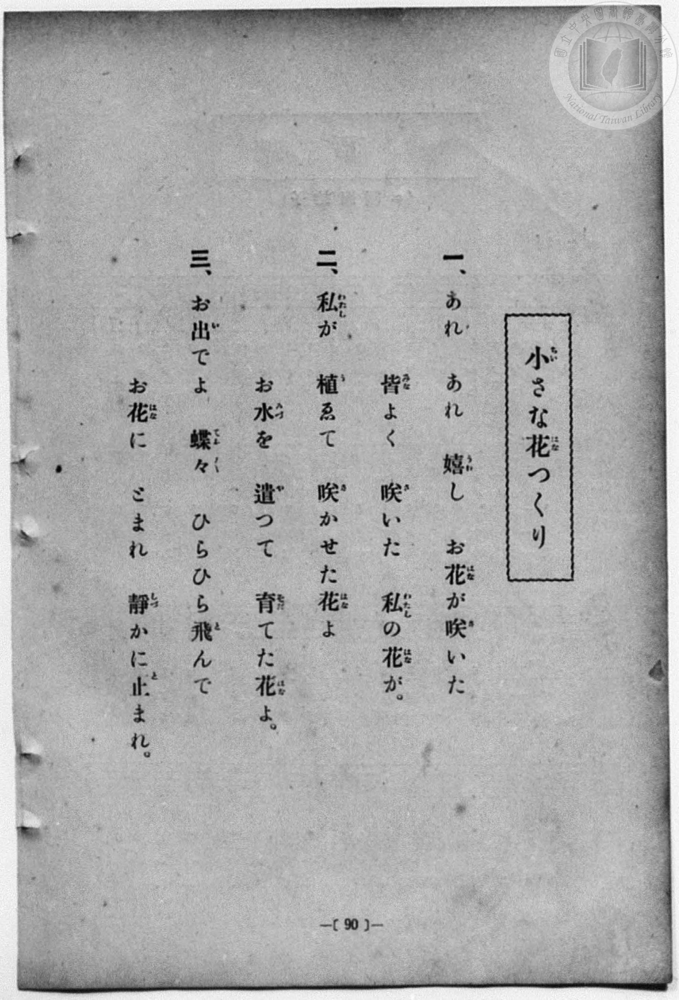
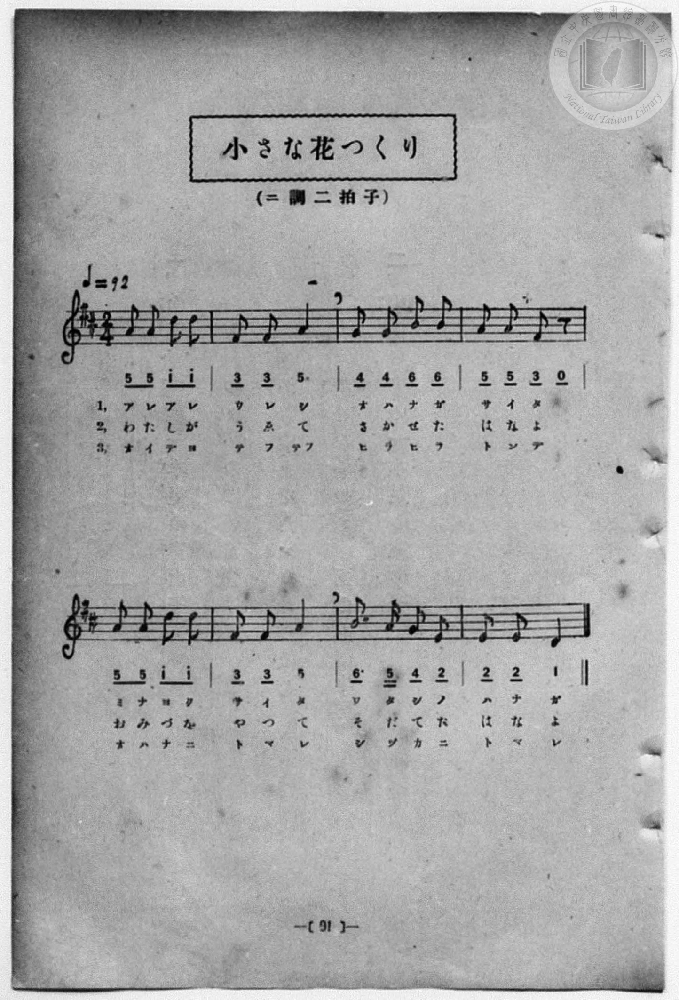

# 小さな花つくり

> Re:Shōka 使用 AI 協助辨識與重建樂譜，可能會有錯誤。歡迎回報。

- **鋼琴伴奏版**：<br><audio controls src="chiisana_hanatsukuri.mp3"></audio>
- **NEUTRINO 歌聲合成版**：<br><audio controls src="chiisana_hanatsukuri_neutrino.mp3"></audio>

- 一條慎三郎 編《新編 小學校・公學校 唱歌教材集》（大正十二年十二月，索書號 0725-41）

## 說明

原書資訊與歌詞全文（對應 P098.jpg–P099.jpg，原書 p. 90–91，第 45 首）：
調性與拍號：ニ調二拍子（D 大調 2/4 拍），♩=92


## 歌詞

```text
一、
あれあれ嬉（うれ）し　お花（はな）が咲（さ）いた
皆（みな）よく咲（さ）いた　私（わたし）の花（はな）が。

二、
私（わたし）が植（う）ゑて　咲（さ）かせた花（はな）よ
お水（みづ）を遣（や）つて　育（そだ）てた花（はな）よ。

三、
お出（い）でよ蝶々（てふ〱）　ひらひら飛（と）んで
お花（はな）にとまれ　靜（しづ）かに止（と）まれ。
```

## ABC

<div class="abc-score" data-abc-src="chiisana_hanatsukuri.abc" aria-label="五線譜載入中"></div>

[下載 ABC 原始檔](chiisana_hanatsukuri.abc)

## TMD 檔案連結

- [主旋律 TMD 檔案](chiisana_hanatsukuri.tmd) [[在 TMD Studio 編輯](https://tmdlang.github.io/Tmd-TS/#tmd=s7IKdvYPcrWy4qpTUCpJTLdSSM7PyUlNLsnMz7MqzsjPTozPrsyvSsyML84ojTe0NDJWgqssy88pzU21Si9KTEmNN4w3QsgU55cWJadaFSdn5OfnxJekVpQk5edno8vHFySmp1oFGFhaIGQKivLLUvMS84C6C4oy80pSU8DaEQpSyzJTUkHSxcmJefFlqUWZaZmpKUiOSi0qBrsdYkVJUWJecXJRZgHIQwhV-UUlGflAhxdkVFplZBaX5BdlJifmxGcn5iUiFJVkpAK9V5CTmIdkP0QwJTEzpzI-JzMtFdnMzPTMPKvSPJADS6DO0tJSeLqh_3Hj1MeNq150bXzcuORxY__jpi4FLS0uRVsFSyMue1sFFy4bI30TO5BJT3Y0PFs091lr35MdnS-b-xSeb1_xuKHr2bQNQAbIpKdrdzxbsPBx8-6nrWsgbIWnUzY-W9vzbOrMZ3MnvJzd9rih-_2ejqdLlj9bu_hpb-OTXT1Pd26BMJ7N6Xi_p-f5lkXPZu94MXO-goG5kamuieH7PZ1KXFz6Wgq21AJcCgoKT_vmg6zZ3P5iRdeLjnagE1-snPe0dcWzae0g923ofdbeqQCKfL2sgvRHDZOBTEsQE-hCiFaFAj0FSwOgjCXQhT3P16xRMDFVeLlsGtC57_fMAlnxYtX-Zw3LQYZ39wL9AxR93NwNFAR5tbv36doJQItcFIBBARRTAIawAlAUrLvn0cyVtsCwBxkCDPHHDY0g1uPGpsdNPRDy6Rqgso7HjW1ANlDL48bpjxsaHjd2AeMQLL4eGJ9g8Z6nkzaBRaaCuS2PG-eDzHo-qw0suh-qrgnI7sdUCjT0-fJGkGATMJHMB1oDllqHac3jhiaIc3cBmWDnYtPY82wJ0Icgd4Mtnfi4cRnQClR7ux83zgZqQbeiqQMSBl3PNmyBOX0pWGLSy8bFYJtawPqBKRhk6IsmiKFzHzcuAIsvw2oo3N07OuHB3PW0fRdYGcTA5UBlL-Zue9zQChYEmrP1cQPQHKAGYJBvetwEVAMiXy6eDVawAmzyZKBGqHEYobUaqOhx4z5QbDY0vJw7Byw7HeofUACsfrZ2EcIsqMomkHGUJ34oUNDS5-JyzsjMLAYWKh5AXFJcml1alGkVlg8sahxqDGqqQfYp2BiaadmBWdhyoAIw3QNT6IuFPQoaJqAC4Pn6Bh1QtgHnFU0sGoDWggyrUTBV0AVjwzgYUaNgDCRBGCQOgjUKJkAShM2gGKEPpM4AJAI2z8ewBpRBgHxgWIFIJDZIpg1JZjrcdGDkgEXWg8lVYBKmYyqY1wIm5wPJeIRdRkD5pn64DMREhE6IXRPBYsuQ7IKY2A0mZ8N1g2SQ7G_qQLXLGOFKiFuWw1WBZEDmAxMkxC4IA2bdJrDCTrAUgg2SWQHmTYYbB7EOfyTv6qFdJIMiFsQHRbQRWAREgrAhTA1SJO9HCyxgyYUjyqAhAY4qiBgsqtZhBjw4-pDsAkUyNOAhNi4F2zgJaibEliWQgEcK9blQuxbAIwdXJCPZhRTJyC5ajRxfjfvAOuGuhCdkkMtgyQqvDq5aLi5dOwUsmV4Bt7AyFwA)]
- [鋼琴伴奏 TMD 檔案](chiisana_hanatsukuri_piano.tmd) [[在 TMD Studio 編輯](https://tmdlang.github.io/Tmd-TS/#tmd=s7IKdvYPcrWy4qpTUCpJTLdSSM7PyUlNLsnMz7MqzsjPTozPrsyvSsyML84ojTe0NDJWgqssy88pzU21Si9KTEmNN4w3QsgU55cWJadaFSdn5OfnxJekVpQk5edno8vHFySmp1oFGFhaIGQKivLLUvMS84C6C4oy80pSU8DaEQpSyzJTUkHSxcmJefFlqUWZaZmpKUiOSi0qBrsdYkVJUWJecXJRZgHIQwhViUVA8fTU3NS8EquCzMS8_PjE5OT83ILEvEyQmBKXlpbC0w39jxunPm5c9aJr4-PGJY8b-x83db3f0_Fy9sxnnd0vu_c8n7DlyZ4tT5f2v9_TqaClxaVoq2BpxGVvq-DCZWOkb2IHsu3JjoZni-Y-a-17sqPzZXOfwvPtKx43dD2btgHIANnwdO2OZwsWPm7e_bR1DYSt8HTKxmdre55Nnfls7oSXs9seN3QDLX26ZPmztYuf9jY-2dXzdOcWCOPZnI73e3qeb1n0bPaOFzPnKxiYG5nqmhgCnaPExeWckZlZnJiX6AHEJcWl2aVFmVYBIK8GeTjUGNRUcykAgY2hmZYdmKWvpWCLDhSer1kD9MCLhT0KGiYg1z5f36CjAIwwS72sgnRNLBq09MGG1SgYa5sq6EJJU23DOARVo2CobQykISREBQjWKBhpmwBpCGmibQYnUU2D6DMAiYPt8jGsUXjc2ATkP27qAZFIbJBMG5LMdLhdjxu7wCLrweQqMAnTMRXMawGT84FkPMIuI6B8Uz9cBmIiQifErolgsWVIdkFM7AaTs-G6QTJI9jd1oNpljHAlxC3L4apAMiDzHzduhdgFYcCs2wRW2AmWQrBBMivAvMlw4yDW4U8Au3rolQAg0Q0RgyQD83htI7AUlAGlDGFakFLAfrSQBOZXHPEJDSZwPELEYPG4DjNWwHGLZBcoBUBjBWLjUrCNk6BmQmxZAokVpCiZC7VrATzmcKUAJLuQUgCyi1YjR2bjPrBOuCvhqRzkMliaw6uDqxZPYeGDXFhYQMsKYAzGK5jGQ0l0ngmYCSGR5AygviJGsxGIB-KCSIgs1KG6dgpY3BrtYxirgEvKCLeUMVhKmQsA)]

## 分析

```text
================================================================================
📊 TMD Song Profile: [ 小さな花つくり ]
================================================================================
⏱  Duration:       0:20 (20.9s), 16 measures total
🎼 Key & Tempo:    首調基準 D, != 92.0 BPM, <2/4>
   - 分析範圍：      由實際發聲的音符與和弦推測調性；播放脈絡另行呈現
🎤 人聲音域:    D4 (MIDI 62) – D5 (MIDI 74) [跨度: 12 個半音 / 1.0 個八度, 難度: easy]
   - 最低音:  D4 in [ChiisanaHanatsukuri #1 @ m.8, 0:09]
   - 最高音: D5 in [ChiisanaHanatsukuri #1 @ m.1, 0:00]
   - 適合: soprano, mezzo-soprano, contralto, tenor, baritone, bass
🏛  結構:      ChiisanaHanatsukuri (10.4s) -> ChiisanaHanatsukuri (10.4s)
⚡ 編曲密度:        Peak 1 軌道同時演奏
🗝  調性診斷：       D 大調（純淨自然大調，未偵測到可信轉調）
   - 風格氣質:    純淨自然大調（陽光明朗、易唱易記，無明顯調外色彩）
   - 轉調歷程:    全曲維持單一推測調性（未偵測到可信轉調）
   - 核心骨幹音:  A, D, F#, B, E
   - 調性數值:    D 大調 [相關度: 0.87, 穩定度: High, 自然音純度: 100.0%]
   - 候選調性 (K-S): D 大調 (0.87), A 大調 (0.75), F# 小調 (0.62)
   - 五度圈歷程:   +2 -> +2
   - 各段落調性細節:
     • [ChiisanaHanatsukuri #1]: D 大調 (r: 0.87, 自然音純度: 100.0%)
     • [ChiisanaHanatsukuri #2]: D 大調 (r: 0.87, 自然音純度: 100.0%)

  [ 五度圈游移軌跡 ]
               C  
         F            G  
      Bb              [D ]*
      Eb               A  
         Ab           E  
            Db       B  
               F# 
     (* = active key center)

  [ 十二半音累積音高分佈 ]
     C  :                            0.0%
     C# :                            0.0%
     D  : ██████████████            19.4%
     D# :                            0.0%
     E  : ███████                    9.7%
     F  :                            0.0%
     F# : ███████████               16.1%
     G  : ███████                    9.7%
     G# :                            0.0%
     A  : ████████████████████████  33.9%
     A# :                            0.0%
     B  : ████████                  11.3%
--------------------------------------------------------------------------------
Assignment 軌道音域：
  - Vocal         : D4 – D5 (12 個半音 / 1.0 個八度, 56 個音符)
================================================================================
```


## 原書掃描頁






