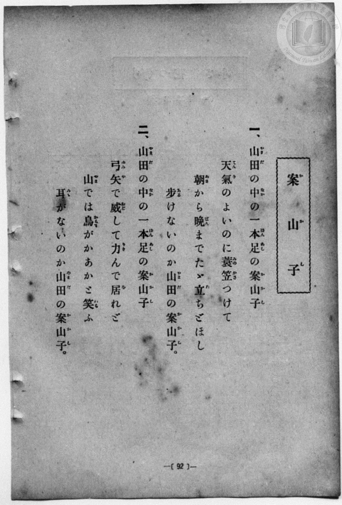
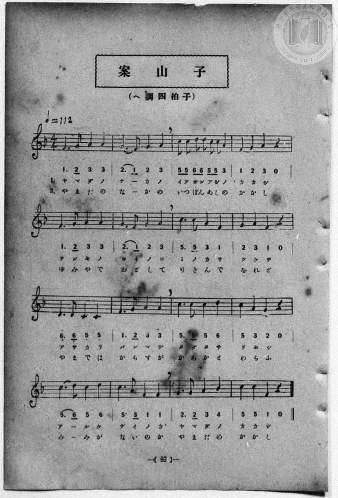

# 案山子

> Re:Shōka 使用 AI 協助辨識與重建樂譜，可能會有錯誤。歡迎回報。

- **鋼琴伴奏版**：<br><audio controls src="kakashi.mp3"></audio>
- **NEUTRINO 歌聲合成版**：<br><audio controls src="kakashi_neutrino.mp3"></audio>

- 作詞：武笠三（文部省尋常小學唱歌）
- 作曲：山田源一郎（文部省尋常小學唱歌）
- 一條慎三郎 編《新編 小學校・公學校 唱歌教材集》（大正十二年十二月，索書號 0725-41）
- 尋常科第一、二學年用（第 92–93 頁）
- 國立臺灣圖書館典藏

## 說明


- 出處：一條慎三郎 編《新編 小學校- 公學校 唱歌教材集》尋常科第一、二學年，〈案山子〉，原書第 92–93 頁（P100–P101）。
- 調性與拍號：ヘ調（F 大調），4/4 拍，速度 != 112。
- 背景與曲風：原出自 1911 年文部省《尋常小學唱歌（二）》第十二課〈案山子〉，
描寫山田中央單腳站立的稻草人，無論晴天或烏鴉嘲笑，始終戴著蓑笠、
張弓搭箭守護稻田的模樣。
- 版本說明：本檔案依原書五線譜與數字簡譜對照轉錄。第 3 小節為「5 5 6 6 5 5 3 -」。

### 編曲說明（鋼琴伴奏版）：

1. 前奏 (Intro, 4 小節)：以第四行「歩けないのか山田の案山子」詼諧明快的終止句引出主歌。
2. 主歌伴奏 (Kakashi, 16 小節 × 2 段)：右手演奏原曲歌唱旋律；左手以輕快四拍子和聲伴奏。


## 歌詞

```text
一、
山田の中の一本足の案山子
天氣のよいのに蓑笠つけて
朝から晩までたゞ立ちどほし
歩けないのか山田の案山子。

二、
山田の中の一本足の案山子
弓矢で威して力んで居れど
山では烏がかあかと笑ふ
耳がないのか山田の案山子。
```

## ABC

<div class="abc-score" data-abc-src="kakashi.abc" aria-label="五線譜載入中"></div>

[下載 ABC 原始檔](kakashi.abc)

## TMD 檔案連結

- [主旋律 TMD 檔案](kakashi.tmd) [[在 TMD Studio 編輯](https://tmdlang.github.io/Tmd-TS/#tmd=s7IKdvYPcrWy4qpTUCpJTLdSSM7PyUlNLsnMz7MqzsjPTozPrsyvSsyML84ojTe0NDJWgqssy88pzU21Si9KTEmNN4w3QsgU55cWJadaFSdn5OfnxJekVpQk5edno8vHFySmp1oFGBoYIGQKivLLUvMS84C6C4oy80pSU8DaEQpSyzJTUkHSxcmJefFlqUWZaZmpKUiOSi0qBrsdYkVJUWJecXJRZgHIQwhV-UUlGflAhxdkVFplZBaX5BdlJifmxGcn5iUiK8pMz8yzys3PSyoFBgWmRGpmViaS77S0FJ4t7Hi6cePTtRMUtLS4FG0VDA2NuOxtFdy4bEz0TexABjzZ0fBs0dxnrX1PdnS-bO5TeL59xeOGrmfTNgAZCk839D9du-PZgoWPm3c_bV0DYSs8nbLx2dqeZ1NnPps74eXstscN3e_3dDxdsvzZ2sVPexuf7Op5unMLhPFsTsf7PT3Ptyx6NnvHi5nzFQzMjUx1TQzf7-kEO_7phu6nO3Y8Xz7x-Zo1QHc8bgBrXrsDqP_5lBVAQ4HiCpZGjxomWxorvFzQCNP3ZO-cFyvnvd8z69naZc_XLAC6HKj22bT2l80rns9phJgKcTrEqUj6ns3eBNQHDJPnUzY82zUBaCvQ08Tpfjqn-_nq7hftu543Ln46ZxrQSy-XrHjauuPF9H4lLi59LQVbagEuBQWFxw0TgG59Pnvdi1Wrns3oe9wwESwKjIf2XS9mTgV6gioxhycKgDH3uKEDnoIeNwBDuedp33ygxzHipQOUa4B8IAWK3ccNTVDXvli1_1nD8hcd7c-6e4EpAOjsx80zgIJALW4KwDQDZoIMBqZHBaAaIOtlw_ynu5YpQFIrkknNPc9mrgeZNHvTy0XA1DEL6BZQYLSvUjC0NDRUADoZHovAgMAWkR1Az4Gd1w30ASSJvli1CdOXICsVFJ719z9dvxqSVp7sWPt0ybqn09a9aN38fPVMYEJ4Pqvl-YrdL3o7n-zaBUrkLQtfrJ72bOaWp0tWPuuY9ry5_-WWzqczNj1fMxEUbMu7n29tetax5cXE6S8mAwN7ATCkIbY83bP16Z7Jzyasfb5u7dN1HS_WbgcaC7QRaP6zFQufrViMCILnnR3P5qyBJAhQ6p-z5tmqKUCnP9k3FxIvT3ZNeb591ou1c0DBNHXH07XTn29YCOQ-3dD7vHX5i72dL3tagMaBos8YlESer2943rTrcUOPqYKpghkQgmhjBd3HDb0gW6HpEGI2MACBme5p6wpgIAONBwYIiLFq3ou164GJE1QCbOh91t6pAEoJelkF6cBwBhsASVUgFiQkHzeuA-oFkw0g32zbDGTDwx-sDhiCGxYDRR83dTxubAExGldDQ61xyePGiY8bl4HUPZsz93Fj9-OmzmczVz5u3Pe4cfnjxvmPm-YBI-dx48LHjUDB3Y8bp4OVrgVygPpWwczrhjsGKerB4Qz0CcRX8HKCYNwDowOM1j9duhfi-Ke9u5-v3A-P7xcLFz-d1PNs2nSgF0CpYd-8Z9NXPu3Y8GwmKBc_n70FaCxQ5ZMdvU-7pwLdATJq9gJg1ABFns1pfrF1w4vt659OB0b6fIiTXixeiOwGoBZ4cO8C5lrSgnvP5OfzFwFD7-mKRmBwAQP3adfsx02TQSIbWx839QBDEmoeOIjXA9P240agKDCUm8DkCmAif9y4FaToRQPQfKAcbQL65expz1u2PeveDwwskLOBOWZF49NZ7aBia-_-p92NLxbPBRYJQEFgCQHOQIuB9oFCfOPGJzu6QKZB8mXv7qcz-p5O7QKRczZAsumT3dOQg_7ZpknP5nQC_fNszlbCQQ_0D-XlPhQoaOlzcXknZicWZ2RaBWQm5uU71BjUVIOLCxsLLTswo0bBUEEXCI1A-RWMa4BskIghmIaIoOVrqC6YvAFIBGyaj2ENsIBZAtb_uHkeEDeAWX1gPY-bu8AyQJGm1cjiTUuA7BYgngvEm4H8RUC8HUkerBpKbke10Qgk3wIxtXEfEC8As9ZBdDaugtnY2I0iDrStEWhr416g7slAugmIpyPJQ1RDyOlwG0kKMpAIJLhA6iFqYDz0IGuDBhnI82tRgmwFNMBAQQQSe9wMchRIZj5UTx88aLZCZUDB8bhpI1gWZDJ6cEFta9wPDTpgfoR6GxJBwJwK9TYwF0OjACbTCw4wJD1Nk8C29UD1oQWVWTxYH5AyBbHABLYAhAUXiDaDi4DkQMGGFlzA9AEJlK3wlASyGOT1CYiABKY_EKsd6sz9UJkGKPtxcyNUTyeYNxtsIqHUBfI0sOyCBhcoKkC6OoHsmWAZUDAgyYDTFSQVgSISZFo_VAdIDBRhKMEFCQZQRkMOBlBAgIIMkY5ggWcCVwPCWFIWNKhAHoSkEVCqQGRFpHQFDki82ZdQNgSmJ1hmAwcwPDAgmRCS6UAZDBIk-DMu9gxYy8Wla6cALdQUUJnKXAA)]
- [鋼琴伴奏 TMD 檔案](kakashi_piano.tmd) [[在 TMD Studio 編輯](https://tmdlang.github.io/Tmd-TS/#tmd=s7IKdvYPcrWy4qpTUCpJTLdSSM7PyUlNLsnMz7MqzsjPTozPrsyvSsyML84ojTe0NDJWgqssy88pzU21Si9KTEmNN4w3QsgU55cWJadaFSdn5OfnxJekVpQk5edno8vHFySmp1oFGBoYIGQKivLLUvMS84C6C4oy80pSU8DaEQpSyzJTUkHSxcmJefFlqUWZaZmpKUiOSi0qBrsdYkVJUWJecXJRZgHIQwhV-UUlGflAhxdkVFplZBaX5BdlJifmxGcn5iUqcWlpKTxb2PF048anaye839PxcvbMZ53dL7v3PJ-w5cmeLU-X9r_f06mgpcWlaKtgaGjEZW-r4MZlY6JvYgcy_smOhmeL5j5r7Xuyo_Nlc5_C8-0rHjd0PZu2AchQeLqh_-naHc8WLHzcvPtp6xoIW-HplI3P1vY8mzrz2dwJL2e3PW7oBtr6dMnyZ2sXP-1tfLKr5-nOLRDGszkd7_f0PN-y6NnsHS9mzlcwMDcy1TUxBLoH7LWnG7qf7tjxfPnE52vWAN3xuAGsee0OoP7nU1YADQWKK1gaPWqYbGms8HJBI0zfk71zXqyc937PrGdrlz1fswDocqDaZ9PaXzaveD6nEWIqxOkQpyLpezZ7E1AfMKyeT9nwbNcEoK1ATxOn--mc7ueru1-073reuPjpnGlAL71csuJp644X0_uVuLj0tRRsqQW4FBQUHjdMALr1-ex1L1atejaj73HDRLAoMB7ad72YORXoCarEHJ4oAMbc44YOeMp63AAM5Z6nffOBHseIlw5QrgDygRQodh83NEFd-2LV_mcNy190tD_r7gWmAKCzHzfPAAoCtbgpANMMmAkyGJgeFYBqgKyXDfOf7lqmAEmtCJOAvgIGCCQ0QKkcKX0_7wQmM6Ahs0BKFRQM9RSedvYCxRU0PPNKivJ1FExA4fF8fYMmKNh2LwU6_-ns2S8WAv3X82ztyseNEx83rnrc2PK4cd3jxm5I4gCykbze-2LlnherlwOtfrp_9fNZLc-3Nj1bu-hp_9Kne6YCI-TJjt3AcIW6VUHBSE8BIgJxnoKGd2J2YnFGpo6CoRnUJQqHpysYKTxbtxXkpKf9m4E59tmeKUDF4ADeBNQLiqvp3U_3ATPX7KfblwEVAF3-Amjd_tVAxwODCuiwp5N6XjRugtgCtZ3y1AcFClr6XFzg8LMKyEzMyw_ycKgxqKkG-9DGQssOzKhRMFXQBUIzMG0GxDARYwVDIAnCNUCPgkSMgGK6wKiAqQFhkLwBSISrFsUyH2TLTOCWGcYrRBvGKpgAKZNYBB9KAY0FMkwhfLA8gm8AsQIaEXh9BHITzLUgDHO_IZiGiJgCoRnY16ZQEZAumDzERyDTfAxrgGl3CVj_4-Z5QNwAZvWB9Txu7gLLAEWaViOLNy0BsluAeC4QbwbyFwHxdiR5sGoouR3VRiOQfAvE1MZ9QLwAzFoH0dm4CmZjYzeKONC2RqCtjXuBuicD6SYgno4kD1ENIafDbSQpyEAikOBCJAsYDz3I2qBBBvL8WpQgWwENMFAQgcQeN4McBZKZD9XTBw-arVAZUHA8btoIlgWZjB5cUNsa90OD7nHjcqi3IRH0uHEl1NuPG5dBowAm0wsOMCQ9TZPAtvVA9aEFlVk8WB-QAiZOYHiACGwBCAsu1HwFkgMFG1pwAdMHJFC2wlMSyGKQ1ycgAhKY_kCsdqgz90NlGqDsx82NUD2dYN5ssImEUhfI048b10ODCxQVIF2dQPZMsAwoGJBkwOkKkopAEQkyrR-qAyQGijCU4KJW8YIeVCAPQtIIKFUgsiJSugIHJN7sSygbAtMTLLOBAxgeGJBMCMl0oAwGCRL8GRd7BkQv0_AXnOgFJYgC86ElJlweyADKQctN4o3AXhYjzIAW3MjWoOhB4iOX70CjMNxBfh2ga6cArmnA5gE50PCL9jGMxRAyggspcwEA)]

## 分析

```text
================================================================================
📊 TMD Song Profile: [ 案山子 ]
================================================================================
⏱  Duration:       1:08 (68.6s), 32 measures total
🎼 Key & Tempo:    首調基準 F, != 112.0 BPM, <4/4>
   - 分析範圍：      由實際發聲的音符與和弦推測調性；播放脈絡另行呈現
🎤 人聲音域:    C4 (MIDI 60) – D5 (MIDI 74) [跨度: 14 個半音 / 1.2 個八度, 難度: moderate]
   - 最低音:  C4 in [Kakashi #1 @ m.9, 0:18]
   - 最高音: D5 in [Kakashi #1 @ m.3, 0:04]
   - 適合: soprano, mezzo-soprano, contralto, tenor, baritone, bass
🏛  結構:      Kakashi (34.3s) -> Kakashi (34.3s)
⚡ 編曲密度:        Peak 1 軌道同時演奏
🗝  調性診斷：       F 調性不明確（純淨自然大調，未偵測到可信轉調）
   - 風格氣質:    純淨自然大調（陽光明朗、易唱易記，無明顯調外色彩）
   - 轉調歷程:    全曲維持單一推測調性（未偵測到可信轉調）
   - 核心骨幹音:  C, A, F, G, D
   - 調性數值:    F 調性不明確 [相關度: 0.80, 穩定度: Ambiguous, 自然音純度: 100.0%]
   - 候選調性 (K-S): F 大調 (0.80), C 大調 (0.79), A 小調 (0.72)
   - 五度圈歷程:   -1 -> -1
   - 各段落調性細節:
     • [Kakashi #1]: F 調性不明確 (r: 0.80, 自然音純度: 100.0%)
     • [Kakashi #2]: F 調性不明確 (r: 0.80, 自然音純度: 100.0%)

  [ 五度圈游移軌跡 ]
               C  
        [F ]*          G  
      Bb               D  
      Eb               A  
         Ab           E  
            Db       B  
               F# 
     (* = active key center)

  [ 十二半音累積音高分佈 ]
     C  : ████████████████████████  26.7%
     C# :                            0.0%
     D  : ████████                   9.2%
     D# :                            0.0%
     E  :                            0.0%
     F  : █████████████████         19.2%
     F# :                            0.0%
     G  : █████████████████         19.2%
     G# :                            0.0%
     A  : ██████████████████████    24.2%
     A# : ██                         1.7%
     B  :                            0.0%
--------------------------------------------------------------------------------
Assignment 軌道音域：
  - Piano         : C4 – D5 (14 個半音 / 1.2 個八度, 126 個音符)
================================================================================
```


## 原書掃描頁






