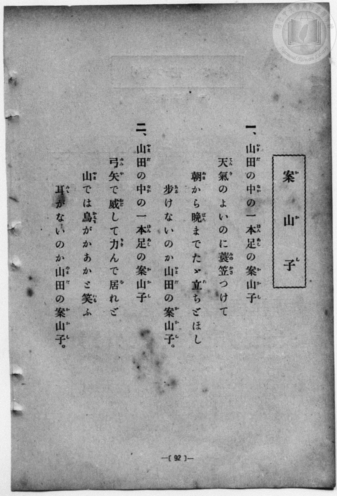
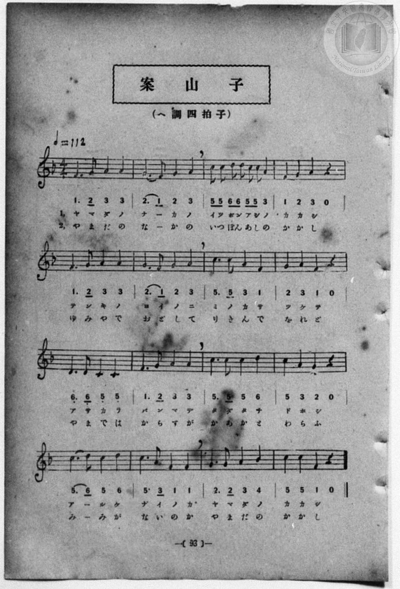

# 案山子

> Re:Shōka 使用 AI 協助辨識與重建樂譜，可能會有錯誤。歡迎[回報](https://github.com/TMDLang/reshoka/issues)。

- **鋼琴伴奏版**：<br><audio controls src="kakashi.mp3"></audio>
- **NEUTRINO 歌聲合成版**：<br><audio controls src="kakashi_neutrino.mp3"></audio>

- 作詞：武笠三（文部省尋常小學唱歌）
- 作曲：山田源一郎（文部省尋常小學唱歌）
- 一條慎三郎 編《新編 小學校・公學校 唱歌教材集》（大正十二年十二月，索書號 0725-41）
- 尋常科第一、二學年用（第 92–93 頁）
- 國立臺灣圖書館典藏

## 說明


- 出處：一條慎三郎 編《新編 小學校- 公學校 唱歌教材集》尋常科第一、二學年，〈案山子〉，原書第 92–93 頁（P100–P101）。
- 調性與拍號：ヘ調（F 大調），4/4 拍，速度 != 112。
- 背景與曲風：原出自 1911 年文部省《尋常小學唱歌（二）》第十二課〈案山子〉，
描寫山田中央單腳站立的稻草人，無論晴天或烏鴉嘲笑，始終戴著蓑笠、
張弓搭箭守護稻田的模樣。
- 版本說明：本檔案依原書五線譜與數字簡譜對照轉錄。第 3 小節為「5 5 6 6 5 5 3 -」。

### 編曲說明（鋼琴伴奏版）：

1. 前奏 (Intro, 4 小節)：以第四行「歩けないのか山田の案山子」詼諧明快的終止句引出主歌。
2. 主歌伴奏 (Kakashi, 16 小節 × 2 段)：右手演奏原曲歌唱旋律；左手以輕快四拍子和聲伴奏。


## 歌詞

```text
一、
山田の中の一本足の案山子
天氣のよいのに蓑笠つけて
朝から晩までたゞ立ちどほし
歩けないのか山田の案山子。

二、
山田の中の一本足の案山子
弓矢で威して力んで居れど
山では烏がかあかと笑ふ
耳がないのか山田の案山子。
```

## ABC

<div class="abc-score" data-abc-src="kakashi.abc" aria-label="五線譜載入中"></div>

[下載 ABC 原始檔](kakashi.abc)

## TMD 檔案連結

- [主旋律 TMD 檔案](kakashi.tmd) [[在 TMD Studio 編輯](https://tmdlang.github.io/Tmd-TS/#tmd=s7IKdvYPcrWy4qpTUCpJTLdSSM7PyUlNLsnMz7MqzsjPTozPrsyvSsyML84ojTe0NDJWgqssy88pzU21Si9KTEmNN4w3QsgU55cWJadaFSdn5OfnxJekVpQk5edno8vHFySmp1oFGBoYIGQKivLLUvMS84C6C4oy80pSU8DaEQpSyzJTUkHSxcmJefFlqUWZaZmpKUiOSi0qBrsdYkVJUWJecXJRZgHIQwhV-UUlGflAhxdkVFplZBaX5BdlJifmxGcn5iUiK8pMz8yzys3PSyoFBgWmRGpmViYW35VkpAKDpai0KDFHiUtLS-HZwo6nGzc-XTtBQUuLS9FWwdDQiMveVsGNy8ZE38QOpO3JjoZni-Y-a-17sqPzZXOfwvPtKx43dD2btgHIUHi6of_p2h3PFix83Lz7aesaCFvh6ZSNz9b2PJs689ncCS9ntz1u6H6_p-PpkuXP1i5-2tv4ZFfP051bIIxnczre7-l5vmXRs9k7Xsycr2BgbmSqa2L4fk8n2MlPN3Q_3bHj-fKJz9esAbrjcQNY89odQP3Pp6wAGgoUV7A0etQw2dJY4eWCRpi-J3vnvFg57_2eWc_WLnu-ZgHQ5UC1z6a1v2xe8XxOI8RUiNMhTkXS92z2JqA-YJg8n7Lh2a4JQFuBniZO99M53c9Xd79o3_W8cfHTOdOAXnq5ZMXT1h0vpvcrcXHpaynYUgtwKSgoPG6YAHTr89nrXqxa9WxG3-OGiWBRYDy073oxcyrQE1SJOTxRAIy5xw0d8BT0uAEYyj1P--YDPY4RLx2grATkAylQ7D5uaIK69sWq_c8alr_oaH_W3QtMAUBnP26eARQEanFTAKYZMBNkMDA9KgDVAFkvG-Y_3bVMAZJakUxq7nk2cz3IpNmbXi4Cpo5ZQLeAAqN9lYKhpaGhAtDJ8FgEBgS2iOwAeg7svG6gDyBJ9MWqTZi-BFmpoPCsv__p-tWQtPJkx9qnS9Y9nbbuRevm56tnAhPC81ktz1fsftHb-WTXLlAib1n4YvW0ZzO3PF2y8lnHtOfN_S-3dD6dsen5momgYFve_Xxr07OOLS8mTn8xGRjYC4AhDbHl6Z6tT_dMfjZh7fN1a5-u63ixdjvQWKCNQPOfrVj4bMViRBA87-x4NmcNJEGAUv-cNc9WTQE6_cm-uZB4ebJryvPts16snQMKpqk7nq6d_nzDQiD36Ybe563LX-ztfNnTAjQOFH3GoCTyfH3D86Zdjxt6TBVMFcyAEEQbK-g-bugF2QpNhxCzgQEIzHRPW1cAAxloPDBAQIxV816sXQ9MnKASYEPvs_ZOBVBK0MsqSAeGM9gASKoCsSAh-bhxHVAvmGwA-WbbZiAbHv5gdcAQ3LAYKPq4qeNxYwuI0bgaGmqNSx43TnzcuAyk7tmcuY8bux83dT6bufJx477HjcsfN85_3DQPGDmPGxc-bgQK7n7cOB2sdC2QA9S3CmZeN9wxSFEPDmegTyC-gpcTBOMeGB1gtP7p0r0Qxz_t3f185X54fL9YuPjppJ5n06YDvQBKDfvmPZu-8mnHhmczQbn4-ewtQGOBKp_s6H3aPRXoDpBRsxcAowYo8mxO84utG15sX_90OjDS50Oc9GLxQmQ3ALXAg3sXMNeSFtx7Jj-fvwgYek9XNAKDCxi4T7tmP26aDBLZ2Pq4qQcYklDzwEG8Hpi2HzcCRYGh3AQmVwAT-ePGrSBFLxqA5gPlaBPQL2dPe96y7Vn3fmBggZwNzDErGp_OagcVW3v3P-1ufLF4LrBIAAoCSwhwBloMtA8U4hs3PtnRBTINki97dz-d0fd0aheInLMBkk2f7J6GHPTPNk16NqcT6J9nc7YSDnqgfygv96FAQUufi8s7MTuxOCPTKiAzMS_focagphpcXNhYaNmBGTUKhgq6QGgEyq9gXANkg0QMwTREBC1fQ3XB5A1AImDTfAxrgAXMErD-x83zgLgBzOoD63nc3AWWAYo0rUYWb1oCZLcA8Vwg3gzkLwLi7UjyYNVQcjuqjUYg-RaIqY37gHgBmLUOorNxFczGxm4UcaBtjUBbG_cCdU8G0k1APB1JHqIaQk6H20hSkIFEIMEFUg9RA-OhB1kbNMhAnl-LEmQroAEGCiKQ2ONmkKNAMvOhevrgQbMVKgMKjsdNG8GyIJPRgwtqW-N-aNAB8yPU25AIAuZUqLeBuRgaBTCZXnCAIelpmgS2rQeqDy2ozOLB-oCUKYgFJrAFICy4QLQZXAQkBwo2tOACpg9IoGyFpySQxSCvT0AEJDD9gVjtUGfuh8o0QNmPmxuhejrBvNlgEwmlLpCngWUXNLhAUQHS1QlkzwTLgIIBSQacriCpCBSRINP6oTpAYqAIQwkuSDCAMhpyMIACAhRkiHQECzwTuBoQxpKyoEEF8iAkjYBSBSIrIqUrcEDizb6EsiEwPcEyGziA4YEByYSQTAfKYJAgwZ9xsWfAWi4uXTsFaKGmgMpU5gIA)]
- [鋼琴伴奏 TMD 檔案](kakashi_piano.tmd) [[在 TMD Studio 編輯](https://tmdlang.github.io/Tmd-TS/#tmd=s7IKdvYPcrWy4qpTUCpJTLdSSM7PyUlNLsnMz7MqzsjPTozPrsyvSsyML84ojTe0NDJWgqssy88pzU21Si9KTEmNN4w3QsgU55cWJadaFSdn5OfnxJekVpQk5edno8vHFySmp1oFGBoYIGQKivLLUvMS84C6C4oy80pSU8DaEQpSyzJTUkHSxcmJefFlqUWZaZmpKUiOSi0qBrsdYkVJUWJecXJRZgHIQwhV-UUlGflAhxdkVFplZBaX5BdlJifmxGcn5iUiFJVkpAK9V1RalJijxKWlpfBsYcfTjRufrp3wfk_Hy9kzn3V2v-ze83zClid7tjxd2v9-T6eClhaXoq2CoaERl72tghuXjYm-iR3IuCc7Gp4tmvuste_Jjs6XzX0Kz7eveNzQ9WzaBiBD4emG_qdrdzxbsPBx8-6nrWsgbIWnUzY-W9vzbOrMZ3MnvJzd9rihG2jr0yXLn61d_LS38cmunqc7t0AYz-Z0vN_T83zLomezd7yYOV_BwNzIVNfEEOgesFeebuh-umPH8-UTn69ZA3TH4waw5rU7gPqfT1kBNBQormBp9KhhsqWxwssFjTB9T_bOebFy3vs9s56tXfZ8zQKgy4Fqn01rf9m84vmcRoipEKdDnIqk79nsTUB9wLB6PmXDs10TgLYCPU2c7qdzup-v7n7Rvut54-Knc6YBvfRyyYqnrTteTO9X4uLS11KwpRbgUlBQeNwwAejW57PXvVi16tmMvscNE8GiwHho3_Vi5lSgJ6gSc3iiABhzjxs64CnrcQMwlHue9s0HehwjXjpAWQXIB1Kg2H3c0AR17YtV-581LH_R0f6suxeYAoDOftw8AygI1OKmAEwzYCbIYGB6VACqAbJeNsx_umuZAiS1IkwC-goYIJDQAKVypPT9vBOYzICGzAIpVVAw1FN42tkLFFfQ8MwrKcrXUTABhcfz9Q2aoGDbvRTo_KezZ79YCPRfz7O1Kx83TnzcuOpxY8vjxnWPG7shiQPIRvJ674uVe16sXg60-un-1c9ntTzf2vRs7aKn_Uuf7pkKjJAnO3YDwxXqVgUFIz0FiAjEeQoa3onZicUZmToKhmZQlygcnq5gpPBs3VaQk572bwbm2Gd7pgAVgwN4E1AvKK6mdz_dB8xcs59uXwZUAHT5C6B1-1cDHQ8MKqDDnk7qedG4CWIL1HbKUx8UKGjpc3GBw88qIDMxLz_Iw6HGoKYa7EMbCy07MKNGwVRBFwjNwLQZEMNEjBUMgSQI1wA9ChIxAorpAqMCpgaEQfIGIBGuWhTLfJAtM4FbZhivEG0Yq2ACpExiEXwoBTQWyDCF8MHyCL4BxApoROD1EchNMNeCMMz9hmAaImIKhGZgX5tCRUC6YPIQH4FM8zGsAabdJWD9j5vnAXEDmNUH1vO4uQssAxRpWo0s3rQEyG4B4rlAvBnIXwTE25Hkwaqh5HZUG41A8i0QUxv3AfECMGsdRGfjKpiNjd0o4kDbGoG2Nu4F6p4MpJuAeDqSPEQ1hJwOt5GkIAOJQIILkSxgPPQga4MGGcjza1GCbAU0wEBBBBJ73AxyFEhmPlRPHzxotkJlQMHxuGkjWBZkMnpwQW1r3A8NuseNy6HehkTQ48aVUG8_blwGjQKYTC84wJD0NE0C29YD1YcWVGbxYH1ACpg4geEBIrAFICy4UPMVSA4UbGjBBUwfkEDZCk9JIItBXp-ACEhg-gOx2qHO3A-VaYCyHzc3QvV0gnmzwSYSSl0gTz9uXA8NLlBUgHR1AtkzwTKgYECSAacrSCoCRSTItH6oDpAYKMJQgotaxQt6UIE8CEkjoFSByIpI6QockHizL6FsCExPsMwGDmB4YEAyISTTgTIYJEjwZ1zsGRC9TMNfcKIXlCAKzIeWmHB5IAMoBy03iTcCe1mMMANacCNbg6IHiY9cvgONwnAH-XWArp0CuKYBmwfkQMMv2scwFkPICC6kzAUA)]

## 分析

```text
================================================================================
📊 TMD Song Profile: [ 案山子 ]
================================================================================
⏱  Duration:       1:08 (68.6s), 32 measures total
🎼 Key & Tempo:    首調基準 F, != 112.0 BPM, <4/4>
   - 分析範圍：      由實際發聲的音符與和弦推測調性；播放脈絡另行呈現
🎤 人聲音域:    C4 (MIDI 60) – D5 (MIDI 74) [跨度: 14 個半音 / 1.2 個八度, 難度: moderate]
   - 最低音:  C4 in [Kakashi #1 @ m.9, 0:18]
   - 最高音: D5 in [Kakashi #1 @ m.3, 0:04]
   - 適合: soprano, mezzo-soprano, contralto, tenor, baritone, bass
🏛  結構:      Kakashi (34.3s) -> Kakashi (34.3s)
⚡ 編曲密度:        Peak 1 軌道同時演奏
🗝  調性診斷：       F 調性不明確（純淨自然大調，未偵測到可信轉調）
   - 風格氣質:    純淨自然大調（陽光明朗、易唱易記，無明顯調外色彩）
   - 轉調歷程:    全曲維持單一推測調性（未偵測到可信轉調）
   - 核心骨幹音:  C, A, F, G, D
   - 調性數值:    F 調性不明確 [相關度: 0.80, 穩定度: Ambiguous, 自然音純度: 100.0%]
   - 候選調性 (K-S): F 大調 (0.80), C 大調 (0.79), A 小調 (0.72)
   - 五度圈歷程:   -1 -> -1
   - 各段落調性細節:
     • [Kakashi #1]: F 調性不明確 (r: 0.80, 自然音純度: 100.0%)
     • [Kakashi #2]: F 調性不明確 (r: 0.80, 自然音純度: 100.0%)

  [ 五度圈游移軌跡 ]
               C  
        [F ]*          G  
      Bb               D  
      Eb               A  
         Ab           E  
            Db       B  
               F# 
     (* = active key center)

  [ 十二半音累積音高分佈 ]
     C  : ████████████████████████  26.7%
     C# :                            0.0%
     D  : ████████                   9.2%
     D# :                            0.0%
     E  :                            0.0%
     F  : █████████████████         19.2%
     F# :                            0.0%
     G  : █████████████████         19.2%
     G# :                            0.0%
     A  : ██████████████████████    24.2%
     A# : ██                         1.7%
     B  :                            0.0%
--------------------------------------------------------------------------------
Assignment 軌道音域：
  - Piano         : C4 – D5 (14 個半音 / 1.2 個八度, 126 個音符)
================================================================================
```


## 原書掃描頁






