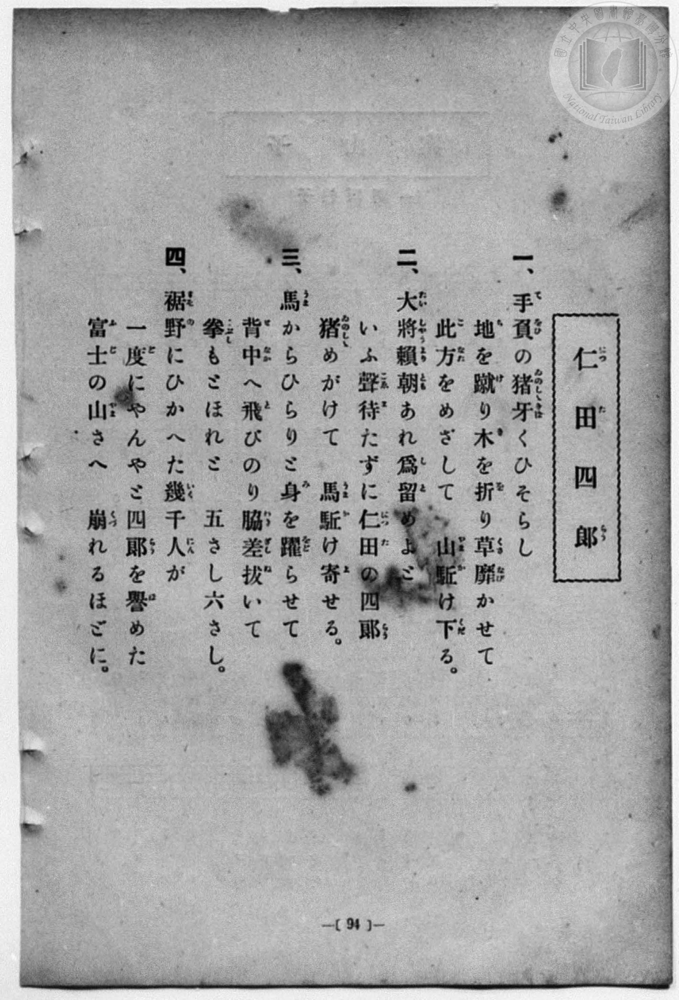
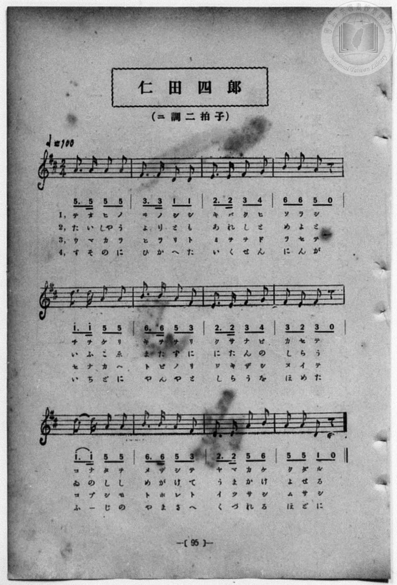

# 仁田四郎

> Re:Shōka 使用 AI 協助辨識與重建樂譜，可能會有錯誤。歡迎回報。

- **鋼琴伴奏版**：<br><audio controls src="nitan_shiro.mp3"></audio>
- **NEUTRINO 歌聲合成版**：<br><audio controls src="nitan_shiro_neutrino.mp3"></audio>

- 一條慎三郎 編《新編 小學校・公學校 唱歌教材集》（大正十二年十二月，索書號 0725-41）
- 尋常科第一、二學年用（第 94–95 頁）
- 文部省

## 說明


- 出處：一條慎三郎 編《新編 小學校- 公學校 唱歌教材集》（大正十二年十二月，索書號 0725-41）
- 出處：尋常科第一、二學年用（第 94–95 頁）
- 出處：文部省
- 調性與拍號：調號 ?= D，拍號 <2/4>，速度 != 100


## 歌詞

```text
一、
手負の猪牙くひそらし
地を蹴り木を折り草靡かせて
此方をめざして　山駆け下る。

二、
大將賴朝あれ爲留めよと
いふ聲待たずに仁田の四郎
猪めがけて　馬駆け寄せる。

三、
馬からひらりと身を躍らせて
背中へ飛びのり脇差拔いて
拳もとほれと　五さし六さし。

四、
裾野にひかへた幾千人が
一度にやんやと四郎を譽めた
富士の山さへ　崩れるほどに。
```

## ABC

<div class="abc-score" data-abc-src="nitan_shiro.abc" aria-label="五線譜載入中"></div>

[下載 ABC 原始檔](nitan_shiro.abc)

## TMD 檔案連結

- [主旋律 TMD 檔案](nitan_shiro.tmd) [[在 TMD Studio 編輯](https://tmdlang.github.io/Tmd-TS/#tmd=s7IKdvYPcrWy4qpTUCpJTLdSSM7PyUlNLsnMz7MqzsjPTozPrsyvSsyML84ojTe0NDJWgqssy88pzU21Si9KTEmNN4w3QsgU55cWJadaFSdn5OfnxJekVpQk5edno8vHFySmp1oFGBog6Swoyi9LzUvMA-ouKMrMK0lNAWtHKEgty0xJBUkXJyfmxZelFmWmZaamIDkqtagY7HaIFSVFiXnFyUWZBSAPIVTlF5Vk5AMdXpBRaZWRWVySX5SZnJgTn52Yl4hQVJKRCvReWn5Odk5-USqy5sz0zDyr3Py8pFJgEClxcWlpKTzZ3fh8yoans2e_bO5T0NLiUrRVMDQw4LK3VXDhsjHSN7EDaX-yo-HZornPWvue7OgEqXu-fcXjhq5n0zYAGQpPN_Q_Xbvj2YKFj5t3P21dA2ErPJ2y8dnanmdTZz6bO-Hl7LbHDd3v93Q8XbL82drFT3sbn-zqebpzC4TxbE7H-z09z7csejZ7x4uZ8xUMzI1MdU0M3-_pBDv96Ybupzt2PF8-8fmaNUB3PG4Aa167A6j_-ZQVQEOB4gqWJo8aJluaKrxc0AjT92xa-8vmFc_nNAL9qa_FBdHK9ayz-8WmBY8b1z3vWfW8c-bjxv7HjZseN8593NT5uHE619M5Gx43TXqxc8vjpq5nc1YA2c-6ZgDZL3o7X85d-Lix-3Hj7MeNy7ierV3ybNpOoPTjpsbHjdOAWoGijxsanm7c-HJ52-PGiU92dD9u6n7c0MTFBXQuyGag359uaH-xecuzOXMfNzY9bup53rHp-dSZIBOaOh43ruB63NjyuHHri8ZNT_e1Pm6c_7hx1uPG1ZD4AToYEkVcQHeD7ewBWgKx8-WyNRA7n64H6p8Nt3ZHJ8haoCzI2SDvbQKRTV1Aq17sWg3y5q5esDjYRy-ae57sWPu4ccfLxUD-ZqCFIG-3tD_dvu5Z9xSw04De7t78uKkJaMDjxt1AD4AYDQ1PdgGlpwKD4GkrUD-IAbYf6F6Q_S8W73vZ3gf0CDicgeG3A-i1pzv3Pe1tfrJrF9AfoJh5umsZSEVTy-OmySCycQXEtyBHrt0L9u98rqfre54uBhqzDhjIYHt2gAJ8y0qQQ4B-BrqocSXIFKDlWvpcXL6JwLQekJmYl-9QY1BTzaUABDaGZlp2YFaNgqmCLhCagmkQrlEwBosYKxgCSRCuUTACixiBZUzAImZAEoRBOgxAImDTfAxrFIDhA1b9uLELiDeBWevAeh43TYDKrAPi6WAWiATp6YXKbADifjALpBMkMxfEa-qEq45H2GYEkp8P1dkCkgcGGpjTBrWwAyLZBHLKCjCrCWosiAbxe-BOAcmD9DSCxUE6IWJIFhqDdILMBsntA-JuuONAMiAnQ_ggG5HMbNwPlZkExiCZlVDbIB6bDSZBAYdkmwlI50yobXOhwQiMWVTbgG4AJgEwCxQUIBlQGID4_TCTmyZDZUB6ITxgikOxrUbBMA6sDUghkgIoikERDeKBIh9bUgCxQKIgGj0pLET4u3EiNCZQIhwRInAZUPSD3DcViFeBWZuhMuDQxh5W4KQA8_dWIAb7sQlkJ0hmH1RmPhDPQglFEA2VgYYLNLFCUgU0fkBxjp4OQO4Aya2CuwwUCyAZUKxD3A2NM5jfmmB-6wXiaWAWLAOsAfMgqRdbOoD5bSE07cB9AE7xkFiFpX5YqgOZDU2PYB9AQhoksxvMA6d0cKohPx2ARECykIIEhEFFBno6AIUsLKxA9sFdAnYDSGYaLMTBvkfyFyKfgVMQLIU8blwANgckg5YOcBczcNtAuR6cHmG2YeZqmG3QkgCSj9BsA6cDmN-2wdMMrIyBpYPd4HIGOWZgflsCxFNRXNgA5iHE0NPBVqjOGdC0BYLooQXRDUuNsDS3FOYKsC_gqQApNUHsquXi0rVTAFUbCki0MhcA)]
- [鋼琴伴奏 TMD 檔案](nitan_shiro_piano.tmd) [[在 TMD Studio 編輯](https://tmdlang.github.io/Tmd-TS/#tmd=s7IKdvYPcrWy4uKqU1AqSUy3UkjOz8lJTS7JzM-zKs7Iz06Mz67Mr0rMjC_OKI03tDQyVoKrLMvPKc1NtUovSkxJjTeMN0LIFOeXFiWnWhUnZ-Tn58SXpFaUJOXnZ6PLxxckpqdaBRgaIOksKMovS81LzAPqLijKzCtJTQFrRyhILctMSQVJFycn5sWXpRZlpmWmpiA5KrWoGOx2iBUlRYl5xclFmQUgDyFU5ReVZOQDHV6QUWmVkVlckl-UmZyYE5-dmJeoxKWlpfBkd-PzKRuezp79srnv_Z6Ol7NnPuvsftm95_mELU_2bHm6tP_9nk4FLS0uRVsFQwMDLntbBRcuGyN9EzuQDU92NDxbNPdZa9-THZ1A_QrPt6943ND1bNoGIEPh6Yb-p2t3PFuw8HHz7qetayBshadTNj5b2_Ns6sxncye8nN32uKEbaOvTJcufrV38tLfxya6epzu3QBjP5nS839PzfMuiZ7N3vJg5X8HA3MhU18QQ6B6w755u6H66Y8fz5ROfr1kDdMfjBrDmtTuA-p9PWQE0FCiuYGnyqGGypanCywWNMH3PprW_bF7xfE6jEheXb2JmnlVAZmJefpCHQ41BTTWXAhDYGJpp2YFZNQqmCrpAaAqmQbhGwRgsYqxgCCRBuEbBCCxiBJYxAYuYAUkQBukwAImATfMxrFF43LgMrPpxYxcQbwKz1oH1PG6aAJVZB8TTwSwQCdLTC5XZAMT9YBZIJ0hmLojX1AlXHY-wzQgkPx-qswUk_7ipBcxpg1rYAZFsAjllBZjVBDUWRIP4PXCngORBehrB4iCdEDEkC41BOkFmg-T2AXE33HEgGZCTIXyQjUhmNu6HykwCY5DMSqhtEI_NBpOggEOyzQSkcybUtrnQYHzcuBrVNqAbHjfuALNAQQGSAYUBiN8PM7lpMlQGpBfCe9zYg2JbjYJhHFgbkEIkBVAUgyIaxANFPrakAGKBREE0elJYiPB340RoTKBEOCJE4DKg6Ae5byoQrwKzNkNlwKGNPazASQHm761ADPZjE8hOkMw-qMx8IJ6FEoogGioDDRdoYoWkCmj8gOIcPR2A3AGSWwV3GSgWQDKgWIe4GxpnML81wfzWC8TTwCxYBlgD5kFSL7Z0APPbQmjagfsAnOIhsQpL_bBUBzIbmh7BPoCENEhmN5gHTungVEN-OgCJgGQhBQkIg4oM9HQACllYWIHsg7sE7AaQzDRYiIN9j-QvRD4DpyBYCnncuABsDkgGLR3gLmbgtoFyPTg9wmzDzNUw26AlASQfodkGTgcwv22DpxlYGQNLB7vB5QxyzMD8tgSIp6K4sAHMQ4ihp4OtUJ0zoGkLBNFDC6IblhphaW4pzBVgX8BTAVJqgthVi1xr-CDXGhbwSsMwXiHaMBZGYfJN44Es0_hYBKNGwQTIMgGrMUCkNTR9CDW4zUHoId4cIyDDCMUUOBNqDtDXunYKII9H-wC1wNlAXXC2MRIbaDqQrcwFAA)]

## 分析

```text
================================================================================
📊 TMD Song Profile: [ 仁田四郎 ]
================================================================================
⏱  Duration:       0:28 (28.8s), 24 measures total
🎼 Key & Tempo:    首調基準 D, != 100.0 BPM, <2/4>
   - 分析範圍：      由實際發聲的音符與和弦推測調性；播放脈絡另行呈現
🎤 人聲音域:    D4 (MIDI 62) – D5 (MIDI 74) [跨度: 12 個半音 / 1.0 個八度, 難度: easy]
   - 最低音:  D4 in [Main #1 @ m.2, 0:01]
   - 最高音: D5 in [Main #1 @ m.5, 0:04]
   - 適合: soprano, mezzo-soprano, contralto, tenor, baritone, bass
🏛  結構:      Main (14.4s) -> Main (14.4s)
⚡ 編曲密度:        Peak 1 軌道同時演奏
🗝  調性診斷：       A 調性不明確（純淨自然大調，未偵測到可信轉調）
   - 風格氣質:    純淨自然大調（陽光明朗、易唱易記，無明顯調外色彩）
   - 轉調歷程:    全曲維持單一推測調性（未偵測到可信轉調）
   - 核心骨幹音:  A, F#, D, E, B
   - 調性數值:    A 調性不明確 [相關度: 0.81, 穩定度: Ambiguous, 自然音純度: 95.6%]
   - 候選調性 (K-S): A 大調 (0.81), D 大調 (0.79), F# 小調 (0.65)
   - 五度圈歷程:   +3 -> +3
   - 各段落調性細節:
     • [Main #1]: A 調性不明確 (r: 0.81, 自然音純度: 95.6%, 調外音: G)
     • [Main #2]: A 調性不明確 (r: 0.81, 自然音純度: 95.6%, 調外音: G)

  [ 五度圈游移軌跡 ]
               C  
         F            G  
      Bb               D  
      Eb              [A ]*
         Ab           E  
            Db       B  
               F# 
     (* = active key center)

  [ 十二半音累積音高分佈 ]
     C  :                            0.0%
     C# :                            0.0%
     D  : ████████████              15.6%
     D# :                            0.0%
     E  : ████████████              15.6%
     F  :                            0.0%
     F# : ██████████████            17.8%
     G  : ███                        4.4%
     G# :                            0.0%
     A  : ████████████████████████  31.1%
     A# :                            0.0%
     B  : ████████████              15.6%
--------------------------------------------------------------------------------
Assignment 軌道音域：
  - Piano         : D4 – D5 (12 個半音 / 1.0 個八度, 90 個音符)
================================================================================
```


## 原書掃描頁






