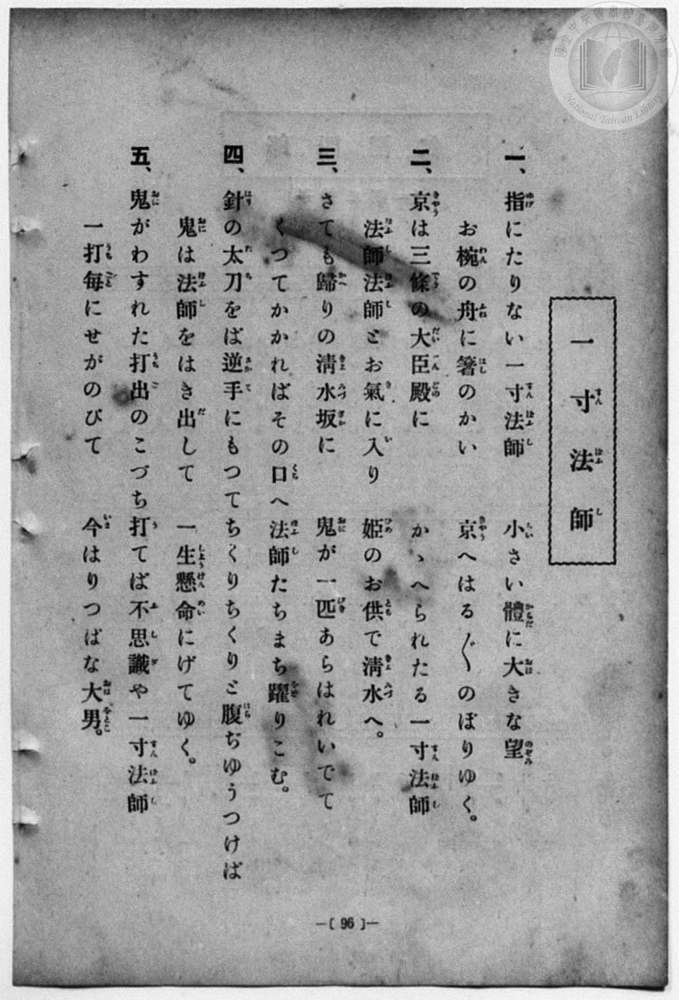
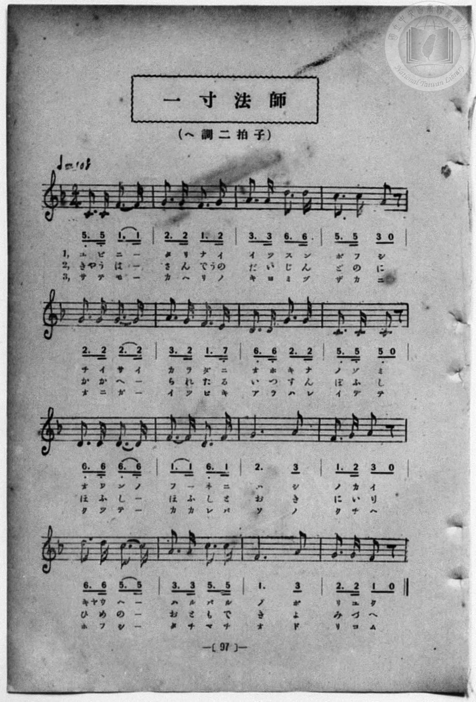

# 一寸法師

> Re:Shōka 使用 AI 協助辨識與重建樂譜，可能會有錯誤。歡迎回報。

- **NEUTRINO 歌聲合成版**：<br><audio controls src="issunboshi_neutrino.mp3"></audio>
- **鋼琴伴奏版**：<br><audio controls src="issunboshi.mp3"></audio>


- 詞：巖谷小波
- 曲：田村虎藏
- 一條慎三郎 編《新編 小學校・公學校 唱歌教材集》（大正十二年十二月，索書號 0725-41）
- 尋常科第一、二學年用（第 96–97 頁）

## 說明

曲目說明
中文解釋：日本民間故事中的小小英雄，描寫他勇敢出發、闖蕩世界。

原書資訊與歌詞全文（對應 P104.jpg–P105.jpg，書頁 pp. 96–97）：
調性與拍號：ヘ調二拍子（F 大調 2/4 拍），♩＝108


## 歌詞

```text
一、
指にたりない一寸法師
小さい體に大きな望
お椀の舟に箸のかい
京へはる／＼のぼりゆく。

二、
京は三條の大臣殿に
かゝへられたる一寸法師
法師法師とお氣に入り
姫のお供で清水へ。

三、
さても歸りの清水坂に
鬼が一匹あらはれいでて
くつてかかればその口へ
法師たちまち躍りこむ。

四、
針の太刀をば逆手にもつて
ちくりちくりと腹ちゆうつけば
鬼は法師をはき出して
一生懸命にげてゆく。

五、
鬼がわすれた打出のこづち
打てば不思議や一寸法師
一打毎にせがのびて
今はりつぱな大男。
```

## ABC

```abc
X:1
T:一寸法師
C:曲：田村虎藏
M:2/4
L:1/16
Q:1/4=108
K:F
V:V1 name="Piano" snm="Pia"
[V:V1]
C3 C F3 F | G3 G F3 G | A3 A d3 d | c3 c A2 z2 |
w: 1.~ユ ビ ニ _ | タ リ ナ イ | イ ッ ス ン | ボ フ シ
w: 2.~キャ ウ ハ _ | サ ン デ ウノ | ダ イ ジ ン | ド ノ ニ
w: 3.~サ テ モ _ | カ ヘ リ ノ | キ ヨ ミ ヅ | ザ カ ニ
w: 4.~ハ リ ノ _ | タ チ ヲ バ | サ カ テ ニ | モ ッ テ
w: 5.~オ ニ ガ _ | ワ ス レ タ | ウ チ デ ノ | コ ヅ チ
G3 G G3 G | A3 G F3 E | D3 D G3 G | C3 C C2 z2 |
w: 1.~チ イ サ イ | カ ラ ダ ニ | オ ホ キ ナ | ノ ゾ ミ
w: 2.~カ カ ヘ _ | ラ レ タ ル | イ ッ ス ン | ボ フ シ
w: 3.~オ ニ ガ _ | イ ッ ピ キ | ア ラ ハ レ | イ デ テ
w: 4.~チ ク リ _ | チ ク リ ト | ハ ラ ヂュ ウ | ツ ケ バ
w: 5.~ウ テ バ _ | フ シ ギ ヤ | イ ッ ス ン | ボ フ シ
D3 D D3 D | F3 F D3 F | G6 A2 | F3 G A2 z2 |
w: 1.~オ ワ ン ノ | フ _ ネ ニ | ハ シ | ノ カ イ
w: 2.~ホ フ シ _ | ホ フ シ ト | オ キ | ニ イ リ
w: 3.~ク ッ テ _ | カ カ レ バ | ソ ノ | ク チ ヘ
w: 4.~オ ニ ハ _ | ホ フ シ ヲ | ハ キ | ダ シ テ
w: 5.~ヒ ト ウ チ | ゴ _ ト ニ | セ ガ | ノ ビ テ
d3 d c3 c | A3 A c3 c | F6 A2 | G3 G F2 z2 |
w: 1.~キャ ウ ヘ _ | ハ ル バ ル | ノ ボ | リ ユ ク
w: 2.~ヒ メ ノ _ | オ ト モ デ | キ ヨ | ミ ヅ ヘ
w: 3.~ホ フ シ _ | タ チ マ チ | ヲ ド | リ コ ム
w: 4.~イッ シャ ウ _ | ケ ン メ イ | ニ ゲ | テ ユ ク
w: 5.~イ マ ハ _ | リ ッ パ ナ | オ ホ | ヲ ト コ
C3 C F3 F | G3 G F3 G | A3 A d3 d | c3 c A2 z2 |
w: 1.~ユ ビ ニ _ | タ リ ナ イ | イ ッ ス ン | ボ フ シ
w: 2.~キャ ウ ハ _ | サ ン デ ウノ | ダ イ ジ ン | ド ノ ニ
w: 3.~サ テ モ _ | カ ヘ リ ノ | キ ヨ ミ ヅ | ザ カ ニ
w: 4.~ハ リ ノ _ | タ チ ヲ バ | サ カ テ ニ | モ ッ テ
w: 5.~オ ニ ガ _ | ワ ス レ タ | ウ チ デ ノ | コ ヅ チ
G3 G G3 G | A3 G F3 E | D3 D G3 G | C3 C C2 z2 |
w: 1.~チ イ サ イ | カ ラ ダ ニ | オ ホ キ ナ | ノ ゾ ミ
w: 2.~カ カ ヘ _ | ラ レ タ ル | イ ッ ス ン | ボ フ シ
w: 3.~オ ニ ガ _ | イ ッ ピ キ | ア ラ ハ レ | イ デ テ
w: 4.~チ ク リ _ | チ ク リ ト | ハ ラ ヂュ ウ | ツ ケ バ
w: 5.~ウ テ バ _ | フ シ ギ ヤ | イ ッ ス ン | ボ フ シ
D3 D D3 D | F3 F D3 F | G6 A2 | F3 G A2 z2 |
w: 1.~オ ワ ン ノ | フ _ ネ ニ | ハ シ | ノ カ イ
w: 2.~ホ フ シ _ | ホ フ シ ト | オ キ | ニ イ リ
w: 3.~ク ッ テ _ | カ カ レ バ | ソ ノ | ク チ ヘ
w: 4.~オ ニ ハ _ | ホ フ シ ヲ | ハ キ | ダ シ テ
w: 5.~ヒ ト ウ チ | ゴ _ ト ニ | セ ガ | ノ ビ テ
d3 d c3 c | A3 A c3 c | F6 A2 | G3 G F2 z2 |
w: 1.~キャ ウ ヘ _ | ハ ル バ ル | ノ ボ | リ ユ ク
w: 2.~ヒ メ ノ _ | オ ト モ デ | キ ヨ | ミ ヅ ヘ
w: 3.~ホ フ シ _ | タ チ マ チ | ヲ ド | リ コ ム
w: 4.~イッ シャ ウ _ | ケ ン メ イ | ニ ゲ | テ ユ ク
w: 5.~イ マ ハ _ | リ ッ パ ナ | オ ホ | ヲ ト コ
```

## TMD 檔案連結

- [主旋律 TMD 檔案](issunboshi.tmd) [[在 TMD Studio 編輯](https://tmdlang.github.io/Tmd-TS/#tmd=s7IKdvYPcrWy4qpTUCpJTLdSSM7PyUlNLsnMz7MqzsjPTozPrsyvSsyML84ojTe0NDJWgqssy88pzU21Si9KTEmNN4w3QsgU55cWJadaFSdn5OfnxJekVpQk5edno8vHFySmp1oFGBqYIGQKivLLUvMS84C6C4oy80pSU8DaEQpSyzJTUkHSxcmJefFlqUWZaZmpKUiOSi0qBrsdYkVJUWJecXJRZgHIQwhV-UUlGflAhxdkVFplZBaX5BdlJifmxGcn5iUiFJVkpAK9l5afk52TX5SqxKWlpfBkR8PT9TuebZ76dMdqBS0tLkVbBUMDCy57WwU3LhsjfRM7kGagomeL5j5r7Xuyo_Nlc5_C8-0rHjd0PZu2AchQeLqh_-naHc8WLHzcvPtp6xoIW-HplI3P1vY8mzrz2dwJL2e3PW7ofr-n4-mS5c_WLn7a2_hkV8_TnVsgjGdzOt7v6Xm-ZdGz2TtezJyvYGBuZKprYvh-TyfY4U83dD_dseP58onP16wBuuNxA1jz2h1A_c-nrAAaChRXsDR71DDZ0lzh5YJGmL4XK-e93zPr6fZpLzZsBzrx2eZFYOFnszcBhZ9P2fBs7sQXM_teTO9X4tLXUgAKP5-97sWqVc9m9HEpKACDZe2zae0vli9-2Q50-Kxn05c-m7Pm2YaJL6dNfja19cmubqCC57NaQH7f0P-ie-PL2S1ATzzr73-6fvWT3dOedrc_m7roafuu5zP3AF38cvq0F1NXPtkx7fnUnscNTVxa-lwgS22pBUAufto3HxSAm9tfrOh60dEODHxgCDxtXQH0BijkN_Q-a-9UACVNvayCdGBoAZmmICbI2bN3AANOoaBADxaQwEAE-hpk7ItV-581LAcZ2N0LjB2g6OPmGUBBUMR19z5dOwFouJsCMGKBYgrA9KIAFAXr7nk0c-X7PXNBiQkSoKCoA7Ge9bQ_blz9uHH-46aux42rHje2IKdBsFc29D9unAqUeLl6ClAp0PDHjb1Apc_mzAZJP27serak4XHjuhcd84HSz9ftALIfN3YDNYBt2rXmcSNQaP3jJmDU9b_fswcsvQdkXVPb48Z-UAxAFAIjA-wksJb1wMQNTOVAxSDftC9-tm4_0HSIhd2Pm4ASOx43dT5u6gE7HZgAUB0NYUHIx40rQI7csBjk-talQJvB3loOlAC6pOvJvtmPG5c_29H6bMMWkKkw9-zohLoH7Ptlj5uanq0F2gkMpXUQxU_nNkGd9HIN0Fc9IDf07Hzc2ARyGMjDQLe1AI0GaoYYAwzHJSCTQIED9ANQesPjRrAX-4Fu24FwN8hPjQsfN-4Dki929YItnfy4CRhnELc9nT0b6raX7ZAgWvW0o-Fx0ySgiS8b2p51Ai1YDXQwxD6I5UDj-sEGwRkrXrQCXbsQHA1ABFQ6Eagf7p_1ULeATF0PjHJg_nncOB1qHtCvz6fMf9a-4-nEveD0A1QEDCLUCJ0CcyQ4eB43Af0_ExJjzzong40Dhv_kx41Lga4Ae74TyAEGz4YnO3qfNcx9sXbD4yaM5Agq_TonP1vfB7YWGHVA84DGbIY5bDfQZ8CwB5JAD20EplNg-nk-ZTvIVUBpynM3FCiASg3P4uLSvKT84oxMq4DMxLx8hxqDmmqQNQo2hmZadmAWtpJFAVJ6vljYo6BhAspgz9c36ICKA3AZoIlFA9A2kGE1CqbxCrpACKQMwQxDoJgRmGUEFTECihiDWcYKZmDaDKQPog0sYwDENWDzfAxrFB43LwPLPW6eDMTdYDZQXuFx036o-Cog7oKwm5aAZZZAZZqB7J1Q9maQTPMcKG8qUGY7kAVyLtQuI5DOtY-bF0ONWgZU1o9k3Va4QY-b22FqHgMrOJC5DXD7HzftQLGxE8rrg7oeyUZjZGPbgHgRknWroeIzwD6EmQF2I5S3AojnQ9mtYJltUFesxrTLBOQWiHcgIdaHJSQbgXgTlD0B2dNgE9ugMt1gf0HcCg5jsAySXaYgnTA3dwPZaxB2Na-HmrgTyIaIg-wH6YDFM8gV0ACG-ngz3JcgWZhd-NPvrh5y0i8srcJoWFqFpV7zeKCQGSSRAymEMkTCB7PQ0zDI1bD0AQtTSFqFxfNKRCqChDA8BGcjxXkXOAwhcfe4aR80BaCnYqiZ4FibgRT2K6GmrEGK89Xk5xhw-sURz8gmNk-BumctWAaWckA-hqXINSh62jHTFDj9wkJxPTxPQPyFKf64uQMsAzMfZFfT4-alUIXLwJItUN5GcHLHTMKwBNkGlYdZNxWqbzsQr4OqIa_gIVAEd5KThBGpE8GqgRfHUDFEuQyBoFQOU2SErRSGxzMojGH5EVL2QYIDxO-F0pASAlZ4wgILEniwtAtMm-DgQku7wNSOGlCwQMcUh8Yx1GUwe0A5BaQeUlOAcxw4TaCnW2g5BC-_YOkWOe9AyydoWbgX2R6wP5DNAZVaoLyGlmaR8wdydYLVP5uwhBvMP7AaBpjosJW3zZPgYYJckoJcsAXu5g64W0Diu1HsAfkVKX7AtS3CHrwJFdjeIyuhgm0yg9f9iHYBQgSSIpHTKHJrAj2NotXeyEUfrCAARSskL0OLPnhFCBED5VOQKCzagOaAoxg9mcKCeyGSCcjRDYwGeBXZjlRtw-xZAbUHUYFjJB9QMsWVHVCq7HlwNkgHpAKH2QNqfiD5B1iVPm5egGoPOJkuAeUEaAoDhSIsEUFs2wg1DaR7IVQZuMSDN8ggYiC7QaKwpgKW0AOXrLBych5apoCFHihTToSywVUeaiYHhwrCr5BEDyqUIPbUcnHp2ikgWr8KGDxlLgA)]
- [鋼琴伴奏 TMD 檔案](issunboshi_piano.tmd) [[在 TMD Studio 編輯](https://tmdlang.github.io/Tmd-TS/#tmd=s7IKdvYPcrWy4qpTUCpJTLdSSM7PyUlNLsnMz7MqzsjPTozPrsyvSsyML84ojTe0NDJWgqssy88pzU21Si9KTEmNN4w3QsgU55cWJadaFSdn5OfnxJekVpQk5edno8vHFySmp1oFGBqYIGQKivLLUvMS84C6C4oy80pSU8DaEQpSyzJTUkHSxcmJefFlqUWZaZmpKUiOSi0qBrsdYkVJUWJecXJRZgHIQwhV-UUlGflAhxdkVFplZBaX5BdlJifmxGcn5iUqcWlpKTzZ0fB0_Y5nm6c-3bH6_Z6Ol7NnPuvsftm95_mELU_2bHm6tP_9nk4FLS0uRVsFQwMLLntbBTcuGyN9EzuQDUDNzxbNfdba92RH58vmPoXn21c8buh6Nm0DkKHwdEP_07U7ni1Y-Lh599PWNRC2wtMpG5-t7Xk2deazuRNezm573NANtPXpkuXP1i5-2tv4ZFfP051bIIxnczre7-l5vmXRs9k7Xsycr2BgbmSqa2IIdA_Yd083dD_dseP58onP16wBuuNxA1jz2h1A_c-nrAAaChRXsDR71DDZ0lzh5YJGmL4XK-e93zPr6fZpLzZsBzrx2eZFYOFnszcBhZ9P2fBs7sQXM_teTO9X4uLyLC4uzUvKL87ItArITMzLD_JwqDGoqeZSAAIbQzMtOzBLX0vBFh0oQFz1YmGPgoYJKCier2_QUQCmAFO9rIJ0TSwatPTBhtUomMYr6AIhkDIEMwyBYkZglhFUxAgoYgxmGSuYgWkzkD6INrCMARDXgM3zMaxReNy8DCz3uHkyEHeD2UB5hcdN-6Hiq4C4C8JuWgKWWQKVaQayd0LZm0EyzXOgvKlAme1AFsi5ULuMQDrXPm5eDDVqGVBZP5J1W-EGPW5uh6l5DEw4IHMb4PY_btqBYmMnlNcHdT2SjcbIxrYB8SIk61ZDxWeAfQgzA-xGKG8FEM-HslvBMtugrliNaZcJyC0Q70BCrA9LSDYC8SYoewKyp8EmtkFlusH-grgVHMZgGSS7TEE6YW7uBrLXIOxqXg81cSeQDREH2Q_SAYtnkCugAQz18Wa4L0GyMLvwp99dPeSkX1hahdGwtApLvebxQCEzSCIHUghliIQPZqGnYZCrYekDFqaQtAqL55WIVAQJYXgIzkaK8y5wGELi7nHTPmgKQE_FUDPBsTYDKexXQk1ZgxTnq8nPMeD0iyOekU1sngJ1z1qwDCzlgHwMS5FrUPS0Y6YpcPqFheJ6eJ6A-AtT_HFzB1gGZj7IrqbHzUuhCpeBJVugvI3g5I6ZhGEJsg0qD7NuKlTfdiBeB1VDXsFDoAjuJCcJI1InglUDL46hYohyGQJBqRymyAhbKQyPZ1AYw_IjpOyDBAeI3wulISUErPCEBRYk8GBpF5g2wcGFlnaBqR01oGCBjikOjWOoy2D2gHIKSD2kpgDnOHCaQE-30HIIXn7B0i1y3oGWT9CycC-yPWB_IJsDKrVAeQ0tzSLnD-TqBKt_NmEJN5h_YDUMMNFhK2-bJ8HDBLkkBblgC9zNHXC3gMR3o9gD8itS_IBrW4Q9eBPq09mzyUqoYJvM4HU_ol2AEIGkSOQ0ityaQE-jaLU3ctEHKwhA0QrJy9CiD14RQsRA-RQkCos2oDngKEZPprDgXohkAnJ0A6MBXkW2I1XbMHtWQO1BVOAYyQeUTHFlB5Qqex6cDdIBqcBh9oCaH0j-AValj5sXoNoDTqZLQDkBmsJAoQhLRBDbNkJNA-leCFUGLvHgDTKIGMhukCisqYAl9MAlK6ycnIeWKWChB8qUE6FscJWHmsnBoYLwKyTRgwoliD21mI1fH-TGrwm07QtMXvEK0Yax4OobyDKNBzFBYiZQhgHU1RgKwJrMQGJGYDGQNEKxCUjCBCyBxEQ1Alk11Dy4wajOMgRpAXlK104B4a9oH6AKNBEjDBFjDBGg19BETMEiylwA)]

## 分析

```text
================================================================================
📊 TMD Song Profile: [ 一寸法師 ]
================================================================================
⏱  Duration:       0:35 (35.6s), 32 measures total
🎼 Key & Tempo:    首調基準 F, != 108.0 BPM, <2/4>
   - 分析範圍：      由實際發聲的音符與和弦推測調性；播放脈絡另行呈現
🎤 人聲音域:    C4 (MIDI 60) – D5 (MIDI 74) [跨度: 14 個半音 / 1.2 個八度, 難度: moderate]
   - 最低音:  C4 in [Issunboshi #1 @ m.1, 0:00]
   - 最高音: D5 in [Issunboshi #1 @ m.3, 0:02]
   - 適合: soprano, mezzo-soprano, contralto, tenor, baritone, bass
🏛  結構:      Issunboshi (17.8s) -> Issunboshi (17.8s)
⚡ 編曲密度:        Peak 1 軌道同時演奏
🗝  調性診斷：       C 調性不明確（純淨自然大調，未偵測到可信轉調）
   - 風格氣質:    純淨自然大調（陽光明朗、易唱易記，無明顯調外色彩）
   - 轉調歷程:    全曲維持單一推測調性（未偵測到可信轉調）
   - 核心骨幹音:  G, F, D, C, A
   - 調性數值:    C 調性不明確 [相關度: 0.74, 穩定度: Ambiguous, 自然音純度: 100.0%]
   - 候選調性 (K-S): C 大調 (0.74), F 大調 (0.74), D 小調 (0.67)
   - 五度圈歷程:   +0 -> +0
   - 各段落調性細節:
     • [Issunboshi #1]: C 調性不明確 (r: 0.74, 自然音純度: 100.0%)
     • [Issunboshi #2]: C 調性不明確 (r: 0.74, 自然音純度: 100.0%)

  [ 五度圈游移軌跡 ]
              [C ]*
         F            G  
      Bb               D  
      Eb               A  
         Ab           E  
            Db       B  
               F# 
     (* = active key center)

  [ 十二半音累積音高分佈 ]
     C  : ██████████████████        18.3%
     C# :                            0.0%
     D  : ███████████████████       19.2%
     D# :                            0.0%
     E  : █                          0.8%
     F  : ██████████████████████    21.7%
     F# :                            0.0%
     G  : ████████████████████████  24.2%
     G# :                            0.0%
     A  : ████████████████          15.8%
     A# :                            0.0%
     B  :                            0.0%
--------------------------------------------------------------------------------
Assignment 軌道音域：
  - Piano         : C4 – D5 (14 個半音 / 1.2 個八度, 112 個音符)
================================================================================
```


## 原書掃描頁






