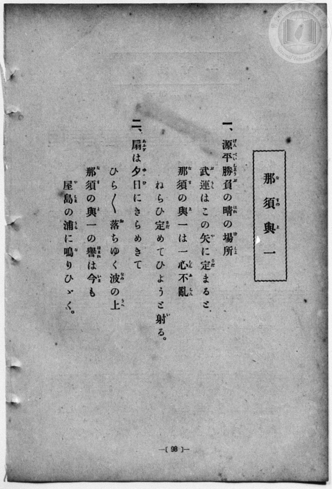
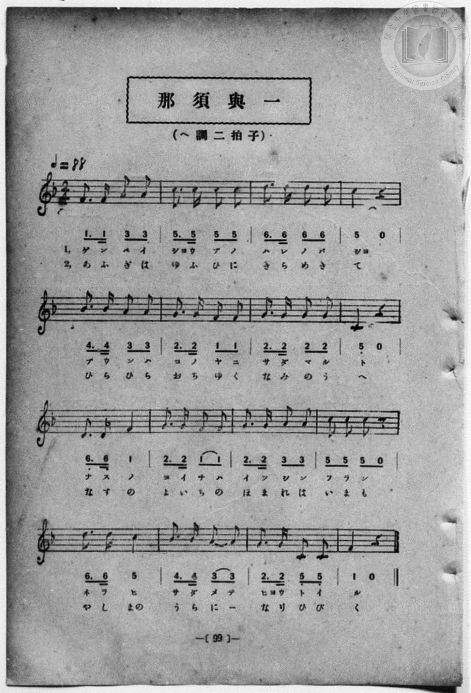

# 那須與一

> Re:Shōka 使用 AI 協助辨識與重建樂譜，可能會有錯誤。歡迎回報。

<audio controls src="nasu_no_yoichi.mp3"></audio>

- 一條慎三郎 編《新編 小學校・公學校 唱歌教材集》（大正十二年十二月，索書號 0725-41）
- 尋常科第一、二學年用（第 98–99 頁）
- 文部省

## 說明

曲目說明
中文解釋：描寫源平故事中的武將那須與一，在海上射中扇子的英勇事蹟。

原書資訊與歌詞全文（對應 P106.jpg–P107.jpg，書頁 pp. 98–99）：
調性與拍號：ヘ調二拍子（F 大調 2/4 拍），♩＝88


## 歌詞

```text
一、
源平勝負の晴の場所
武運はこの矢に定まると
那須の與一は一心不亂
ねらひ定めてひようと射る。

二、
扇は夕日にきらめきて
ひら／＼落ちゆく波の上
那須の與一の譽は今も
屋島の浦に鳴りひゞく。
```

## ABC

```abc
X:1
T:那須與一
M:2/4
L:1/16
Q:1/4=88
K:F
V:V1 name="Piano" snm="Pia"
[V:V1]
F3 F A2 A2 | c3 c c2 c2 | d3 d d2 d2 | c4 z4 |
w: げ ん ぺ い | しよ う ぶ の | は れ の ば | しよ
B3 B A2 A2 | G3 G F2 F2 | G3 G G2 G2 | C4 z4 |
w: ぶ う ん は | こ の や に | さ だ ま る | と
D3 D F4 | G3 G F2 F2 | G3 G A2 A2 | c2 c2 c2 z2 |
w: な す の | よ い ち は | い つ し ん | ふ ら ん
d3 d c4 | B3 B A2 A2 | G3 G C2 C2 | F4 z4 |
w: ね ら ひ | さ だ め て | ひよ う と い | る
F3 F A2 A2 | c3 c c2 c2 | d3 d d2 d2 | c4 z4 |
w: あ ふ ぎ は | ゆ ふ ひ に | き ら め き | て
B3 B A2 A2 | G3 G F2 F2 | G3 G G2 G2 | C4 z4 |
w: ひ ら ひ ら | お ち ゆ く | な み の う | へ
D3 D F4 | G3 G F2 F2 | G3 G A2 A2 | c2 c2 c2 z2 |
w: な す の | よ い ち の | ほ ま れ は | い ま も
d3 d c4 | B3 B A2 A2 | G3 G C2 C2 | F4 z4 |
w: や し まの | う ら に _ | な り ひ び | く
```

## TMD 檔案連結

- [主旋律 TMD 檔案](nasu_no_yoichi.tmd) [[在 TMD Studio 編輯](https://tmdlang.github.io/Tmd-TS/#tmd=s7IKdvYPcrWy4qpTUCpJTLdSSM7PyUlNLsnMz7MqzsjPTozPrsyvSsyML84ojTe0NDJWgqssy88pzU21Si9KTEmNN4w3QsgU55cWJadaFSdn5OfnxJekVpQk5edno8vHFySmp1oFGBqYIWQKivLLUvMS84C6C4oy80pSU8DaEQpSyzJTUkHSxcmJefFlqUWZaZmpKUiOSi0qBrsdYkVJUWJecXJRZgHIQwhV-UUlGflAhxdkVFplZBaX5BdlJifmxGcn5iUiFJVkpAK9l5afk52TX5SKLg7RVqnEpaWl8LJp8csFHS862p_saFDQ0uJStFWwsOCyt1Vw47Ix0jexA2kFSj1bNPdZa9-THZ0vm_sUnm9f8bih69m0DUCGwtMN_U_X7ni2YOHj5t1PW9dA2ApPp2x8trbn2dSZz-ZOeDm77XFD9_s9HU-XLH-2dvHT3sYnu3qe7twCYTyb0_F-T8_zLYuezd7xYuZ8BQNzI1NdE8P3ezrBzn66ofvpjh3Pl098vmYN0B2PG8Ca1-4A6n8-ZQXQUKC4gqXFo4bJlpYKLxc0wvQ9m9b-snnF8zmNSlz6WgrPZm96Pnvdi1Wrns3o41JQUHiyYy1QwYvli1-2Ax0261l__9P1q5_tmvB05-ZnU1uf7OoGKng-q-XZ2mVPN7QjBxHQqU_nrHi2dfuTHV1PN7SAzOlsf7p2AlDxi-6NT7vbgXpf7Jz_uKGJS0ufC2S1LbUAyN1P--aDgmlz-4sVXUAHAYP4xcp5T1tXAD0DCt8Nvc_aOxVAyVIvqyAdGCZApjmICXQ2UB8weBQKCvRgwQUMKqDfQca-WLX_WcNykIHdvcA4AIo-bp4BFARFT3cv0HtAw90UgNEHFFMApgoFoChYd8-jmSvf75kLTDGQUAXFD4gFCcqn3XNfbFrwuHHds5lbgOTTBVuedTaApdcue9nY_bhx_ePGyUCJ5_MXPW5c_XTdrMeN-x43AcVXgBRBgh0oDQl5oGog-XR_85MdvU92NYFUPG5c-7ip83HjJpDWpsbHjcuA7MdNQD1tQDOA0QMyDBgTYLft6oG5rbMdaNbTJVOfTV8KtPZxYy_IEJD2XqAJEHOBpgB91_9-z54XE_Y-blz4uAloYv-zzUB3rgPGPFbnrXuxFqh0_ZPdXY-bwM57urH76eZtIO9vBTps9cvNWx43dYHNngc0DOQwoCLK0wUUKIDSm19icalffmR-ZnJGplVAZmJevkONQU01yCIFG0MzLTswq0bBUEEXCA0VjIEkCNcomIJFTME0CNcomIFFzMA0CMPU6CoYQOkasGk-hjXAEJsEFnncNBnI3gViNbaA9TxunA6MEYhkYxsQbwOz1kEl10O19UDFHjduQNemqxCPap8RSLoJauRWIO4Ds0BGAWWa2pBkNoFZq6FG9kIt6wTiRrAMSAQkswyrTTUKJmCeCVI4GYFFjMAhCMIIERANwsBwghmDLaBA_oeGBTCwkBzeCOJBwuZxEyjwEA6fCpVZAMT7wF7ohsqswBNEIM9DvQsJCCALoqsLat5CaHABkyNUZhVUZj88PkDyIJkdOILIDCIApCCJCn8goSY4GAaFE3IYwVwxE-oKiKmIdNQCdjty2IHCC8RfAko5YL-CQhMksxXuc4gYyLnIoUS8XbA0uxsqsw-cbtFdAYshUAJF2IXITrBMhC9xgRMQmIBlVexpaS3EJfAYhrodOb1AEzoogYPTBGpmBCUfeE4FJyociQmcIEFqp4M8iBJS4BQCcwUoxcLEoSHb1AXPiJuhMqDUhmpRLReXrp0CcvEV7WMYq4AhZgQWU-YCAA)]
- [鋼琴伴奏 TMD 檔案](nasu_no_yoichi_piano.tmd) [[在 TMD Studio 編輯](https://tmdlang.github.io/Tmd-TS/#tmd=s7IKdvYPcrWy4qpTUCpJTLdSSM7PyUlNLsnMz7MqzsjPTozPrsyvSsyML84ojTe0NDJWgqssy88pzU21Si9KTEmNN4w3QsgU55cWJadaFSdn5OfnxJekVpQk5edno8vHFySmp1oFGBqYIWQKivLLUvMS84C6C4oy80pSU8DaEQpSyzJTUkHSxcmJefFlqUWZaZmpKUiOSi0qBrsdYkVJUWJecXJRZgHIQwhV-UUlGflAhxdkVFplZBaX5BdlJifmxGcn5iUqcWlpKbxsWvxyQceLjvYnOxre7-l4OXvms87ul917nk_Y8mTPlqdL-9_v6VTQ0uJStFWwsOCyt1Vw47Ix0jexA1kA1PJs0dxnrX1PdnS-bO5TeL59xeOGrmfTNgAZCk839D9du-PZgoWPm3c_bV0DYSs8nbLx2dqeZ1NnPps74eXstscN3UBLny5Z_mzt4qe9jU929TzduQXCeDan4_2enudbFj2bvePFzPkKBuZGpromhkDngD33dEP30x07ni-f-HzNGqA7HjeANa_dAdT_fMoKoKFAcQVLi0cNky0tFV4uaITpezat_WXziudzGpW4uPwSi0v98iPzM5MzMq0CMhPz8oM8HGoMaqq5FIDAxtBMyw7MqlEwVNAFQkMFYyAJwjUKpmARUzANwjUKZmARMzANwjA1ugoGULoGbJqPYY3C48ZJYJHHTZOB7F0gVmMLWM_jxumPmzogko1tQLwNzFoHlVwP1dYDFXvcuAFdm65CPKp9RiDpJqiRW4G4D8wCGQWUaWpDktkEZq2GGtkLtawTiBvBMiARkMwyrDbVKJiAeSZI4WQEFjEChyAII0RANAgDwwlmDLaAAvkfGhbAwEJyeCOIBwmbx02gwEM4fCpUZgEQ7wN7oRsqswJPEIE8D_UuJCCALIiuLqh5C6HB9bixHyqzCiqzHx4fIHmQzA4cQWQGEQBSkESFP5BQExwMg8IJOYxgrpgJdQXEVEQ6agG7HTnsQOEF4i8BpRywX0GhCZLZCvc5RAzkXORQIt4uWJrdDZXZB0636K6AxRAogSLsQmQnWCbCl7jACQhMwLIq9rS0FuISeAxD3Y6cXqAJHZTAwWkCNTOCkg88p4ITFY7EBE6QILXTQR5ECSlwCoG5ApRiYeLQkG3qgmfEzVAZUGpDtagWW-nlg1x6mSAKr3iFaMNYZIYJkGECFTFAZF6YtGk8Css0HsZEVotDMcwiVGPBlqGaDzEVqhLoHV07BWQfRfsAlWKIGYHFlLkA)]

## 分析

```text
================================================================================
📊 TMD Song Profile: [ 那須與一 ]
================================================================================
⏱  Duration:       0:43 (43.6s), 32 measures total
🎼 Key & Tempo:    首調基準 F, != 88.0 BPM, <2/4>
   - 分析範圍：      由實際發聲的音符與和弦推測調性；播放脈絡另行呈現
🎤 人聲音域:    C4 (MIDI 60) – D5 (MIDI 74) [跨度: 14 個半音 / 1.2 個八度, 難度: moderate]
   - 最低音:  C4 in [NasuNoYoichi[L1] #1 @ m.8, 0:09]
   - 最高音: D5 in [NasuNoYoichi[L1] #1 @ m.3, 0:02]
   - 適合: soprano, mezzo-soprano, contralto, tenor, baritone, bass
🏛  結構:      NasuNoYoichi[L1] (21.8s) -> NasuNoYoichi[L2] (21.8s)
⚡ 編曲密度:        Peak 1 軌道同時演奏
🗝  調性診斷：       C 調性不明確（流行色彩大調，未偵測到可信轉調）
   - 風格氣質:    流行大調（略帶和弦色彩音與裝飾副屬和弦）
   - 轉調歷程:    全曲維持單一推測調性（未偵測到可信轉調）
   - 核心骨幹音:  C, G, F, D, A
   - 調性數值:    C 調性不明確 [相關度: 0.82, 穩定度: Ambiguous, 自然音純度: 93.0%]
   - 候選調性 (K-S): C 大調 (0.82), F 大調 (0.81), D 小調 (0.53)
   - 五度圈歷程:   +0 -> +0
   - 各段落調性細節:
     • [NasuNoYoichi[L1] #1]: C 調性不明確 (r: 0.82, 自然音純度: 93.0%, 調外音: A#)
     • [NasuNoYoichi[L2] #1]: C 調性不明確 (r: 0.82, 自然音純度: 93.0%, 調外音: A#)

  [ 五度圈游移軌跡 ]
              [C ]*
         F            G  
      Bb               D  
      Eb               A  
         Ab           E  
            Db       B  
               F# 
     (* = active key center)

  [ 十二半音累積音高分佈 ]
     C  : ████████████████████████  26.3%
     C# :                            0.0%
     D  : █████████████             14.0%
     D# :                            0.0%
     E  :                            0.0%
     F  : ████████████████          17.5%
     F# :                            0.0%
     G  : ███████████████████       21.1%
     G# :                            0.0%
     A  : █████████████             14.0%
     A# : ██████                     7.0%
     B  :                            0.0%
--------------------------------------------------------------------------------
Assignment 軌道音域：
  - Piano         : C4 – D5 (14 個半音 / 1.2 個八度, 104 個音符)
================================================================================
```


## 原書掃描頁






