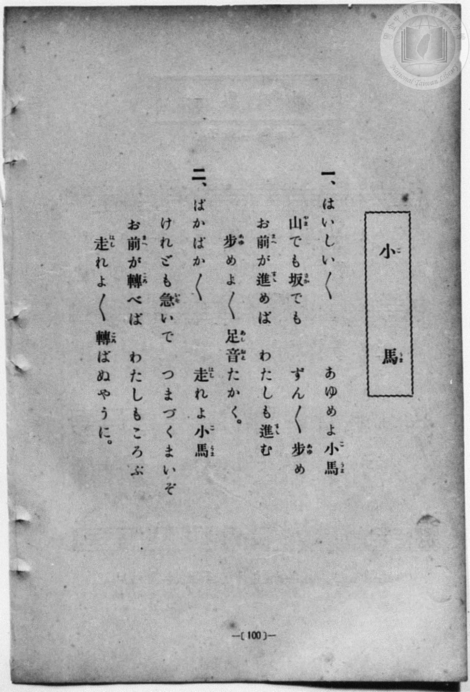
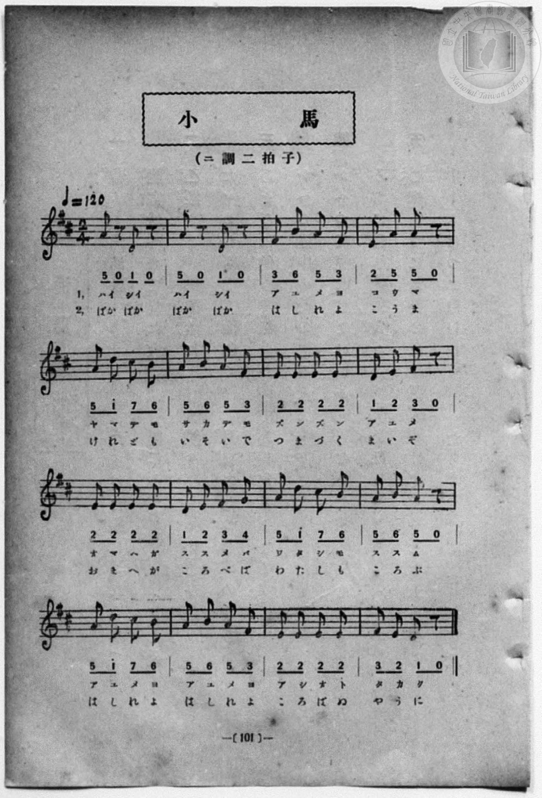

# 小馬

> Re:Shōka 使用 AI 協助辨識與重建樂譜，可能會有錯誤。歡迎回報。

- **鋼琴伴奏版**：<br><audio controls src="kouma.mp3"></audio>
- **NEUTRINO 歌聲合成版**：<br><audio controls src="kouma_neutrino.mp3"></audio>

- 一條慎三郎 編《新編 小學校・公學校 唱歌教材集》（大正十二年十二月，索書號 0725-41）
- 尋常科第一、二學年用（第 100–101 頁）
- 文部省

## 說明

原書資訊與歌詞全文（對應 P108.jpg–P109.jpg，書頁 pp. 100–101）：
調性與拍號：ニ調二拍子（D 大調 2/4 拍），♩＝120


## 歌詞

```text
一、
はいしい／＼　あゆめよ小馬
山でも坂でも　ずん／＼歩め
お前が進めば　わたしも進む
歩めよ／＼足音たかく。

二、
ぱかぱか／＼　走れよ小馬
けれども急いで　つまづくまいぞ
お前が轉べば　わたしもころぶ
走れよ／＼轉ばぬやうに。
```

## ABC

```abc
X:1
T:小馬
M:2/4
L:1/16
Q:1/4=120
K:D
V:V1 name="Piano" snm="Pia"
[V:V1]
A2 z2 d2 z2 | A2 z2 d2 z2 | F2 B2 A2 F2 | E2 A2 A2 z2 |
w: 1.~ハイ シイ | ハイ シイ | ア ユ メ ヨ | コ ウ マ
w: 2.~ぱか ぱか | ぱか ぱか | は し れ よ | こ う ま
A2 d2 c2 B2 | A2 B2 A2 F2 | E2 E2 E2 E2 | D2 E2 F2 z2 |
w: 1.~ヤ マ デ モ | サ カ デ モ | ズ ン ズ ン | ア ユ メ
w: 2.~け れ ど も | い そ い で | つ ま づ く | ま い ぞ
E2 E2 E2 E2 | D2 E2 F2 G2 | A2 d2 c2 B2 | A2 B2 A2 z2 |
w: 1.~オ マ ヘ ガ | ス ス メ バ | ワ タ シ モ | ス ス ム
w: 2.~お ま へ が | こ ろ べ ば | わ た し も | こ ろ ぶ
A2 d2 c2 B2 | A2 B2 A2 F2 | E2 E2 E2 E2 | F2 E2 D2 z2 |
w: 1.~ア ユ メ ヨ | ア ユ メ ヨ | ア シ オ ト | タ カ ク
w: 2.~は し れ よ | は し れ よ | こ ろ ば ぬ | や う に
A2 z2 d2 z2 | A2 z2 d2 z2 | F2 B2 A2 F2 | E2 A2 A2 z2 |
w: 1.~ハイ シイ | ハイ シイ | ア ユ メ ヨ | コ ウ マ
w: 2.~ぱか ぱか | ぱか ぱか | は し れ よ | こ う ま
A2 d2 c2 B2 | A2 B2 A2 F2 | E2 E2 E2 E2 | D2 E2 F2 z2 |
w: 1.~ヤ マ デ モ | サ カ デ モ | ズ ン ズ ン | ア ユ メ
w: 2.~け れ ど も | い そ い で | つ ま づ く | ま い ぞ
E2 E2 E2 E2 | D2 E2 F2 G2 | A2 d2 c2 B2 | A2 B2 A2 z2 |
w: 1.~オ マ ヘ ガ | ス ス メ バ | ワ タ シ モ | ス ス ム
w: 2.~お ま へ が | こ ろ べ ば | わ た し も | こ ろ ぶ
A2 d2 c2 B2 | A2 B2 A2 F2 | E2 E2 E2 E2 | F2 E2 D2 z2 |
w: 1.~ア ユ メ ヨ | ア ユ メ ヨ | ア シ オ ト | タ カ ク
w: 2.~は し れ よ | は し れ よ | こ ろ ば ぬ | や う に
```

## TMD 檔案連結

- [主旋律 TMD 檔案](kouma.tmd) [[在 TMD Studio 編輯](https://tmdlang.github.io/Tmd-TS/#tmd=s7IKdvYPcrWy4qpTUCpJTLdSSM7PyUlNLsnMz7MqzsjPTozPrsyvSsyML84ojTe0NDJWgqssy88pzU21Si9KTEmNN4w3QsgU55cWJadaFSdn5OfnxJekVpQk5edno8vHFySmp1oFGBpYIGQKivLLUvMS84C6C4oy80pSU8DaEQpSyzJTUkHSxcmJefFlqUWZaZmpKUiOSi0qBrsdYkVJUWJecXJRZgHIQwhV-UUlGflAhxdkVFplZBaX5BdlJifmxGcn5iUiFJVkpAK9l5iXmZuYg6w1Mz0zzyo3Py-pFBhASlxaWgpPN_S_XLZGQUuLS9FWwdDIgMveVsGFy8ZI38QOpO_JjoZni-Y-a-17sqPzZXOfwvPtKx43dD2btgHIAOl9unbHswULHzfvftq6BsJWeDpl47O1Pc-mznw2d8LL2W2PG7rf7-l4umT5s7WLn_Y2PtnV83TnFgjj2ZyO93t6nm9Z9Gz2jhcz5ysYmBuZ6poYvt_TCXbz0w3dT3fseL584vM1a4DueNwA1rx2B1D_8ykrgIYCxRUMDQweNUw2NDBUeLmgEabz2bT2l80rns9pVOLi0tdSsKUW4FJQUHjaNx_k3M3tL1Z0vehoB3r1xcp5T1tXAO0E-XND77P2TgVQytDLKkgHOg3ItAQxgT4F6gM6UqGgQA_hbKCT3--ZBTL4xar9zxqWg4zs7gWGBlD0cXM3UBAUUN29T9dOABrvogAMSKCYAjB-FICiYN09j2aufL9nLijyQOZAggrEety4_nFjy-PG6UDy_Z7-93v2PG5oeNzY9Lip7XFT4-MmoGtBkQ_21caNjxuXP25qejq3CcIAK531uGkyROeztSuBeiCmdj3t7H3c2POyYRPImMYNIKVN_Y8b54OsamoCizeAlEI0AS2CmPFi2-aX8zeD1XU_bux_3NAEcfCuHriDga4ASoFIuINfbN3wuKkHxbWPGyeChBqBpjc9a1gK9uRysIOXPG7c97gRKAJ0DpABFJ-H4uYXezsfN-7EdPPjxsmPm4AKtoFjAmYj1NkgPRseN6553AQ0r-1x42qQy4HqKE9QUKCgpc_F5Z1fmptoFZCZmJfvUGNQUw2yQcHG0EzLDszClo4VIDnjxcIeBQ0TUHZ8vr5BB5T4wClOE4sGoEUgw2oUTBV0FQyA2DAOysAqZAwkzYAYJAVi1ygYQXkwxTVg83wMaxQeN_c_bloCFIoH4sdN2xEcAnJNi0CCzcvA5EIwuQIqsxmsHCIzD6YDYqMRUB6cUGCmInMIya0HC04Hm94DJjugMpPBMm1gch_cRvwxsKuH3BgAB7U5NJAhQpjBjYxrFAyhLJA8egSAAhUSUI-b28EkKGhBAbkV7MnVWGR2gXmQgEawsUULeuBPRARf40owuwkaiC1gsblgEsJeDpUBuxAcsMBcCib7oTIQMYhqRFQTSPqd5AQ8_jA1gccEnshBC_imVUgBPwMcFGuggbgTzAOT0LQ9ASLTDE6DTfvB5HaUKEHWswBLwHchBeIOMAmKBHjqbeoFi4H1N26AmgkKZmBpByYh6R4WWch6thEX8E9nz6ZjigeJg1igWEIPeNxFBwEZSJBDIw6a-aGRAc4lTaDoQQ943MUGgQIFGrygyADWI1DbIGkdUtSA7ITYVsvFpWunAK4MFJAZylwA)]
- [鋼琴伴奏 TMD 檔案](kouma_piano.tmd) [[在 TMD Studio 編輯](https://tmdlang.github.io/Tmd-TS/#tmd=s7IKdvYPcrWy4qpTUCpJTLdSSM7PyUlNLsnMz7MqzsjPTozPrsyvSsyML84ojTe0NDJWgqssy88pzU21Si9KTEmNN4w3QsgU55cWJadaFSdn5OfnxJekVpQk5edno8vHFySmp1oFGBpYIGQKivLLUvMS84C6C4oy80pSU8DaEQpSyzJTUkHSxcmJefFlqUWZaZmpKUiOSi0qBrsdYkVJUWJecXJRZgHIQwhV-UUlGflAhxdkVFplZBaX5BdlJifmxGcn5iUqcWlpKTzd0P9y2Zr3ezpezp75rLP7Zfee5xO2PNmz5enS_vd7OhW0tLgUbRUMjQy47G0VXLhsjPRN7EBmP9nR8GzR3GetfU92dL5s7lN4vn3F44auZ9M2ABkgM5-u3fFswcLHzbuftq6BsBWeTtn4bG3Ps6kzn82d8HJ22-OGbqCtT5csf7Z28dPexie7ep7u3AJhPJvT8X5Pz_Mti57N3vFi5nwFA3MjU10TQ6B7wP56uqH76Y4dz5dPfL5mDdAdjxvAmtfuAOp_PmUF0FCguIKhgcGjhsmGBoYKLxc0wnQ-m9b-snnF8zmNSlxc3vmluYlWAZmJeflBHg41BjXVXApAYGNopmUHZulrKdiiAwWIlS8W9ihomID8-Xx9g44CMGIt9bIK0jWxaNDSBxtWo2CqoKtgAMSGcVAGViFjIGkGxCApELtGwQjKgymuAZvnY1ij8Li5_3HTEqBQPBA_btqO4BCQa1oEEmxeBiYXgskVUJnNYOUQmXkwHRAbjYDyjRsfN3bDTEXmEJJbDxacDja9B0x2QGUmg2XawOQ-uI34Y2BXD7kxAA5qc2ggQ4QwgxsZ1ygYQlkgefQIAAUqJKAeN7eDSVDQggJyK9iTq7HI7ALzIAGNYGOLFvTAn4gIvsaVYHYTNBBbwGJzwSSEvRwqA3YhOGAfNy4Fk_1QGYgYRDUiqgkk_U5yAh5_mJrAYwJP5KAFfNMqpICfAQ6KNdBA3AnmgUlo2p4AkWkGp8Gm_WByO0qUIOtZgCXgu5ACcQeYBEUCPPU29YLFwPobN0DNBAXz48b5YBKS7mGRhaxnG3EB_3T2bDqmeJA4iAWKJfSAx110EJCBBDk04qCZHxoZ4FzSBIoe9IDHXWwQKFCgwQuKjMeNsKQBSeuQogZkJ8S2WpS6wAe5LjBBVAUv9kx9un81sKp8sbMFGAHA6vHp9mXAChNSVSKC3DBeIdowFivDND4eGJwQ7-GSjzaNh4ohVKKKY5pOmplA7-raKYB9HO0DVIPgGIE5ylwA)]

## 分析

```text
================================================================================
📊 TMD Song Profile: [ 小馬 ]
================================================================================
⏱  Duration:       0:32 (32.0s), 32 measures total
🎼 Key & Tempo:    首調基準 D, != 120.0 BPM, <2/4>
   - 分析範圍：      由實際發聲的音符與和弦推測調性；播放脈絡另行呈現
🎤 人聲音域:    D4 (MIDI 62) – D5 (MIDI 74) [跨度: 12 個半音 / 1.0 個八度, 難度: easy]
   - 最低音:  D4 in [Kouma #1 @ m.8, 0:07]
   - 最高音: D5 in [Kouma #1 @ m.1, 0:00]
   - 適合: soprano, mezzo-soprano, contralto, tenor, baritone, bass
🏛  結構:      Kouma (16.0s) -> Kouma (16.0s)
⚡ 編曲密度:        Peak 1 軌道同時演奏
🗝  調性診斷：       A 大調（純淨自然大調，未偵測到可信轉調）
   - 風格氣質:    純淨自然大調（陽光明朗、易唱易記，無明顯調外色彩）
   - 轉調歷程:    全曲維持單一推測調性（未偵測到可信轉調）
   - 核心骨幹音:  E, A, D, F#, B
   - 調性數值:    A 大調 [相關度: 0.90, 穩定度: High, 自然音純度: 98.2%]
   - 候選調性 (K-S): A 大調 (0.90), E 大調 (0.67), D 大調 (0.64)
   - 五度圈歷程:   +3 -> +3
   - 各段落調性細節:
     • [Kouma #1]: A 大調 (r: 0.90, 自然音純度: 98.2%, 調外音: G)
     • [Kouma #2]: A 大調 (r: 0.90, 自然音純度: 98.2%, 調外音: G)

  [ 五度圈游移軌跡 ]
               C  
         F            G  
      Bb               D  
      Eb              [A ]*
         Ab           E  
            Db       B  
               F# 
     (* = active key center)

  [ 十二半音累積音高分佈 ]
     C  :                            0.0%
     C# : █████                      5.4%
     D  : ████████████              14.3%
     D# :                            0.0%
     E  : ████████████████████████  28.6%
     F  :                            0.0%
     F# : ███████████               12.5%
     G  : ██                         1.8%
     G# :                            0.0%
     A  : █████████████████████     25.0%
     A# :                            0.0%
     B  : ███████████               12.5%
--------------------------------------------------------------------------------
Assignment 軌道音域：
  - Piano         : D4 – D5 (12 個半音 / 1.0 個八度, 112 個音符)
================================================================================
```


## 原書掃描頁






