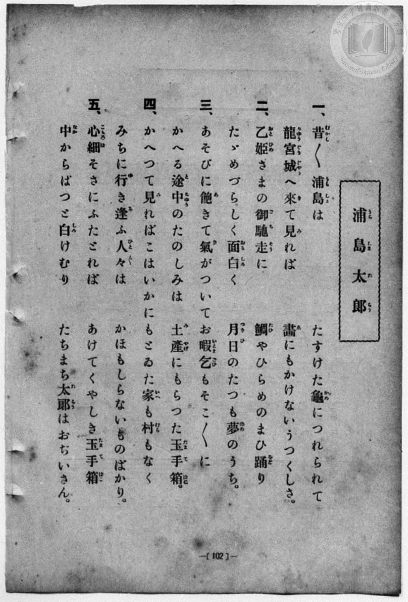
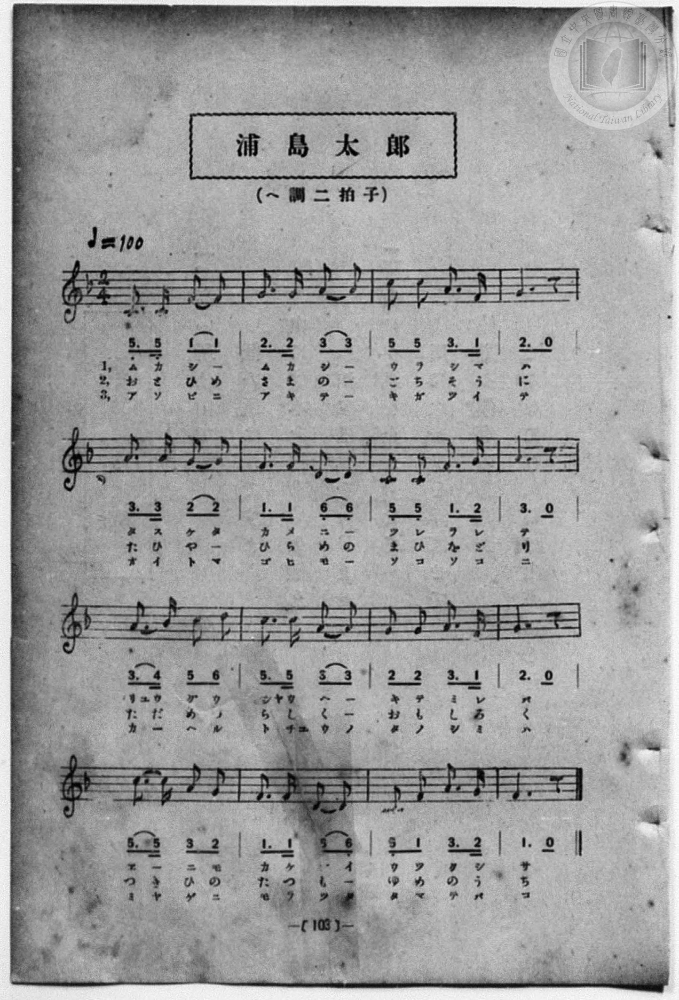

# 浦島太郎

> Re:Shōka 使用 AI 協助辨識與重建樂譜，可能會有錯誤。歡迎回報。

<audio controls src="urashima_taro.mp3"></audio>

- 一條慎三郎 編《新編 小學校・公學校 唱歌教材集》（大正十二年十二月，索書號 0725-41）
- 尋常科第一、二學年用（第 102–103 頁）
- 文部省

## 說明

原書資訊與歌詞全文（對應 P110.jpg–P111.jpg，書頁 pp. 102–103）：
調性與拍號：ヘ調二拍子（F 大調 2/4 拍），♩＝100


## 歌詞

```text
一、
昔／＼浦島は　たすけた龜につれられて
龍宮城へ來て見れば　畫にもかけないうつくしさ。

二、
乙姫さまの御馳走に　鯛やひらめのまひ踊り
たゞめづらしく面白く　月日のたつも夢のうち。

三、
あそびに飽きて氣がついて　お暇乞もそこ／＼に
かへる途中のたのしみは　土産にもらつた玉手箱。

四、
かへつて見ればこはいかに　もとゐた家も村もなく
みちに行き逢ふ人々は　かほもしらないものばかり。

五、
心細さにふたとれば　あけてくやしき玉手箱
中からぱつと白けむり　たちまち太郎はおぢいさん。
```

## ABC

```abc
X:1
T:浦島太郎
M:2/4
L:1/16
Q:1/4=100
K:F
V:V1 name="Piano" snm="Pia"
[V:V1]
C3 C F2 F2 | G3 G A2 A2 | c2 c2 A3 F | G6 z2 |
w: む か し _ | む か し _ | う ら し ま | は
A3 A G2 G2 | F3 F D2 D2 | C2 C2 F3 G | A6 z2 |
w: た す け た | か め に _ | つ れ ら れ | て
A3 B c2 d2 | c3 c A2 A2 | G2 G2 A3 F | G6 z2 |
w: りゆ う ぐ う | じや う へ _ | き て み れ | ば
c3 c A2 G2 | F3 F D2 D2 | C2 F2 A3 G | F6 z2 |
w: ゑ _ に も | か け な い | う つ く し | さ
C3 C F2 F2 | G3 G A2 A2 | c2 c2 A3 F | G6 z2 |
w: お と ひ め | さ ま の _ | ご ち そ う | に
A3 A G2 G2 | F3 F D2 D2 | C2 C2 F3 G | A6 z2 |
w: た ひ や _ | ひ ら め の | ま ひ お ど | り
A3 B c2 d2 | c3 c A2 A2 | G2 G2 A3 F | G6 z2 |
w: た だ め づ | ら し く _ | お も し ろ | く
c3 c A2 G2 | F3 F D2 D2 | C2 F2 A3 G | F6 z2 |
w: つ き ひ の | た つ も _ | ゆ め の う | ち
C3 C F2 F2 | G3 G A2 A2 | c2 c2 A3 F | G6 z2 |
w: あ そ び に | あ き て _ | き が つ い | て
A3 A G2 G2 | F3 F D2 D2 | C2 C2 F3 G | A6 z2 |
w: お い と ま | ご ひ も _ | そ こ そ こ | に
A3 B c2 d2 | c3 c A2 A2 | G2 G2 A3 F | G6 z2 |
w: か へ る と | ちゆ う の _ | た の し み | は
c3 c A2 G2 | F3 F D2 D2 | C2 F2 A3 G | F6 z2 |
w: み や げ に | も ら つ た | た ま て ば | こ
C3 C F2 F2 | G3 G A2 A2 | c2 c2 A3 F | G6 z2 |
w: か へ つ て | み れ ば _ | こ は い か | に
A3 A G2 G2 | F3 F D2 D2 | C2 C2 F3 G | A6 z2 |
w: も と ゐ た | い へ も _ | む ら も な | く
A3 B c2 d2 | c3 c A2 A2 | G2 G2 A3 F | G6 z2 |
w: み ち に ゆ | き あ ふ _ | ひ と び と | は
c3 c A2 G2 | F3 F D2 D2 | C2 F2 A3 G | F6 z2 |
w: か ほ も し | ら な い _ | も の ば か | り
C3 C F2 F2 | G3 G A2 A2 | c2 c2 A3 F | G6 z2 |
w: こ こ ろ ぼ | そ さ に _ | ふ た と れ | ば
A3 A G2 G2 | F3 F D2 D2 | C2 C2 F3 G | A6 z2 |
w: あ け て く | や し き _ | た ま て ば | こ
A3 B c2 d2 | c3 c A2 A2 | G2 G2 A3 F | G6 z2 |
w: な か か ら | ぱ つ と _ | し ろ け む | り
c3 c A2 G2 | F3 F D2 D2 | C2 F2 A3 G | F6 z2 |
w: た ち ま ち | た ら う は | お ぢ い さ | ん
```

## TMD 檔案連結

- [主旋律 TMD 檔案](urashima_taro.tmd) [[在 TMD Studio 編輯](https://tmdlang.github.io/Tmd-TS/#tmd=s7IKdvYPcrWy4qpTUCpJTLdSSM7PyUlNLsnMz7MqzsjPTozPrsyvSsyML84ojTe0NDJWgqssy88pzU21Si9KTEmNN4w3QsgU55cWJadaFSdn5OfnxJekVpQk5edno8vHFySmp1oFGBoaIGQKivLLUvMS84C6C4oy80pSU8DaEQpSyzJTUkHSxcmJefFlqUWZaZmpKUiOSi0qBrsdYkVJUWJecXJRZgHIQwhV-UUlGflAhxdkVFplZBaX5BdlJifmxGcn5iUiFJVkpAK9l5afk52TX5SqxKWlpfBs67Knm7c9XbLqZXOfgpYWl6KtgqGBAZe9rYIbl42RvokdSPOTHQ3PFs191tr3ZEcnSN3z7SseN3Q9m7YByFB4uqH_6dodzxYsfNy8-2nrGghb4emUjc_W9jybOvPZ3AkvZ7c9buh-v6fj6ZLlz9Yuftrb-GRXz9OdWyCMZ3M63u_peb5l0bPZO17MnK9gYG5kqmti-H5PJ9jhTzd0P92x4_nyic_XrAG643EDWPPaHUD9z6esABoKFAc62ehRw2RDA2OFlwsaYTqfTWt_2bzi-ZxGJS4ufS0FW2oBLgUFhad980HO3dz-YkXXi452oFdfrJz3tHUF0E6QPzf0PmvvVAAlBL2sgnSg04BMQxAT6FOgPqAjFQoK9BDOBjr5_Z5ZIINfrNr_rGE5yMjuXmBoAEUfN88ACoICqrv36doJQOPdFIABCRRTAMaPAlAUrLvn0cyV7_fMBUUeyBxIUIFYz2ZMeb-n__2ePZCofty4_nFDw-PG-Y8bZz5unAhkvNw353Hj6seNSx439Txu6gSRjctAOl_u6326bt3T-X2PG3c82dcGFH2xrBssvQFoxPOpQD2rHzc1PW7sBhu06nFjy-NGoLIljxv7HzdOf9w49XFDE8Q1u3qgrnmyc-bT5UCNUx837nvcuO7pvoUvl21-sXUDyKiGhpfrZz9uAhqyCeyORqACsLJNL3Z0PW7qAukHObxpHlhuKUgRyJr-l3MXPZ-5F2RrQwMwOT2bvhSsE-hFoJ-ani5ZBOYCXbYQ7qAdnVAHPW4EemDu48bNQBe8XAw0pBfoz2cbFj9uBPoT6BOga5aBA6zr2az2JzuBVkPUT4YEKlAXxBRgGOx43NT9smHKkx1rYdYDSaD79kPC_Omc-c-nAM0FhxnI6UDT5z_v63zW2f183UaYy57Ong13GdhMkDKkgG-cDDIN5CygLCjMwA5a8bhpAtC0p-u2AbnP5k4ECwIjpB9iENAFC4GqXywEGtH7sgEYHluf7Nr1uKEVlhqAZu0G65kOdhk4KkFcoAeAVgLt7kJE5RSo-57ub36-BSgLjEpghG4FexjoDmjyAIcrMFUsA0ULKE6BAdEL9y0kDoDhBDQaaN9GsC9XgCMR6Hagn4D2QRIp0N3AFLAQUkKBvd71uBHoAaCJUx83TQY5C2gW5bkaChS09Lm4QosSizMycxNDEovyrQIyE_PyHWoMaqpBFinYGJpp2YFZNQqm8Qq6QAikDIEUCNcoGIGFjBSMgSQIA1WBlEB5IFUwNRBoAFIDNs_HsEYB6HewKDBggHg6VA0e8cY2kGhTJ1gOIg4MMLDMeiRbQA6F2mIEkuuCqlwBxJvAJjRCzZsKNwMY-0j2TAGLLgSTc6Fq2sAyq7HbYwySa4KqnAvEm8EskGpkmV4gXoZkTy9YtAdMLoGqaQHLwFSh2WMCkuuGqtwB1QVRDZLZD5Fp6gGyNyDZMxmsChRGIPNhYYvHP6YwXSCVk4EmQly6B2oeLEymIpkAEt8KFp0PJlfA3QKSgbkG1Z4aaDoxBqcSEK4BpyxQyjEDKQMT0LQHJiCyRnCdWNMV2AUgN8wE4olwNyGFHTAFoLocHI5At8LSF8LlOGICnLJg9mwCqoaEK8Q0UCqDmARJa5DUBZLZB1UPImHpciU4zUN42FMWTGULNFwh5sBSKswFkFSGiCFYvMNiazK-GAelLKgJ4JzSNAEl3GCpBpjmkO0B51RojoTrXgXW0Y_dHnDKgqmcCA1fiGqQeTB7pkNzB8w_kDQFCT1IjIDSFCKV4kpZJuDSyAxsCogFKp0QpRUs1RFXWgGrZVABBCkMHjdCAggkAnLGDITbQZI7kNwO8gfMn4gcijtXoKatBfA0tBQaRtD0CQ4jWCjDUgkkFuClIzDf4okLcNpCKk2aQGxICgPJLET1L3IBCYkOkAiiIN6PryAGF1xQzwMLVkgyhJgPCyKQTBMQgwoRmD2QjAJJ8qAiFcLDYw84ea2CqgRVH2AvgYMMJLMRKrMEairMHpAfYIUcqMAA8RrwZEvUxESg4AJJQFIYqNyCKMOewiBWgxwBCR5QXCLHESi_gDwHyY_wGhFaC0BiGeQZRN2GPW3B6ppeeBDDyidYqgMGEEo-h9S8iLIMkijAqQS7PeC0BUvtoHJrEtxfSCUNqISEuh5W0pCa01HrxN0oOQA5t6yChhrMRxBVkCQMyYfQOhFXSQxOWrDwASVhiBtB_keSAfsIEiugJArPl42LwCSsjJgKtgnTR7VcXLp2Cshtsmgfw1gFDDEjLGLGWMRMsIiZgsWUuQA)]
- [鋼琴伴奏 TMD 檔案](urashima_taro_piano.tmd) [[在 TMD Studio 編輯](https://tmdlang.github.io/Tmd-TS/#tmd=s7IKdvYPcrWy4qpTUCpJTLdSSM7PyUlNLsnMz7MqzsjPTozPrsyvSsyML84ojTe0NDJWgqssy88pzU21Si9KTEmNN4w3QsgU55cWJadaFSdn5OfnxJekVpQk5edno8vHFySmp1oFGBoaIGQKivLLUvMS84C6C4oy80pSU8DaEQpSyzJTUkHSxcmJefFlqUWZaZmpKUiOSi0qBrsdYkVJUWJecXJRZgHIQwhV-UUlGflAhxdkVFplZBaX5BdlJifmxGcn5iUqcWlpKTzbuuzp5m1Pl6x62dz3fk_Hy9kzn3V2v-ze83zClid7tjxd2v9-T6eClhaXoq2CoYEBl72tghuXjZG-iR3Ihic7Gp4tmvuste_Jjk6gfoXn21c8buh6Nm0DkKHwdEP_07U7ni1Y-Lh599PWNRC2wtMpG5-t7Xk2deazuRNezm573NANtPXpkuXP1i5-2tv4ZFfP051bIIxnczre7-l5vmXRs9k7Xsycr2BgbmSqa2IIdA_Yd083dD_dseP58onP16wBuuNxA1jz2h1A_c-nrAAaChQHOtnoUcNkQwNjhZcLGmE6n01rf9m84vmcRiUurtCixOKMzNzEkMSifKuAzMS8_CAPhxqDmmouBSCwMTTTsgOzahRM4xV0gRBIGQIpEK5RMAILGSkYA0kQBqoCKYHyQKpgaiDQAKQGbJ6PYY3C46YGsOjjxm4gng5Vg0e8sQ0k2tQJloOIP27cB5ZZj2QLyKFQW4xAcl1QlSuAeBPYhEaoeVPhZjxuXIdkzxSw6EIwOReqpg0ssxq7PcYguSaoyrlAvBnMAqlGlukF4mVI9vSCRXvA5BKomhawDEwVmj0mILluqModUF0Q1SCZ_RCZph4gewOSPZPBqkBhBDIfFrZ4_GMK0wVSORloIsSle6DmwcJkKpIJIPGtYNH5YHIF3C0gGZhrUO2pgaYTY3AqAeEacMoCpRwzkDIwAU17YAIiawTXiTVdgV0AcsNMIJ4IdxNS2AFTAKrLweEIdCssfSFcjiMmwCkLZs8moGpIuEJMA6UyiEmQtAZJXSCZfVD1IBKWLleC0zyEhz1lwVS2QMMVYg4spcJcAElliBiCxTsstibji3FQyoKaAM4pTRNQwg2WaoBpDtkecE6F5ki47lVgHf3Y7QGnLJjKidDwhagGmQezZzo0d8D8A0lTkNCDxAgoTSFSKa6UZQIujczApoBYoNIJUVrBUh1xpVXX4yZQAQQpDB43QgIIJAJyxgyE20GSO5DcDvIHzJ-IHIo7V6CmrQXwNLQUGkbQ9AkOI1gow1IJJBbgpSMw3-KJC3DaQipNmkBsSAoDySxE9S9yAQmJDpAIoiDej68gBhdcUM8DC1ZIMoSYDwsikEwTEIMKEZg9kIwCSfKgIhXCw2MPOHmtgqoEVR9gL4GDDCSzESqzBGoqzB6QH2CFHKjAAPEa8GRL1MREoOACSUBSGKjcgijDnsIgVoMcAQkeUFwixxEov4A8B8mP8BoRWgtAYhnkGUTdhj1tweqaXngQw8onWKoDBhBKPofUvIiyDJIowKkEuz3gtAVL7aByaxLcX0glDaiEhLoeVtKQmtNR68TdKDkAObesgoYazEcQVZAkDMmH0DoRV0kMTlqw8AElYYgbQf5HkgH7CBIroCQKz5eNi8AkrIyYCrYJ00e12JpkPshNMhN4i8wwXiHaMBacymAsFCEDeGIFCZvGwxSYwFlwMVSlJhhGkW0o0D-6dgrIXor2AZqFIWaERcwYixjQaRhipmAxZS4A)]

## 分析

```text
================================================================================
📊 TMD Song Profile: [ 浦島太郎 ]
================================================================================
⏱  Duration:       1:36 (96.0s), 80 measures total
🎼 Key & Tempo:    首調基準 F, != 100.0 BPM, <2/4>
   - 分析範圍：      由實際發聲的音符與和弦推測調性；播放脈絡另行呈現
🎤 人聲音域:    C4 (MIDI 60) – D5 (MIDI 74) [跨度: 14 個半音 / 1.2 個八度, 難度: moderate]
   - 最低音:  C4 in [UrashimaTaro[L1] #1 @ m.1, 0:00]
   - 最高音: D5 in [UrashimaTaro[L1] #1 @ m.9, 0:10]
   - 適合: soprano, mezzo-soprano, contralto, tenor, baritone, bass
🏛  結構:      UrashimaTaro[L1] (19.2s) -> UrashimaTaro[L2] (19.2s) -> UrashimaTaro[L3] (19.2s) -> UrashimaTaro[L4] (19.2s) -> UrashimaTaro[L5] (19.2s)
⚡ 編曲密度:        Peak 1 軌道同時演奏
🗝  調性診斷：       F 大調（純淨自然大調，未偵測到可信轉調）
   - 風格氣質:    純淨自然大調（陽光明朗、易唱易記，無明顯調外色彩）
   - 轉調歷程:    全曲維持單一推測調性（未偵測到可信轉調）
   - 核心骨幹音:  A, G, F, C, D
   - 調性數值:    F 大調 [相關度: 0.75, 穩定度: Moderate, 自然音純度: 100.0%]
   - 候選調性 (K-S): F 大調 (0.75), C 大調 (0.71), A 小調 (0.67)
   - 五度圈歷程:   -1 -> -1 -> -1 -> -1 -> -1
   - 各段落調性細節:
     • [UrashimaTaro[L1] #1]: F 大調 (r: 0.75, 自然音純度: 100.0%)
     • [UrashimaTaro[L2] #1]: F 大調 (r: 0.75, 自然音純度: 100.0%)
     • [UrashimaTaro[L3] #1]: F 大調 (r: 0.75, 自然音純度: 100.0%)
     • [UrashimaTaro[L4] #1]: F 大調 (r: 0.75, 自然音純度: 100.0%)
     • [UrashimaTaro[L5] #1]: F 大調 (r: 0.75, 自然音純度: 100.0%)

  [ 五度圈游移軌跡 ]
               C  
        [F ]*          G  
      Bb               D  
      Eb               A  
         Ab           E  
            Db       B  
               F# 
     (* = active key center)

  [ 十二半音累積音高分佈 ]
     C  : ██████████████████        20.0%
     C# :                            0.0%
     D  : ████████                   8.3%
     D# :                            0.0%
     E  :                            0.0%
     F  : ███████████████████       20.8%
     F# :                            0.0%
     G  : █████████████████████     23.3%
     G# :                            0.0%
     A  : ████████████████████████  26.7%
     A# : █                          0.8%
     B  :                            0.0%
--------------------------------------------------------------------------------
Assignment 軌道音域：
  - Piano         : C4 – D5 (14 個半音 / 1.2 個八度, 260 個音符)
================================================================================
```


## 原書掃描頁






