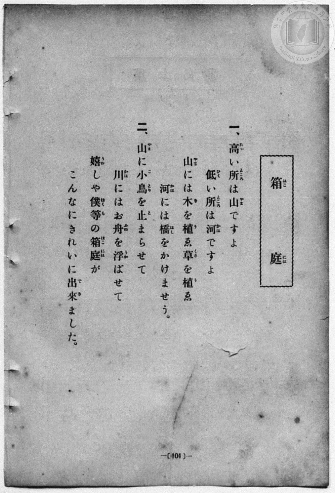
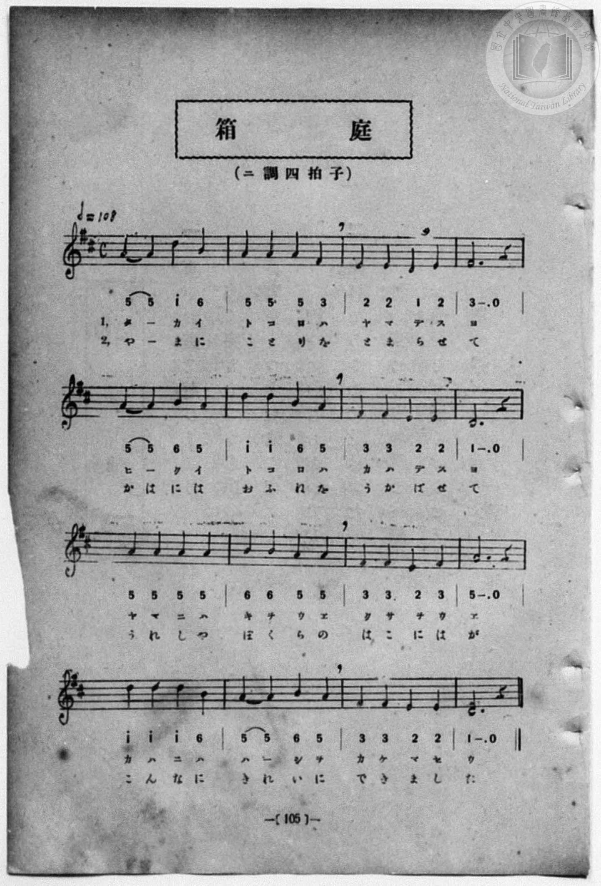

# 箱庭

> Re:Shōka 使用 AI 協助辨識與重建樂譜，可能會有錯誤。歡迎回報。

- **鋼琴伴奏版**：<br><audio controls src="hakoniwa.mp3"></audio>
- **NEUTRINO 歌聲合成版**：<br><audio controls src="hakoniwa_neutrino.mp3"></audio>

- 曲：小松耕輔
- 一條慎三郎 編《新編 小學校・公學校 唱歌教材集》（大正十二年十二月，索書號 0725-41）
- 尋常科第一、二學年用（第 104–105 頁）

## 說明

曲目說明
中文解釋：描寫箱庭中的小型山水與庭園景色，像一個縮小的世界。

原書資訊與歌詞全文（對應 P112.jpg–P113.jpg，書頁 pp. 104–105）：
調性與拍號：ニ調四拍子（D 大調 4/4 拍），♩＝108


## 歌詞

```text
一、
高い所は山ですよ
低い所は河ですよ
山には木を植ゑ草を植ゑ
河には橋をかけませう。

二、
山に小鳥を止まらせて
川にはお舟を浮ばせて
嬉しや僕等の箱庭が
こんなにきれいに出來ました。
```

## ABC

```abc
X:1
T:箱庭
C:曲：小松耕輔
M:4/4
L:1/16
Q:1/4=108
K:D
V:V1 name="Piano" snm="Pia"
[V:V1]
A4 A4 d4 B4 | A4 A4 A4 F4 | E4 E4 D4 E4 | F12 z4 |
w: 1.~タ _ カ イ | ト コ ロ ハ | ヤ マ デ ス | ヨ
w: 2.~や _ ま に | こ と り を | と ま ら せ | て
A4 A4 B4 A4 | d4 d4 B4 A4 | F4 F4 E4 E4 | D12 z4 |
w: 1.~ヒ _ ク イ | ト コ ロ ハ | カ ハ デ ス | ヨ
w: 2.~か は に は | お ふ ね を | う か ば せ | て
A4 A4 A4 A4 | B4 B4 A4 A4 | F4 F4 E4 F4 | A12 z4 |
w: 1.~ヤ マ ニ ハ | キ ヲ ウ ヱ | ク サ ヲ ウ | ヱ
w: 2.~う れ し や | ぼ く ら の | は こ に は | が
d4 d4 d4 B4 | A4 A4 B4 A4 | F4 F4 E4 E4 | D12 z4 |
w: 1.~カ ハ ニ ハ | ハ _ シ ヲ | カ ケ マ セ | ウ
w: 2.~こ ん な に | き れ い に | で き ま し | た
A4 A4 d4 B4 | A4 A4 A4 F4 | E4 E4 D4 E4 | F12 z4 |
w: 1.~タ _ カ イ | ト コ ロ ハ | ヤ マ デ ス | ヨ
w: 2.~や _ ま に | こ と り を | と ま ら せ | て
A4 A4 B4 A4 | d4 d4 B4 A4 | F4 F4 E4 E4 | D12 z4 |
w: 1.~ヒ _ ク イ | ト コ ロ ハ | カ ハ デ ス | ヨ
w: 2.~か は に は | お ふ ね を | う か ば せ | て
A4 A4 A4 A4 | B4 B4 A4 A4 | F4 F4 E4 F4 | A12 z4 |
w: 1.~ヤ マ ニ ハ | キ ヲ ウ ヱ | ク サ ヲ ウ | ヱ
w: 2.~う れ し や | ぼ く ら の | は こ に は | が
d4 d4 d4 B4 | A4 A4 B4 A4 | F4 F4 E4 E4 | D12 z4 |
w: 1.~カ ハ ニ ハ | ハ _ シ ヲ | カ ケ マ セ | ウ
w: 2.~こ ん な に | き れ い に | で き ま し | た
```

## TMD 檔案連結

- [主旋律 TMD 檔案](hakoniwa.tmd) [[在 TMD Studio 編輯](https://tmdlang.github.io/Tmd-TS/#tmd=s7IKdvYPcrWy4qpTUCpJTLdSSM7PyUlNLsnMz7MqzsjPTozPrsyvSsyML84ojTe0NDJWgqssy88pzU21Si9KTEmNN4w3QsgU55cWJadaFSdn5OfnxJekVpQk5edno8vHFySmp1oFGBoi6Swoyi9LzUvMA-ouKMrMK0lNAWtHKEgty0xJBUkXJyfmxZelFmWmZaamIDkqtagY7HaIFSVFiXnFyUWZBSAPIVTlF5Vk5AMdXpBRaZWRWVySX5SZnJgTn52Yl4hQVJKRCvReXmJJaVEqstbM9Mw8q5LETGDwAEMlvzwxPjcxMy8nMQ_oDC0thefrNj7dtVZBS4tL0VbB0MCCy95WwYXLxkTfxA5kyJMdDc8WzX3W2vdkR-fL5j6F59tXPG7oejZtA5Ch8HRD_9O1O54tWPi4effT1jUQtsLTKRufre15NnXms7kTXs5ue9zQ_X5Px9Mly5-tXfy0t_HJrp6nO7dAGM_mdLzf0_N8y6Jns3e8mDlfwcDcyFTXxPD9nk6wB55u6H66Y8fz5ROfr1kDdMfjBrDmtTuA-p9PWQE0FCgOdLLJo4bJhgamCi8XNMJ0Ppu96f2eWUDnPZu770XD1Bd7pihx6WspAIWfz173YtWqZzP6uBQUFJ7sWPtsWvuL5YtftgPdOOtZf__T9ashAQKUej6rBeTBed1PN258tmHLi452oPjTOZOezVz_ohNofs_T5n6gs542dD_fsQ6oEqj-yY5pz6f2PG5o4tLS5wLZaEstAHLu0775oIDa3P5iRRfQNcBAfrFy3tPWFUA_gEJ4Q--z9k4FUALVyypIBwYKkGkMYgKdCtQHDB6FggI9RIABAwvoaZDBL1btf9awHGRkdy8wHoCij5u7gYJPZ88GijxdOwFovIsCMAqBYgrAlKEAFAXr7nk0c-X7PXNByQYSnqBIArFerp7xuLHlWWfD48b1wOB73Lj8cePMx00dYFV7--ByzzZtRpEDq10Nkpiz4nHTpGdLeh83TXzR2wlngxSBNYEVrewGSjxu7H7cOPFx477HjbMfNwLTWxPEMbuAEQF2DMRQYAy93LwUZNDaRSDFTZ1g9cvAKrbPhZj4uBEYsvNBiraue9y4AUnFGqDy6Y-bWp42T32-FsheB0knjxt7QNKPGyc_bpr8uHEV2BigQ3uAXgRZ2r7ryb42sNumP26cD3IbUDXlyQEKFEDJzCMxOz8vszzRKiAzMS_focagphpkiYKNiZYdmFGjYAqEhnEKZlCmqYIxkGUEhIZAXAPk6QKhgUINWLmPYY3C46b9QJHHTauBeAlQxePmDiBrM5BeC8T9YJElQDwPiNuBMjvBIivA5sTDzDECmdMCMqdxHxCvBqlpnAzEK4DiXUA8CSwC5IHkmzqB9GywyDIUcyBuNgPiGpAnwP4AsY2BEOQHoCim-5sngd2_Hrf7QX4Dsgi4v7EbiIGmAF0PokEiQJc3bgVioElQH7RB1W3A6wMQrAG6HeR6hPtBMWGKxf2w0AWaC3UvyOWbgPQyIL0RLALyHdAlUFGQro1YfAB0XVMPkJ4Ojg2QyB4gBvocHOLrwCIgH4JiBuHLHjQfQEIeKREREQnwIIZ7AkiComU72NFQFU0bIV5t2g0WQQ06iBeATmsCOW8VPBn1Qj3VAhdZDhEFJ7XpYJH5cJNqubh07RRgGUUBja3MBQA)]
- [鋼琴伴奏 TMD 檔案](hakoniwa_piano.tmd) [[在 TMD Studio 編輯](https://tmdlang.github.io/Tmd-TS/#tmd=s7IKdvYPcrWy4qpTUCpJTLdSSM7PyUlNLsnMz7MqzsjPTozPrsyvSsyML84ojTe0NDJWgqssy88pzU21Si9KTEmNN4w3QsgU55cWJadaFSdn5OfnxJekVpQk5edno8vHFySmp1oFGBoi6Swoyi9LzUvMA-ouKMrMK0lNAWtHKEgty0xJBUkXJyfmxZelFmWmZaamIDkqtagY7HaIFSVFiXnFyUWZBSAPIVTlF5Vk5AMdXpBRaZWRWVySX5SZnJgTn52Yl6jEpaWl8Hzdxqe71r7f0_Fy9sxnnd0vu_c8n7DlyZ4tT5f2v9_TqaClxaVoq2BoYMFlb6vgwmVjom9iBzL7yY6GZ4vmPmvte7Kj82Vzn8Lz7SseN3Q9m7YByFB4uqH_6dodzxYsfNy8-2nrGghb4emUjc_W9jybOvPZ3AkvZ7c9bugG2vp0yfJnaxc_7W18sqvn6c4tEMazOR3v9_Q837Lo2ewdL2bOVzAwNzLVNTEEugfsr6cbup_u2PF8-cTna9YA3fG4Aax57Q6g_udTVgANBYoDnWzyqGGyoYGpwssFjTCdz2Zver9nFtB5z-bue9Ew9cWeKUpcXB6J2fl5meWJVgGZiXn5QR4ONQY11VwKQGBjomUHZtQomAKhYZyCGZRpqmAMZBkBoSEQ1wB5ukBooFADVu5jWKPwuGk_UORx02ogXgJU8bi5A8jaDKTXAnE_WGQJEM8D4nagzE6wyAqwOfEwc4xA5rSAzGncB8SrQWoaJwPxCqB4FxBPAosAeSD5pk4gPRsssgzFHIibzYC4BuQJsD9AbGMgBPkBKIrp_uZJYPevx-1-kN-ALALub-wGYqApQNeDaJAI0OWNW4EYaBLUB21QdRvw-gAEa4BuB7ke4X5QTJhicT8sdIHmQt0LcvkmIL0MSG8Ei4B8B3QJVBSkayMWHwBd19QDpKeDYwMksgeIgT4Hh_g6sAjIh6CYQfiyB80HkJBHSkRERAI8iOGeAJKgaNkOdjRURdNGiFebdoNFUIMO4gWg05pAzlsFT0a9UE-1wEWWQ0TBSW06WGQ-3KRa9Hzigz2fGMYrRBvGKpgAKZNYBB9KAf0dD2SZxsciGHA1IAzzPIpBYI1QE-F8sH4gi0hz4A6AmgPnQxkw45BcCCYQBiE5ANlnJDgIGIa6dgqwYIz2AQqj8I3AfGUuAA)]

## 分析

```text
================================================================================
📊 TMD Song Profile: [ 箱庭 ]
================================================================================
⏱  Duration:       1:11 (71.1s), 32 measures total
🎼 Key & Tempo:    首調基準 D, != 108.0 BPM, <4/4>
   - 分析範圍：      由實際發聲的音符與和弦推測調性；播放脈絡另行呈現
🎤 人聲音域:    D4 (MIDI 62) – D5 (MIDI 74) [跨度: 12 個半音 / 1.0 個八度, 難度: easy]
   - 最低音:  D4 in [Hakoniwa #1 @ m.3, 0:05]
   - 最高音: D5 in [Hakoniwa #1 @ m.1, 0:01]
   - 適合: soprano, mezzo-soprano, contralto, tenor, baritone, bass
🏛  結構:      Hakoniwa (35.6s) -> Hakoniwa (35.6s)
⚡ 編曲密度:        Peak 1 軌道同時演奏
🗝  調性診斷：       D 調性不明確（純淨自然大調，未偵測到可信轉調）
   - 風格氣質:    純淨自然大調（陽光明朗、易唱易記，無明顯調外色彩）
   - 轉調歷程:    全曲維持單一推測調性（未偵測到可信轉調）
   - 核心骨幹音:  A, D, F#, E, B
   - 調性數值:    D 調性不明確 [相關度: 0.83, 穩定度: Ambiguous, 自然音純度: 100.0%]
   - 候選調性 (K-S): D 大調 (0.83), A 大調 (0.82), F# 小調 (0.68)
   - 五度圈歷程:   +2 -> +2
   - 各段落調性細節:
     • [Hakoniwa #1]: D 調性不明確 (r: 0.83, 自然音純度: 100.0%)
     • [Hakoniwa #2]: D 調性不明確 (r: 0.83, 自然音純度: 100.0%)

  [ 五度圈游移軌跡 ]
               C  
         F            G  
      Bb              [D ]*
      Eb               A  
         Ab           E  
            Db       B  
               F# 
     (* = active key center)

  [ 十二半音累積音高分佈 ]
     C  :                            0.0%
     C# :                            0.0%
     D  : ███████████████           21.7%
     D# :                            0.0%
     E  : █████████                 13.3%
     F  :                            0.0%
     F# : █████████████             18.3%
     G  :                            0.0%
     G# :                            0.0%
     A  : ████████████████████████  35.0%
     A# :                            0.0%
     B  : ████████                  11.7%
--------------------------------------------------------------------------------
Assignment 軌道音域：
  - Piano         : D4 – D5 (12 個半音 / 1.0 個八度, 104 個音符)
================================================================================
```


## 原書掃描頁






