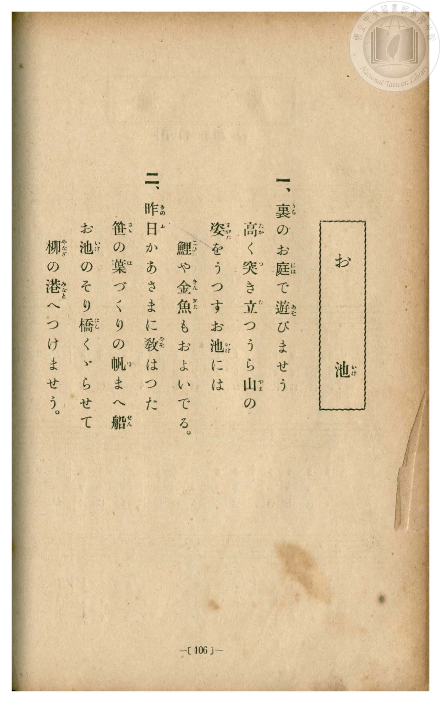
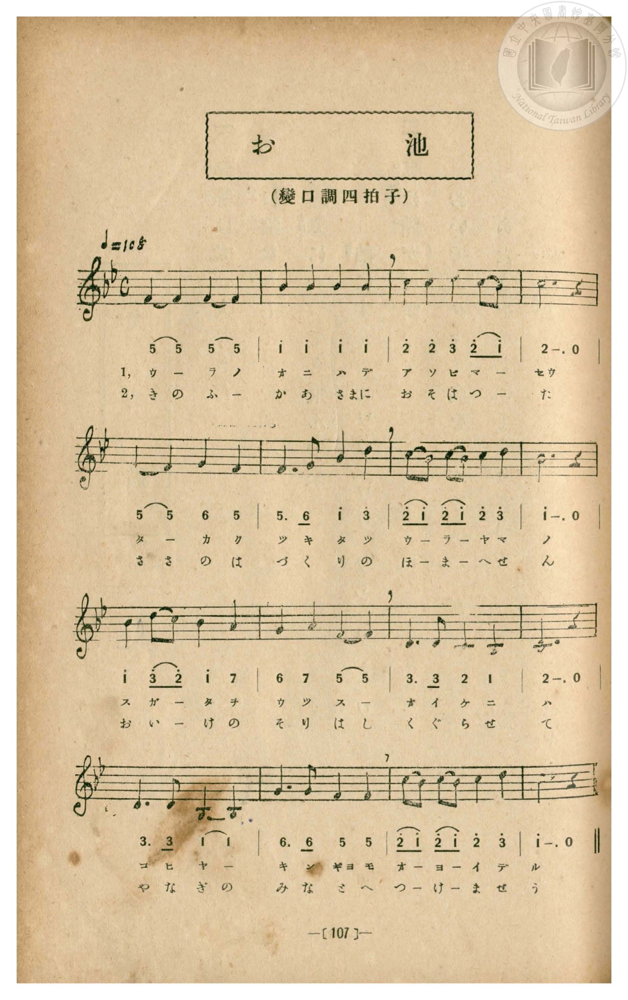

# お池

> Re:Shōka 使用 AI 協助辨識與重建樂譜，可能會有錯誤。歡迎回報。

<audio controls src="oike.mp3"></audio>

- 一條慎三郎 編《新編 小學校・公學校 唱歌教材集》（大正十二年十二月，索書號 0725-41）
- 尋常科第一、二學年用（第 106–107 頁）

## 說明

原書資訊與歌詞全文（對應 P114.jpg–P115.jpg，書頁 pp. 106–107）：
調性與拍號：變ロ調四拍子（降 B 大調 4/4 拍），♩＝108


## 歌詞

```text
一、
裏のお庭で遊びませう
高く突き立つうら山の
姿をうつすお池には
鯉や金魚もおよいでる。

二、
昨日かあさまに敎はつた
笹の葉づくりの帆まへ船
お池のそり橋くゞらせて
柳の港へつけませう。
```

## ABC

```abc
X:1
T:お池
M:4/4
L:1/16
Q:1/4=108
K:Bb
V:V1 name="Piano" snm="Pia"
[V:V1]
F4 F4 F4 F4 | B4 B4 B4 B4 | c4 c4 d4 c2 B2 | c12 z4 |
w: 1.~ウ _ ラ ノ | オ ニ ハ デ | ア ソ ビ マ _ | セウ
w: 2.~き の ふ _ | か あ さ まに | お そ は つ _ | た
F4 F4 G4 F4 | F6 G2 B4 d4 | c2 B2 c2 B2 c4 d4 | B12 z4 |
w: 1.~タ _ カ ク | ツ キ タ ツ | ウ _ ラ _ ヤ マ | ノ
w: 2.~さ さ の は | づ く り の | ほ _ ま _ へ せ | ん
B4 d2 c2 B4 A4 | G4 A4 F4 F4 | D6 D2 C4 B,4 | C12 z4 |
w: 1.~ス ガ _ タ ヲ | ウ ツ ス _ | オ イ ケ ニ | ハ
w: 2.~お い _ け の | そ り は し | く ぐ ら せ | て
D6 D2 B,4 B,4 | G6 G2 F4 F4 | c2 B2 c2 B2 c4 d4 | B12 z4 |
w: 1.~コ ヒ ヤ _ | キ ン ギヨ モ | オ _ ヨ _ イ デ | ル
w: 2.~や な ぎ の | み な と へ | つ _ け _ ま せ | う
F4 F4 F4 F4 | B4 B4 B4 B4 | c4 c4 d4 c2 B2 | c12 z4 |
w: 1.~ウ _ ラ ノ | オ ニ ハ デ | ア ソ ビ マ _ | セウ
w: 2.~き の ふ _ | か あ さ まに | お そ は つ _ | た
F4 F4 G4 F4 | F6 G2 B4 d4 | c2 B2 c2 B2 c4 d4 | B12 z4 |
w: 1.~タ _ カ ク | ツ キ タ ツ | ウ _ ラ _ ヤ マ | ノ
w: 2.~さ さ の は | づ く り の | ほ _ ま _ へ せ | ん
B4 d2 c2 B4 A4 | G4 A4 F4 F4 | D6 D2 C4 B,4 | C12 z4 |
w: 1.~ス ガ _ タ ヲ | ウ ツ ス _ | オ イ ケ ニ | ハ
w: 2.~お い _ け の | そ り は し | く ぐ ら せ | て
D6 D2 B,4 B,4 | G6 G2 F4 F4 | c2 B2 c2 B2 c4 d4 | B12 z4 |
w: 1.~コ ヒ ヤ _ | キ ン ギヨ モ | オ _ ヨ _ イ デ | ル
w: 2.~や な ぎ の | み な と へ | つ _ け _ ま せ | う
```

## TMD 檔案連結

- [主旋律 TMD 檔案](oike.tmd) [[在 TMD Studio 編輯](https://tmdlang.github.io/Tmd-TS/#tmd=s7IKdvYPcrWy4qpTUCpJTLdSSM7PyUlNLsnMz7MqzsjPTozPrsyvSsyML84ojTe0NDJWgqssy88pzU21Si9KTEmNN4w3QsgU55cWJadaFSdn5OfnxJekVpQk5edno8vHFySmp1oFGBqaIGQKivLLUvMS84C6C4oy80pSU8DaEQpSyzJTUkHSxcmJefFlqUWZaZmpKUiOSi0qBrsdYkVJUWJecXJRZgHIQwhV-UUlGflAhxdkVFplZBaX5BdlJifmxGcn5iUiFJVkpAK9l5dYUlqUqsSlpaXwuLHr2cYFClpaXIq2CoYGFlz2tgpOOlw2JvomdiBdT3Y0PFs091lr35MdnS-b-xSeb1_xuKHr2bQNQIbC0w39T9fueLZg4ePm3U9b10DYCk-nbHy2tufZ1JnP5k54ObvtcUP3-z0dT5csf7Z28dPexie7ep7u3AJhPJvT8X5Pz_Mti57N3vFi5nwFA3MjU10Tw_d7OsEufrqh--mOHc-XT3y-Zg3QHY8bwJrX7gDqfz5lBdBQoDjQzWaPGiYbGpgrvFzQCNbJpa-lYEstwKWgoPC0bz7IgZvbX6zoetHRDvTci5XznraueDatHeSzDb3P2jsVQHGul1WQDnQMkGkKYgL9BtQHdJZCQYEewqFAR77fMwtk8ItV-581LAcZ2d0L9D9Q9MW6rsfNa4HiT2fPBgo-XTsBaMPLmb0KTgrAEASKKwAjRgEoAzak59HMle_3zAVFG8g4SBiBDV7c_7hxHTBun-5a-7hx-cvGrseNmx837nvcOPtxYxtIxcvVMx439j9f1fi4sff56u7HjUuAEo-bOp9u3AjUCfb18v2PmyaBREFyMyEJ5XHj6seN68EGrO983NTysn3iy7WzHjc1AaUfN3U8bmwBWve4qftxQxPESbt6oE56NmPFs-lLHzcCrQIqngp2zOpnU_uAxoEtmA9S9HzNTqDtLyZ2Pm4EKu1_3AR097qnO4BOAKre8aJjJ0gRzCVA_80Fqni2EmgkUOk8oOvB_lsGtm4-0L_rnu0AGr4DbP5EuPdBbgOqoDxtQIGClj4Xl39mNjDfZybm5TvUGNRUgyxQsLHQsgMzahRM4xV00YkaBUMgiYxrFIyAJAgbg2lDqAgMGoDUgE30MaxReNy0DCr-uHklmOwDm_G4aRWY1w0m-8FkO1RmEYjXtBcsNhlMzoPK7EYYB4JgB0KsMgJKN_aCFDeuA5NboWpA4mBLGpvA5FQwCYpXqGQXWGAumFwPJpdAZeZjWIURUGZIAQWmwEKgYAIFDihgDKEYJgKSwxVU-2FB1QRy3OMmkHOA4s0tUNG1UDUQEVjgwgIW5Gx4UIGDGVc4QcIAQkJCC2pT41KITY39QLMhAQOSB8nshoQbmNwBJmdD3QCKIqzBBAkGkPd1FcwhYQQOLzAbOYkZQ0IOSBmBWIYQUTAbV1DtBAfIGjAJCZJNKEECCiCIKmgiAKc3kNgSIN4IVgNKFqCgAqU-XEEFCQSwaY0TUQIEnGKggQRJN9OhMhDzHjdOAMp3IgdVI2bihQYVIgTAnoeGADi0wCkKObRIS1ObIY5pngRNIbDgWAsV3wxkr3vcvALMAeU8RN4EiwHDCylvNoMSJo6waoIm08ZVQAxKfoiwgiRsiAzYVHASAsmATYeGLCRxwcKqDcOmWi4uXTsFUCGmgEQrcwEA)]
- [鋼琴伴奏 TMD 檔案](oike_piano.tmd) [[在 TMD Studio 編輯](https://tmdlang.github.io/Tmd-TS/#tmd=s7IKdvYPcrWy4qpTUCpJTLdSSM7PyUlNLsnMz7MqzsjPTozPrsyvSsyML84ojTe0NDJWgqssy88pzU21Si9KTEmNN4w3QsgU55cWJadaFSdn5OfnxJekVpQk5edno8vHFySmp1oFGBqaIGQKivLLUvMS84C6C4oy80pSU8DaEQpSyzJTUkHSxcmJefFlqUWZaZmpKUiOSi0qBrsdYkVJUWJecXJRZgHIQwhV-UUlGflAhxdkVFplZBaX5BdlJifmxGcn5iUiFCUWATWnp-am5pVYFWQm5uXHJyYn5-cWJOZlgsSUuLS0FB43dj3buOD9no6Xs2c-6-x-2b3n-YQtT_Zsebq0__2eTgUtLS5FWwVDAwsue1sFJx0uGxN9EzuQBU92NDxbNPdZa9-THZ0vm_sUnm9f8bih69m0DUCGwtMN_U_X7ni2YOHj5t1PW9dA2ApPp2x8trbn2dSZz-ZOeDm77XFDN9Dap0uWP1u7-Glv45NdPU93boEwns3peL-n5_mWRc9m73gxc76CgbmRqa6JIdBBYM893dD9dMeO58snPl-zBuiOxw1gzWt3APU_n7ICaChQHOhms0cNkw0NzBVeLmgE6-Tyz8wGRhcoIII8HGoMaqq5FIDAxkLLDsyoUTCNV9BFJ2oUDIEkMq5RMAKSIGwMpg2hIjBoAFIDNtHHsEbhcdMyqPjj5pVgsg9sxuOmVWBeN5jsB5PtUJlFIF7TXrDYZDA5DyqzG2EcCIIdCLHKCCjd2AtS3LgOTG6FqgGJgy1pbAKTU8HkvseNq6GSXWCBuWByPZhcApWZj2EVRkCZIQUUmAILgYIJFDiggDGEYpgISA5XUO2HBVUTyHGPm0DOAYo3t0BF10LVQERggQsLWJCz4UEFDmZc4QQJAwgJCS2oTY1LITY19gPNhgQMSB4ksxsSbmByB5icDXUDKIqwBhMkGEDe11Uwh4QROLzAbOQkZgwJOSBlBGIZQkTBbFxBtRMcIGvAJCRINqEECSiAIKqgiQCc3kBiS4B4I1gNKFmAggqU-nAFFSQQwKY1TkQJEHCKgQYSJN1Mh8pAzHvcOAEo34kcVI2YiRcaVIgQAHseGgLg0AKnKOTQIi1NbYY4pnkSNIXAgmMtVHwzkL3ucfMKMAeU8xB5EywGDC-kvNkMSpg4wqoJmkwbVwExKPkhwgqSsCEyYFPBSQgkAzYdGrKQxAULqzYMm2qRyzAf5DLMBF6GGcbHA0MxXtsUSCOz8cmASKN4bRNQMMNYEFFzoBpgMgQxDaBeRTXIBIjNgGxghBFvA9RUTA3Y7UA1CslGUvxH0CdE2kKCT4DRpWunAIqxaB_DWAU42wjMVuYCAA)]

## 分析

```text
================================================================================
📊 TMD Song Profile: [ お池 ]
================================================================================
⏱  Duration:       1:11 (71.1s), 32 measures total
🎼 Key & Tempo:    首調基準 B,, != 108.0 BPM, <4/4>
   - 分析範圍：      由實際發聲的音符與和弦推測調性；播放脈絡另行呈現
🎤 人聲音域:    A#3 (MIDI 58) – D5 (MIDI 74) [跨度: 16 個半音 / 1.3 個八度, 難度: moderate]
   - 最低音:  A#3 in [Oike #1 @ m.11, 0:23]
   - 最高音: D5 in [Oike #1 @ m.3, 0:05]
   - 適合: soprano, mezzo-soprano, contralto, tenor, baritone, bass
🏛  結構:      Oike (35.6s) -> Oike (35.6s)
⚡ 編曲密度:        Peak 1 軌道同時演奏
🗝  調性診斷：       A# 大調（純淨自然大調，未偵測到可信轉調）
   - 風格氣質:    純淨自然大調（陽光明朗、易唱易記，無明顯調外色彩）
   - 轉調歷程:    全曲維持單一推測調性（未偵測到可信轉調）
   - 核心骨幹音:  A#, C, F, D, G
   - 調性數值:    A# 大調 [相關度: 0.84, 穩定度: Moderate, 自然音純度: 100.0%]
   - 候選調性 (K-S): A# 大調 (0.84), F 大調 (0.77), D 小調 (0.50)
   - 五度圈歷程:   -2 -> -2
   - 各段落調性細節:
     • [Oike #1]: A# 大調 (r: 0.84, 自然音純度: 100.0%)
     • [Oike #2]: A# 大調 (r: 0.84, 自然音純度: 100.0%)

  [ 五度圈游移軌跡 ]
               C  
         F            G  
     [Bb]*              D  
      Eb               A  
         Ab           E  
            Db       B  
               F# 
     (* = active key center)

  [ 十二半音累積音高分佈 ]
     C  : ██████████████████        23.3%
     C# :                            0.0%
     D  : ███████████               14.2%
     D# :                            0.0%
     E  :                            0.0%
     F  : ████████████████          20.8%
     F# :                            0.0%
     G  : ██████                     7.5%
     G# :                            0.0%
     A  : ███                        3.3%
     A# : ████████████████████████  30.8%
     B  :                            0.0%
--------------------------------------------------------------------------------
Assignment 軌道音域：
  - Piano         : A#3 – D5 (16 個半音 / 1.3 個八度, 116 個音符)
================================================================================
```


## 原書掃描頁






