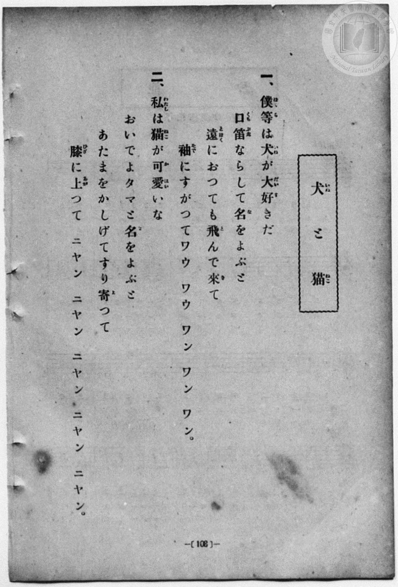
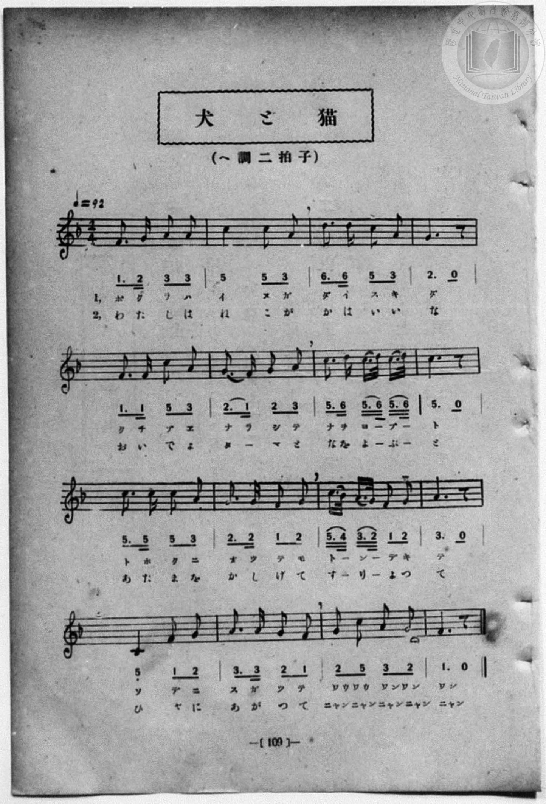

# 犬と猫

> Re:Shōka 使用 AI 協助辨識與重建樂譜，可能會有錯誤。歡迎回報。

- **鋼琴伴奏版**：<br><audio controls src="inu_to_neko.mp3"></audio>
- **NEUTRINO 歌聲合成版**：<br><audio controls src="inu_to_neko_neutrino.mp3"></audio>

- 一條慎三郎 編《新編 小學校・公學校 唱歌教材集》（大正十二年十二月，索書號 0725-41）
- 尋常科第一、二學年用（第 108–109 頁）

## 說明

原書資訊與歌詞全文（對應 P116.jpg–P117.jpg，書頁 pp. 108–109）：
調性與拍號：ヘ調二拍子（F 大調 2/4 拍），♩＝92


## 歌詞

```text
一、
僕等は犬が大好きだ
口笛ならして名をよぶと
遠におつても飛んで來て
袖にすがつてワウ　ワウ　ワン　ワン　ワン。

二、
私は猫が可愛いな
おいでよタマと名をよぶと
あたまをかしげてすり寄つて
膝に上つて　ニヤン　ニヤン　ニヤン　ニヤン　ニヤン。
```

## ABC

```abc
X:1
T:犬と猫
M:2/4
L:1/16
Q:1/4=92
K:F
V:V1 name="Piano" snm="Pia"
[V:V1]
F3 G A2 A2 | c4 c2 A2 | d3 d c2 A2 | G6 z2 |
w: 1.~ボ ク ラ ハ | イ ヌ ガ | ダ イ ス キ | ダ
w: 2.~わ た し は | ね こ が | か は い い | な
F3 F c2 A2 | G3 F G2 A2 | c3 d c3/2 d/2 c3/2 d/2 | c6 z2 |
w: 1.~ク チ ブ エ | ナ ラ シ テ | ナ ヲ ヨ _ ブ _ | ト
w: 2.~お い で よ | タ _ マ と | な を よ _ ぶ _ | と
c3 c c2 A2 | G3 G F2 G2 | c3/2 B/2 A3/2 G/2 F2 G2 | A6 z2 |
w: 1.~ト ホ ク ニ | オ ツ テ モ | ト _ ン _ デ キ | テ
w: 2.~あ た ま を | か し げ て | す _ り _ よ つ | て
C4 F2 G2 | A3 A G2 F2 | G2 c2 A2 G2 | F6 z2 |
w: 1.~ソ デ ニ | ス ガ ツ テ | ワウ ワウ ワン ワン | ワン
w: 2.~ひ ざ に | あ が つ て | ニヤン ニヤン ニヤン ニヤン | ニヤン
```

## TMD 檔案連結

- [主旋律 TMD 檔案](inu_to_neko.tmd) [[在 TMD Studio 編輯](https://tmdlang.github.io/Tmd-TS/#tmd=s7IKdvYPcrWy4qpTUCpJTLdSSM7PyUlNLsnMz7MqzsjPTozPrsyvSsyML84ojTe0NDJWgqssy88pzU21Si9KTEmNN4w3QsgU55cWJadaFSdn5OfnxJekVpQk5edno8vHFySmp1oFGBqaIWQKivLLUvMS84C6C4oy80pSU8DaEQpSyzJTUkHSxcmJefFlqUWZaZmpKUiOSi0qBrsdYkVJUWJecXJRZgHIQwhV-UUlGflAhxdkVFplZBaX5BdlJifmxGcn5iUiFJVkpAK9l5iXmZuYg6w1Mz0zz6o0D-SOEqjtWloKz7vWPG5c8bxntYKWFpeirYKlEZe9rYIbl42RvokdSPeTHQ3PFs191tr3ZEfny-Y-hefbVzxu6Ho2bQOQofB0Q__TtTueLVj4uHn309Y1ELbC0ykbn63teTZ15rO5E17Obnvc0P1-T8fTJcufrV38tLfxya6epzu3QBjP5nS839PzfMuiZ7N3vJg5X8HA3MhU18Tw_Z5OsMufbuh-umPH8-UTn69ZA3TH4waw5rU7gPqfT1kBNBQormBoYPGoYbKhgaXCywWNYJ1c-loKttQCXAoKCk_75oMcuLn9xYquFx3tQM-9WDnvaeuKZ9PaQT7b0PusvVMBlCL0sgrSgY4BMs1BTKDfgPqAzlIoKNBDOBToyPd7ZoEMfrFq_7OG5SAju3uB_geKPm6eARQEBU1379O1E4DGuykAgw4opgCMEQWgKFh3z6OZK9_vmQuMLZAxkLABu7R56vO1nY8b14PjtQeo8-nSvY8bex83LgBL9y9-vmb248ZVj5uAiqY_blz2dELv46ZJj5s6HjduAyYEkKKXjQseN65-3Nj1uHEJUMXjpqaXi2c_bpr8uHH5k31tQBGwyxdNAyuaCbQFqq55_eOmZY8bGlAYzZuxMZogzt7VA3X28-WNIDf3AA3sedq__lkL0I0tQGeC5MAOAXKWgxzZtP9x8zygO7E4-3Fj0-PG-Y8b94EkGrvB3gMyloHc2NT1dD3QCJAzwY5vmwt0_JMdMB-CHNb9uHkJzJEksZtAJlKezqBAQUufi8szrzQk3y81O98qIDMxL9-hxqCmGmSLgo2xkZYdmFWjYKigC4dGQGwMZcPoGgVTJBUgCOMjVJghyYLYmCpAJmODBjAVYNf4GNYoPG6egyT_uGk9iGxeCeM398PNfNy0BM20x809cH1rEOqaG1BMBOl63LQTzl-LQyUyjEd1pxHIdphLwKY0zgeT0-F8kLuhpjbCbECongxnwVwMUteNogbs88YWOB_GAqlcRdCdWKIXxMYfNSAVMD72BICIXjM4jZlEYBBL9IIjFO7J5kYwOQ3Gb1oBt_VxcxeKSlASeNy0Hc5vw6lyE5iEmYQwHaSyA4dLsURwI4qp4OAHFh9wl8JMAvlpP5ppwNIFrg_JRyjRBixfUMwBFkFIKmG6cLsTGsHIQQ9i449gEBuWJGDiMDNMoHqMsKiAmYYOseVf5CB-3DwbRMIjHVjgwc183IQSHM3gAIZH6-PmRQiVcDOBRSWc1Q5joeRgmH50iC2Cm5Dth-bgfXBTQdEDNRUtZ4JyObBWgPOXIamcCdcPSz7IUQwrsUAqYbpwuxQWxTARGMQfPyA2TAamEpEK0NMHwgzkogIZYsvEe9HUIMUGSgzDSlmwDLhMhsQzRCVyFgZV9nAJNA5SpCNxILrgXHSILcJBJQOKsxvhJU_jaoSxaAkDVEQjog4lumH1N9x9pPExTcDti1ouLl07BXidrgDkKHMBAA)]
- [鋼琴伴奏 TMD 檔案](inu_to_neko_piano.tmd) [[在 TMD Studio 編輯](https://tmdlang.github.io/Tmd-TS/#tmd=s7IKdvYPcrWy4qpTUCpJTLdSSM7PyUlNLsnMz7MqzsjPTozPrsyvSsyML84ojTe0NDJWgqssy88pzU21Si9KTEmNN4w3QsgU55cWJadaFSdn5OfnxJekVpQk5edno8vHFySmp1oFGBqaIWQKivLLUvMS84C6C4oy80pSU8DaEQpSyzJTUkHSxcmJefFlqUWZaZmpKUiOSi0qBrsdYkVJUWJecXJRZgHIQwhV-UUlGflAhxdkVFplZBaX5BdlJifmxGcn5iUiFCUWATWnp-am5pVYFWQm5uXHJyYn5-cWJOZlgsSUuLS0FJ53rXncuOJ5z-r3ezpezp75rLP7Zfee5xO2PNmz5enS_vd7OhW0tLgUbRUsjbjsbRXcuGyM9E3sQDY82dHwbNHcZ619T3Z0vmzuU3i-fcXjhq5n0zYAGQpPN_Q_Xbvj2YKFj5t3P21dA2ErPJ2y8dnanmdTZz6bO-Hl7LbHDd1AS58uWf5s7eKnvY1PdvU83bkFwng2p-P9np7nWxY9m73jxcz5CgbmRqa6JoZA54B993RD99MdO54vn_h8zRqgOx43gDWv3QHU_3zKCqChQHEFQwOLRw2TDQ0sFV4uaATr5PLMKw3J90vNzrcKAAVHkIdDjUFNNZcCENgYG2nZgVk1CoYKunBoBMTGUDaMrlEwRVIBgjA-QoUZkiyIjakCZDI2aABTAXaNj2GNwuPmOUjyj5vWg8jmlTB-cz_czMdNS9BMe9zcA9e3BqGuuQHFRJCux0074fy1OFQiw3hUdxqBbIe5BGxK43wwOR3OB7kbamojzAaE6slwFszFIHXdKGrAPm9sgfNhLJDKVQTdiSV6QWz8UQNSAeNjTwCI6DWD05hJBAaxRC84QuGebG4Ek9Ng_KYVcFsfN3ehqAQlgcdN2-H8NpwqN4FJmEkI00EqO3C4FEsEN6KYCg7-x43L4S6FmQTy03400x43z4PrQ_IRSrQ9bpqEYs7jxm1IKmG6cLsTGsHIQQ9i449gEBuWJGDiMDNMoHqMsKiAmYYOseVf5CB-3DwbRMIj_XEzLI2Dgg0lOJrBAQyP1sfNixAq4WY-bt4MZ7XDWCg5GKYfHWKL4CZk-6E5eB_cVFD0QE1Fy5mgXP64ESb_uHEZksqZcP2w5IMcxbASC6QSpgu3S2FRDBOBQfzxA2LDZGAqEakAPX0gzEAuKpAhtky8F00NUmygxDCslAXLgMtkSDxDVCJn4fWPm2ABgsFBinQkDkQXnIsOsUU4qGRAcXYjvORpXI0wFi1hgIpoRNShRHdz9-PmJcjuI42PaQJuX9RiVOk-yFW6CaJGj1cwjtcGJhoUpkk8kKdtDGKaxscDIxUSLihqQBLm8fHaRlC9JvHaZlAmYfXomhE6QDIwu_HYBtIA9KSunQLcn9E-hrEKqAJGYAFlLgA)]

## 分析

```text
================================================================================
📊 TMD Song Profile: [ 犬と猫 ]
================================================================================
⏱  Duration:       0:20 (20.9s), 16 measures total
🎼 Key & Tempo:    首調基準 F, != 92.0 BPM, <2/4>
   - 分析範圍：      由實際發聲的音符與和弦推測調性；播放脈絡另行呈現
🎤 人聲音域:    C4 (MIDI 60) – D5 (MIDI 74) [跨度: 14 個半音 / 1.2 個八度, 難度: moderate]
   - 最低音:  C4 in [InuToNeko #1 @ m.13, 0:15]
   - 最高音: D5 in [InuToNeko #1 @ m.3, 0:02]
   - 適合: soprano, mezzo-soprano, contralto, tenor, baritone, bass
🏛  結構:      InuToNeko (20.9s)
⚡ 編曲密度:        Peak 1 軌道同時演奏
🗝  調性診斷：       C 大調（純淨自然大調，未偵測到可信轉調）
   - 風格氣質:    純淨自然大調（陽光明朗、易唱易記，無明顯調外色彩）
   - 轉調歷程:    全曲維持單一推測調性（未偵測到可信轉調）
   - 核心骨幹音:  C, G, A, F, D
   - 調性數值:    C 大調 [相關度: 0.83, 穩定度: Moderate, 自然音純度: 99.6%]
   - 候選調性 (K-S): C 大調 (0.83), F 大調 (0.74), A 小調 (0.68)
   - 五度圈歷程:   +0
   - 各段落調性細節:
     • [InuToNeko #1]: C 大調 (r: 0.83, 自然音純度: 99.6%, 調外音: A#)

  [ 五度圈游移軌跡 ]
              [C ]*
         F            G  
      Bb               D  
      Eb               A  
         Ab           E  
            Db       B  
               F# 
     (* = active key center)

  [ 十二半音累積音高分佈 ]
     C  : ████████████████████████  29.6%
     C# :                            0.0%
     D  : ████                       5.0%
     D# :                            0.0%
     E  :                            0.0%
     F  : ███████████████           18.3%
     F# :                            0.0%
     G  : ███████████████████       23.7%
     G# :                            0.0%
     A  : ███████████████████       22.9%
     A# :                            0.4%
     B  :                            0.0%
--------------------------------------------------------------------------------
Assignment 軌道音域：
  - Piano         : C4 – D5 (14 個半音 / 1.2 個八度, 54 個音符)
================================================================================
```


## 原書掃描頁






