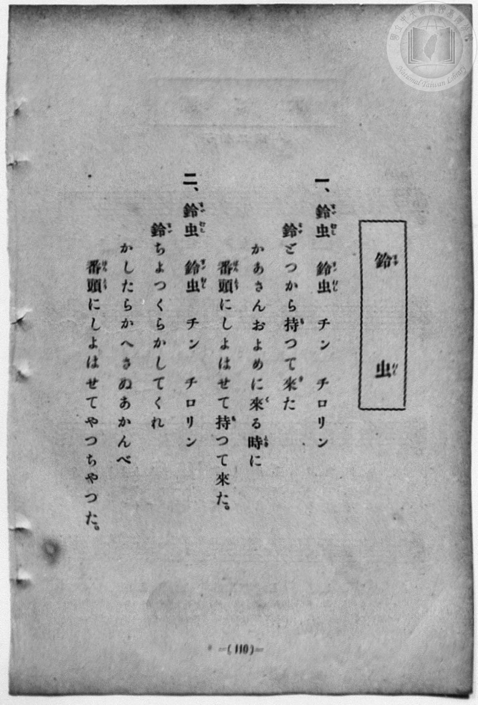
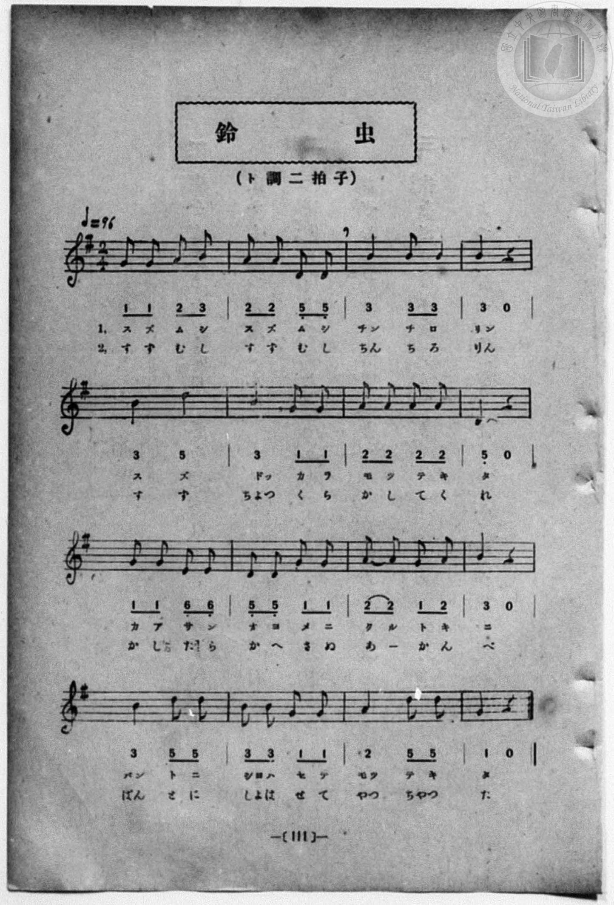

# 鈴蟲

> Re:Shōka 使用 AI 協助辨識與重建樂譜，可能會有錯誤。歡迎回報。

- **鋼琴伴奏版**：<br><audio controls src="suzumushi.mp3"></audio>
- **NEUTRINO 歌聲合成版**：<br><audio controls src="suzumushi_neutrino.mp3"></audio>

- 一條慎三郎 編《新編 小學校・公學校 唱歌教材集》（大正十二年十二月，索書號 0725-41）
- 尋常科第一、二學年用（第 110–111 頁）

## 說明

原書資訊與歌詞全文（對應 P118.jpg–P119.jpg，書頁 pp. 110–111）：
調性與拍號：ト調二拍子（G 大調 2/4 拍），♩＝96


## 歌詞

```text
一、
鈴虫　鈴虫　チン　チロリン
鈴どつから持つて來た
かあさんおよめに來る時に
番頭にしよはせて持つて來た。

二、
鈴虫　鈴虫　チン　チロリン
鈴ちよつくら貸してくれ
かしたら返さぬあかんべ
番頭にしよはせてやつちやつた。
```

## ABC

```abc
X:1
T:鈴蟲
M:2/4
L:1/16
Q:1/4=96
K:G
V:V1 name="Piano" snm="Pia"
[V:V1]
G2 G2 A2 B2 | A2 A2 D2 D2 | B4 B2 B2 | B4 z4 |
w: 1.~ス ズ ム シ | ス ズ ム シ | チン チ ロ | リン
w: 2.~す ず む し | す ず む し | ちん ち ろ | りん
B4 d4 | B4 G2 G2 | A2 A2 A2 A2 | D4 z4 |
w: 1.~ス ズ | ドッ カ ラ | モ ツ テ キ | タ
w: 2.~す ず | ちよつ く ら | か し て く | れ
G2 G2 E2 E2 | D2 D2 G2 G2 | A2 A2 G2 A2 | B4 z4 |
w: 1.~カ ア サ ン | オ ヨ メ ニ | ク ル ト キ | ニ
w: 2.~か し た ら | か へ さ ぬ | あ _ か ん | べ
B4 d2 d2 | B2 B2 G2 G2 | A4 D2 D2 | G4 z4 |
w: 1.~バン ト ニ | シヨ ハ セ テ | モツ テ キ | タ
w: 2.~ばん と に | しよ は せ て | やつ ちや つ | た
G2 G2 A2 B2 | A2 A2 D2 D2 | B4 B2 B2 | B4 z4 |
w: 1.~ス ズ ム シ | ス ズ ム シ | チン チ ロ | リン
w: 2.~す ず む し | す ず む し | ちん ち ろ | りん
B4 d4 | B4 G2 G2 | A2 A2 A2 A2 | D4 z4 |
w: 1.~ス ズ | ドッ カ ラ | モ ツ テ キ | タ
w: 2.~す ず | ちよつ く ら | か し て く | れ
G2 G2 E2 E2 | D2 D2 G2 G2 | A2 A2 G2 A2 | B4 z4 |
w: 1.~カ ア サ ン | オ ヨ メ ニ | ク ル ト キ | ニ
w: 2.~か し た ら | か へ さ ぬ | あ _ か ん | べ
B4 d2 d2 | B2 B2 G2 G2 | A4 D2 D2 | G4 z4 |
w: 1.~バン ト ニ | シヨ ハ セ テ | モツ テ キ | タ
w: 2.~ばん と に | しよ は せ て | やつ ちや つ | た
```

## TMD 檔案連結

- [主旋律 TMD 檔案](suzumushi.tmd) [[在 TMD Studio 編輯](https://tmdlang.github.io/Tmd-TS/#tmd=s7IKdvYPcrWy4qpTUCpJTLdSSM7PyUlNLsnMz7MqzsjPTozPrsyvSsyML84ojTe0NDJWgqssy88pzU21Si9KTEmNN4w3QsgU55cWJadaFSdn5OfnxJekVpQk5edno8vHFySmp1oFGBpaIGQKivLLUvMS84C6C4oy80pSU8DaEQpSyzJTUkHSxcmJefFlqUWZaZmpKUiOSi0qBrsdYkVJUWJecXJRZgHIQwhV-UUlGflAhxdkVFplZBaX5BdlJifmxGcn5iUiFJVkpAK9l5dYUlqUiqw1Mz0zz6o0D-SOEqjtWloKLzu2vJi_SUFLi0vRVsHSjMveVsGdy8ZI38QOpPXJjoZni-Y-a-17sqPzZXOfwvPtKx43dD2btgHIUHi6of_p2h3PFix83Lz7aesaCFvh6ZSNz9b2PJs689ncCS9ntz1u6H6_p-PpkuXP1i5-2tv4ZFfP051bIIxnczre7-l5vmXRs9k7Xsycr2BgbmSqa2L4fk8n2NlPN3Q_3bHj-fKJz9esAbrjcQNY89odQP3Pp6wAGgoUVzA0NHjUMNnQ0FDh5YJGsE4ufS0FW2oBLgUFhad980EO3Nz-YkXXi452oOderJz3tHXFs2ntIJ9t6H3W3qkASg56WQXpQMcAmZYgJtBvQH1AZykUFOghHAp05Ps9s0AGv1i1_1nDcpCR3b1A_wNFHzd3AAVBQdPd-3TtBKDx7grAoAOKKQBjRAEoCtbd82jmyvd75gJjC2QMJGxALFBczlz9uKEBznjc3Pi4eTOMsfZx8yogF6r0cePKx41LHjd2P27qfNbTCGYve7Kv7XHjfJAKkERj0-PGqY-bJj9u7Hrc1PG4CahoNUhFU_ezmUCp1SB1z6euerlgLZDzuHE6SFHj-seNs4EmoRn5uKEJ4tpdPWS6diHYdKCJ_UAHv9i0A2Rf4zIwtwfuYKDQfJD0_ikglzeuAXsB6EOgF3bic-3jphaw2UBLIAywg4EaKE9DUKCgpc_FFVxaVZpbWpyRaRWQmZiX71BjUFMNskXBxkLLDsyoUTAEQiMFYyDLCAhN40GoBsjXBWKQKIhlAMQ1YPU-hjUKj5t2AvEuhcfNC4D0dqAaLCLgsAVqAzKAeC1YCBS-QKF4hGlGQOHGmUA8C6ivAUhPBynEIgIMqMkg0xoXAoV7wVYC0whICGIa1DMgx5qCBMAskNcg3gLBGpDPsPkFaCzQ7SBNj5s7Hzc3gwVWAzkrwUKLgLgFiNuAomB_NO3H6gmQ62ZBjIElHrBYP1BHJ1i0G-wdYPSDRUEm9aB7AORks3gQAjsXiBCeAMUT9vgAOrYJ6MymrUBnbgYbvArIWgHEwOBq7gaLrAeyQJ7qgHkDKI7pDZgT56M4egcQTwXiNWCRJrC3gOLA8AfxQSGIJRZMwSxjuAeAYtDEZYjpheYJsOQCdB_UxdshXgCF325w-INjAxQZIHX4o2MDLL0ATWhcDXYmKAMCKWA4NM4GRwJILyj3QdIVkA2kloCVzoebWMvFpWunAM9HCugcZS4A)]
- [鋼琴伴奏 TMD 檔案](suzumushi_piano.tmd) [[在 TMD Studio 編輯](https://tmdlang.github.io/Tmd-TS/#tmd=s7IKdvYPcrWy4qpTUCpJTLdSSM7PyUlNLsnMz7MqzsjPTozPrsyvSsyML84ojTe0NDJWgqssy88pzU21Si9KTEmNN4w3QsgU55cWJadaFSdn5OfnxJekVpQk5edno8vHFySmp1oFGBpaIGQKivLLUvMS84C6C4oy80pSU8DaEQpSyzJTUkHSxcmJefFlqUWZaZmpKUiOSi0qBrsdYkVJUWJecXJRZgHIQwhV-UUlGflAhxdkVFplZBaX5BdlJifmxGcn5iUiFCUWATWnp-am5pVYFWQm5uXHJyYn5-cWJOZlgsSUuLS0FF52bHkxf9P7PR0vZ8981tn9snvP8wlbnuzZ8nRp__s9nQpaWlyKtgqWZlz2tgruXDZG-iZ2IOOf7Gh4tmjus9a-Jzs6Xzb3KTzfvuJxQ9ezaRuADIWnG_qfrt3xbMHCx827n7augbAVnk7Z-Gxtz7OpM5_NnfBydtvjhm6gpU-XLH-2dvHT3sYnu3qe7twCYTyb0_F-T8_zLYuezd7xYuZ8BQNzI1NdE0Ogc8Bee7qh--mOHc-XT3y-Zg3QHY8bwJrX7gDqfz5lBdBQoLiCoaHBo4bJhoaGCi8XNIJ1cgWXVpXmlhZnZFoFgMIiyMOhxqCmmksBCGwstOzAjBoFQyA0UjAGsoyA0DQehGqAfF0gBomCWAZAXANW72NYo_C4aScQ71J43LwASG8HqsEi0tz4uHkzUBuQAcRrwUKrIELxCNOMgMKNM4F4FlBfA5CeDlKIRWTh46bJINMaFwKFe8FWdkGEIKZBPQNyrClIAMwCeQ3iLRCsAfkMm1-AxgLdDtL0uLnzcXMzWGA1kLMSLLQIiFuAuA0oCvZH036sngC5bhbEGJBzOx43LgGL9QN1dIJFu8Heedy4DCwKMqkH3QMgJ5vFgxDYuUCE8AQonrDHB9CxTUBnNm0FOnMz2OBVQNYKIAYGV3M3WGQ9kAXyVAfMG0BxTG_AnDgfxdE7gHgqEK8BizSBvQUUB4Y_iA8KQSyxYApmGcM9ABSDJi5DTC80T4AlF6D7oC7eDvECKPx2g8MfHBugyACpwx8dG2DpBWhC42qwM6cD4wRIAcOhcTY4EkB6W2CxBIwxYCQDOSCl8-Em1mJkIx_kbGSCyEbxCsbx2mDvmcbHK5jHx2sbgf2KEAcyDaCORBfHqhXEQdcATRjAZBGvbYzNMpJsgKoHelLXTgHuz2gfw1gFVAEjsIAyFwA)]

## 分析

```text
================================================================================
📊 TMD Song Profile: [ 鈴蟲 ]
================================================================================
⏱  Duration:       0:40 (40.0s), 32 measures total
🎼 Key & Tempo:    首調基準 G, != 96.0 BPM, <2/4>
   - 分析範圍：      由實際發聲的音符與和弦推測調性；播放脈絡另行呈現
🎤 人聲音域:    D4 (MIDI 62) – D5 (MIDI 74) [跨度: 12 個半音 / 1.0 個八度, 難度: easy]
   - 最低音:  D4 in [Suzumushi #1 @ m.2, 0:01]
   - 最高音: D5 in [Suzumushi #1 @ m.5, 0:05]
   - 適合: soprano, mezzo-soprano, contralto, tenor, baritone, bass
🏛  結構:      Suzumushi (20.0s) -> Suzumushi (20.0s)
⚡ 編曲密度:        Peak 1 軌道同時演奏
🗝  調性診斷：       G 大調（純淨自然大調，未偵測到可信轉調）
   - 風格氣質:    純淨自然大調（陽光明朗、易唱易記，無明顯調外色彩）
   - 轉調歷程:    全曲維持單一推測調性（未偵測到可信轉調）
   - 核心骨幹音:  B, G, D, A, E
   - 調性數值:    G 大調 [相關度: 0.76, 穩定度: Moderate, 自然音純度: 100.0%]
   - 候選調性 (K-S): G 大調 (0.76), B 小調 (0.72), D 大調 (0.68)
   - 五度圈歷程:   +1 -> +1
   - 各段落調性細節:
     • [Suzumushi #1]: G 大調 (r: 0.76, 自然音純度: 100.0%)
     • [Suzumushi #2]: G 大調 (r: 0.76, 自然音純度: 100.0%)

  [ 五度圈游移軌跡 ]
               C  
         F           [G ]*
      Bb               D  
      Eb               A  
         Ab           E  
            Db       B  
               F# 
     (* = active key center)

  [ 十二半音累積音高分佈 ]
     C  :                            0.0%
     C# :                            0.0%
     D  : █████████████████         21.4%
     D# :                            0.0%
     E  : ███                        3.6%
     F  :                            0.0%
     F# :                            0.0%
     G  : ██████████████████        23.2%
     G# :                            0.0%
     A  : █████████████████         21.4%
     A# :                            0.0%
     B  : ████████████████████████  30.4%
--------------------------------------------------------------------------------
Assignment 軌道音域：
  - Piano         : D4 – D5 (12 個半音 / 1.0 個八度, 92 個音符)
================================================================================
```


## 原書掃描頁






