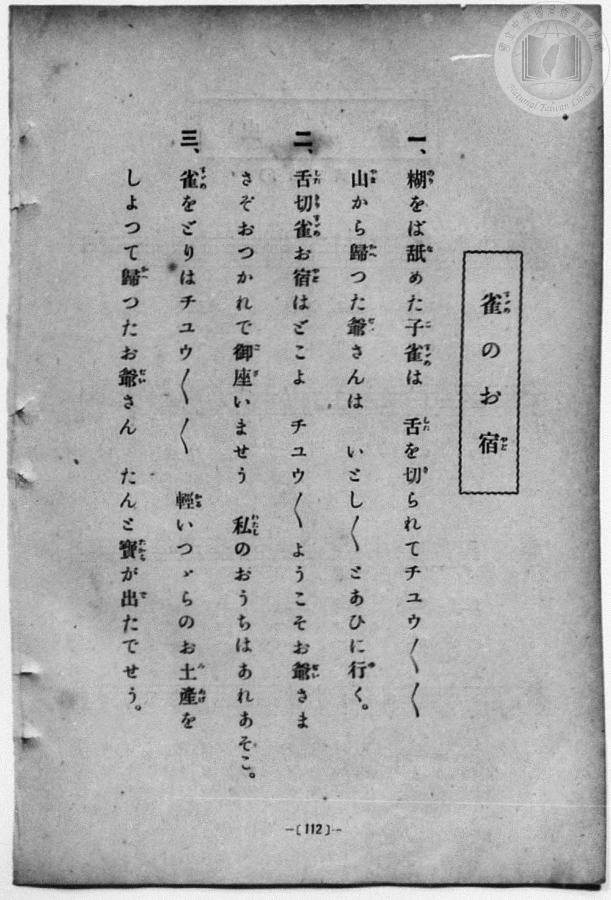
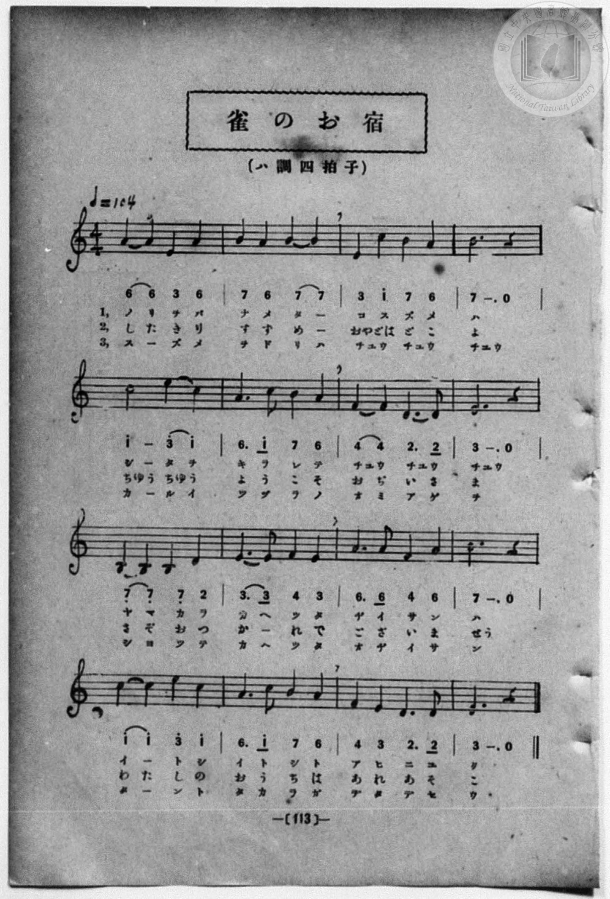

# 雀のお宿

> Re:Shōka 使用 AI 協助辨識與重建樂譜，可能會有錯誤。歡迎回報。

- **NEUTRINO 歌聲合成版**：<br><audio controls src="suzume_no_oyado_neutrino.mp3"></audio>
- **鋼琴伴奏版**：<br><audio controls src="suzume_no_oyado.mp3"></audio>


- 一條慎三郎 編《新編 小學校・公學校 唱歌教材集》（大正十二年十二月，索書號 0725-41）
- 尋常科第一、二學年用（第 112–113 頁）

## 說明

原書資訊與歌詞全文（對應 P120.jpg–P121.jpg，書頁 pp. 112–113）：
調性與拍號：ハ調四拍子（a 小調 4/4 拍），♩＝104


## 歌詞

```text
一、
糊をば舐めた子雀は　舌を切られてチユウ／＼／＼
山から歸つた爺さんは　いとし／＼とあひに行く。

二、
舌切雀お宿はどこよ　チユウ／＼ようこそお爺さま
さぞおつかれで御座いませう　私のおうちはあれあそこ。

三、
雀をどりはチユウ／＼／＼　輕いつゞらのお土産を
しよつて歸つたお爺さん　たんと寶が出たでせう。
```

## ABC

```abc
X:1
T:雀のお宿
M:4/4
L:1/16
Q:1/4=104
K:Am
V:V1 name="Piano" snm="Pia"
[V:V1]
A4 A4 E4 A4 | B4 A4 B4 B4 | E4 c4 B4 A4 | B12 z4 |
w: 1.~ノ リ ヲ バ | ナ メ タ _ | コ ス ズ メ | ハ
w: 2.~し た き り | す ず め _ | おや どは ど こ | よ
w: 3.~ス _ ズ メ | ヲ ド リ ハ | チユ ウ チユ ウ | チユウ
c8 e4 c4 | A6 c2 B4 A4 | F4 F4 D6 D2 | E12 z4 |
w: 1.~シ タ ヲ | キ ラ レ テ | チユウ _ チユ ウ | チユウ
w: 2.~ちゆう ちゆう _ | よ う こ そ | お ぢ い さ | ま
w: 3.~カ ル イ | ツ ヅ ラ ノ | オ ミ ア ゲ | ヲ
B,4 B,4 B,4 D4 | E6 E2 F4 E4 | A6 A2 F4 A4 | B12 z4 |
w: 1.~ヤ マ カ ラ | カ ヘ ツ タ | ヂ イ サ ン | ハ
w: 2.~さ ぞ お つ | か _ れ で | ご ざ い ま | せう
w: 3.~シ ヨ ツ テ | カ ヘ ツ タ | オ ヂ イ サ | ン
c4 c4 e4 c4 | A6 c2 B4 A4 | F4 E4 D6 D2 | E12 z4 |
w: 1.~イ _ ト シ | イ ト シ ト | ア ヒ ニ ユ | ク
w: 2.~わ た し の | お う ち は | あ れ あ そ | こ
w: 3.~タ _ ン ト | タ カ ラ ガ | デ タ デ セ | ウ
A4 A4 E4 A4 | B4 A4 B4 B4 | E4 c4 B4 A4 | B12 z4 |
w: 1.~ノ リ ヲ バ | ナ メ タ _ | コ ス ズ メ | ハ
w: 2.~し た き り | す ず め _ | おや どは ど こ | よ
w: 3.~ス _ ズ メ | ヲ ド リ ハ | チユ ウ チユ ウ | チユウ
c8 e4 c4 | A6 c2 B4 A4 | F4 F4 D6 D2 | E12 z4 |
w: 1.~シ タ ヲ | キ ラ レ テ | チユウ _ チユ ウ | チユウ
w: 2.~ちゆう ちゆう _ | よ う こ そ | お ぢ い さ | ま
w: 3.~カ ル イ | ツ ヅ ラ ノ | オ ミ ア ゲ | ヲ
B,4 B,4 B,4 D4 | E6 E2 F4 E4 | A6 A2 F4 A4 | B12 z4 |
w: 1.~ヤ マ カ ラ | カ ヘ ツ タ | ヂ イ サ ン | ハ
w: 2.~さ ぞ お つ | か _ れ で | ご ざ い ま | せう
w: 3.~シ ヨ ツ テ | カ ヘ ツ タ | オ ヂ イ サ | ン
c4 c4 e4 c4 | A6 c2 B4 A4 | F4 E4 D6 D2 | E12 z4 |
w: 1.~イ _ ト シ | イ ト シ ト | ア ヒ ニ ユ | ク
w: 2.~わ た し の | お う ち は | あ れ あ そ | こ
w: 3.~タ _ ン ト | タ カ ラ ガ | デ タ デ セ | ウ
```

## TMD 檔案連結

- [主旋律 TMD 檔案](suzume_no_oyado.tmd) [[在 TMD Studio 編輯](https://tmdlang.github.io/Tmd-TS/#tmd=s7IKdvYPcrWy4qpTUCpJTLdSSM7PyUlNLsnMz7MqzsjPTozPrsyvSsyML84ojTe0NDJWgqssy88pzU21Si9KTEmNN4w3QsgU55cWJadaFSdn5OfnxJekVpQk5edno8vHFySmp1oFGBoZIGQKivLLUvMS84C6C4oy80pSU8DaEQpSyzJTUkHSxcmJefFlqUWZaZmpKUiOSi0qBrsdYkVJUWJecXJRZgHIQwhV-UUlGflAhxdkVFplZBaX5BdlJifmxGcn5iUiFJVkpAK9l5afk52TX5SKLp6Yl5mbmINsZGZ6Zp5VbmpmViaSl7W0FF7ObnjcuO5xY9fTdfsVtLS4FG0VDA1MuOxtFZy5slMrbRUcc7lsTPRN7EBmPdnR8GzR3GetfU92dL5s7lN4vn3F44auZ9M2ABkKTzf0P12749mChY-bdz9tXQNhKzydsvHZ2p5nU2c-mzvh5ey2xw3d7_d0PF2y_NnaxU97G5_s6nm6cwuE8WxOx_s9Pc-3LHo2e8eLmfMVDMyNTHVNDN_v6QT74-mG7qc7djxfPvH5mjVAdzxuAGteuwOo__mUFUBDgeIKhoZGjxomGxoaK7xc0AjWyaWvpWBLLcCloKDwtG8-yIGb21-s6HrR0Q703IuV8562rng2rR3ksw29z9o7FUDpRi-rIB3oGCDTEMQE-g2oD-gshYICPYRDgY58v2cWyOAXq_Y_a1gOMrK7F-h_oOjj5n6g4NPZs4EiT9dOABqfCAploJgCMEYUgKJg3T2PZq58v2cuKNpA5kACB8R6vrnrcdOkx40bXnRMeNzU-LhxPtAUcISvf9zQ8KKjByj7tKP9cVPn46aex43LHjc3Pm5e9rhp2fs9_e_37IGQYD9v3Pi4sRuo7tnaHY8blwANet6x63Hj1MdNkyFmPW5sedy44nHjdIgeMLvpceOmx42rXywEGt3_uKEJ4rhdPVDHAa0H2g12DSjtgcxpXPm4cfLjpg6QgahOAQk2toFkG-cC1UNtb9wHMgjMmgcUBbsM6Eqgfcuf7lv4dNdysLP2PW6cDdLc0PB8OTAMQGkdbNZCsJVNYPVAtwLNnQx35Y5OqCtB7gMF4crHTUBd67GGECgs9wDdALRryeOmeaDghOSoOfOfT1kM1A5x5XSwJ4BOXAYPRYRXgAEJCsX54BBd8XT9tseNPU_bgVJANUBvQDzQBDKI8lQMBQpa-lxcwaVVwGLSL9-_MjEl3yogMzEv36HGoKYaZJOCjYWWHZhRo2CmoAvGxlC6RsEcygLRIFwDljOMg3IRimDQACQCNs7HsEbhMbD40AWSq8DkJjA5AazncXMXmLcQRDbth-oGijdtBovsBJO74GpAOvqR7IlH2GMElGucDlLZOB9M9oL1gswHycwEi80CizUi7AGmj6YWsBQwPa6HMMDkZKg7OrDbZgySA7kOBNFdCPFhJ5KfQW4GyYBSFFgDmETlwuQhPFQ7oTEDDnEQNAYxwDxIdIE5iKgwAZIgbASWMoLGF47IadoO9wYoAiDOB4mvhYg2rwTiNWBWG1Znwv0B8Qk-fyBiauHjJmC-BBkI1ofGR4Q8SAwSG8BsC5FpBKeZxkVgEhR5IHoqWGYfdhvBsbUa7lwQ63HTEqhnoCY0t4K9CmKBUitIByTuwKmpCWQbiN4Ej2GsMWQO4iEIUATAAt8YHCUgNizOzMAihHMPyKWPm-eB7Qe7HexOhJ8eN8-A-gMShSA9TVD3LgHirWA1oBxFKP9MBYcl2CZoKENDqbEbFnpNPWDx5VDxKRDRxmnQuIDEAUgGVI5htwocHaBU97h5BZgEa4SlLtyeAkcISKYJGn0Qr4E8BfIc7iwDJojIM6DIIS7PgGyHuAWUTCG-QYiDRGE-BMmDZMDJtXkSmIQEJijTgGRAxQ6OCGkCRRasQIMUbusg5oGjB5Y9wMUnuPgCyYCiHhZN0GQAzDogGVA2whUfsMIXEpYId0PEQbECzR5NoLIAFObtYB6kzACxQbzdYD2YGb-Wi0vXTgGlBlLAJqDMBQA)]
- [鋼琴伴奏 TMD 檔案](suzume_no_oyado_piano.tmd) [[在 TMD Studio 編輯](https://tmdlang.github.io/Tmd-TS/#tmd=s7IKdvYPcrWy4qpTUCpJTLdSSM7PyUlNLsnMz7MqzsjPTozPrsyvSsyML84ojTe0NDJWgqssy88pzU21Si9KTEmNN4w3QsgU55cWJadaFSdn5OfnxJekVpQk5edno8vHFySmp1oFGBoZIGQKivLLUvMS84C6C4oy80pSU8DaEQpSyzJTUkHSxcmJefFlqUWZaZmpKUiOSi0qBrsdYkVJUWJecXJRZgHIQwhV-UUlGflAhxdkVFplZBaX5BdlJifmxGcn5iUiFCUWATWnp-am5pVYFWQm5uXHJyYn5-cWJOZlgsSUuLS0FF7ObnjcuO5xY9fTdfvf7-l4OXvms87ul917nk_Y8mTPlqdL-9_v6VTQ0uJStFUwNDDhsrdVcObKTq20VXDM5bIx0TexA9n2ZEfDs0Vzn7X2PdnR-bK5T-H59hWPG7qeTdsAZCg83dD_dO2OZwsWPm7e_bR1DYSt8HTKxmdre55Nnfls7oSXs9seN3QDbX-6ZPmztYuf9jY-2dXzdOcWCOPZnI73e3qeb1n0bPaOFzPnKxiYG5nqmhgC3QX26dMN3U937Hi-fOLzNWuA7njcANa8dgdQ__MpK4CGAsUVDA2NHjVMNjQ0Vni5oBGskyu4tAoY-X75_pWJKflWAaDgCfJwqDGoqeZSAAIbCy07MKNGwUxBF4yNoXSNgjmUBaJBuAYsZxgH5SIUwaABSARsnI9hjcJjYBDpAslVYHITmJwA1vO4uQvMWwgim_ZDdQPFmzaDRXaCyV1wNSAd_Uj2xCPsMQLKNU4HqWycDyZ7wXpB5oNkZoLFZoHFGhH2NHY9bmoBS6183LgewgCTk6Hu6MBumzFIDuQ6EER3IcSHnUh-BrkZJNP4uHkZWAOYROXC5CE8VDuhMQMOcRA0BjHAPEh0gTmIqDABkiBsBJYygsYXjshp2g73BigCIM4Hia-FiDavBOI1YFYbVmfC_QHxCT5_IGJq4eOmtseNIAPB-tD4iJAHiUFi43HjXIhMIzjNNC4Ck6DIA9FTwTL7sNsIjq3VcOeCWI-blkA9AzWhuRXsVRALlFpBOiBxB05NTSDbQPQmeAxjjSFzEA9BgCIAFvjG4CgBsWFxZgYWIZx7QC593DwPbD_Y7WB3Ivz0uHkG1B-QKATpaYK6dwkQbwWrAeUoQvlnKjgswTZBQxkaSo3dsNBr6gGLL4eKT4GINk6DxgUkDkAysxHRiS06QKnucfMKMAnWCEtduD0FjhCQTBM0-iBeA3kK5DncWQZMEJFnQJFDXJ4B2Q5xCyiZQnyDEAeJwnwIkgfJgJNr8yQwCQlMUKYByYCKHRwR0gSKLFiBBinc1kHMA0cPLHuAi09w8QWSAUU9LJqgyQCYdUAyoGyEKz5ghS8kLBHuhoiDYgWaPZpAZQEozNvBPEiZAWKDeLvBejAzfi3WCsgHuQIyQVRA8fEKhvHaxvFILGB0ANnm8WAOEpOQaiOIagOoX3EpR7BNgCwgT9sQJAzUbRKvbRaPYGC4A2EympVQJmEbsZhNF1cD40TXTgElWqJ9DGMVMAWNsAkagwWVuQA)]

## 分析

```text
================================================================================
📊 TMD Song Profile: [ 雀のお宿 ]
================================================================================
⏱  Duration:       1:13 (73.8s), 32 measures total
🎼 Key & Tempo:    首調基準 C, != 104.0 BPM, <4/4>
   - 分析範圍：      由實際發聲的音符與和弦推測調性；播放脈絡另行呈現
🎤 人聲音域:    B3 (MIDI 59) – E5 (MIDI 76) [跨度: 17 個半音 / 1.4 個八度, 難度: challenging]
   - 最低音:  B3 in [SuzumeNoOyado #1 @ m.9, 0:18]
   - 最高音: E5 in [SuzumeNoOyado #1 @ m.5, 0:10]
   - 適合: soprano, mezzo-soprano, contralto, tenor, baritone, bass
🏛  結構:      SuzumeNoOyado (36.9s) -> SuzumeNoOyado (36.9s)
⚡ 編曲密度:        Peak 1 軌道同時演奏
🗝  調性診斷：       A 小調（純淨自然小調，未偵測到可信轉調）
   - 風格氣質:    純淨自然小調（陰鬱抒情、旋律集中，無明顯調外色彩）
   - 轉調歷程:    全曲維持單一推測調性（未偵測到可信轉調）
   - 核心骨幹音:  B, E, A, C, D
   - 調性數值:    A 小調 [相關度: 0.74, 穩定度: Moderate, 自然音純度: 100.0%]
   - 候選調性 (K-S): A 小調 (0.74), E 大調 (0.60), A 大調 (0.56)
   - 五度圈歷程:   +3 -> +3
   - 各段落調性細節:
     • [SuzumeNoOyado #1]: A 小調 (r: 0.74, 自然音純度: 100.0%)
     • [SuzumeNoOyado #2]: A 小調 (r: 0.74, 自然音純度: 100.0%)

  [ 五度圈游移軌跡 ]
               C  
         F            G  
      Bb               D  
      Eb              [A ]*
         Ab           E  
            Db       B  
               F# 
     (* = active key center)

  [ 十二半音累積音高分佈 ]
     C  : █████████████             13.3%
     C# :                            0.0%
     D  : ████████                   8.3%
     D# :                            0.0%
     E  : ██████████████████████    23.3%
     F  : ████████                   8.3%
     F# :                            0.0%
     G  :                            0.0%
     G# :                            0.0%
     A  : █████████████████████     21.7%
     A# :                            0.0%
     B  : ████████████████████████  25.0%
--------------------------------------------------------------------------------
Assignment 軌道音域：
  - Piano         : B3 – E5 (17 個半音 / 1.4 個八度, 102 個音符)
================================================================================
```


## 原書掃描頁






