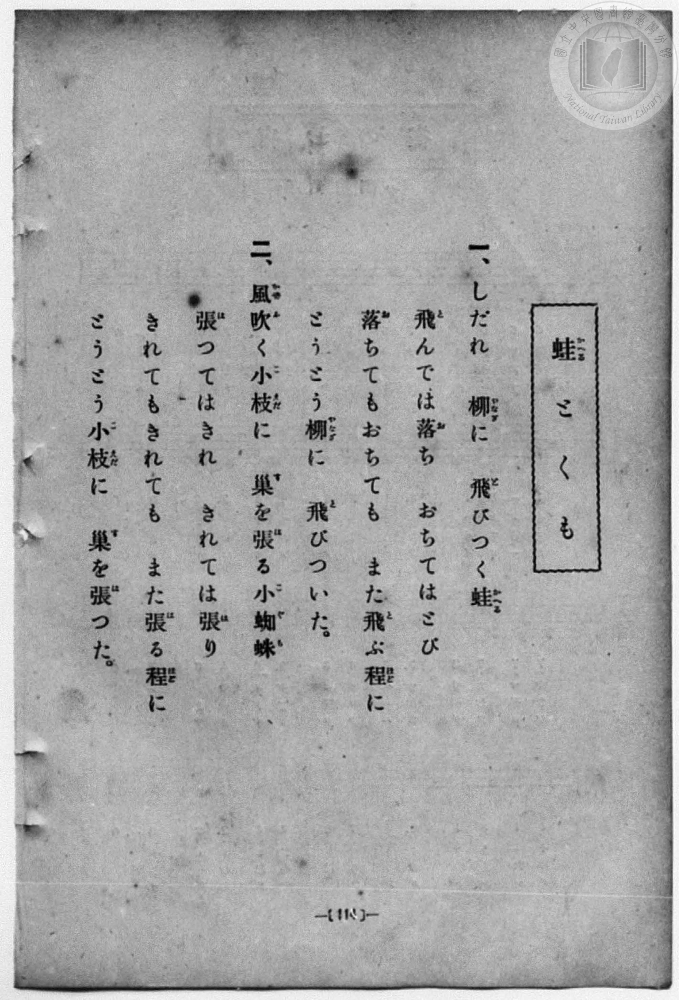
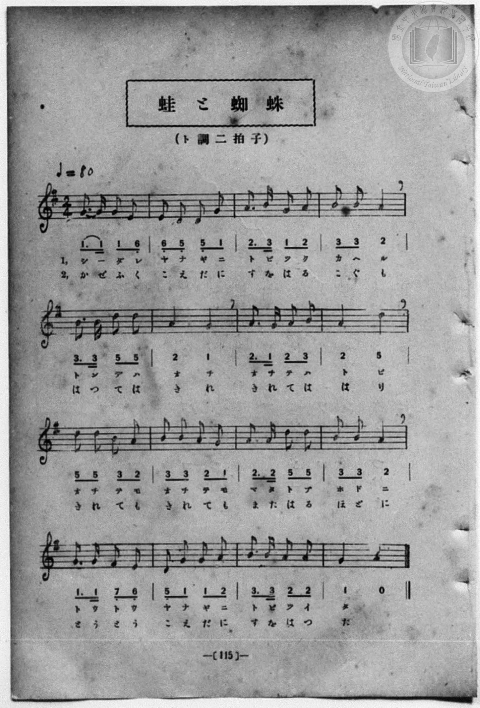

# 蛙とくも

> Re:Shōka 使用 AI 協助辨識與重建樂譜，可能會有錯誤。歡迎回報。

- **NEUTRINO 歌聲合成版**：<br><audio controls src="kaeru_to_kumo_neutrino.mp3"></audio>
- **鋼琴伴奏版**：<br><audio controls src="kaeru_to_kumo.mp3"></audio>


- 一條慎三郎 編《新編 小學校・公學校 唱歌教材集》（大正十二年十二月，索書號 0725-41）
- 尋常科第一、二學年用（第 114–115 頁）
- 文部省《尋常小學唱歌》

## 說明

原書資訊與歌詞全文（對應 P122.jpg–P123.jpg，書頁 pp. 114–115）：
調性與拍號：ト調二拍子（G 大調 2/4 拍），速度 ♩=80


## 歌詞

```text
一、
しだれ　柳に　飛びつく蛙
飛んでは落ち　おちてはとび
落ちてもおちても　また飛ぶ程に
とうとう柳に　飛びついた。

二、
風吹く小枝に　巢を張る小蜘蛛
張つてはきれ　きれては張り
きれてもきれても　また張る程に
とうとう小枝に　巢を張つた。
```

## ABC

```abc
X:1
T:蛙とくも
M:2/4
L:1/16
Q:1/4=80
K:G
V:V1 name="Piano" snm="Pia"
[V:V1]
G3 G G2 E2 | E2 D2 D2 G2 | A3 B G2 A2 | B2 B2 A4 |
w: 1.~し _ だ れ | や な ぎ に | と び つ く | か へ る
w: 2.~か ぜ ふ く | こ え だ に | す を は る | こ ぐ も
B3 B d2 d2 | A4 G4 | A3 G A2 B2 | A4 d4 |
w: 1.~と ん で は | お ち | お ち て は | と び
w: 2.~は つ て は | き れ | き れ て は | は り
d2 d2 B2 A2 | B2 B2 A2 G2 | A3 A d2 d2 | B2 B2 A4 |
w: 1.~お ち て も | お ち て も | ま た と ぶ | ほ ど に
w: 2.~き れ て も | き れ て も | ま た は る | ほ ど に
G3 G F2 E2 | D2 G2 G2 A2 | B3 B A2 A2 | G4 z4 |
w: 1.~と う と う | や な ぎ に | と び つ い | た
w: 2.~と う と う | こ え だ に | す を は つ | た
G3 G G2 E2 | E2 D2 D2 G2 | A3 B G2 A2 | B2 B2 A4 |
w: 1.~し _ だ れ | や な ぎ に | と び つ く | か へ る
w: 2.~か ぜ ふ く | こ え だ に | す を は る | こ ぐ も
B3 B d2 d2 | A4 G4 | A3 G A2 B2 | A4 d4 |
w: 1.~と ん で は | お ち | お ち て は | と び
w: 2.~は つ て は | き れ | き れ て は | は り
d2 d2 B2 A2 | B2 B2 A2 G2 | A3 A d2 d2 | B2 B2 A4 |
w: 1.~お ち て も | お ち て も | ま た と ぶ | ほ ど に
w: 2.~き れ て も | き れ て も | ま た は る | ほ ど に
G3 G F2 E2 | D2 G2 G2 A2 | B3 B A2 A2 | G4 z4 |
w: 1.~と う と う | や な ぎ に | と び つ い | た
w: 2.~と う と う | こ え だ に | す を は つ | た
```

## TMD 檔案連結

- [主旋律 TMD 檔案](kaeru_to_kumo.tmd) [[在 TMD Studio 編輯](https://tmdlang.github.io/Tmd-TS/#tmd=s7IKdvYPcrWy4qpTUCpJTLdSSM7PyUlNLsnMz7MqzsjPTozPrsyvSsyML84ojTe0NDJWgqssy88pzU21Si9KTEmNN4w3QsgU55cWJadaFSdn5OfnxJekVpQk5edno8vHFySmp1oFGBoh6Swoyi9LzUvMA-ouKMrMK0lNAWtHKEgty0xJBUkXJyfmxZelFmWmZaamIDkqtagY7HaIFSVFiXnFyUWZBSAPIVTlF5Vk5AMdXpBRaZWRWVySX5SZnJgTn52Yl4hQVJKRCvReYl5mbmIOumheYklpUSq6aHlqIpBRpMSlpaXwYvbMx40rHjf2P25qUtDS4lK0VbAw4LK3VXDnsjHSN7EDaX2yo-HZornPWvue7Oh82dyn8Hz7iscNXc-mbQAyFJ5u6H-6dsezBQsfN-9-2roGwlZ4OmXjs7U9z6bOfDZ3wsvZbY8but_v6Xi6ZPmztYuf9jY-2dXzdOcWCOPZnI73e3qeb1n0bPaOFzPnKxiYG5nqmhi-39MJdvbTDd1Pd-x4vnzi8zVrgO543ADWvHYHUP_zKSuAhgLFFQwNTR41TDY0NFV4uaARpvPZtPaXzSuez2kEuhViCsSpEKcBXaTExaWvpWBLLcCloKDwtG8-yBub21-s6HrR0Q6058XKeU9bVwDdAvL_ht5n7Z0KoKSkl1WQDnQykGkMYgJDAKgP6HiFggI9hHeAXnm_ZxbI4Ber9j9rWA4ysrsXGEpA0cfNHUBBUAB29z5dOwFovLsCMICBYgrAeFMAioJ197xsmP901zKFRzNX2gIjFmQWJBhBrMeN0x83LnjcBAyNhmfzNz9uXA1kvFw8-3EjkL0EmCiAqQOkDiTUNPlx4_LHjetfTNj7uHEhUN3jxi4Qo3EZUBCchDaDHQqRBoo2NSFUANkgDfseN84HG7_t-YpuoG0QNwC1tkFIbG5oAep53NAEcfkuoEvBLn-5aMXTCTuBLgTG6bN5cyG6nm5f9Lhp0tM9Wx83dQPFX8yZ8WL2bHC0AIVAZkGc2gvxMJQBFgTr6YI4ByYKcj8SG-Z-iPHY3Y_dMSCbwV4AqqY8mUGBgpY-F5d3YmpRaUi-d2luvlVAZmJevkONQU01yB4FG0MzLTswC1saV4DkphcLexQ0TEBZ-Pn6Bh1QwgSnRk0sGoDWgQyrUTBU0AVCQzBtFg8kaiCUKZwAydQoGIHVGYN5IHYNkA3iQ3ggWAM20cewBpQOoWLA5Agim3rAOh43tYDFVoHJPjC5GiLTuAKqfjMQLwGz-qEy3WDeDrA5IDaSXUYweZCKOUC8FUXnZDCvA-EOuG0zIXqaJgHZ6-EmI_RMAIs1wW3DH_K7esgJeVDYgULQFBTQSGEMCXGwvVARQzANUo9QA9KBHurQMGyaDGQvB_sD5DeQTBc8PhbCzYaJgsSAmQJFPcQkSHxghjhIFUhuCYa-Xpg-cIzD7IGIgsTQ1UNMAsnBXEgorHd0khPWsDCGpVfU1Iucwo2Q4gNfCge5FxKaUD-BUwt-mX3QcJsPDWFgwQmV2Q3mrQSToDSKHuKgEISEKbqZuGWQbUNN49htwxvuT2fPpqR0MQcVJNDiBV6ooBYloKAG8SAisCxggCXoYUVFGzwY2yAeI6l4AakFycyH2gByFXqw47SJlKIFbB92m2q5uHTtFJCKfQVMrjIXAA)]
- [鋼琴伴奏 TMD 檔案](kaeru_to_kumo_piano.tmd) [[在 TMD Studio 編輯](https://tmdlang.github.io/Tmd-TS/#tmd=s7IKdvYPcrWy4qpTUCpJTLdSSM7PyUlNLsnMz7MqzsjPTozPrsyvSsyML84ojTe0NDJWgqssy88pzU21Si9KTEmNN4w3QsgU55cWJadaFSdn5OfnxJekVpQk5edno8vHFySmp1oFGBoh6Swoyi9LzUvMA-ouKMrMK0lNAWtHKEgty0xJBUkXJyfmxZelFmWmZaamIDkqtagY7HaIFSVFiXnFyUWZBSAPIVTlF5Vk5AMdXpBRaZWRWVySX5SZnJgTn52Yl6jEpaWl8GL2zMeNKx439j9uanq_p-Pl7JnPOrtfdu95PmHLkz1bni7tf7-nU0FLi0vRVsHCgMveVsGdy8ZI38QOZMGTHQ3PFs191tr3ZEfny-Y-hefbVzxu6Ho2bQOQofB0Q__TtTueLVj4uHn309Y1ELbC0ykbn63teTZ15rO5E17Obnvc0A209OmS5c_WLn7a2_hkV8_TnVsgjGdzOt7v6Xm-ZdGz2TtezJyvYGBuZKprYgh0DthzTzd0P92x4_nyic_XrAG643EDWPPaHUD9z6esABoKFFcwNDR51DDZ0NBU4eWCRpjOZ9PaXzaveD6nEehWiCkQp0KcBnSREheXd2JqUWlIvndpbr5VQGZiXn6Qh0ONQU01lwIQ2BiaadmBWfpaCrboQAHioBcLexQ0TECh8Hx9g44CMO6N9bIK0jWxaNDSBxtWo2CooAuEhmDaLB5I1EAoUzgBkqlRMAKrMwbzQOwaIBvEh_BAsAZsoo9hjcLjxulQsceNC0BkUw9Yx-OmFrDYKjDZByZXQ2QaV0DVbwbiJWBWP1SmG8zbATYHxEayywgmD1IxB4i3ouicDOZ1INwBt20mRE_TJCB7PdxkhJ4JYLEmuG34Q35XDzkhDwo7UAiaggIaKYwhIQ62FypiCKZB6hFqQDrQQx0ahk2TgezlYH-A_AaS6YLHx0K42TBRkNjjxmUo6iEmQeIDM8RBqkBySzD09cL0gWMcZg9EFCSGrh5iEkgO5kJCYb2jk5ywhoUxLL2ipl7kFG6EFB_4UjjIvZDQhPoJnFrwy-yDhtt8aAg_btwGldkN5q0Ek6A0ih7ioBCEhCm6mbhlkG1DTePYbcMb7k9nz6akdDEHFSTQ4gVeqKAWJaCgBvEgIrAsYIAl6GFFRRs8GNsgHiOpeAGpBcnMh9oAchV6sOO0iZSiBWwfdptqsZT6Psilvgmi0H--cuXTxqXPps54sqv75aIVT7cvA1aakOoSKbzjFaINY5EZpvHIQqbxQBa6WoQSMAusBsw0wFSLqgmiFJvBCBksqkHmAr2ua6eA5PtoH8NYsAHowkZwYWUuAA)]

## 分析

```text
================================================================================
📊 TMD Song Profile: [ 蛙とくも ]
================================================================================
⏱  Duration:       0:48 (48.0s), 32 measures total
🎼 Key & Tempo:    首調基準 G, != 80.0 BPM, <2/4>
   - 分析範圍：      由實際發聲的音符與和弦推測調性；播放脈絡另行呈現
🎤 人聲音域:    D4 (MIDI 62) – D5 (MIDI 74) [跨度: 12 個半音 / 1.0 個八度, 難度: easy]
   - 最低音:  D4 in [KaeruToKumo #1 @ m.2, 0:01]
   - 最高音: D5 in [KaeruToKumo #1 @ m.5, 0:06]
   - 適合: soprano, mezzo-soprano, contralto, tenor, baritone, bass
🏛  結構:      KaeruToKumo (24.0s) -> KaeruToKumo (24.0s)
⚡ 編曲密度:        Peak 1 軌道同時演奏
🗝  調性診斷：       D 大調（純淨自然大調，未偵測到可信轉調）
   - 風格氣質:    純淨自然大調（陽光明朗、易唱易記，無明顯調外色彩）
   - 轉調歷程:    全曲維持單一推測調性（未偵測到可信轉調）
   - 核心骨幹音:  A, G, B, D, E
   - 調性數值:    D 大調 [相關度: 0.74, 穩定度: Moderate, 自然音純度: 100.0%]
   - 候選調性 (K-S): D 大調 (0.74), G 大調 (0.68), B 小調 (0.50)
   - 五度圈歷程:   +2 -> +2
   - 各段落調性細節:
     • [KaeruToKumo #1]: D 大調 (r: 0.74, 自然音純度: 100.0%)
     • [KaeruToKumo #2]: D 大調 (r: 0.74, 自然音純度: 100.0%)

  [ 五度圈游移軌跡 ]
               C  
         F            G  
      Bb              [D ]*
      Eb               A  
         Ab           E  
            Db       B  
               F# 
     (* = active key center)

  [ 十二半音累積音高分佈 ]
     C  :                            0.0%
     C# :                            0.0%
     D  : █████████████             17.7%
     D# :                            0.0%
     E  : ████                       4.8%
     F  :                            0.0%
     F# : █                          1.6%
     G  : █████████████████         23.4%
     G# :                            0.0%
     A  : ████████████████████████  32.3%
     A# :                            0.0%
     B  : ███████████████           20.2%
--------------------------------------------------------------------------------
Assignment 軌道音域：
  - Piano         : D4 – D5 (12 個半音 / 1.0 個八度, 110 個音符)
================================================================================
```


## 原書掃描頁






