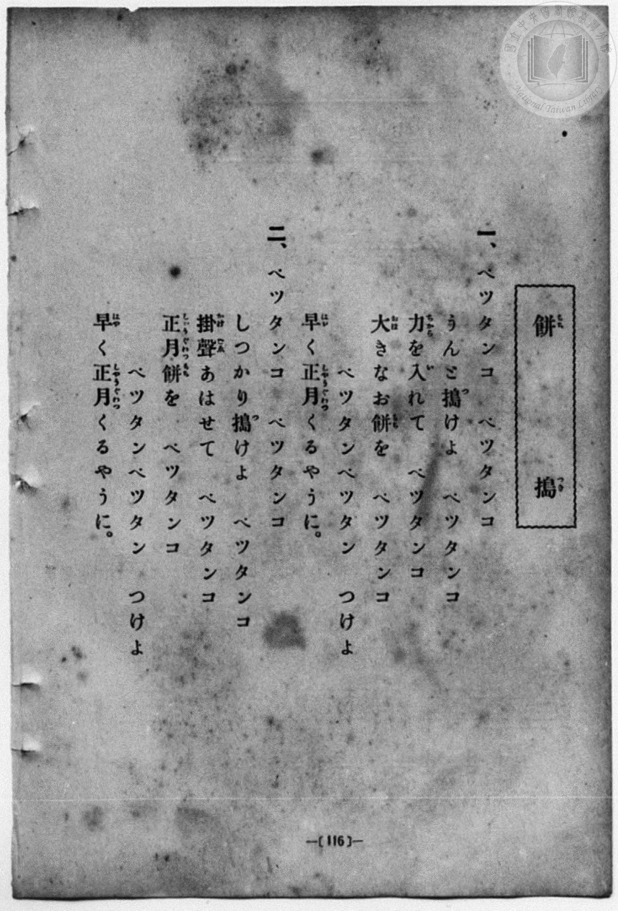
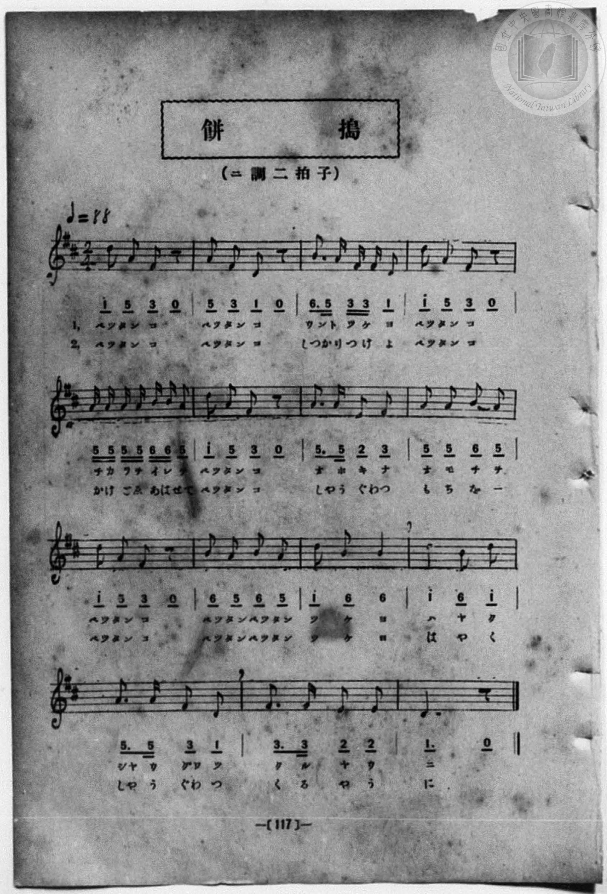

# 餅搗

> Re:Shōka 使用 AI 協助辨識與重建樂譜，可能會有錯誤。歡迎回報。

<audio controls src="mochitsuki.mp3"></audio>

- 詞：葛原𦱳
- 曲：小松耕輔
- 一條慎三郎 編《新編 小學校・公學校 唱歌教材集》（大正十二年十二月，索書號 0725-41）
- 尋常科第一、二學年用（第 116–117 頁）

## 說明

曲目說明
中文解釋：描寫過年或節慶時大家一起搗麻糬的熱鬧情景。

原書資訊與歌詞全文（對應 P124.jpg–P125.jpg，書頁 pp. 116–117）：
調性與拍號：ニ調二拍子（D 大調 2/4 拍），♩＝88（全曲共 15 小節）


## 歌詞

```text
一、
ペツタンコ　ペツタンコ
うんと搗けよ　ペツタンコ
力を入れて　ペツタンコ
大きなお餅を　ペツタンコ
ペツタンペツタン　つけよ
早く正月くるやうに。

二、
ペツタンコ　ペツタンコ
しつかり搗けよ　ペツタンコ
掛聲あはせて　ペツタンコ
正月餅を　ペツタンコ
ペツタンペツタン　つけよ
早く正月くるやうに。
```

## ABC

```abc
X:1
T:餅搗
C:曲：小松耕輔
M:2/4
L:1/16
Q:1/4=88
K:D
V:V1 name="Piano" snm="Pia"
[V:V1]
d2 A2 F2 z2 | A2 F2 D2 z2 | B3 A F F D2 | d2 A2 F2 z2 |
w: ペツ タン コ | ペツ タン コ | ウン ト ツ ケ ヨ | ペツ タン コ
A A A A B B A2 | d2 A2 F2 z2 | A3 A E2 F2 | A2 A2 B2 A2 |
w: チ カ ラ ヲ イ レ テ | ペツ タン コ | オ ホ キ ナ | オ モ チ ヲ
d2 A2 F2 z2 | B2 A2 B2 A2 | d2 B2 B4 | d4 B2 d2 |
w: ペツ タン コ | ペツ タン ペツ タン | ツ ケ ヨ | ハ ヤ ク
A3 A F2 D2 | F3 F E2 E2 | D6 z2 | d2 A2 F2 z2 |
w: シヤ ウ グワ ツ | ク ル ヤ ウ | ニ | ペツ タン コ
A2 F2 D2 z2 | B3 A F F D2 | d2 A2 F2 z2 | A A A A B B A2 |
w: ペツ タン コ | しつ かり つ け よ | ペツ タン コ | か け ご ゑ あ は せて
d2 A2 F2 z2 | A3 A E2 F2 | A2 A2 B2 A2 | d2 A2 F2 z2 |
w: ペツ タン コ | しや う ぐわ つ | も ち を _ | ペツ タン コ
B2 A2 B2 A2 | d2 B2 B4 | d4 B2 d2 | A3 A F2 D2 |
w: ペツ タン ペツ タン | ツ ケ ヨ | は や く | しや う ぐわ つ
F3 F E2 E2 | D6 z2 |
w: く る や う | に
```

## TMD 檔案連結

- [主旋律 TMD 檔案](mochitsuki.tmd) [[在 TMD Studio 編輯](https://tmdlang.github.io/Tmd-TS/#tmd=s7IKdvYPcrWy4qpTUCpJTLdSSM7PyUlNLsnMz7MqzsjPTozPrsyvSsyML84ojTe0NDJWgqssy88pzU21Si9KTEmNN4w3QsgU55cWJadaFSdn5OfnxJekVpQk5edno8vHFySmp1oFGBqZIGQKivLLUvMS84C6C4oy80pSU8DaEQpSyzJTUkHSxcmJefFlqUWZaZmpKUiOSi0qBrsdYkVJUWJecXJRZgHIQwhV-UUlGflAhxdkVFplZBaX5BdlJifmxGcn5iUiFJVkpAK9l5ZaXJJZlpiDIZ6fD7RWS0vh5ZLWZxOmK2hpcSnaKlhYcNnbKrhw2Rjpm9iBdDzZ0fBs0dxnrX1PdnS-bO5TeL59xeOGrmfTNgAZCk839D9du-PZgoWPm3c_bV0DYSs8nbLx2dqeZ1NnPps74eXstscN3e_3dDxdsvzZ2sVPexuf7Op5unMLhPFsTsf7PT3Ptyx6NnvHi5nzFQzMjUx1TQzf7-kEu_bphu6nO3Y8Xz7x-Zo1QHc8bgBrXrsDqP_5lBVAQ4HiCoaGZo8aJhsamiu8XNAI0_li5bz3e2a9mDj7ad_8D8s2bgYLPpu9CSgIdPOzufteNEx9sWeKEpe-lgJQ-PnsdS9WrXo2o49LQUHhyY61z6a1v1i--GU70OGznvX3P12_-mVjH9DWZx3Tnq9veNa67dnMJqCHnq7bBnTWi63bgeH3ctfu55vXPJ_V8rxt48s1y581tz6buf5xQxOXlj4XyBZbagGQE4G-AoXY5vYXK7pedLQDQxvo4aetK4DuBgX1ht5n7Z0KoISpl1WQDgwdINMUxAQGNlAfMJwUCgr0ECEHDDWgR0EGv1i1_1nDcpCR3b3ACAGKPm7uBgqC4qq79-naCUDjXRSAXgeKKQCTiAJQFKy759HMle_3zLWwANkPdMjsTU9bNyoYmoKSCDDIgGq4IGELikUQ63Ez0OiWx037Hzdvfty0-XFDA5oIWFFj2-OmyY8bVwAD-HHjxMdNHdjVPe2a_bhp0tPWpY-beh43LsOhaMnyx429jxtXPW7sAqZ5oAYcliILIbOBqhuXQJwBUvds-srHjf3ARA1MxUDG46bux00tIBc3rgbFO9i7u3pI8y7Ql0AbgAZ1EfDxs77ZLxo3PW5sety4_nHjbJyehjiPDt4FqqA8bUOBAijP-CZm5lkFZCbm5TvUGNRUgyxQsDE007IDs2oUDOMUdBVMgdgYiA2AuAbOM4SLmAFJkCpjIASJYtMGNs_HsAYaEkAhSACAGSAyHqyRgGzTMoggULi5A4hbgEIbgfQKwpohDjCi0AHgtANxADgBAaklQDwRqKqDSDeAQhACzYAQFEg4gxkkZgQVhYiAMCi4wdqQwrQRaM1qIL0SiDcB2UBHNa8B4jaiQnUVNEhnA9lrwawuJJnHzYvAZCOY3IQamI3dEO83TgGqBtFNQLweiEG5hcgQbQLJgkK0DYgnPG7qB3NAwQxyQhOYtxCsbxJYISIksYQbLHTgoQRRBOJC0ilcCARBQmAOBQkUQwSkCiKwESwPSp0Qex83g_wGCWyQ_x43rUcNTlraDYwWqN3gAAcWL0ghCUtusJxdA2aBAhaUAEEYGGpQ_SCIlqmbtkM8BDJ8GRBveNwMsg3iFpA8xO7HzaBECvE5LHV0I5mKllMJpQ2wD0BmARMh1E_QBN-4GsPUWi4uXTsFUIEX7WMYqwBnG4HZylwA)]
- [鋼琴伴奏 TMD 檔案](mochitsuki_piano.tmd) [[在 TMD Studio 編輯](https://tmdlang.github.io/Tmd-TS/#tmd=s7IKdvYPcrWy4qpTUCpJTLdSSM7PyUlNLsnMz7MqzsjPTozPrsyvSsyML84ojTe0NDJWgqssy88pzU21Si9KTEmNN4w3QsgU55cWJadaFSdn5OfnxJekVpQk5edno8vHFySmp1oFGBqZIGQKivLLUvMS84C6C4oy80pSU8DaEQpSyzJTUkHSxcmJefFlqUWZaZmpKUiOSi0qBrsdYkVJUWJecXJRZgHIQwhV-UUlGflAhxdkVFplZBaX5BdlJifmxGcn5iUqcWlpKbxc0vpswvT3ezpezp75rLP7Zfee5xO2PNmz5enS_vd7OhW0tLgUbRUsLLjsbRVcuGyM9E3sQEY_2dHwbNHcZ619T3Z0vmzuU3i-fcXjhq5n0zYAGQpPN_Q_Xbvj2YKFj5t3P21dA2ErPJ2y8dnanmdTZz6bO-Hl7LbHDd1AS58uWf5s7eKnvY1PdvU83bkFwng2p-P9np7nWxY9m73jxcz5CgbmRqa6JoZA54C99XRD99MdO54vn_h8zRqgOx43gDWv3QHU_3zKCqChQHEFQ0OzRw2TDQ3NFV4uaITpfLFy3vs9s15MnP20b_6HZRs3gwWfzd4EFAS6-dncfS8apr7YM0WJi8s3MTPPKiAzMS8_yMOhxqCmmksBCGwMzbTswKwaBcM4BV0FUyA2BmIDIK6B8wzhImZAEqTKGAhBoti0gc3zMaxReNw863FzC1DocdP-x82bwQwQGQ_WSEC2aRlEECjc3AHELUChjUB6BWHNEAcYUeiAxumPG5dAHNDY_bipC0gtAeKJQFUdRLoBFIIQaAaEoEDCGcwgMSOoKEQEhEHBDdaGFKaNQGtWA-mVQLwJyAY6qnkNELcRFaqroEE6G8heC2Z1Ick8bl4EJhvB5CbUwGzshni_cQpQNYhuAuL1QDz7ceMyIkO0CSQLCtE2IJ7wuKkfzAEFM8gJTWDeQrC-SWCFiJDEEm6w0IGHEkQRiAtJp3AhEAQJgTkUJFAMEZAqiMBGsDwodULsfdwM8hsksEH-e9y0HjU4aWk3MFqgdoMD_HEjyC2INAnLw5CcXQNmgQIWlABBGBhqUP0giJapm7ZDPAQyfBkQb3jcDLIN4haQPMTux82gRArxOSx1dCOZipZTCaUNsA9AZgETIdRP0ATfuBrD1Frk8s4HubyzgBd30YaxQLUg0gCTZwLjgWxAkUPVDVaHwyzTeBRJiFLslkOsQzUMGw9DN5IKVOtAsQYOB107BVBQRPuAhGFsIzBbmQsA)]

## 分析

```text
================================================================================
📊 TMD Song Profile: [ 餅搗 ]
================================================================================
⏱  Duration:       0:40 (40.9s), 30 measures total
🎼 Key & Tempo:    首調基準 D, != 88.0 BPM, <2/4>
   - 分析範圍：      由實際發聲的音符與和弦推測調性；播放脈絡另行呈現
🎤 人聲音域:    D4 (MIDI 62) – D5 (MIDI 74) [跨度: 12 個半音 / 1.0 個八度, 難度: easy]
   - 最低音:  D4 in [Main[L1] #1 @ m.2, 0:02]
   - 最高音: D5 in [Main[L1] #1 @ m.1, 0:00]
   - 適合: soprano, mezzo-soprano, contralto, tenor, baritone, bass
🏛  結構:      Main[L1] (20.5s) -> Main[L2] (20.5s)
⚡ 編曲密度:        Peak 1 軌道同時演奏
🗝  調性診斷：       D 大調（純淨自然大調，未偵測到可信轉調）
   - 風格氣質:    純淨自然大調（陽光明朗、易唱易記，無明顯調外色彩）
   - 轉調歷程:    全曲維持單一推測調性（未偵測到可信轉調）
   - 核心骨幹音:  A, D, F#, B, E
   - 調性數值:    D 大調 [相關度: 0.86, 穩定度: High, 自然音純度: 100.0%]
   - 候選調性 (K-S): D 大調 (0.86), A 大調 (0.70), F# 小調 (0.66)
   - 五度圈歷程:   +2 -> +2
   - 各段落調性細節:
     • [Main[L1] #1]: D 大調 (r: 0.86, 自然音純度: 100.0%)
     • [Main[L2] #1]: D 大調 (r: 0.86, 自然音純度: 100.0%)

  [ 五度圈游移軌跡 ]
               C  
         F            G  
      Bb              [D ]*
      Eb               A  
         Ab           E  
            Db       B  
               F# 
     (* = active key center)

  [ 十二半音累積音高分佈 ]
     C  :                            0.0%
     C# :                            0.0%
     D  : ███████████████████       25.9%
     D# :                            0.0%
     E  : ████                       5.6%
     F  :                            0.0%
     F# : ██████████████            18.5%
     G  :                            0.0%
     G# :                            0.0%
     A  : ████████████████████████  32.4%
     A# :                            0.0%
     B  : █████████████             17.6%
--------------------------------------------------------------------------------
Assignment 軌道音域：
  - Piano         : D4 – D5 (12 個半音 / 1.0 個八度, 108 個音符)
================================================================================
```


## 原書掃描頁






