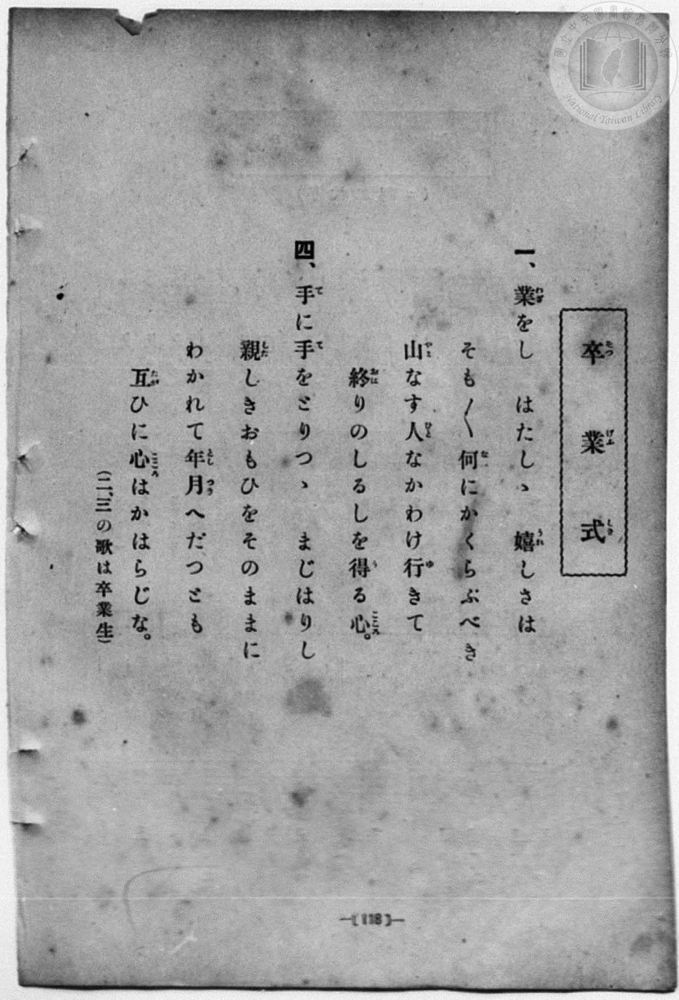
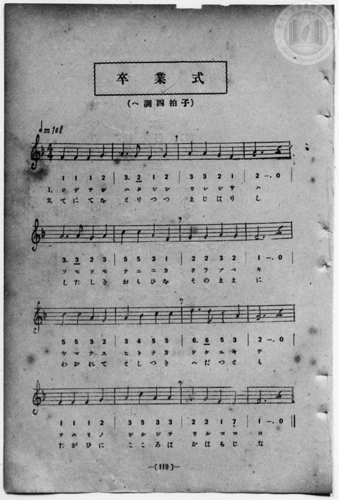

# 卒業式

> Re:Shōka 使用 AI 協助辨識與重建樂譜，可能會有錯誤。歡迎回報。

- **鋼琴伴奏版**：<br><audio controls src="sotsugyoshiki.mp3"></audio>
- **NEUTRINO 歌聲合成版**：<br><audio controls src="sotsugyoshiki_neutrino.mp3"></audio>

- 一條慎三郎 編《新編 小學校・公學校 唱歌教材集》（大正十二年十二月，索書號 0725-41）
- 尋常科第一、二學年用（第 118–119 頁）

## 說明

原書資訊與歌詞全文（對應 P126.jpg–P127.jpg，書頁 pp. 118–119）：
調性與拍號：ヘ調四拍子（F 大調 4/4 拍），♩＝108
註記：本冊 P126.jpg 僅印出一、四兩節在校生歌詞，並註記「（二、三の歌は卒業生）」。
右頁 P127.jpg 譜下將一、四兩節標為「1,」「2,」。


## 歌詞

```text
一、
業をし　はたしゝ　嬉しさは
そも／＼何にかけらぶべき
山なす人なかわけ行きて
終りのしるしを得る心。

四、
手に手をとりつゝ　まじはりし
親しきおもひをそのままに
わかれて年月へだつとも
互ひに心はかはらじな。
（二、三の歌は卒業生）
```

## ABC

<div class="abc-score" data-abc-src="sotsugyoshiki.abc" aria-label="五線譜載入中"></div>

[下載 ABC 原始檔](sotsugyoshiki.abc)

## TMD 檔案連結

- [主旋律 TMD 檔案](sotsugyoshiki.tmd) [[在 TMD Studio 編輯](https://tmdlang.github.io/Tmd-TS/#tmd=s7IKdvYPcrWy4qpTUCpJTLdSSM7PyUlNLsnMz7MqzsjPTozPrsyvSsyML84ojTe0NDJWgqssy88pzU21Si9KTEmNN4w3QsgU55cWJadaFSdn5OfnxJekVpQk5edno8vHFySmp1oFGBqZIWQKivLLUvMS84C6C4oy80pSU8DaEQpSyzJTUkHSxcmJefFlqUWZaZmpKUiOSi0qBrsdYkVJUWJecXJRZgHIQwhV-UUlGflAhxdkVFplZBaX5BdlJifmxGcn5iUiFJVkpAK9l5xalJqbn5eZmIMuA_VeTmZaKrLJmemZeVa5qZlZmUg-19JSeNo76dnStU_39CtoaXEp2ioYGlhw2dsquHHZmOib2IEMeLKj4dmiuc9a-57s6HzZ3KfwfPuKxw1dz6ZtADIUnm7of7p2x7MFCx83737augbCVng6ZeOztT3Pps58NnfCy9ltjxu63-_peLpk-bO1i5_2Nj7Z1fN05xYI49mcjvd7ep5vWfRs9o4XM-crGJgbmeqaGL7f0wl2_NMN3U937Hi-fOLzNWuA7njcANa8dgdQ__MpK4CGAsUVDA0tHjVMNjS0VHi5oBGsk0tfS8GWWoBLQUHhad98kAM3t79Y0fWiox3ouRcr5z1tXfFsWjvIZxt6n7V3KoDSjF5WQTrQMUCmOYgJ9BtQH9BZCgUFegiHAh35fs8skMEvVu1_1rAcZGR3L9D_QNHHzTOAgk9nzwaKPF07AWi8mwIw6IBiCsAYUQCKgnX3PJq58v2euaDoAhmzYveLFTOAup_NWfO0rQvuFIWnza1Pezc8bd8FCT2gsU9bVz5f3_B0zgpgRD2fMh_iFaB5T3Ysg5jyuKEHaCkwnEGhvaPzceM6oJrHjeshKQWoBWj_44bexw1NIJsh4Gn_ZpAnYd5WeLF2zpMd3U83tKNZ-2zFzOdNu4A2GOqAjegxgtBNXCCzIIpBLKBFj5smPW6c_rihAWj148b5IHbTXCD36Rqgk6Y_bpwKFAcpfdw493FT0_s9_e_37HmyFyi6-nFj9-PGiY-bgOq2PW7c-bixFxyFGzc-blz1uHHmk127wIzux039QHUvFgI91_u4cRlI0fOtTY-buoBeBlsHNAZITnq6D8R-ur8Z5k6gd2Du7ASqWQ0iQa5dAda7BOLOx437HjfOADkeJDgdHEvLgNYCnQ60rQvo5seNm8Da5oLtA6oGotVgL4EcBjQS6LBlwJQOzCOPG3c8blwAMhtkCTjgn-wCat0E1AFyGCiIgC4B2gX0NNDSVdDYIRiRIEWUZxEoUNDS5-LyTQQWNGH5wILLocagRqEanEhsLLTswAxsGVMBkrmBEaGgYQIqUYAJRQeeljSxaADaAzKsRsFQQReOjYC4RsEYSILYqCIgDOKBRGvALBg0AImATfMxrFF43LweyH_ctA1ENm8Cs7eD9Txu7gerf9y0HyoGl2laBla9Bi72uGkrih4IjEfYZASUawTralwNJsHspkkQXY0roDZ1AdlLwPIgEiSzD8ybASYhLu2CykzHsAl_eO_qISe8IaFrDA5BELtGwRRIgjCIhwhdmDwkBkDiOMK7aS_Er82LoGwQCxJ2IJ89bu5GkE2gsALpAfu8eSWYnAYmZ0Jl1uIJb0gIAYsSKBuYD6FhB7apqQksBolzWEzMBYutA5OQsAeRIBmQW0gJ7x2d5IQ3cugiUrMJVBSEaxTMwG4wg6vDn77B6al5HpiE-HsnNLxBfn7c3IEkAw1vcJ4A8TcC2ZCUCgpnkEwb7vBuAqV9YKkEVt8DZoP0wtI3LA4g6RsWEzugcbQALgNSCzINFDskhDewiKZeeQILWUTowsoSc7BT8CVwSCECLggeN68Ck31QL4GLimZwAQBlg9QiChSIzGY4CTINXwKfDw4wSFCDbQUnUpDMZDAPTDaBghpSeIBkwNEDLUo6wWxQ4QKSAbkV1aZaLi5dOwVQ-a6ARCtzAQA)]
- [鋼琴伴奏 TMD 檔案](sotsugyoshiki_piano.tmd) [[在 TMD Studio 編輯](https://tmdlang.github.io/Tmd-TS/#tmd=s7IKdvYPcrWy4qpTUCpJTLdSSM7PyUlNLsnMz7MqzsjPTozPrsyvSsyML84ojTe0NDJWgqssy88pzU21Si9KTEmNN4w3QsgU55cWJadaFSdn5OfnxJekVpQk5edno8vHFySmp1oFGBqZIWQKivLLUvMS84C6C4oy80pSU8DaEQpSyzJTUkHSxcmJefFlqUWZaZmpKUiOSi0qBrsdYkVJUWJecXJRZgHIQwhV-UUlGflAhxdkVFplZBaX5BdlJifmxGcn5iUqcWlpKTztnfRs6dqne_rf7-l4OXvms87ul917nk_Y8mTPlqdLgYKdClpaXIq2CoYGFlz2tgpuXDYm-iZ2IOOf7Gh4tmjus9a-Jzs6Xzb3KTzfvuJxQ9ezaRuADIWnG_qfrt3xbMHCx827n7augbAVnk7Z-Gxtz7OpM5_NnfBydtvjhm6grU-XLH-2dvHT3sYnu3qe7twCYTyb0_F-T8_zLYuezd7xYuZ8BQNzI1NdE0Oge8Bee7qh--mOHc-XT3y-Zg3QHY8bwJrX7gDqfz5lBdBQoLiCoaHFo4bJhoaWCi8XNIJ1cvkmZuZZheUDQ8ChxqBGoZpLAQhsLLTswIwaBUMFXTg2AuIaBWMgCWKjioAwiAcSrQGzYNAAJAI2zcewRuFx83og_3HTNhDZvAnM3g7W87i5H6z-cdN-qBhcpmkZWPUauNjjpq0oeiAwHmGTEVCuEayrcTWYBLObJkF0Na6A2tQFZC8By4NIkMw-MG8GmIS4tAsqMx2rTbDwMAb7GcSuUTAFkiAM4iHCAyYPCTOQOI4QatoLcV3zIigbxIL4FuSWx83dCLIJ5DuQHrBbm1eCyWlgciZUZi2eEIL46XHjfCj7cWMv1Ldgm5qawGKQWIKF3Vyw2DowCQktEAmSAbkFWwghhwcixZhARUG4RsEMrMsMrg5_GgLHWfM8MAlx6U5oCIFc-bi5A0kGGkLgdAfibwSyIakBFDIgmTbcIdQESl-PGyFh3QNmg_TC0hAs1CBpCBZ2O6ChugAuA1ILMg0UnthCCHsug4UFIjxgOcwcrBlfIoJkLXD2eNy8Ckz2QR0BzkDN4GwBZYPUIrIZRGYznASZhi8RzQd7ERI4YFvBCQEkMxnMA5NNoMCBZCmQDDhAoRmsE8wGZTmQDMitqDbVQkupgMzEvPwgD-zllGm8Nig0UCnzeG1obtOGlVrYZSAkVBCqpAaJj8FChDbCcGOYBogAWEIbFIdINLLxZhDVUAqoF8kNKB5C1oZmMRbz0bxmpA3KaOhKQbIm2rBMh2oA0R4nJsxRjYZZgOp1hAHQdI3X7yjJwQdHcjAEGWQaDyKRmFBxEMQUBRNGcBbIFQg1EBIl8GEmIdmCaS9U2AQsYoRhIKYGDCsQBIoWcxx2wP1GvCdwBROCMIMKk-oNYFTp2imAYivaxzBWAc42ArOVuQA)]

## 分析

```text
================================================================================
📊 TMD Song Profile: [ 卒業式 ]
================================================================================
⏱  Duration:       1:11 (71.1s), 32 measures total
🎼 Key & Tempo:    首調基準 F, != 108.0 BPM, <4/4>
   - 分析範圍：      由實際發聲的音符與和弦推測調性；播放脈絡另行呈現
🎤 人聲音域:    E4 (MIDI 64) – D5 (MIDI 74) [跨度: 10 個半音 / 0.8 個八度, 難度: easy]
   - 最低音:  E4 in [Main #1 @ m.15, 0:32]
   - 最高音: D5 in [Main #1 @ m.11, 0:22]
   - 適合: soprano, mezzo-soprano, contralto, tenor, baritone, bass
🏛  結構:      Main (35.6s) -> Main (35.6s)
⚡ 編曲密度:        Peak 1 軌道同時演奏
🗝  調性診斷：       F 大調（純淨自然大調，未偵測到可信轉調）
   - 風格氣質:    純淨自然大調（陽光明朗、易唱易記，無明顯調外色彩）
   - 轉調歷程:    全曲維持單一推測調性（未偵測到可信轉調）
   - 核心骨幹音:  G, F, A, C, D
   - 調性數值:    F 大調 [相關度: 0.72, 穩定度: Moderate, 自然音純度: 100.0%]
   - 候選調性 (K-S): F 大調 (0.72), C 大調 (0.64), A 小調 (0.52)
   - 五度圈歷程:   -1 -> -1
   - 各段落調性細節:
     • [Main #1]: F 大調 (r: 0.72, 自然音純度: 100.0%)
     • [Main #2]: F 大調 (r: 0.72, 自然音純度: 100.0%)

  [ 五度圈游移軌跡 ]
               C  
        [F ]*          G  
      Bb               D  
      Eb               A  
         Ab           E  
            Db       B  
               F# 
     (* = active key center)

  [ 十二半音累積音高分佈 ]
     C  : ███████████               13.3%
     C# :                            0.0%
     D  : ███                        3.3%
     D# :                            0.0%
     E  : █                          1.7%
     F  : ██████████████████████    26.7%
     F# :                            0.0%
     G  : ████████████████████████  29.2%
     G# :                            0.0%
     A  : ████████████████████      24.2%
     A# : █                          1.7%
     B  :                            0.0%
--------------------------------------------------------------------------------
Assignment 軌道音域：
  - Vocal         : E4 – D5 (10 個半音 / 0.8 個八度, 104 個音符)
================================================================================
```


## 原書掃描頁






