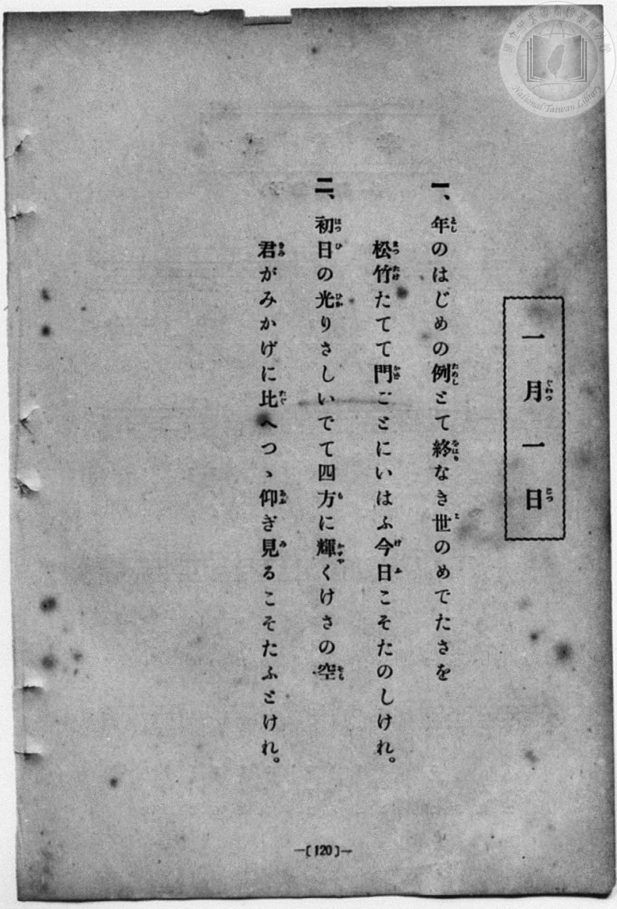
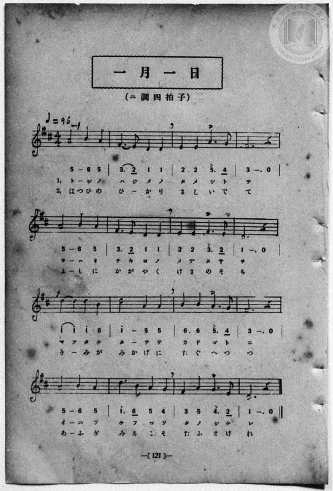

# 一月一日

> Re:Shōka 使用 AI 協助辨識與重建樂譜，可能會有錯誤。歡迎回報。

<audio controls src="ichigatsu_ichijitsu.mp3"></audio>

- 詞：千家尊福
- 曲：上真行
- 一條慎三郎 編《新編 小學校・公學校 唱歌教材集》（大正十二年十二月，索書號 0725-41）
- 尋常科第一、二學年用（第 120–121 頁）

## 說明

原書資訊與歌詞全文（對應 P128.jpg–P129.jpg，原書 pp. 120–121）：
調性與拍號：ニ調四拍子（D 大調 4/4 拍），♩= 96


## 歌詞

```text
一、
年のはじめの例とて　終なき世のめでたさを
松竹たてて門ごとに　いはふ今日こそたのしけれ。

二、
初日の光りさしいでて　四方に輝くけさの空
君がみかげに比へつゝ　仰ぎ見るこそたふとけれ。
```

## ABC

```abc
X:1
T:一月一日
C:曲：上真行
M:4/4
L:1/16
Q:1/4=96
K:D
V:V1 name="Piano" snm="Pia"
[V:V1]
A8 B4 A4 | F6 E2 D4 D4 | E4 E4 A6 G2 | F12 z4 |
w: 1.~と し の | は じ め の | た め し と | て
w: 2.~はつ ひ の | ひ _ か り | さ し い で | て
A8 B4 A4 | F6 E2 D4 D4 | E4 E4 F6 E2 | D12 z4 |
w: 1.~を は り | な き よ の | め で た さ | を
w: 2.~よ も に | か が や く | け さ の そ | ら
d4 d4 d4 B4 | d8 A4 A4 | B4 B4 A6 G2 | F12 z4 |
w: 1.~ま つ た け | た て て | か ど ご と | に
w: 2.~き _ み が | みか げ に | た ぐ へ つ | つ
A8 B4 A4 | d6 B2 A4 G4 | F4 A4 G6 E2 | D12 z4 |
w: 1.~い は ふ | け ふ こ そ | た の し け | れ
w: 2.~あ ふ ぎ | み る こ そ | た ふ と け | れ
A8 B4 A4 | F6 E2 D4 D4 | E4 E4 A6 G2 | F12 z4 |
w: 1.~と し の | は じ め の | た め し と | て
w: 2.~はつ ひ の | ひ _ か り | さ し い で | て
A8 B4 A4 | F6 E2 D4 D4 | E4 E4 F6 E2 | D12 z4 |
w: 1.~を は り | な き よ の | め で た さ | を
w: 2.~よ も に | か が や く | け さ の そ | ら
d4 d4 d4 B4 | d8 A4 A4 | B4 B4 A6 G2 | F12 z4 |
w: 1.~ま つ た け | た て て | か ど ご と | に
w: 2.~き _ み が | みか げ に | た ぐ へ つ | つ
A8 B4 A4 | d6 B2 A4 G4 | F4 A4 G6 E2 | D12 z4 |
w: 1.~い は ふ | け ふ こ そ | た の し け | れ
w: 2.~あ ふ ぎ | み る こ そ | た ふ と け | れ
```

## TMD 檔案連結

- [主旋律 TMD 檔案](ichigatsu_ichijitsu.tmd) [[在 TMD Studio 編輯](https://tmdlang.github.io/Tmd-TS/#tmd=s7IKdvYPcrWy4qpTUCpJTLdSSM7PyUlNLsnMz7MqzsjPTozPrsyvSsyML84ojTe0NDJWgqssy88pzU21Si9KTEmNN4w3QsgU55cWJadaFSdn5OfnxJekVpQk5edno8vHFySmp1oFGBpZIGQKivLLUvMS84C6C4oy80pSU8DaEQpSyzJTUkHSxcmJefFlqUWZaZmpKUiOSi0qBrsdYkVJUWJecXJRZgHIQwhV-UUlGflAhxdkVFplZBaX5BdlJifmxGcn5iUiFJVkpAK9V5yaWJyfV4wunJxalJqbn5eZmKPEpaWl8GRHw7M5HSBy-lIFLS0uRVsFSzMue1sFFy4bE30TO5BukOyiuc9a-57s6HzZ3KfwfPuKxw1dz6ZtADIUnm7of7p2x7MFCx83737augbCVng6ZeOztT3Pps58NnfCy9ltjxu63-_peLpk-bO1i5_2Nj7Z1fN05xYIA2j7-z09z7csejZ7x4uZ8xUMzI1MdU0M3-_pBLv86Ybupzt2PF8-8fmaNUB3PG4Aa167A6j_-ZQVQEOB4gqGRgaPGiYbGhkqvFzQCNP5YuW893tmPe1tfrpu29MNXc-X9YOFn83eBBR-sqPr-Zz5Lxb2KHFx6Wsp2FILcCkoKDztmw_yy-b2Fyu6XnS0A8MB6JSnrSueTWsHBcKG3mftnQqg1KOXVZAOdDeQaQliAoMBolWhoEAP4Segf4AOBhn8YtX-Zw3LQUZ29wKDCij6uLkbKPh09mygyNO1E4DGuygAQxkopgCMPAWgKFh3z6OZK8HxCjIFEopgh-7c8rhx3ePG9Y8bZzxuagSyn-zrfty44nHjsscNDc-3Nj1uXPW4sffJjmkgZSAFyx83zn_cOPVx0ySQ_mdz9z1fvRMstAyIXk5reNw4Bax_NVD_48YWsNFbn-zuAiaux42THzfOBSsGWjn9cePEx009jxuaIG7aBWRC3NQxF6x43dPWzsdNXSDLQIqBRgHtBjkL5NlpQEtXv9gDNK0fZA5IzbrnK3eB9U-Y_bix53Hj_seNQK9MAqp7th7oph2PG5c8bpoL1P9k94bHjX0vlnU_bgIqgLtpK9jdMDcBDaI8LUCBgpY-F5dnckZmemJJcSmIkZUJZFgFZCbm5TvUGNRUg6xTsLHQsgMzsCVHBUjqB6ZXBQ0TUJZ7vr5BB5SGwAlHE4sGoKUgw2oUTBV0wdAMiEHsGgVjMN9IwRBIgnANkA3iQ-R1FUzgaiDQAKQGbJqPYY0CMJyg4sCIAZPrwGYA4xoqOkMBmFZQZOaDeFAxkB4QvQIsswzJnniEPUZg84BxBrdqE4qBIB5EvBtsdBdUfCqSs1qgKpbjsAh_YO_qoXVgw2RqwOI4ArtpEtynoOBF-HQVVLQXKNaBHDbQYF4OJkEBD6KngmVgZmEJbLAZYLVNTWAdq6H2gMIXxO8ByoBCFJjloDIToSbD7AbRc8H2dJIY1js6yQlrwzhQkMIJUJBDBUEQFPqQGABJwOKDcOLeB_YHKN1Bky3Yn7BEDPElKC1BSFgIPW5cCSanQFVAEjcoDHEl7l64afuh4QsxDVRuwaVAEYaICohzJoDJHVAVS8AysGxCZIADi1DqJG5oaJuBuSZgIVDYwngEUzc0j8JTd-NWqFdBYQ7hA4toMGsuSiCA0huiKJkITnWgEMQV2qA0DTMRRPbBQhsi2tSNwx6IakiBh9ueWi4uXTsFzCJeAaeoMhcA)]
- [鋼琴伴奏 TMD 檔案](ichigatsu_ichijitsu_piano.tmd) [[在 TMD Studio 編輯](https://tmdlang.github.io/Tmd-TS/#tmd=s7IKdvYPcrWy4qpTUCpJTLdSSM7PyUlNLsnMz7MqzsjPTozPrsyvSsyML84ojTe0NDJWgqssy88pzU21Si9KTEmNN4w3QsgU55cWJadaFSdn5OfnxJekVpQk5edno8vHFySmp1oFGBpZIGQKivLLUvMS84C6C4oy80pSU8DaEQpSyzJTUkHSxcmJefFlqUWZaZmpKUiOSi0qBrsdYkVJUWJecXJRZgHIQwhV-UUlGflAhxdkVFplZBaX5BdlJifmxGcn5iUqcWlpKTzZ0fBsTgeInL70_Z6Ol7NnPuvsftm95_mELU_2bHm6tP_9nk4FLS0uRVsFSzMue1sFFy4bE30TO5AFIF2L5j5r7Xuyo_Nlc5_C8-0rHjd0PZu2AchQeLqh_-naHc8WLHzcvPtp6xoIW-HplI3P1vY8mzrz2dwJL2e3PW7oBlr6dMnyZ2sXP-1tfLKr5-nOLRAG0FXv9_Q837Lo2ewdL2bOVzAwNzLVNTEEOgfsuacbup_u2PF8-cTna9YA3fG4Aax57Q6g_udTVgANBYorGBoZPGqYbGhkqPByQSNM54uV897vmfW0t_npum1PN3Q9X9YPFn42exNQ-MmOrudz5r9Y2KPExeWZnJGZnlhSXApiZGUCGVYBmYl5-UEeDjUGNdVcCkBgY6FlB2boaynYogMFiNuApilomIAC5Pn6Bh2FAAMzC72sgnRNLBq09MGG1SiYKuiCoRkQg9g1CsZgvpGCIZAE4RogG8SHyOsqmMDVQKABSA3YNB_DGoXHjSug4o8bp4PJdWAzHjeuh4rOUHjc1IgiMx_Eg4qB9IDoFWCZZUj2xCPsMQKb97hxCdyqTSgGgngQ8W6w0V1Q8alIzmqBqliOwyL8gb2rh9aBDZOpAYvjCOymSXCfgoIX4dNVUNFeoFgHcthAg3k5mAQFPIieCpaBmYUlsMFmgNU2NYF1rIbaAwpfEL8HKAMK0ceN_VCZiVCTYXaD6LlgezpJDOsdneSEtWEcKEjhBCjIoYIgCAp9SAyAJGDxQThx7wP7A5TuoMkW7E9YIob4EpSWICQshB43rgSTU6AqIIkbFIa4Encv3LT90PCFmLYfFuQgQVCEIaIC4pwJYHIHVMUSsAwsmxAZ4E9nz6ZO4oaGthmYawIWAoUtjEcwdUPzKDx1N26FehUU5hD-48bJYNZclEAApTdEUTIRnOpAIYgrtEFpGmYiiOyDhTZEtKkbhz0Q1ZACD7c9tbhLeB_kEt4EUcI_nTbnWeu2ZzP6nuxaB4yOZ929T9dOgFSTSCk8XiHaMBZGYfJN44Es0_hYBANZjQE0BOBiJkDKBEkNnE-sOVANcPtx8IlzDWFdOM0BhreunQJmkEf7ANXgkDECyyhzAQA)]

## 分析

```text
================================================================================
📊 TMD Song Profile: [ 一月一日 ]
================================================================================
⏱  Duration:       1:20 (80.0s), 32 measures total
🎼 Key & Tempo:    首調基準 D, != 96.0 BPM, <4/4>
   - 分析範圍：      由實際發聲的音符與和弦推測調性；播放脈絡另行呈現
🎤 人聲音域:    D4 (MIDI 62) – D5 (MIDI 74) [跨度: 12 個半音 / 1.0 個八度, 難度: easy]
   - 最低音:  D4 in [IchigatsuIchijitsu #1 @ m.2, 0:03]
   - 最高音: D5 in [IchigatsuIchijitsu #1 @ m.9, 0:20]
   - 適合: soprano, mezzo-soprano, contralto, tenor, baritone, bass
🏛  結構:      IchigatsuIchijitsu (40.0s) -> IchigatsuIchijitsu (40.0s)
⚡ 編曲密度:        Peak 1 軌道同時演奏
🗝  調性診斷：       D 大調（純淨自然大調，未偵測到可信轉調）
   - 風格氣質:    純淨自然大調（陽光明朗、易唱易記，無明顯調外色彩）
   - 轉調歷程:    全曲維持單一推測調性（未偵測到可信轉調）
   - 核心骨幹音:  D, A, F#, B, E
   - 調性數值:    D 大調 [相關度: 0.95, 穩定度: High, 自然音純度: 100.0%]
   - 候選調性 (K-S): D 大調 (0.95), A 大調 (0.69), F# 小調 (0.64)
   - 五度圈歷程:   +2 -> +2
   - 各段落調性細節:
     • [IchigatsuIchijitsu #1]: D 大調 (r: 0.95, 自然音純度: 100.0%)
     • [IchigatsuIchijitsu #2]: D 大調 (r: 0.95, 自然音純度: 100.0%)

  [ 五度圈游移軌跡 ]
               C  
         F            G  
      Bb              [D ]*
      Eb               A  
         Ab           E  
            Db       B  
               F# 
     (* = active key center)

  [ 十二半音累積音高分佈 ]
     C  :                            0.0%
     C# :                            0.0%
     D  : ████████████████████████  27.5%
     D# :                            0.0%
     E  : █████████                 10.0%
     F  :                            0.0%
     F# : █████████████████         19.2%
     G  : █████                      5.8%
     G# :                            0.0%
     A  : ███████████████████████   26.7%
     A# :                            0.0%
     B  : █████████                 10.8%
--------------------------------------------------------------------------------
Assignment 軌道音域：
  - Piano         : D4 – D5 (12 個半音 / 1.0 個八度, 96 個音符)
================================================================================
```


## 原書掃描頁






