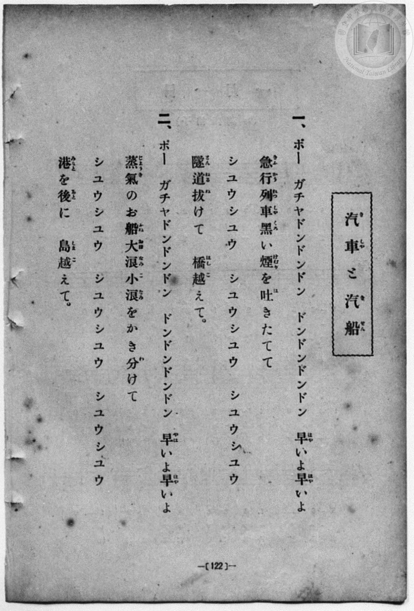
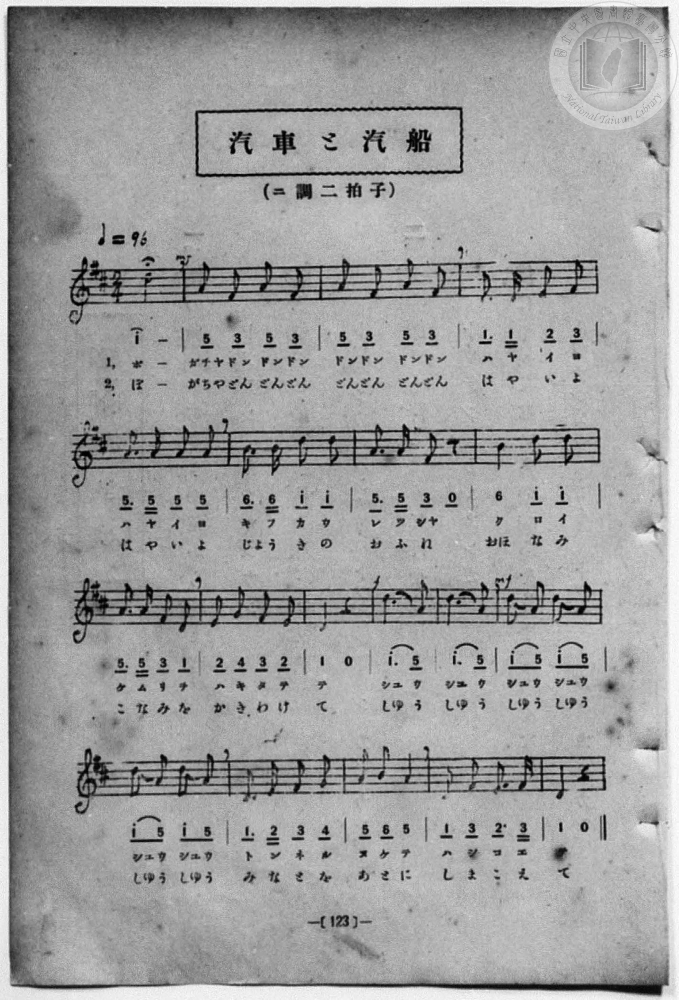

# 汽車と汽船

> Re:Shōka 使用 AI 協助辨識與重建樂譜，可能會有錯誤。歡迎回報。

<audio controls src="kisha_to_kisen.mp3"></audio>

- book: 新編 小學校・公學校 唱歌教材集（尋常科三・四學年用）
- 一條慎三郎 編《新編 小學校・公學校 唱歌教材集》（大正十二年十二月，索書號 0725-41）
- 日治時期公學校《唱歌帳》（典藏號 2020.006.0843・P146）
- 原載《小公唱歌教材集》第 123 頁（大正 13 年 12 月 12 日抄）

## 說明

> [!NOTE]
> **原書資訊與歌詞全文**（對應 `P130.jpg`–`P131.jpg`，原書 p. 122–123，尋常科三・四學年第 1 首）：
> - **調性與拍號**：ニ調二拍子（D 大調 2/4 拍），♩= 96
> - **比較校勘**：與公學校手抄《唱歌帳》（`docs/shokacho/vol_01/p146_kisha_to_kisen`）對照，原書第 14–15 小節共有兩小節八分音符「シュウシュウ」（全曲共 19 小節，與手抄《唱歌帳》小節數一致），原書於第 3、14、15 小節標明完整四次「ドンドンドンドン」與「シュウシュウ」，本檔補齊雙段歌詞（`L1:`、`L2:`）。
>
> **一、**
> ポー　ガチヤドンドンドン　ドンドンドンドン
> 早（はや）いよ早（はや）いよ
> 急行列車（きふかうれつしや）黑（くろ）い煙（けむり）を吐（は）きたてて
> シユウシユウ　シユウシユウ　シユウシユウ
> 隧道（とんねる）拔（ぬ）けて　橋越（はしこ）えて。
>
> **二、**
> ポー　ガチヤドンドンドン　ドンドンドンドン
> 早（はや）いよ早（はや）いよ
> 蒸氣（じようき）のお船（ふね）大浪（おほなみ）小浪（こなみ）をかき分（わ）けて
> シユウシユウ　シユウシユウ　シユウシユウ
> 港（みなと）を後（あと）に　島越（しまこ）えて。


## 歌詞

```text
（TMD 檔案未包含歌詞註解）
```

## ABC

```abc
X:1
T:汽車と汽船
M:2/4
L:1/16
Q:1/4=96
K:D
V:V1 name="Piano" snm="Pia"
[V:V1]
!mf! d8 | A A F2 A2 F2 | A2 F2 A2 F2 | D3 D E2 F2 |
w: 1.~ポー | ガ チヤ ドン ドン ドン | ドン ドン ドン ドン | ハ ヤ イ ヨ
w: 2.~ぽー | が ちや どん どん どん | どん どん どん どん | は や い よ
A3 A A2 A2 | B3 B d2 d2 | A3 A F2 z2 | B4 d2 d2 |
w: 1.~ハ ヤ イ ヨ | キ フ カ ウ | レ ツ シヤ | ク ロ イ
w: 2.~は や い よ | じよう _ き の | お ふ ね | おほ な み
A3 A F2 D2 | E2 G2 F2 E2 | D4 z4 | !f! d3 A5 |
w: 1.~ケ ム リ ヲ | ハ キ タ テ | テ | シユ ウ
w: 2.~こ な み を | か き わ け | て | しゆ う
d3 A5 | !mf! d2 A2 d2 A2 | d2 A2 d2 A2 | D3 E F2 G2 |
w: 1.~シユ ウ | シユ ウ シユ ウ | シユ ウ シユ ウ | ト ン ネ ル
w: 2.~しゆ う | しゆ う しゆ う | しゆ う しゆ う | み な と を
A2 B2 A4 | D2 F2 E3 F | D4 z4 | !mf! d8 |
w: 1.~ヌ ケ テ | ハ シ コ エ | テ | ポー
w: 2.~あ と に | し ま こ え | て | ぽー
A A F2 A2 F2 | A2 F2 A2 F2 | D3 D E2 F2 | A3 A A2 A2 |
w: 1.~ガ チヤ ドン ドン ドン | ドン ドン ドン ドン | ハ ヤ イ ヨ | ハ ヤ イ ヨ
w: 2.~が ちや どん どん どん | どん どん どん どん | は や い よ | は や い よ
B3 B d2 d2 | A3 A F2 z2 | B4 d2 d2 | A3 A F2 D2 |
w: 1.~キ フ カ ウ | レ ツ シヤ | ク ロ イ | ケ ム リ ヲ
w: 2.~じよう _ き の | お ふ ね | おほ な み | こ な み を
E2 G2 F2 E2 | D4 z4 | !f! d3 A5 | d3 A5 |
w: 1.~ハ キ タ テ | テ | シユ ウ | シユ ウ
w: 2.~か き わ け | て | しゆ う | しゆ う
!mf! d2 A2 d2 A2 | d2 A2 d2 A2 | D3 E F2 G2 | A2 B2 A4 |
w: 1.~シユ ウ シユ ウ | シユ ウ シユ ウ | ト ン ネ ル | ヌ ケ テ
w: 2.~しゆ う しゆ う | しゆ う しゆ う | み な と を | あ と に
D2 F2 E3 F | D4 z4 |
w: 1.~ハ シ コ エ | テ
w: 2.~し ま こ え | て
```

## TMD 檔案連結

- [主旋律 TMD 檔案](kisha_to_kisen.tmd) [[在 TMD Studio 編輯](https://tmdlang.github.io/Tmd-TS/#tmd=s7IKdvYPcrWy4qpTUCpJTLdSSM7PyUlNLsnMz7MqzsjPTozPrsyvSsyML84ojTe0NDJWgqssy88pzU21Si9KTEmNN443QcgU55cWJadaFSdn5OfnxJekVpQk5edno8vHFySmp1oFGBobIGQKivLLUvMS84C6C4oy80pSU8DaEQpSyzJTUkHSxcmJefFlqUWZaZmpKUiOSi0qBrsdYkVJUWJecXJRZgHIQwhV-UUlGflAhxdkVFplZBaX5BdlJifmxGcn5iUiFJVkpAK9BzahAKhBiUtLS-HZxr0vdnc9blwBYnTsVNDS4lK0VbA047K3VXDhsjHSN7ED6Qd510rh2bQNz7evUHi6of_p2h3PFix83Lz7aesaCFvh6ZSNz9b2PJs689ncCS9nt73f0_F0Q_fTHTueL5_4ZEcnSOns2UClT3dueT5lxfs9nWB3PdnR8GzR3GetfUAlL5v7FIDGP27oIsWexw3dIKuWLH-2dvHT3sYnu3qANkAYz-Z0vN_T83zLomezd7yYOV_BwNzIVNfEEGb3s-lLn23a_Wxm07M58-HGA22HWPB0x2ao0a07XkzvB-k3MjAy0DMwMNMzsDAxBropwNDEDGbY0775L_Z0gnQDHQ00DMORz9esUTA0MlZ4uaAR7l4FQ2MFoGuB4gpAt4IpoJu6WsCGculrKdhSC3ApKCjYKUQr-vmHuMZCOFpaQDeDQmZz-4sVXS862oEOfrFy3tPWFc-mtWtpgeOv91l7p0ICKEXrZRWkJzxqmAziGII5wKCFGKBQoAd0uhFQEug_kCiuaAeFgMLLZdOA3nu_ZxbEFbpAd7xYtf9Zw3KQC7p7geEMsnvW4-ZuoDAoErt7n66dAHSNiwIw0IBiCsA0qQAUBZvS82jmSnByhRv2bP2UF3uagTH5tHsG2CSgufDYfdbZDQxezDhOSMlPLtYHFw_ALK4PLAjiDQz1C4DxG5-dWZyRGF-SD2Kk5gF93QkMluety-HeB3vLBOR7U1CKfb6-4WnrxmdzOp-2roRxVz_taHs5f_PzNcseN_Q8btr-uHnp46ZlCEYD0DPAdLbi2exNQL0KhpZQg4B2gEIFm6MhCp5N3QHMQS_at0ACA-KgZ9P2gNxk_Lih0dAERMDc9WzFzGcz-p6uA6bLLcBYebYGmNp7HjcDI2kzFrKhF2g3bvcCc9eaZ6umvFg85-XerpezZz5btxWSgEDB6WNolQC0OcHHyAoUYo8bmsARBEt4QDcDZYFFDZj_uHnu4-Y9jxsaHjetedzc-Lh5CTbXNOByKMSQZ9NXAi1-3Lj-cRMo-zxubHnc1IFVEKq-YemLhT1PO6YDSz-wmt7HjVsfN3Y_bmx73NTzuHHJ48bpEF0vd08EK-h_3ARKc0BDnrfOBItMfNwEdDNQe-fjpklPJ4ASKdAusBqgafMfNy4DIqgfQWEHDEFIIIIZIP8SJQgx4eWs5S8bJ4OtWPG4afLjxrWPm4BJt_NZ9xSw4BqwvRNBljY0PFvZ_WIbxF_rQR4BaQTKArlAWbS42NUz0HHxYtKOZxsWg2VnAAVBUdAICep1jxuBJdNOsBQwdtaCch-w5Ny6CiwCrLZ2P25c9bhxPzhX9sPEgYEDFQTGCzhOe4EZECTV1A8PJWrFy7MdwBgHWrofbCmoYgMlhn09YMEmqEjjaqAJTzdvg0UKMEb2YYkUyst5KFDQ0ufi8gaVXCH5QCo1zyogMzEv36HGoEahGmSTgo2hmRY4DShgq2YUgAUIqGBZ2KOgYQItPXQUYEW_JhYNQAtBhgGNz02rVTCMA5bFyLBGwRQIjYEsUyAG0SARCAshYghWa6hgBBMBm-ljWANNlxiGAlMpUAqUTIEUKAECRTEZIO04JVFU9YPNBRvXtATMWoFwhhFQReNerM5o7AHihcCUDaRWAnMnSCsGA6QOpySKqvUQZ4CNawGzOsDOwB9fu3rIiS9Q6IPiAESDcI2CGVjEDBKJYAKhChQrBkiqoAogqpBiC0dAAnlroTJTgezVYL8tgwb-GqgM0NegLAbSFg_VBAkQkCRIO8RI5FjBEWBAHrRAgelv7AWT66CyXVDRrUAMMhlqH7hkgWtZBSb3ExEDOzrBMWBGXgyAwhaUA2rA6d8EiEEiIDYsZ0DCHpLmqhHZDGIARBiLECJHgkThDKToatoIDd0FQAz2bvMmaKSAIhISaY-bQEHwuBkUliAZWJiCwgyWG0ElIzQqIDSxEhBhNC5yDIOyBiQyIFEBLGQhJjR2g8XB8doEdm3jRKgMzCYkF4IqdYjDEYmCOAmIMBqXQIIANrLACQLWACMyQWCJK2gCMAInCVDSgCQbUCaERTVEDSzJgFhYkg1SnOMNeWD8gnIQKL43AzE4dJtB2RUk0wNWB0oziFSASCvbwSSoRAXRK7CnFaSYxRu-0NiGxTyoEEHEfBNYHCzWCHIbPMbAIvvAJCzddGBPEVy1XFy6dgrIVaUCFr4yFwA)]
- [鋼琴伴奏 TMD 檔案](kisha_to_kisen_piano.tmd) [[在 TMD Studio 編輯](https://tmdlang.github.io/Tmd-TS/#tmd=s7IKdvYPcrWy4qpTUCpJTLdSSM7PyUlNLsnMz7MqzsjPTozPrsyvSsyML84ojTe0NDJWgqssy88pzU21Si9KTEmNN443QcgU55cWJadaFSdn5OfnxJekVpQk5edno8vHFySmp1oFGBobIGQKivLLUvMS84C6C4oy80pSU8DaEQpSyzJTUkHSxcmJefFlqUWZaZmpKUiOSi0qBrsdYkVJUWJecXJRZgHIQwhV-UUlGflAhxdkVFplZBaX5BdlJifmxGcn5iUiFCUWATWnp-am5pVYFWQm5uXHJyYn5-cWJOZlgsQQCksygIqswFYVAE1W4tLSUni2ce-L3V2PG1eAGB073-_peDl75rPO7pfde55P2PJkz5anS_vf7-lU0NLiUrRVsDTjsrdVcOGyMdI3sQOZCwovK4Vn0zY8375C4emG_qdrdzxbsPBx8-6nrWsgbIWnUzY-W9vzbOrMZ3MnvJzdBrTh6Ybupzt2PF8-8cmOTpDS2bOBSp_u3PJ8ygqgVWD3PtnR8GzR3GetfUAlL5v7FIDGP27oIsWexw3dIKuWLH-2dvHT3sYnu3qANkAYz-Z0vN_T83zLomezd7yYOV_BwNzIVNfEEGb3s-lLn23a_Wxm07M58-HGA22HWPB0x2ao0a07XkzvB-k3MjAy0DMwMNMzsDAxBropwNDEDGbY0775L_Z0gnQDHQ00DMORz9esUTA0MlZ4uaBRiYvLM6-kKN8qABSLQR4ONQY1CtVcCkBgY2imZQdm1SgYxinoosAaBVMgNAayTIEYRAMVQVlGYBXGUBEQNIDp4qpFsc8HxT4LhHXxCtGGsTAKzjeNxyZgGo8kAqQMINZ4ZxZnJIbkA6nUPLy-09dSsEUHCsAgAqaHFwt7FDRMQJH_fH2DjgIwPxrqZRWka2LRoKUPdXt1blotceEFY6GGoC6QBIUgWARspo9hjcLj5rmPm_dgGPq4aQ1QqvFx8xIgBUzYm4GimAyQdpySKKr6weaCjWtaAmatQDjDCKiicS9WZzT2APHCx00tQGrl46bJIK0YDJA6nJIoqtZDnAE2rgXM6gA7A3987eohJ75AoQ-KAxANwjUKZmARM0gkggmEKlCsgFIzTBVUAUQVUmzhCEggby1UZiqQvRrst2XQwF8DlQH6umk7SKuuQjxUEyRAQJIg7RAjkWMFR4ABeTOAzMeNbTD9jb1gch1UtgsquhWIQSZD7WsEls674VpWgcn9RMTAjk5wDJiRFwOgsAXlgBpw-jcBYlhpgqUkUahGZDOIARBhLEKIHAkShTOQoqtpIzR0FwAx2LvNm6CRAopISKQ9bgIFweNmUFiCZGBhCgozWG4ERhsoNmGxSrwERBiNixzDoKwBiQxIVDxumgQxobEbLA6O1yawaxsnQmVgNiG5sHH64yaIwxGJgjgJiDAal0CCAFaz4ARhSlqCwBJX0ARgBE4SoKQBSTagTAiLauIqIESc4w15YPyCchAovjcDMTh0m0HZFSTTA1YHSjOIVIBIK9vBJKhEBdErsKcVpJjFG77Q2IbFPKgQQcR8E1gcLNYIchs8xsAi-8AkLN10YE8R2GtKqtTLWAVQDUKoMwEyTGJhFFp1ji6LwzXw1gCuZgEV3YtLAN0D-FoounYK4LaQApCBHAfRPkBlGGJGYDFlLgA)]

## 分析

```text
================================================================================
📊 TMD Song Profile: [ 汽車と汽船 ]
================================================================================
⏱  Duration:       0:47 (47.5s), 38 measures total
🎼 Key & Tempo:    首調基準 D, != 96.0 BPM, <2/4>
   - 分析範圍：      由實際發聲的音符與和弦推測調性；播放脈絡另行呈現
🎤 人聲音域:    D4 (MIDI 62) – D5 (MIDI 74) [跨度: 12 個半音 / 1.0 個八度, 難度: easy]
   - 最低音:  D4 in [KishaToKisen #1 @ m.4, 0:03]
   - 最高音: D5 in [KishaToKisen #1 @ m.1, 0:00]
   - 適合: soprano, mezzo-soprano, contralto, tenor, baritone, bass
🏛  結構:      KishaToKisen (23.8s) -> KishaToKisen (23.8s)
⚡ 編曲密度:        Peak 1 軌道同時演奏
🗝  調性診斷：       D 大調（純淨自然大調，未偵測到可信轉調）
   - 風格氣質:    純淨自然大調（陽光明朗、易唱易記，無明顯調外色彩）
   - 轉調歷程:    全曲維持單一推測調性（未偵測到可信轉調）
   - 核心骨幹音:  D, A, F#, E, B
   - 調性數值:    D 大調 [相關度: 0.92, 穩定度: High, 自然音純度: 100.0%]
   - 候選調性 (K-S): D 大調 (0.92), A 大調 (0.69), D 小調 (0.59)
   - 五度圈歷程:   +2 -> +2
   - 各段落調性細節:
     • [KishaToKisen #1]: D 大調 (r: 0.92, 自然音純度: 100.0%)
     • [KishaToKisen #2]: D 大調 (r: 0.92, 自然音純度: 100.0%)

  [ 五度圈游移軌跡 ]
               C  
         F            G  
      Bb              [D ]*
      Eb               A  
         Ab           E  
            Db       B  
               F# 
     (* = active key center)

  [ 十二半音累積音高分佈 ]
     C  :                            0.0%
     C# :                            0.0%
     D  : ████████████████████████  34.5%
     D# :                            0.0%
     E  : █████                      7.0%
     F  :                            0.0%
     F# : ██████████                14.8%
     G  : ██                         2.8%
     G# :                            0.0%
     A  : ████████████████████████  33.8%
     A# :                            0.0%
     B  : █████                      7.0%
--------------------------------------------------------------------------------
Assignment 軌道音域：
  - Piano         : D4 – D5 (12 個半音 / 1.0 個八度, 122 個音符)
================================================================================
```


## 原書掃描頁






