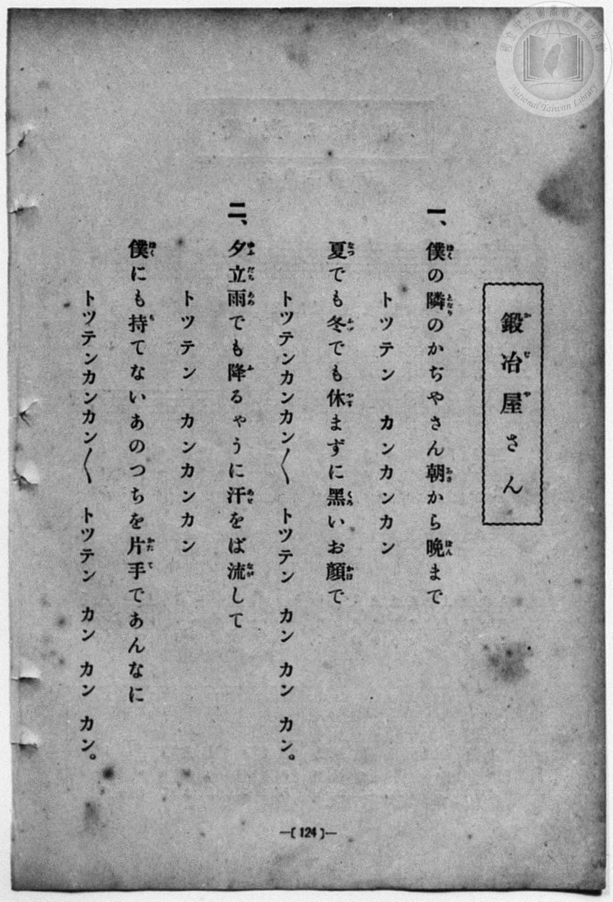
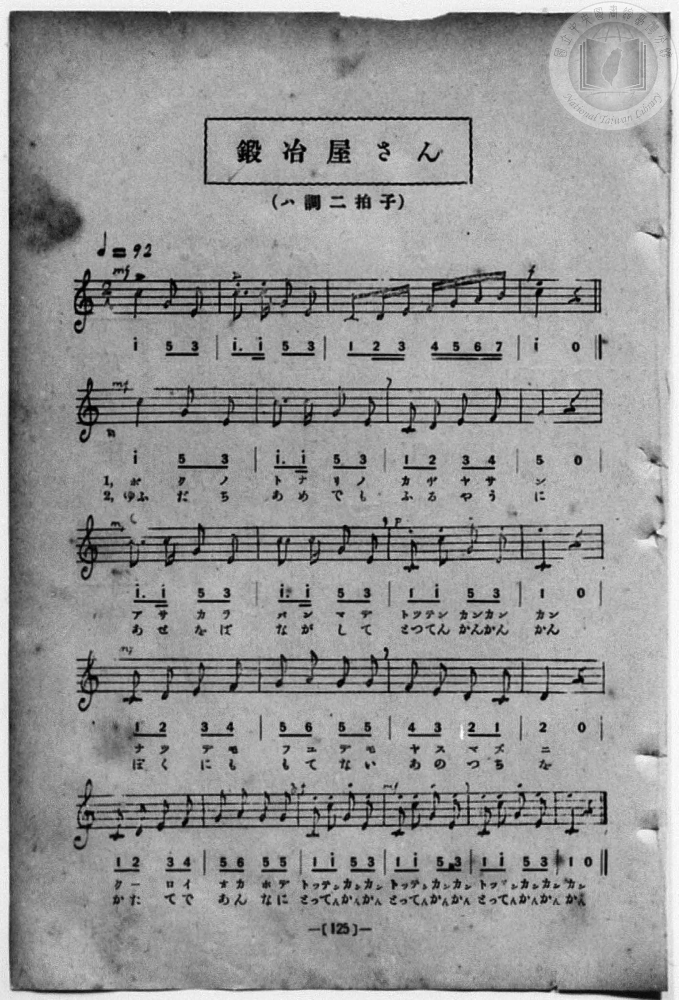

# 鍛冶屋さん

> Re:Shōka 使用 AI 協助辨識與重建樂譜，可能會有錯誤。歡迎回報。

- **鋼琴伴奏版**：<br><audio controls src="kajiyasan.mp3"></audio>
- **NEUTRINO 歌聲合成版**：<br><audio controls src="kajiyasan_neutrino.mp3"></audio>

- book: 新編 小學校・公學校 唱歌教材集（尋常科三・四學年用）
- 一條慎三郎 編《新編 小學校・公學校 唱歌教材集》（大正十二年十二月，索書號 0725-41）

## 說明

> [!NOTE]
> **原書資訊與歌詞全文**（對應 `P132.jpg`–`P133.jpg`，原書 p. 124–125，尋常科三・四學年第 2 首）：
> - **調性與拍號**：ハ調二拍子（C 大調 2/4 拍），♩= 92
> - **樂曲結構**：含 4 小節器樂前奏（模擬打鐵與音階上行），主歌共 18 小節（前段 12 小節為每行 4 小節，末行 6 小節連續三次「トツテンカンカン」結尾）。注意此曲與文部省《尋常小學唱歌》「しばしもやすまず槌うつひびき」之〈鍛冶屋〉為同名異曲。
>
> **一、**
> 僕（ぼく）の隣（となり）のかぢやさん　朝（あさ）から晚（ばん）まで
> トツテン　カンカンカン
> 夏（なつ）でも冬（ふゆ）でも休（やす）まずに　黑（くろ）いお顏（かほ）で
> トツテンカンカン　トツテンカンカン　トツテン　カン　カン　カン。
>
> **二、**
> 夕立雨（ゆふだちあめ）でも降（ふ）るやうに　汗（あせ）をば流（なが）して
> トツテン　カンカンカン
> 僕（ぼく）にも持（も）てないあのつちを　片手（かたて）であんなに
> トツテンカンカン　トツテンカンカン　トツテン　カン　カン　カン。


## 歌詞

```text
（TMD 檔案未包含歌詞註解）
```

## ABC

<div class="abc-score" data-abc-src="kajiyasan.abc" aria-label="五線譜載入中"></div>

[下載 ABC 原始檔](kajiyasan.abc)

## TMD 檔案連結

- [主旋律 TMD 檔案](kajiyasan.tmd) [[在 TMD Studio 編輯](https://tmdlang.github.io/Tmd-TS/#tmd=s7IKdvYPcrWy4qpTUCpJTLdSSM7PyUlNLsnMz7MqzsjPTozPrsyvSsyML84ojTe0NDJWgqssy88pzU21Si9KTEmNN443QcgU55cWJadaFSdn5OfnxJekVpQk5edno8vHFySmp1oFGBobIWQKivLLUvMS84C6C4oy80pSU8DaEQpSyzJTUkHSxcmJefFlqUWZaZmpKUiOSi0qBrsdYkVJUWJecXJRZgHIQwhV-UUlGflAhxdkVFplZBaX5BdlJifmxGcn5iUiFJVkpAK9V55fhORyoML0zDyr0jyQK0qgdmtpKbzsnf20bdvTjd2PG6c-bpqsoKXFpWirYGnEZW-r4MxlY6RvYgcyAxQMVgrPpm14vn2FwtMN_U_X7ni2YOHj5t1PW9dA2ApPp2x8trbn2dSZz-ZOeDm77f2ejqcbup_u2PF8-cQnOzpBSmfPBip9unPL8ykr3u_pBLvtyY6GZ4vmPmvtAyp52dynADT-cUMXKfY8bugGWbVk-bO1i5_2Nj7Z1QO0AcJ4Nqfj_Z6e51sWPZu948XM-QoG5kamuiaGYLu59LUUbKkFuBQUFOwUohX9_ENcYyEcLa2nffNB9m5uf7Gi60VHO9DNL1bOe9q64tm0di0tcOj0PmvvVEgApSO9rIL0hEcNk0EcYzAH6HCIAQoFegqGRiZASUMjU5AorkBds0bBSOHlsmlA773fMwviCl2gO16s2v-sYTnIBd29wFAA2T3rcXM_UBgURN29T9dOALrGWQEYhEAxBWCMKwBFwab0PJq5EpwY4IY9W9H0bPam51snPFveDTbp6YTVCiagmHq-vuHpzBVA-aedvU-X9gONfLZi4bPJa551Tn45YSvQ-pfzN7-cBYznrhcLeyCmP9mxGxgqT1s3KhhaQI0AhUtn77N1W4F-hgo9b9r1bH0_UBPcHqDWZ3NWg0TMoCIvGxY_3wU0r_PZmoWPG3oeN3c8bm553Nz2uHnz46bVCLKhF-j0pxv2Ae1_3ND0bPOKZy39z9YuAXoJFD7T2l82r3g-pxGYAiGhDEmAkAQHTGcgkxunP27cACKbmh43tTxunPm4cd_jxlnPlgOl2h43LnncuOlx4-bHjb1Au57sBGrpQOSwhk6gX55O6Hk6off51A1AS4FuAActLMkAc8PjhkZgFgTznzZPBQbH48Y9jxuBwdn5uHHdy1mLwSIrHjeuetzUBRF83AjMu4vAjgHl4McNDc_mzAUrawKKgNV0P27qfDZzFlhwA1ANWBDo7OUQi1CCq6EBJcTAJNQ9S0CxCrK6cQnYhOXAQHjatgYsuPVxEzDLQwWf7JkIEgSHD8yuWY8bVwMNf7kbLNXY_7gJlMYeNwLVdL1cCDEZ6JHdEEOwOAwlHhuIlYJ7BwsDLfB3AeMYEfhLpj5f3f1yNrCkAnoEGLNbHzcueNy4EBSqTY1wn76cCfQFyPsgkSZgOAO9A1QM8umzjdNhsTAbLDsJGPjPtgL1QsIQlAnAyWkZabGAnipWA53xrAdsbFMTWGQZ2HygS4BWA5MHME0uBNne0PC8s_1ZJ6i4BAf1fKBKqEdAnpoM1rWafiFPebkLBQpa-lxcnnklRflWAZmJefkONQY1CtUgKxRsDM20wDGsgK28VwAWmsA8By6QZkHKLQUNWCmjowArjDWx6ARaCTIVaE9uWq2CYRywdARBUyA2BuIamBCQQhIDkkZAtglQzEzBHKFKV8EAStdw1XJxeSdmZVYmFifmkeOfXT2gkpH23oDwTMAiIDlUX4BM9TGsASakOVCxx03rQSSwkgfpACYViGhzFxCvQpZpWg3mNYHJJWCdW6F6NkPNike1xwikC5RHYVY1LgCTCyHaGkFGgYxpBLKXg1kgEZAMSAcw34LJFrCeNqgMyBGoVhFIRp3kBDvW4MUiVl0AjB2IIErs4A73pkVQT2-Fh-hKaChOgIb8ZiCeB2a1w-IEmH3BAqAcDNYNyq_IDHD84I0IWGg3zgYqnQRmbYCGKSiaQfweIJ4OZi2DygBrNHBMA8suYCMUxACWpSgMkCook4RoATaPyM8NQOMxk7kZNAJAuAYsDpIHqQOprwGzcGWFLnDYQkIYFOSPm0GRBJKZCuaBQgNdBpIBdoLFwJHVtAsqA0q1uOJgDzjo-sEkOPJhKR5MQ8IdEh_AigIauhCZdWASEhnQ_AOORVLywq4p4ECHtc6IzQtEhDeOPECcEK6cAiqXIDliLTioQJ4HiYODB5p3ZsOjBppPmsEC-PIJNVURynPgEqxxPpiExC2onIPHKjQrQeIb5CFonlsM0YAvz1FTFdb8C6zvdO0UwNW3ApABr_tAHGUuAA)]
- [鋼琴伴奏 TMD 檔案](kajiyasan_piano.tmd) [[在 TMD Studio 編輯](https://tmdlang.github.io/Tmd-TS/#tmd=s7IKdvYPcrWy4qpTUCpJTLdSSM7PyUlNLsnMz7MqzsjPTozPrsyvSsyML84ojTe0NDJWgqssy88pzU21Si9KTEmNN443QcgU55cWJadaFSdn5OfnxJekVpQk5edno8vHFySmp1oFGBobIWQKivLLUvMS84C6C4oy80pSU8DaEQpSyzJTUkHSxcmJefFlqUWZaZmpKUiOSi0qBrsdYkVJUWJecXJRZgHIQwhV-UUlGflAhxdkVFplZBaX5BdlJifmxGcn5iUiFCUWATWnp-am5pVYFWQm5uXHJyYn5-cWJOZlgsQQCksygIqsyvOLgF7U0lJ42Tv7adu2pxu7HzdOfdw0-f2ejpezZz7r7H7Zvef5hC1P9mx5urT__Z5OBS0tLkVbBUsjLntbBWcuGyN9EzuQkaCgslJ4Nm3D8-0rFJ5u6H-6dsezBQsfN-9-2roGwlZ4OmXjs7U9z6bOfDZ3wsvZbUAbnm7ofrpjx_PlE5_s6AQpnT0bqPTpzi3Pp6wAWgV26pMdDc8WzX3W2gdU8rK5TwFo_OOGLlLsedzQDbJqyfJnaxc_7W18sqsHaAOE8WxOx_s9Pc-3LHo2e8eLmfMVDMyNTHVNDMF2c3nmlRTlWwWAgjDIw6HGoEahmksBCGwMzbTswCygSG5arYJhnIIuGJoCsTEQ18CEgBSSGJA0ArJNgGJmCuYIVboKBlC6hqsWxV4fFHst4NYaxitEG8YqmMZDaAICpvFIIkDKAGKPd2JWZmVicWIeXj_qaynYogOF52vWAEPvxcIeBQ0TUCQ8X9-gowDMEsZ6WQXpmlg0aOmTHWAQnglYBCSHGl4gU30MaxQeN8-Bij1uWg8igUkFpONxcwdEtLkLiFchyzStBvOawOQSsM6tUD2boWbFo9pjBNLV9rgRpAxsaOMCMLkQoq0RZBTImEYgezmYBRIByYB0PG7qBpMtYD1tUBmQI1Ctwh_sOzrJCXaswYtFrLoAGDsQQZTYwR3uTYugnt4KD9GV0FCcAA35zUA8D8xqh8XJ42ZwKDS3QcIaqBONAY4fvBEBC-3G2UClk8CsDdAwBUUziN8DxNPBrGVQmRWPG8Ex3bgMWMSBGd1oDJAqKJOEaAGWXOTnBqDxmMncDBoBIFwDFgfJg9SB1NeAWbiyQhc4bCEhDAryx82gSALJTAXzQKGBLgPJADvBYuDIatoFlQGlWlxxsAccdP1gEhz5sBQPpiHhDomPx40g98Di7XHjOjAJiQxo_gHHIil5YdcUcKCbkZgXiAhvHHmAOCFcOQVULkFyxFpwUIE8DxIHBw8078yGRw00nzSDBfDlE2qqIpTnwCVY43wwCYlbUDkHj1VoVoLEN8hD0Dy3GKIBX56jpiqs-RezxqO4djUBUiYgPryaBTFA1Ss51TSyALSWRjEGbhtCDUQPVALOx-8anMZQpVGha6cAbr8oABnw4I72AapBFTACCyhzAQA)]

## 分析

```text
================================================================================
📊 TMD Song Profile: [ 鍛冶屋さん ]
================================================================================
⏱  Duration:       0:28 (28.7s), 22 measures total
🎼 Key & Tempo:    首調基準 C, != 92.0 BPM, <2/4>
   - 分析範圍：      由實際發聲的音符與和弦推測調性；播放脈絡另行呈現
🎤 人聲音域:    C4 (MIDI 60) – C5 (MIDI 72) [跨度: 12 個半音 / 1.0 個八度, 難度: easy]
   - 最低音:  C4 in [Intro #1 @ m.3, 0:02]
   - 最高音: C5 in [Intro #1 @ m.1, 0:00]
   - 適合: soprano, mezzo-soprano, contralto, tenor, baritone, bass
🏛  結構:      Intro (5.2s) -> Kajiyasan (23.5s)
⚡ 編曲密度:        Peak 1 軌道同時演奏
🗝  調性診斷：       C 大調（純淨自然大調，未偵測到可信轉調）
   - 風格氣質:    純淨自然大調（陽光明朗、易唱易記，無明顯調外色彩）
   - 轉調歷程:    全曲維持單一推測調性（未偵測到可信轉調）
   - 核心骨幹音:  C, G, E, D, F
   - 調性數值:    C 大調 [相關度: 0.95, 穩定度: High, 自然音純度: 100.0%]
   - 候選調性 (K-S): C 大調 (0.95), C 小調 (0.61), G 大調 (0.56)
   - 五度圈歷程:   +0 -> +0
   - 各段落調性細節:
     • [Intro #1]: C 大調 (r: 0.90, 自然音純度: 100.0%)
     • [Kajiyasan #1]: C 大調 (r: 0.95, 自然音純度: 100.0%)

  [ 五度圈游移軌跡 ]
              [C ]*
         F            G  
      Bb               D  
      Eb               A  
         Ab           E  
            Db       B  
               F# 
     (* = active key center)

  [ 十二半音累積音高分佈 ]
     C  : ████████████████████████  39.7%
     C# :                            0.0%
     D  : █████                      8.3%
     D# :                            0.0%
     E  : ███████████               18.6%
     F  : ███                        5.8%
     F# :                            0.0%
     G  : ██████████████            23.7%
     G# :                            0.0%
     A  : ██                         3.2%
     A# :                            0.0%
     B  :                            0.6%
--------------------------------------------------------------------------------
Assignment 軌道音域：
  - Piano         : C4 – C5 (12 個半音 / 1.0 個八度, 74 個音符)
================================================================================
```


## 原書掃描頁






