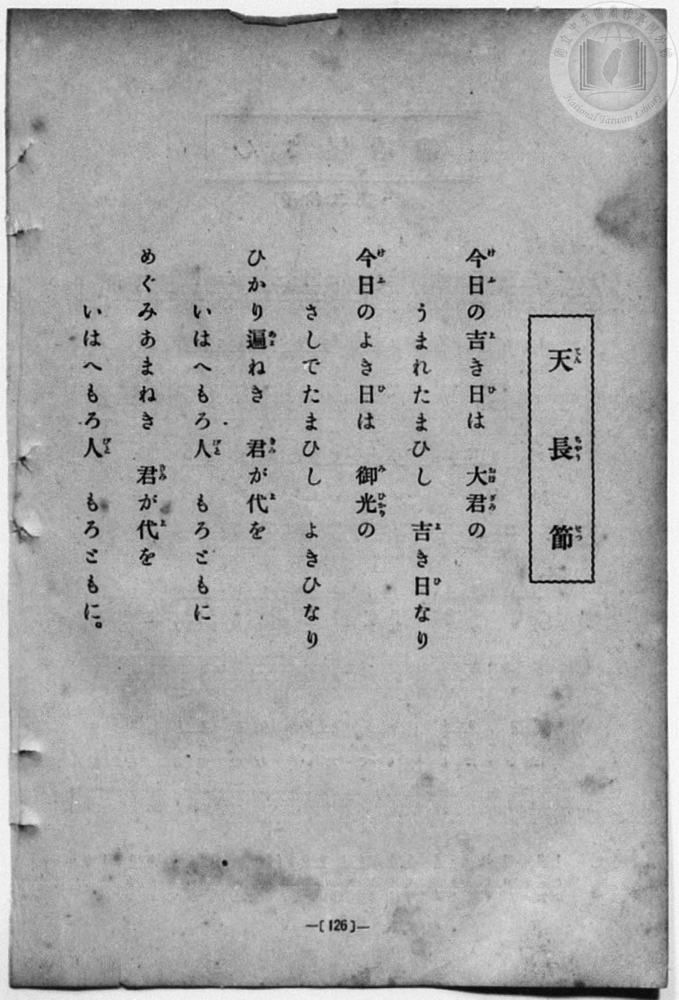
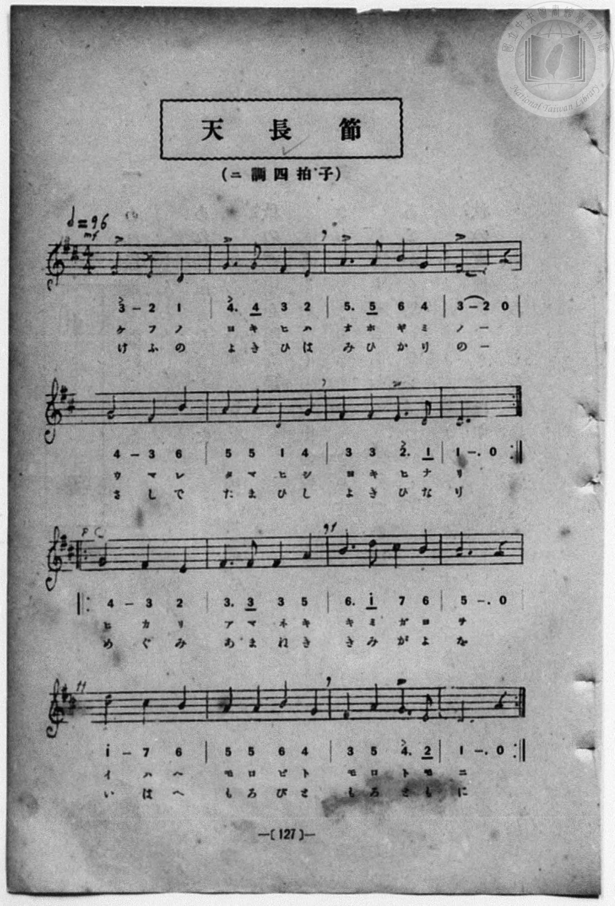

# 天長節

> Re:Shōka 使用 AI 協助辨識與重建樂譜，可能會有錯誤。歡迎回報。

- **鋼琴伴奏版**：<br><audio controls src="tenchosetsu.mp3"></audio>
- **NEUTRINO 歌聲合成版**：<br><audio controls src="tenchosetsu_neutrino.mp3"></audio>

- 詞：黒川眞頼
- 曲：奥好義
- book: 新編 小學校・公學校 唱歌教材集（尋常科三・四學年用）
- 一條慎三郎 編《新編 小學校・公學校 唱歌教材集》（大正十二年十二月，索書號 0725-41）
- 臺灣總督府《公學校唱歌集》（大正四年三月，索書號 0725 26）

## 說明

> [!NOTE]
> **原書資訊與歌詞全文**（對應 `P134.jpg`–`P135.jpg`，原書 p. 126–127，尋常科三・四學年第 3 首）：
> - **調性與拍號**：ニ調四拍子（D 大調 4/4 拍），♩= 96
> - **樂曲結構**：二段體（A 段 8 小節與 B 段 8 小節各有反覆記號 `||: ... :||`，雙層歌詞於同一段反覆演唱後再進入下一段）。
>
> 今日（けふ）の吉（よ）き日（ひ）は　大君（おほぎみ）の
> うまれたまひし　吉（よ）き日（ひ）なり
> 今日（けふ）のよき日（ひ）は　御光（みひかり）の
> さしでたまひし　よきひなり
> ひかり遍（あま）ねき　君（きみ）が代（よ）を
> いはへもろ人（びと）　もろともに
> めぐみあまねき　君（きみ）が代（よ）を
> いはへもろ人（びと）　もろともに。


## 歌詞

```text
（TMD 檔案未包含歌詞註解）
```

## ABC

<div class="abc-score" data-abc-src="tenchosetsu.abc" aria-label="五線譜載入中"></div>

[下載 ABC 原始檔](tenchosetsu.abc)

## TMD 檔案連結

- [主旋律 TMD 檔案](tenchosetsu.tmd) [[在 TMD Studio 編輯](https://tmdlang.github.io/Tmd-TS/#tmd=s7IKdvYPcrWy4qpTUCpJTLdSSM7PyUlNLsnMz7MqzsjPTozPrsyvSsyML84ojTe0NDJWgqssy88pzU21Si9KTEmNN443QcgU55cWJadaFSdn5OfnxJekVpQk5edno8vHFySmp1oFGBoj6Swoyi9LzUvMA-ouKMrMK0lNAWtHKEgty0xJBUkXJyfmxZelFmWmZaamIDkqtagY7HaIFSVFiXnFyUWZBSAPIVTlF5Vk5AMdXpBRaZWRWVySX5SZnJgTn52Yl4hQVJKRCvReZm4B0JLEHHTx5NSi1Nz8PBQZoDHpmXlWQOGkUmDgYUqkZmZlIoWHlpbC0yUrX07d_nx9g4KWFpeirYKlGZe9rYILl42JvokdSD9IpZXCs2kbnm9fofB0Q__TtTueLVj4uHn309Y1ELbC0ykbn63teTZ15rO5E17Obnu_p-Pphu6nO3Y8Xz7xyY5OkNLZs4FKn-7c8nzKivd7OsHuerKj4dmiuc9a-4BKXjb3KQCNf9zQRYo9jxu6QVYtWf5s7eKnvY1PdvUAbYAwns3peL-n5_mWRc9m73gxc76CgbmRqa6JIczuFyvnvd8z6-XuSU-3z30-Z97LBXvAws9mbwIKP1269OnSvc_3rYQobd_1vHHx8x17n89d_HTXHKAT4e6BOAfdIUCv7twC9BM2JygYmYGdwKWvpWBLLcCloKBgpxCt6Ocf4hoL4WhpPe2bD7J3c_uLFV0vOtqB7gT6-WnrimfT2rW0wBHU-6y9UyEBlPr1sgrSEx41TAZxTMEcoMMhBigU6CkYGpkBJQ2NzEGiuOJ1zRoFY4WXy6YBvQcMQogrdIHueLFq_7OG5SAXdPcCQwFk96zHzd1AYaBeoNjTtROArnEBJsPlQDEFYKJTAIqCTel5NHMlOD3CDXu2ogkYRc-3Tni2vBtsEiim1219uXoK0AxHBSBTwQKUdICpGWijghOKyNMJLc_mdD7t732xrO3FihmgKEmoqbFS0NPTU7CqqQH5-eXsmU83LoGE1bNpe55O6AEl0nVbIZqe7ZkCjPGn-3qetvW-bNj0tHXpkx3dEAVA9z5uaAI7FOLaJ7u7nk1fCnTV48aJjxvB8o3rnk4A-qrjcRMwXQC5vTAFwDQH5K5_3NAADISnE2aDBbseN-5-3Nj3uHE_RC_E2MeNbY8b9z1u6nncOB_EaNz0uHE6SCM-k1c9burC4yqgLuyO2bfwaSvY2Mb9YIu6geagOmYqyPbG5WiOgRgI5iKshpvwshEYu0AFTUAtYNPWghSDvADxOFAjxMs9T3YvRniqaRLMnBaQ8xp3PG5qetzU-2TXLrCuzY8bQQUL2HaQOJALYjSuhupqanzcOAHsEZC9tLYUmhYoz9pQoKClz8UVkFhU4mgVlg-sJxxqDGqqQTYo2FhogVOcArYCRQGYK4Hp88XCHgUNE2gu0FGAZXJNLBqA9oAMq1Gozk2rBWZoXTA0AmJDIK5RMAHzTcAyINEaBVOwiKmCGVgcJIKsywAkAjbSx7AGGIwToXLAxAcm14F1AEMbKtoLSidg1nqITGMXVGY3EPeBWfuhMiC9MBiPsMeIPHtApoL4m4C4G8RqAtmM3R78Ab6rh5wAh4SsLjj0QGEJCVkQBoU8ImRhIQ8SrwHLwSB6WLfBw2Af2D89UP_MR4hBw2A6UuiAwgYmA6JXgWUgsYA9rKfC7QGZAywOqGpPLSThO5GR8DvJSvgFtShxAUnlkDRtDKZBcQLNIKCIAkZEnII5kELEGq4YgfgV5FvUFNYEjydgwQQPG5AMiIakeWDRBNYDCjtQSE3CHSNNjXB7JkB1U9MevKEOrNTJCnVgYAKDEWINamCCMGrhAhKBRJERgSzQAg8IUDYHlt9QT4ECAlheg8U2g8kVWGRAYiBeEziIVuMOcBrbA8wCunYK4OJfAZ3hBGIocwEA)]
- [鋼琴伴奏 TMD 檔案](tenchosetsu_piano.tmd) [[在 TMD Studio 編輯](https://tmdlang.github.io/Tmd-TS/#tmd=s7IKdvYPcrWy4qpTUCpJTLdSSM7PyUlNLsnMz7MqzsjPTozPrsyvSsyML84ojTe0NDJWgqssy88pzU21Si9KTEmNN443QcgU55cWJadaFSdn5OfnxJekVpQk5edno8vHFySmp1oFGBoj6Swoyi9LzUvMA-ouKMrMK0lNAWtHKEgty0xJBUkXJyfmxZelFmWmZaamIDkqtagY7HaIFSVFiXnFyUWZBSAPIVTlF5Vk5AMdXpBRaZWRWVySX5SZnJgTn52Yl4hQlFgE1JyempuaV2JVkJmYlx-fmJycn1uQmJcJEkMoLMkAKrLKzC0AuiYxB108ObUoNTc_DyyjpaXwdMnKl1O3P1_f8H5Px8vZM591dr_s3vN8wpYne7Y8Xdr_fk-ngpYWl6KtgqUZl72tgguXjYm-iR3ISFAQWik8m7bh-fYVCk839D9du-PZgoWPm3c_bV0DYSs8nbLx2dqeZ1NnPps74eXsNqANTzd0P92x4_nyiU92dIKUzp4NVPp055bnU1YArQI79cmOhmeL5j5r7QMqedncpwA0_nFDFyn2PG7oBlm1ZPmztYuf9jY-2dUDtAHCeDan4_2enudbFj2bvePFzPkKBuZGpromhjC7X6yc937PrJe7Jz3dPvf5nHkvF-wBCz-bvQko_HTp0qdL9z7ftxKitH3X88bFz3fsfT538dNdc4BOhLsH4hx0hwC9unML0E_YnKBgZAZ2AldAYlGJo1UAKHaDPBxqDGqquRSAwMZCyw7M0NdSsEUHCs_XrAEG2ouFPQoaJqAQAkamjgIwHZvqZRWka2LRoKUPNqxGoTo3rVbBWEEXDI2A2BCIaxRMwHwTsAxItEbBFCxiqmAGFgeJIOsyAImAjfQxrFF43DgRKve4cSuYXAfW8bipAyraC8SbwKz1EJnGLqjMbiDuA7P2Q2VAemEwHmGPEXn2gEwF8TcBcTeI1QSyGbs9-AN8Vw85AQ4JWV1w6IHCEhKyIAwKeUTIwkIeJF4DloNB9LBug4fBPrB_eqD-mY8Qg4bBdKTQAYUNTAZErwLLQGIBe1hPhdsDMudx43Kq2lOLkvR9kJO-CTTpA4MhXiHaMBZGAYMuHsgyjUcSgTJMgJQJigoQwwDqH2AsQORxaoPy4bqRrQaZAnWtE1kZtZOsjFpQi5J2ILkSkgeNwTQoDUEzNChhARNOnII5kEKkMlwpCBI3oNhBzRFN8HT1uHEtPC5BMiAakkcfN4LSGySuQTE7CXcKamqE2zMBqpua9uANdWDhS1aoAwMTGIwQa1ADE4RRC0OQCCSKjAhk2RZ4QICKpceNO6CeAgXE4yZIhtkMJldgkQGJgXhN4CBajTvAaWwPaiYgMsui5zx0Po4MiyODYs_nuLKsrp0CuIyJ9gEKIzhGcI4TsgyQA5FR5gIA)]

## 分析

```text
================================================================================
📊 TMD Song Profile: [ 天長節 ]
================================================================================
⏱  Duration:       1:00 (60.0s), 24 measures total
🎼 Key & Tempo:    首調基準 D, != 96.0 BPM, <4/4>
   - 分析範圍：      由實際發聲的音符與和弦推測調性；播放脈絡另行呈現
🎤 人聲音域:    D4 (MIDI 62) – D5 (MIDI 74) [跨度: 12 個半音 / 1.0 個八度, 難度: easy]
   - 最低音:  D4 in [PartA #1 @ m.1, 0:01]
   - 最高音: D5 in [PartB #1 @ m.19, 0:45]
   - 適合: soprano, mezzo-soprano, contralto, tenor, baritone, bass
🏛  結構:      PartA (20.0s) -> PartA (20.0s) -> PartB (20.0s)
⚡ 編曲密度:        Peak 1 軌道同時演奏
🗝  調性診斷：       D 大調（純淨自然大調，未偵測到可信轉調）
   - 風格氣質:    純淨自然大調（陽光明朗、易唱易記，無明顯調外色彩）
   - 轉調歷程:    全曲維持單一推測調性（未偵測到可信轉調）
   - 核心骨幹音:  F#, D, G, A, E
   - 調性數值:    D 大調 [相關度: 0.87, 穩定度: High, 自然音純度: 100.0%]
   - 候選調性 (K-S): D 大調 (0.87), B 小調 (0.64), G 大調 (0.60)
   - 五度圈歷程:   +2 -> +2 -> +2
   - 各段落調性細節:
     • [PartA #1]: D 大調 (r: 0.79, 自然音純度: 100.0%)
     • [PartA #2]: D 大調 (r: 0.79, 自然音純度: 100.0%)
     • [PartB #1]: D 大調 (r: 0.91, 自然音純度: 100.0%)

  [ 五度圈游移軌跡 ]
               C  
         F            G  
      Bb              [D ]*
      Eb               A  
         Ab           E  
            Db       B  
               F# 
     (* = active key center)

  [ 十二半音累積音高分佈 ]
     C  :                            0.0%
     C# : ██                         2.2%
     D  : ███████████████████       18.3%
     D# :                            0.0%
     E  : ████████████              11.7%
     F  :                            0.0%
     F# : ████████████████████████  23.3%
     G  : ███████████████████       18.3%
     G# :                            0.0%
     A  : █████████████████         16.7%
     A# :                            0.0%
     B  : ██████████                 9.4%
--------------------------------------------------------------------------------
Assignment 軌道音域：
  - Vocal         : D4 – D5 (12 個半音 / 1.0 個八度, 74 個音符)
================================================================================
```


## 原書掃描頁






