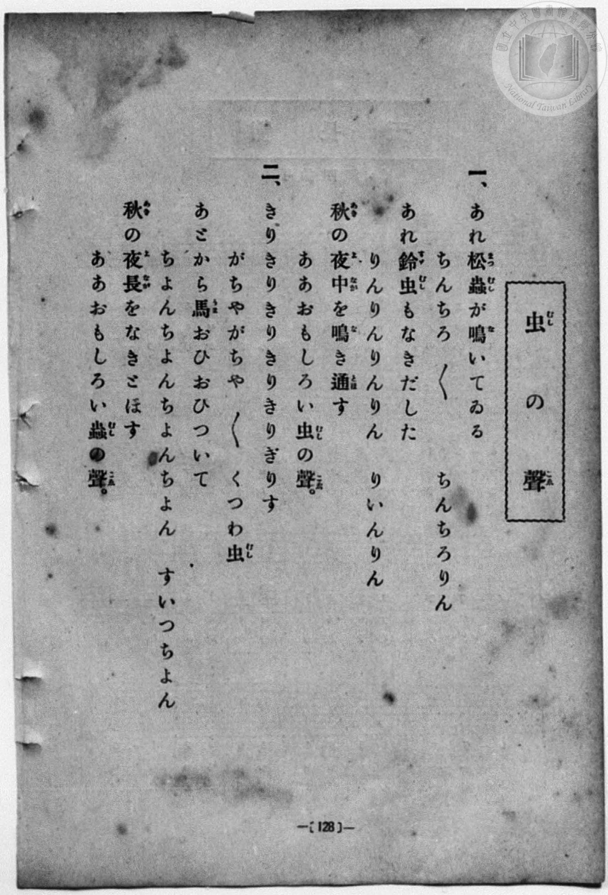
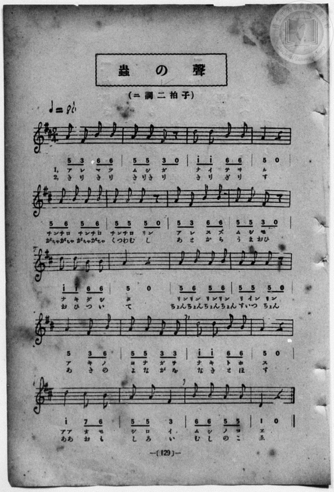

# 蟲の聲

> Re:Shōka 使用 AI 協助辨識與重建樂譜，可能會有錯誤。歡迎回報。

- **NEUTRINO 歌聲合成版**：<br><audio controls src="mushi_no_koe_neutrino.mp3"></audio>
- **鋼琴伴奏版**：<br><audio controls src="mushi_no_koe.mp3"></audio>


- book: 新編 小學校・公學校 唱歌教材集（尋常科三・四學年用）
- 一條慎三郎 編《新編 小學校・公學校 唱歌教材集》（大正十二年十二月，索書號 0725-41）
- 文部省《尋常小學唱歌》（明治四十三年・尋常小學讀本唱歌）

## 說明

> [!NOTE]
> **原書資訊與歌詞全文**（對應 `P136.jpg`–`P137.jpg`，原書 p. 128–129，尋常科三・四學年第 4 首）：
> - **調性與拍號**：ニ調二拍子（D 大調 2/4 拍），♩= 86
> - **版本說明**：本曲為文部省《尋常小學唱歌》名曲〈蟲の聲〉（あれ松蟲が鳴いてゐる，共 20 小節），與《新定兒童唱歌》第一學年同名異曲（小松耕輔曲「リンリンチリリンムシガナク」）不同。
> - **原譜對照註記**：第 14 小節第一拍五線譜印為單個四分音符 `5`（A4），下方簡譜則印為 `5 5` 以配合第二段歌詞「すいつ」（二音節）；此處採八分音符分割以同時對齊兩段歌詞。
>
> **一、**
> あれ松蟲（まつむし）が鳴（な）いてゐる
> ちんちろ　ちんちろ　ちんちろりん
> あれ鈴蟲（すずむし）もなきだした
> りんりんりんりん　りいんりん
> 秋（あき）の夜中（よなか）を鳴（な）き通（とほ）す
> ああおもしろい蟲（むし）の聲（こゑ）。
>
> **二、**
> きりきりきりきり　きりぎりす
> がちやがちや　がちやがちや　くつわ蟲（むし）
> あとから馬（うま）おひおひついて
> ちよんちよんちよんちよん　すいつちよん
> 秋（あき）の夜長（よなが）をなきとほす
> ああおもしろい蟲（むし）の聲（こゑ）。


## 歌詞

```text
（TMD 檔案未包含歌詞註解）
```

## ABC

```abc
X:1
T:蟲の聲
M:2/4
L:1/16
Q:1/4=86
K:D
V:V1 name="Piano" snm="Pia"
[V:V1]
A2 F2 B2 B2 | A2 A2 F2 z2 | d2 d2 B2 B2 | A6 z2 |
w: 1.~ア レ マ ツ | ム シ ガ | ナ イ テ ヰ | ル
w: 2.~き り き り | き り き | き り ぎ り | す
A2 B2 A2 B2 | A2 A2 A2 z2 | A2 F2 B2 B2 | A2 A2 F2 z2 |
w: 1.~チン チロ チン チロ | チン チロ リン | ア レ ス ズ | ム シ モ
w: 2.~がちや がちや がちや がちや | くつ わ む | あ と か ら | う ま おひ
d2 d2 B2 B2 | A6 z2 | A2 B2 A2 B2 | A2 A2 A2 z2 |
w: 1.~ナ キ ダ シ | タ | リン リン リン リン | リ イン リン
w: 2.~お ひ つ い | て | ちよん ちよん ちよん ちよん | す い つ
A4 F2 B2 | A2 A2 F2 F2 | d2 d2 B2 B2 | A6 z2 |
w: 1.~ア キ ノ | ヨ ナ カ ヲ | ナ キ ト ホ | ス
w: 2.~あ き の | よ な が を | な き と ほ | す
d4 c2 B2 | A2 A2 F4 | B2 B2 A2 A2 | D6 z2 |
w: 1.~アア オ モ | シ ロ イ | ム シ ノ コ | ヱ
w: 2.~ああ お も | し ろ い | む し の こ | ゑ
A2 F2 B2 B2 | A2 A2 F2 z2 | d2 d2 B2 B2 | A6 z2 |
w: 1.~ア レ マ ツ | ム シ ガ | ナ イ テ ヰ | ル
w: 2.~き り き り | き り き | き り ぎ り | す
A2 B2 A2 B2 | A2 A2 A2 z2 | A2 F2 B2 B2 | A2 A2 F2 z2 |
w: 1.~チン チロ チン チロ | チン チロ リン | ア レ ス ズ | ム シ モ
w: 2.~がちや がちや がちや がちや | くつ わ む | あ と か ら | う ま おひ
d2 d2 B2 B2 | A6 z2 | A2 B2 A2 B2 | A2 A2 A2 z2 |
w: 1.~ナ キ ダ シ | タ | リン リン リン リン | リ イン リン
w: 2.~お ひ つ い | て | ちよん ちよん ちよん ちよん | す い つ
A4 F2 B2 | A2 A2 F2 F2 | d2 d2 B2 B2 | A6 z2 |
w: 1.~ア キ ノ | ヨ ナ カ ヲ | ナ キ ト ホ | ス
w: 2.~あ き の | よ な が を | な き と ほ | す
d4 c2 B2 | A2 A2 F4 | B2 B2 A2 A2 | D6 z2 |
w: 1.~アア オ モ | シ ロ イ | ム シ ノ コ | ヱ
w: 2.~ああ お も | し ろ い | む し の こ | ゑ
```

## TMD 檔案連結

- [主旋律 TMD 檔案](mushi_no_koe.tmd) [[在 TMD Studio 編輯](https://tmdlang.github.io/Tmd-TS/#tmd=s7IKdvYPcrWy4qpTUCpJTLdSSM7PyUlNLsnMz7MqzsjPTozPrsyvSsyML84ojTe0NDJWgqssy88pzU21Si9KTEmNN443QcgU55cWJadaFSdn5OfnxJekVpQk5edno8vHFySmp1oFGBqbIWQKivLLUvMS84C6C4oy80pSU8DaEQpSyzJTUkHSxcmJefFlqUWZaZmpKUiOSi0qBrsdYkVJUWJecXJRZgHIQwhV-UUlGflAhxdkVFplZBaX5BdlJifmxGcn5iUiFJVkpAK9l5iXmZuYg6w1Mz0zzyo3Py-pFBhAGBIliZlAYWBw5ZcnxucmZublJOYB3aelpfBi_qbHjeteNG5S0NLiUrRVsDDjsrdVcOGyMdI3sQMZAwokK4Vn0zY8375C4emG_qdrdzxbsPBx8-6nrWsgbIWnUzY-W9vzbOrMZ3MnvJzd9n5Px9MN3U937Hi-fOKTHZ0gpbNnA5U-3bnl-ZQV7_d0gp33ZEfDs0Vzn7X2AZW8bO5TABr_uKGLFHseN3SDrFqy_NnaxU97G5_s6gHaAGE8m9Pxfk_P8y2Lns3e8WLmfAUDcyNTXRNDmN3PprW_bF7xfE4j0EaIUyEWQiyAmPtsRt-zTWCXA03c0Qk0GuQWJMUv1jU8m7MGogVsMJe-loIttQCXgoKCnUK0op9_iGsshKOl9bRvPshDm9tfrOh60dEOtPjFynlPW1cA_aOlBQ723mftnQoJoOSrl1WQnvCoYTKIYw7mAEMEYoBCgZ6CoZEFUNLQyBIkiiu21qxRMFF4uWwa0Hvv98yCuEIX6I4Xq_Y_a1gOckF3LzB4QXbPetzcDRQGhX1379O1E4CucVEAxg1QTAGYlBSAomBTeh7NXAlOZXDDnnd2AMPxxapVwBAHmwTkPZu96XnTLoLR9HRCL1Dl44YOeCp-3AC0o-NxY9Pjpp5nc_eBxXtebt7yuLHlceOyx00THjcBI7fnaetGBSMDUDJ7vr4B4i6gbyDp7-m6WU9bJz1fvRRuDTAcgKkVEiZPJ_QAbX0-dQPQYnCI94OsaZj6Ys8UsFN6Hjevety8GUY2ghkQ9oLHTdsfN6153Nz1uGn94wZQeDzZ0Qs08HFDEyI4gFH0Yu0cYEw-b13-YsXuFytmgAMFFBeGJlAXQxwEDNInu6Y83z4LpL53AzDAnk5b9xQYKsD462h7OX_z8zXLFBJMgfHe4WgC8eSTHd3Ppu18vmEhSEtnO0QXUI2CaYLCk91LX7YCndMBMh0Yjeu2QtIXyE-NM8EBuATs6g6gLMh0aMjNfrZ2yYuZU5_1LXzauhpuMZDxtHMT0Eyg_57NbAL65-XerqetK5GMhXgalraBHnrc0AgshMB85BgER-g-kO1NDY8bpwMthcQpWHwVmIuIXJj2hY-bJoPJ3scNQF24uU3A2JiMbOnLji0wS4G-noWwtKkJaN3jxt7HjQuAIo8b50N1gU3AQgItAjKAboOJQNQ_Xw4qXkB2NYKSADDdPl0y58mOtSDBJpCPHjcCFQCtm4Tqx96XDbPA3BWPG3eDRWYinA1CQCuA5HSQpxpboF5AhBgod4C1Ax0zESSCHv67gOkQKfzBIYNJgkIPwu0Dk3A3ABMJMDyBEQFjgFRiFewHR2U_mguR_AL0YPfjps6Xy9aAHdwGjH2wF4DWAbMzhFwCiXSk6AYaBYlTHAyQ1bBkDBPEEyMvp25HihFQCQ-MEVgCAEUBdcKf8poCChS09Lm4fIG1f6Zfvnc-sAmTmZiX71BjUFMNskbBxkILHNUK2CopBUiB8mJhj4IGrIzRUYBVHJpYNAAtAxlWo2CqYKxgBoQgFohtAGQZxoEQTFQXCIGiYPU-hjXA_LJI4XHzGiCeB8QtQDXAohEouh2I1yjEg_ldQPYSIN0GxBvAIqvB5gBlIeYYAcUae0F5D07jF-mDi8yEm4Q_PHb1kBceZmAMCQ9TcHhgCSNEaICqiM0Qai0aD1MWVJFAgggWiE07gXgXciA2L0ILJmjeI8ACqQTlTKAh_UDcAOROBws2AfEKIO4GinaCRYCx0rgPiEE5kYiA3NFJTkBiTUTYghcpKEHJBhRMQMcDQwIUSvthkQ0LPKwUWBaU5JDEUMMQlIQ2ATEweBohYbUMYTKsNCHAgiQ-kH6IOXBx_OEHrM7JS4i64GQHS3TGRGVMXWgI9oHDBBjt4DBdDaQ3wTMmSL4DiGeDQ3gnlozZBDIHlPUa14HVAFU3AsO3sQfIngQOBxAPJA9KWLtJy5ZTyExNugrmSMGhC2SBAgLEA0pjCwxYeADdCsxTICFQ7gL6Hlg0gbQjchyocIGkoo3YQgMWIKDAawJ7djqQBfJ-C8QgaG4DBRewfgCLTIQbVMvFpWungCjZFTB4ylwA)]
- [鋼琴伴奏 TMD 檔案](mushi_no_koe_piano.tmd) [[在 TMD Studio 編輯](https://tmdlang.github.io/Tmd-TS/#tmd=s7IKdvYPcrWy4qpTUCpJTLdSSM7PyUlNLsnMz7MqzsjPTozPrsyvSsyML84ojTe0NDJWgqssy88pzU21Si9KTEmNN443QcgU55cWJadaFSdn5OfnxJekVpQk5edno8vHFySmp1oFGBqbIWQKivLLUvMS84C6C4oy80pSU8DaEQpSyzJTUkHSxcmJefFlqUWZaZmpKUiOSi0qBrsdYkVJUWJecXJRZgHIQwhV-UUlGflAhxdkVFplZBaX5BdlJifmxGcn5iUiFCUWATWnp-am5pVYFWQm5uXHJyYn5-cWJOZlgsQQCksygIqsQMKJOUpcWloKL-Zvety47kXjpvd7Ol7Onvmss_tl957nE7Y82bPl6dL-93s6FbS0uBRtFSzMuOxtFVy4bIz0TexAxoGCyUrh2bQNz7evUHi6of_p2h3PFix83Lz7aesaCFvh6ZSNz9b2PJs689ncCS9ntwFteLqh--mOHc-XT3yyoxOkdPZsoNKnO7c8n7ICaBXYmU92NDxbNPdZax9QycvmPgWg8Y8bukix53FDN8iqJcufrV38tLfxya4eoA0QxrM5He_39DzfsujZ7B0vZs5XMDA3MtU1MYTZ_Wxa-8vmFc_nNAJthDgVYiHEAoi5z2b0PdsEdjnQxB2dQKNBbkFS_GJdw7M5ayBawAZz-ZYWZ2T65XvnA5MQKHKCPBxqDGqquRSAwMZCyw7M0NdSsEUHCs_XrAGGx4uFPQoaJiDPP1_foKMATIbmelkF6ZpYNGjpgw2rUTBVMFYwA0IQC8Q2ALIM40AIJqoLhEBRsHofwxqFx02LFB43rwHieUDcAlTzuHkBUHQ7EK9RiAfzu4DsJUC6DYg3gEVWg80BykLMMQKKNfYCVQFVQmn8In1wkZlwk_CHx64e8sLDDIwh4WEKDg8sYYQIjebGx82bIdRaNB6m7CoQDxxEsEBs2gnEu5ADsXkRWjD1PG5c-LiphQALpLL_cSMw1Jv6gbgByJ0OFmwC4hVA3A0U7QSLAGOlcR8Qdz1u3EREQO7oJCcgsSYibMGLFJSgZAMKJqDjgSEBCqX9sMiGBR5WCiwLSnJIYqhhCEpCm4AYGDyNkLBahjAZFIAdj5smE2BBEh9IP8QcuDj-8AMWAeQlRF1wsoMlOmOiMqYuNAT7wGECjHZwmK4G0pvgGRMk3wHEs8EhvBNLxmwCmQPKeo3rwGqAqhuB4dvYA2RPAocDiAeSByWs3aRlyylkpiZdBXOk4NAFskABAeIBpbEFBiw8gG4F5imQECh3AX0PLJpA2hE5DlS4QFLRRmyhAQsQUOA1gT07HcgCeb8FYhA0t4GC63EjOKE0TYQbVItZsPsgF-wm0IId6It4hWiTWCjDEMQwQRKB-Q5VHbi8RtcHVYemG10fkmlgywjYChI1jcdQCBcCqQT6VddOAeHdaB-gOjQRI7CIMhcA)]

## 分析

```text
================================================================================
📊 TMD Song Profile: [ 蟲の聲 ]
================================================================================
⏱  Duration:       0:55 (55.8s), 40 measures total
🎼 Key & Tempo:    首調基準 D, != 86.0 BPM, <2/4>
   - 分析範圍：      由實際發聲的音符與和弦推測調性；播放脈絡另行呈現
🎤 人聲音域:    D4 (MIDI 62) – D5 (MIDI 74) [跨度: 12 個半音 / 1.0 個八度, 難度: easy]
   - 最低音:  D4 in [MushiNoKoe #1 @ m.20, 0:26]
   - 最高音: D5 in [MushiNoKoe #1 @ m.3, 0:02]
   - 適合: soprano, mezzo-soprano, contralto, tenor, baritone, bass
🏛  結構:      MushiNoKoe (27.9s) -> MushiNoKoe (27.9s)
⚡ 編曲密度:        Peak 1 軌道同時演奏
🗝  調性診斷：       A 調性不明確（純淨自然大調，未偵測到可信轉調）
   - 風格氣質:    純淨自然大調（陽光明朗、易唱易記，無明顯調外色彩）
   - 轉調歷程:    全曲維持單一推測調性（未偵測到可信轉調）
   - 核心骨幹音:  A, B, D, F#, C#
   - 調性數值:    A 調性不明確 [相關度: 0.69, 穩定度: Ambiguous, 自然音純度: 100.0%]
   - 候選調性 (K-S): A 大調 (0.69), D 大調 (0.65), F# 小調 (0.58)
   - 五度圈歷程:   +3 -> +3
   - 各段落調性細節:
     • [MushiNoKoe #1]: A 調性不明確 (r: 0.69, 自然音純度: 100.0%)
     • [MushiNoKoe #2]: A 調性不明確 (r: 0.69, 自然音純度: 100.0%)

  [ 五度圈游移軌跡 ]
               C  
         F            G  
      Bb               D  
      Eb              [A ]*
         Ab           E  
            Db       B  
               F# 
     (* = active key center)

  [ 十二半音累積音高分佈 ]
     C  :                            0.0%
     C# : █                          1.4%
     D  : ████████                  15.3%
     D# :                            0.0%
     E  :                            0.0%
     F  :                            0.0%
     F# : ███████                   12.5%
     G  :                            0.0%
     G# :                            0.0%
     A  : ████████████████████████  45.8%
     A# :                            0.0%
     B  : █████████████             25.0%
--------------------------------------------------------------------------------
Assignment 軌道音域：
  - Piano         : D4 – D5 (12 個半音 / 1.0 個八度, 122 個音符)
================================================================================
```


## 原書掃描頁






