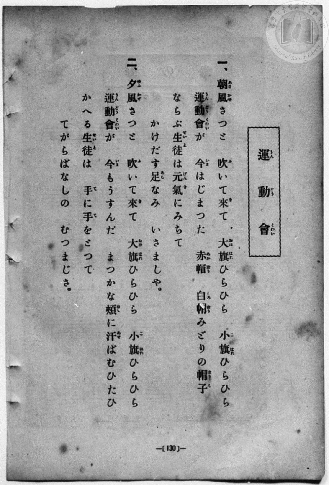
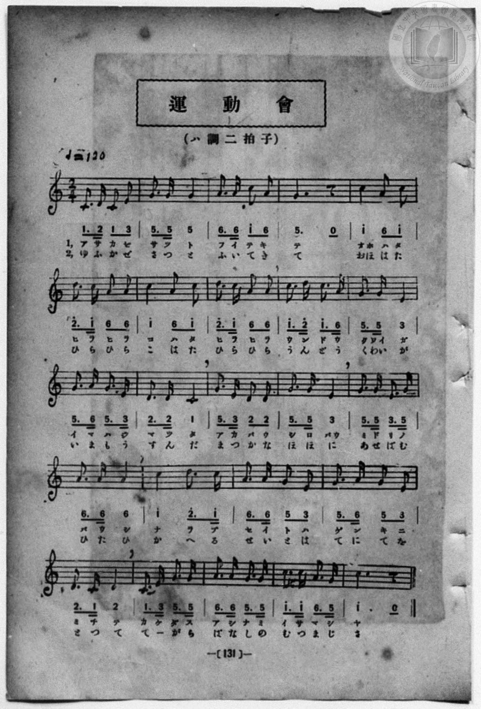

# 運動會

> Re:Shōka 使用 AI 協助辨識與重建樂譜，可能會有錯誤。歡迎回報。

- **鋼琴伴奏版**：<br><audio controls src="undokai.mp3"></audio>
- **NEUTRINO 歌聲合成版**：<br><audio controls src="undokai_neutrino.mp3"></audio>

- 詞：公學校用國民讀本
- 曲：宮島慎三郎
- book: 新編 小學校・公學校 唱歌教材集（尋常科三・四學年用）
- 一條慎三郎 編《新編 小學校・公學校 唱歌教材集》（大正十二年十二月，索書號 0725-41）
- 臺灣總督府《公學校唱歌集》（大正四年三月，索書號 0725 26）

## 說明

> [!NOTE]
> **原書資訊與歌詞全文**（對應 `P138.jpg`–`P139.jpg`，原書 p. 130–131，尋常科三・四學年第 5 首）：
> - **調性與拍號**：ハ調二拍子（C 大調 2/4 拍），♩= 120
> - **作曲**：臺灣總督府國語學校助教授 宮島慎三郎（原載大正四年《公學校唱歌集》第三學年第 5 首）
> - **原譜對照註記**：第 14 小節第二拍原譜五線譜與簡譜均印為八分音符＋兩個十六分音符 `2 2`（對應「バウ」二字分音，與第 13 小節「バウ」`2 2` 為兩個八分音符形成趣味對比）。
>
> **一、**
> 朝風（あさかぜ）さつと　吹（ふ）いて來（き）て
> 大旗（おほはた）ひらひら　小旗（こはた）ひらひら
> 運動會（うんどうくわい）が　今（いま）はじまつた
> 赤帽（あかばう）　白帽（しろばう）みどりの帽子（ばうし）
> ならぶ生徒（せいと）は元氣（げんき）にみちて
> かけだす足（あし）なみ　いさましや。
>
> **二、**
> 夕風（ゆふかぜ）さつと　吹（ふ）いて來（き）て
> 大旗（おほはた）ひらひら　小旗（こはた）ひらひら
> 運動會（うんどうくわい）が　今（いま）もうすんだ
> まつかな頰（ほほ）に汗（あせ）ばむひたひ
> かへる生徒（せいと）は　手（て）に手（て）をとつて
> てがらばなしの　むつまじさ。


## 歌詞

```text
（TMD 檔案未包含歌詞註解）
```

## ABC

<div class="abc-score" data-abc-src="undokai.abc" aria-label="五線譜載入中"></div>

[下載 ABC 原始檔](undokai.abc)

## TMD 檔案連結

- [主旋律 TMD 檔案](undokai.tmd) [[在 TMD Studio 編輯](https://tmdlang.github.io/Tmd-TS/#tmd=s7IKdvYPcrWy4qpTUCpJTLdSSM7PyUlNLsnMz7MqzsjPTozPrsyvSsyML84ojTe0NDJWgqssy88pzU21Si9KTEmNN443QcgU55cWJadaFSdn5OfnxJekVpQk5edno8vHFySmp1oFGBpbIGQKivLLUvMS84C6C4oy80pSU8DaEQpSyzJTUkHSxcmJefFlqUWZaZmpKUiOSi0qBrsdYkVJUWJecXJRZgHIQwhV-UUlGflAhxdkVFplZBaX5BdlJifmxGcn5iUiFJVkpAK9V1wAVIysMzM9M8-qJDGzHGh_flpaZnJmYo4Sl5aWwsvG7qfdU5_NaVbQ0uJStFUwNDLgsrdVcOayMdI3sQOZAAoFK4Vn0zY8375C4emG_qdrdzxbsPBx8-6nrWsgbIWnUzY-W9vzbOrMZ3MnvJzd9n5Px9MN3U937Hi-fOKTHZ0gpbNnA5U-3bnl-ZQV7_d0gl32ZEfDs0Vzn7X2AZW8bO5TABr_uKGLFHseN3SDrFqy_NnaxU97G5_s6gHaAGE8m9Pxfk_P8y2Lns3e8WLmfAUDcyNTXRNDmN0vVs57v2cW3GCgq57O6X62YeKLdQ3P5qwBK3k2exNIybp1TzdvgzsSorl91_PGxc937H0-d_HTXXOAjoYbBHEgutOAnt-5BWgANkcpGJmBHcWlr6VgSy3ApaCgYKcQrejnH-IaC-FoaT3tmw-yd3P7ixVdLzrage4EhsLT1hXPprVraYGjrPdZe6dCAiht62UVpCc8apgM4liCOUCHQwxQKNBTMDQ2AEoaGgPDswdnTK9Zo2Cq8HLZNKD3gAEJcYUu0B0vVu1_1rAc5ILuXmAogOye9bi5HygMirfu3qdrJwBd46wADDygmAIwGSoARcGm9DyauRKSROGmPdk7BxhTYEPQ4gUYoy9WzYPGS9dKUKrp61BAi1CQv_vmv9jTiRxVuGIU6CWgLkzvIVwDMmvtHGBIPm9d_mLF7hcrZoBdBlJsaAJK1M_XN4BMgXgUrPjJrinPt88CMoAh8nzDQpD2ue1Pezc8b9r1tHX10462l_M3P1-z7P2e7qetK582dAPT99PWtXBxhQQjBSNg7ECj73FDz-PmCY-blj1u6AXlh7XTISqBYQcyH-QOY6g7kJWCDVEAWwm2A8nip3sXPeuY8GLb4qcTN4PsWD8F6OPHDU1gT8PSFjAvP25oBJYgYP6zOXNfLgLm847HjU2PG6c-bux-3DgHpAvEXvK4EZjPG55O2AlWsBUs3vK4cdmTfaCC43EjKKqBXIhRoGiZPh0s3vW4cffjxvWPG-eDFWx63AQjgaZt6Icpm4xVDcQ0eGEHVtn2uAmoeCWI0dj_uKkf6Aywrh6ggU92d4HVAB22DywINHMGkA12_3yIaS-2Lnm6Yy_Mm0A_bgAaBQ6chucz98Kkpj9u6kVINe4H2dgE9Ms6oAJIUofIAlXCk9LjxlVgl297PmX-032TwGpmgx0DKj2Bjnna2vxsw2Kw-CSwLyCBthps_kJ46IFdNfFx44LHjTNfbAMmAohTQRaBrAAqbmgAGwuMF6DXgE5twYjZXcDggMfs0yVToTHbBHTw1uEQs03AAAEqmwnWsgAWbpCIBvpu1csFG8DqgS7cDQnkZxsh7gFqnA0W2fC4CRiMm4BuA5JIIb_jcVM3rhgEuuRZJ6iOAAYI1FhkbtMkUGCC3ACPymUg94N8DUwtwLibDkxCoOgDWQ1UBnQwMH1OhUYf5VUIFCho6XNxhealANtUmVYBmYl5-Q41BjXVIDsUbAzNtMDpRAFb3aUALi0bXizsUdAwhRY5Ogqw-kQTiwagVSDDahQMgWWproIRmDYG4hpgSQsSMYXSIBEzMG2mYBgHphCKINAALAKWhKjThXBqwFb4GNYoPG5aBJZ63LQViFeDWXvAukAiYJnmFiDugFv5uHkqVMcSILsNzFoLlQHxYDAeasqqx82zoULA-g2sfD_CCUYgJRBtwLwCSjBg1hyI5kaoVY1AqxpXIJwAVAkRBzqtcRmY1QuVAfHQnADOWTAnNK4Hk_PBTsAfbbt6yIk2I0hoA8MZFNyQOMESA_jUAaWgLDOkWAelAbD_EZHXPAkariuhbBALEuybsYU5Xh2QkHvcvBmIOyFsoBhIZv3j5vWg6Iaa2LQG1SWgOGzcBJXrhLJBLEjoT8YW9Hh1QNND02QgG-Q6kK42sAy0GIOb2AN3CYEc2ElOVEJC3gxKG4MiDRI_0LyJyG7GYBkQxhJfaCKmKNkPEqqPm-dBYwrk7x3gmJoHlQGmcXDsQdM-PMOuBspNgMYSRGY7VMdakAwsQiHRDgp0kBQwsJtXQdl9KBEICVRgEQo0qAkl0GciRccChJlAlRBVoMwJybYgk0EykNwGooElOpIOmLmzgXgD1NQGQpEHbI2CIw_WciQy8mBFI4RGyYWIrIdQBooj5FIWSQQpv4HCGxLisNCGBG8XlA3JTSB6GjhGoAEBLipBRSgkjkEy0NQPym3g4vNxMygIseQoYH6BsSGBCFIHkdkBNb0bLA4pZSFlIqishOQ3RJkIigpoadkEyvkEi78pZBV_kKCF0uBgB9PG8FyAGuYQEWjUQAtDFDEIBNdkSBEBS8-NSLUOKFghqe1x00ageAOUvRMl22yHRxfIFKQsCKoBYZkOqApkC6zIA0FwZYIUPZDqCJL6kXIanA0rnEDFGkgcmt6BeQTYaoGy14Hth7oTbBIsT81Aqv6Q7a_l4tK1U4A2RRRQmcpcAA)]
- [鋼琴伴奏 TMD 檔案](undokai_piano.tmd) [[在 TMD Studio 編輯](https://tmdlang.github.io/Tmd-TS/#tmd=s7IKdvYPcrWy4qpTUCpJTLdSSM7PyUlNLsnMz7MqzsjPTozPrsyvSsyML84ojTe0NDJWgqssy88pzU21Si9KTEmNN443QcgU55cWJadaFSdn5OfnxJekVpQk5edno8vHFySmp1oFGBpbIGQKivLLUvMS84C6C4oy80pSU8DaEQpSyzJTUkHSxcmJefFlqUWZaZmpKUiOSi0qBrsdYkVJUWJecXJRZgHIQwhV-UUlGflAhxdkVFplZBaX5BdlJifmxGcn5iUiFCUWATWnp-am5pVYFWQm5uXHJyYn5-cWJOZlgsQQCksygIqsiguApipxaWkpvGzsfto99dmc5vd7Ol7Onvmss_tl957nE7Y82bPl6dL-93s6FbS0uBRtFQyNDLjsbRWcuWyM9E3sQMaBgslK4dm0Dc-3r1B4uqH_6dodzxYsfNy8-2nrGghb4emUjc_W9jybOvPZ3AkvZ7cBrXi6ofvpjh3Pl098sqMTpHT2bKDSpzu3PJ-yAmgX2JlPdjQ8WzT3WWsfUMnL5j4FoPGPG7pIsedxQzfIqiXLn61d_LS38cmuHqANEMazOR3v9_Q837Lo2ewdL2bOVzAwNzLVNTGE2f1i5bz3e2bBDQa66umc7mcbJr5Y1_BszhqwkmezN4GUrFv3dPM2uCMhmtt3PW9c_HzH3udzFz_dNQfoaLhBEAeiOw3o-Z1bgAZgc5SCkRnYUVyheSnAlJ1pFQCK1SAPhxqDmmouBSCwMTTTsgOz9LUUbNGBwvM1a4Ah-WJhj4KGKSjYnq9v0FEAJmBLvayCdE0sGrT0wYbVKBgq6AKhEZg2BuIaBVOwiCmUBomYgWkzBcM4MIVQBIEGYBGwJESdLoRTA7bCx7BG4XHTIrDU46atQLwazNoD1gUSAcs0twBxB9zKx81ToTqWANltYNZaqAyIB4PxUFNWPW6eDRV63NwPVr4f4QQjkBKItseNQCc0doNZcyCaG6FWNQKtalyBcAJQJUQc6LTGZWBWL1QGxENzQmPX48bdMCc0rgeT88FOwB9tu3rIiTYjSGgDwxkU3JA4wRID-NQBpaAsM6RYB6UBsP8Rkdc8CRquK6FsEAsS7JuxhTleHZCQe9y8GYg7IWygGEhm_ePm9aDohprYtAbVJaA4bNwEleuEskEsSOhPxhb0eHVA00PTZCAb5DqQrjawTP_jpn5QrMNM7IG7hEAO7CQnKiEhbwaljUGRBokfaN5EZDdjsAwIY4kvNBFTlOwHCdXHzfOgMQXy9w5wTM2DygDTODj2oGkfnmFXA-UmQGMJIrMdqmMtSAYWoZBoBwU6SAoY2M2roOw-lAiEBOrjxn1Ag5pQAn0mUnQsQJgJVAlRBcqckGwLMhkkA8ltIPpxI6hMgemAmTsbiDdATW0gFHnA8hkceSakRR6saITQKLkQkfUQykBxhFzKIokg5TdQeENCHBbakODtgrIhuQlETwPHCDQgwEUlqAiFxDFIBpr6QbkNXHw-bgYFIZYcBcwvMDYkEEHqIDI7oKZ3g8UhpSykTASVlZD8higTQVEBLS2bQDmfYPE3haziDxK0UBoc7GDaGJ4LUMMcIgKNGmhhiCIGgeCaDCkiYOm5EanWAQUrJLU9btoIFG-AsneiZJvt8OgCmYKUBUE1ICzTAVWBbIEVeSAIrkyQogdSHUFSP1JOg7NhhROoWAOJQ9M7MI88bpwOZa8D2w91J9gkWJ6agVT9Idtfi9YS8UFuiZhAGyLAsItXiDaMRWaYABkmUBEDJD6sqIuHycMVIoRAhsAZINPQbQErhdtnGo9iM5omZIeA9EFEsKkEm4pmGIpaJP-AAkbXTgEaNtE-QDXIXCMwV5kLAA)]

## 分析

```text
================================================================================
📊 TMD Song Profile: [ 運動會 ]
================================================================================
⏱  Duration:       0:48 (48.0s), 48 measures total
🎼 Key & Tempo:    首調基準 C, != 120.0 BPM, <2/4>
   - 分析範圍：      由實際發聲的音符與和弦推測調性；播放脈絡另行呈現
🎤 人聲音域:    C4 (MIDI 60) – D5 (MIDI 74) [跨度: 14 個半音 / 1.2 個八度, 難度: moderate]
   - 最低音:  C4 in [Undokai #1 @ m.1, 0:00]
   - 最高音: D5 in [Undokai #1 @ m.6, 0:05]
   - 適合: soprano, mezzo-soprano, contralto, tenor, baritone, bass
🏛  結構:      Undokai (24.0s) -> Undokai (24.0s)
⚡ 編曲密度:        Peak 1 軌道同時演奏
🗝  調性診斷：       C 大調（純淨自然大調，未偵測到可信轉調）
   - 風格氣質:    純淨自然大調（陽光明朗、易唱易記，無明顯調外色彩）
   - 轉調歷程:    全曲維持單一推測調性（未偵測到可信轉調）
   - 核心骨幹音:  G, C, A, D, E
   - 調性數值:    C 大調 [相關度: 0.84, 穩定度: Moderate, 自然音純度: 100.0%]
   - 候選調性 (K-S): C 大調 (0.84), G 大調 (0.74), A 小調 (0.66)
   - 五度圈歷程:   +0 -> +0
   - 各段落調性細節:
     • [Undokai #1]: C 大調 (r: 0.84, 自然音純度: 100.0%)
     • [Undokai #2]: C 大調 (r: 0.84, 自然音純度: 100.0%)

  [ 五度圈游移軌跡 ]
              [C ]*
         F            G  
      Bb               D  
      Eb               A  
         Ab           E  
            Db       B  
               F# 
     (* = active key center)

  [ 十二半音累積音高分佈 ]
     C  : ███████████████████████   26.6%
     C# :                            0.0%
     D  : ████████████              13.8%
     D# :                            0.0%
     E  : █████████                 10.6%
     F  :                            0.0%
     F# :                            0.0%
     G  : ████████████████████████  27.7%
     G# :                            0.0%
     A  : ██████████████████        21.3%
     A# :                            0.0%
     B  :                            0.0%
--------------------------------------------------------------------------------
Assignment 軌道音域：
  - Piano         : C4 – D5 (14 個半音 / 1.2 個八度, 162 個音符)
================================================================================
```


## 原書掃描頁






