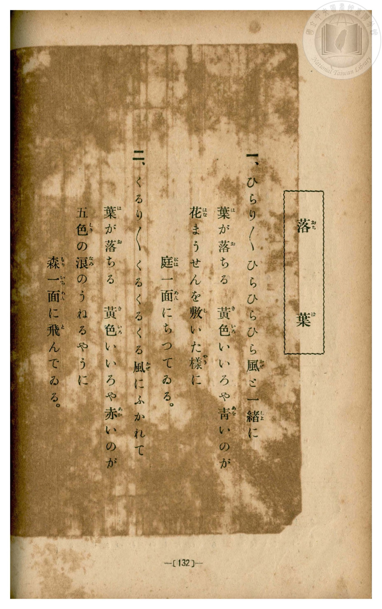
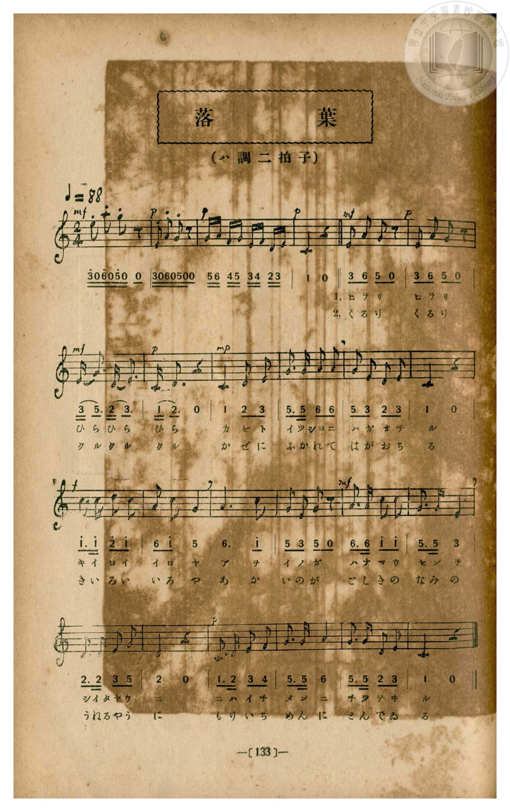

# 落葉

> Re:Shōka 使用 AI 協助辨識與重建樂譜，可能會有錯誤。歡迎回報。

- **鋼琴伴奏版**：<br><audio controls src="ochiba.mp3"></audio>
- **NEUTRINO 歌聲合成版**：<br><audio controls src="ochiba_neutrino.mp3"></audio>

- book: 新編 小學校・公學校 唱歌教材集（尋常科三・四學年用）
- 一條慎三郎 編《新編 小學校・公學校 唱歌教材集》（大正十二年十二月，索書號 0725-41）

## 說明

> [!NOTE]
> **原書資訊與歌詞全文**（對應 `P140.jpg`–`P141.jpg`，原書 p. 132–133，尋常科三・四學年第 6 首）：
> - **調性與拍號**：ハ調二拍子（C 大調 2/4 拍），♩= 88
> - **樂曲結構**：含 4 小節輕巧的斷奏前奏（模擬落葉飄零），主歌共 20 小節（第一行後段 2 小節、第二行 6 小節、第三行 5 小節、第四行 7 小節）。注意本曲（「ひらりひらりひらひらひら」）與手抄《唱歌帳》補遺所錄 3/4 拍〈落葉〉（「北風さむき霜のあした」）為同名異曲。
> - **原譜印刷勘誤**：第 11 小節（第三行第 3 小節）歌詞「あを」（青），五線譜音高為 G4（`5`），下方簡譜數字將 `5` 誤印為相似字形之片假名「チ」，此處依五線譜校正為 `5`。
>
> **一、**
> ひらり　ひらり　ひらひらひら
> 風（かぜ）と一緒（いつしよ）に　葉（は）が落（お）ちる
> 黃色（きいろ）いいろや青（あを）いのが
> 花（はな）まうせんを敷（し）いた樣（やう）に
> 庭一面（にはいちめん）にちつてゐる。
>
> **二、**
> くるり　くるり　くるくるくる
> 風（かぜ）にふかれて　葉（は）が落（お）ちる
> 黃色（きいろ）いいろや赤（あか）いのが
> 五色（ごしき）の浪（なみ）のうねるやうに
> 森一面（もりいちめん）に飛（と）んでゐる。


## 歌詞

```text
（TMD 檔案未包含歌詞註解）
```

## ABC

```abc
X:1
T:落葉
M:2/4
L:1/16
Q:1/4=88
K:C
V:V1 name="Piano" snm="Pia"
[V:V1]
!mf! e z a z g z z2 | !p! E z A z G z z2 | G A F G E F D E | !p! C4 z4 |
!mf! E A G2 z4 | !p! E A G2 z4 | !mf! E G3 D E3 | !p! C D3 z4 |
w: 1.~ヒ ラ リ | ヒ ラ リ | ひ ら ひ ら | ひ ら
w: 2.~く る り | く る り | ク ル ク ル | ク ル
!mp! C4 D2 E2 | G3 G A2 A2 | G2 E2 D2 E2 | C4 z4 |
w: 1.~カ ゼ ト | イツ シヨ ニ _ | ハ ガ オ チ | ル
w: 2.~か ぜ に | ふ か れ て | は が お ち | る
!f! c3 c d2 c2 | A2 c2 G4 | A4 c2 G2 | G2 E2 G2 z2 |
w: 1.~キ イ ロ イ | イ ロ ヤ | ア ヲ _ | イ ノ ガ
w: 2.~き い ろ い | い ろ や | あ か _ | い の が
!mf! A3 A c2 c2 | G3 G E4 | D3 D E2 G2 | D4 z4 |
w: 1.~ハ ナ マ ウ | セ ン ヲ | シ イ タ ヤウ | ニ
w: 2.~ご し き の | な み の | う ね る やう | に
!p! C3 D E2 F2 | G3 G A4 | G3 G D2 E2 | C4 z4 |
w: 1.~ニ ハ イ チ | メ ン ニ | チ ツ テ ヰ | ル
w: 2.~も り い ち | め ん に | と ん で ゐ | る
```

## TMD 檔案連結

- [主旋律 TMD 檔案](ochiba.tmd) [[在 TMD Studio 編輯](https://tmdlang.github.io/Tmd-TS/#tmd=s7IKdvYPcrWy4qpTUCpJTLdSSM7PyUlNLsnMz7MqzsjPTozPrsyvSsyML84ojTe0NDJWgqssy88pzU21Si9KTEmNN443QcgU55cWJadaFSdn5OfnxJekVpQk5edno8vHFySmp1oFGJoYIGQKivLLUvMS84C6C4oy80pSU8DaEQpSyzJTUkHSxcmJefFlqUWZaZmpKUiOSi0qBrsdYkVJUWJecXJRZgHIQwhV-UUlGflAhxdkVFplZBaX5BdlJifmxGcn5iUiFJVkpAK9l5dYUlqUii5anJpYjGpgZnpmnlVpHsh1JVA3aWkpvJiw98XETgUtLS5FWwULCy57WwVnLhsjfRM7kFZQqFgpPJu24fn2FQpPN_Q_Xbvj2YKFj5t3P21dA2ErPJ2y8dnanmdTZz6bO-Hl7Lb3ezqebuh-umPH8-UTn-zoBCmdPRuo9OnOLc-nrHi_pxPspCc7Gp4tmvustQ-o5GVznwLQ-McNXaTY87ihG2TVkuXP1i5-2tv4ZFcP0AYI49mcjvd7ep5vWfRs9o4XM-crGJgbmeqaGILt5tLXUrClFuBSUFCwU4hW9PMPcY2FcLS0nvbNB9m7uf3Fiq4XHe1AN79YOe9p64pn09q1tMCh0_usvVMhAZSs9LIK0hMeNUwGcQzBHKDDIQYoFOgpGBobASUNjY1BorgCdc0aBTOFl8umAb33fs8siCt0ge54sWr_s4blIBd09wJDAWT3rMfN_UBhUBB19z5dOwHoGmcFYBACxRSAMa4AFAWb0vNo5kpwYoAb9mxF07PZm55vnfBseTfYpKcTViuYgGLq-fqGF3umPt2-_PmslmfTtj9d2v-0sxdIAs1-tmLhs8lrIAns5eKWl7O3QUx_smM3MFSetm5UMDKAGgFUDfQIMFW8WNjzdF_Ps3VbFYygUo8bGkFSu3qAUkCfogju6AQJmqIIAkMGJGgON7nzcUPTs80rnrX0P5uzBugLoF2PG3oeN2563NT5uKkLnYFMNoDCAxSEnd3PulqAKRSSCJ_u2AxMfi8Wz3nZuOtZZ8PLnhYFY0jwPW7ogPj3cQPQpyB7nvZMf7loxePGqY-bGh439r6cM-dx47rHjU2PG6c_bpwPseF5066nE3qeTuh9PnUD0IFA9yJCHpgaXqyd87R3w9OO7U-7Z7xYtQQc_qBoNzRECz1QaIAkjBF-hyQ_sH-bHjdNAtvX8XLuJGhM7JryfPssoPkv529-uXoG0B0K7iZABQmmwIQIiaruZ9N2Pt-wEKjm2dQdT9dOf7qhXQEorQB0CNBRQB3PZ-94smcPSGbvoic7u593tj9tbAf6BWRncyPYwp5na5e8mDn1yb65cAuBORqYcUEWAg2DeRiWhYDpABiXwCIJzEdEUAMwBDHYSCREPTC4QUHf2P24cQ4o9htXAM17vh3oZaBgy-PGJaCgbwIWEUCp1UBzgLEFlloPFukBxh-Y2wXmLnzc1A01dnfzi05w4mnsBZnTBIo5sIEg9uOmFnCoAmVB4QyTAsZ0D0T7i66NEFseN64Cy-573Nj2uHH246bJQPXPpm4Hy06HaZz_bMVikEgTkA0sU0FOhZjzdNdaoHdezl0EVr8abCBQDdCdjUCjoJ4CckHeXPa4aQLQ_RjBu6sHJXj7QWqgQYrBRiJxBC_Quq0gbhMwjS2jYni-2LoEGp6NwKIePTyBKQmmfQo4L0G0r3u2FRi8QMFVjxv3Q0TA4bwW7C9QYMJD8tnidYiQbALGGrAEQA_Jl4tng00DVVygmGpcjhKklFchUKCgpc_F5ZlXUpRvFZCZmJfvUGNQo1ANskLBxtBMCxx1CtiqLgVEsdnZCyw2QUUzuPxV0IAVzzoKsNpFE4t-oMUgs4G25abVKhjHKRgomIEIUxBhACyCgDIFQAmQOEgYLmoK5JsASWMgaQQkIeoMgXIgCFIDgjVctVxc_skZmUmJ5PsMUiFowGoEkjwEdKUpsnugvkETBWvxMaxReNw8CYhXAvEqoHg8XBcOcYg-I6B8Y78CMF0AcReqPuziXPi9DansNGC1HWkeBnlMFxwlCA8bAvko0QJUjBRbIEmQclCsgviguNUFY4gISA6hBjOO4aHXuAno006wKDIbVQYpdJpWQ9mPm_aAyOYOqPiSx80tUIntj5tXAGW6keKiHyyxBkyC4gNY0UBlYOZhiaGm9XB5ZDaqDHLMwWwEFnRgEqQCJL4VKgqK1R4waxlUZj2YBxEDxTewNIHaADOL2BQAadlowJo2xKYAYAIwjANbAKSMQCwwtwYcl2AmJIJhQlCVEGFEXMPyBjRNQVSaQVRCDEREedNaaJAuAQYiiA1iQSMRHDVgsWYQGxbci2AB27wJSRSiug9sAihqQUEFi2yQTBcQzwPLgoMbKev1QiOkBSgHYoNYkAgB0VCxJkh6gog3wVwAj2S46sZ1YBIUiVAXNE6Bqp0OtQuihkAUQtuhGrCGKJFRCMuAkNwLsh-ScyH5GRJNEBH0Qg2SLSHqTMCiyJkZog4mQlRmbtoNDfnNaDG1HSIOivGm_WAVS6CRgpRPkctOiBgoKmHRDMuvoPwBswI5h4PkQeLAKG1uA7M2QGXw5PBGUFkAip790CiCRSzIBJD4WmhOhLQEoJIYBgKlIekDVGjDUgUsI0Md1jQZSSfIlBVI4svBrAlQHZhZH1gl6topgKt7BSADUj2CWMpcAA)]
- [鋼琴伴奏 TMD 檔案](ochiba_piano.tmd) [[在 TMD Studio 編輯](https://tmdlang.github.io/Tmd-TS/#tmd=s7IKdvYPcrWy4qpTUCpJTLdSSM7PyUlNLsnMz7MqzsjPTozPrsyvSsyML84ojTe0NDJWgqssy88pzU21Si9KTEmNN443QcgU55cWJadaFSdn5OfnxJekVpQk5edno8vHFySmp1oFGJoYIGQKivLLUvMS84C6C4oy80pSU8DaEQpSyzJTUkHSxcmJefFlqUWZaZmpKUiOSi0qBrsdYkVJUWJecXJRZgHIQwhV-UUlGflAhxdkVFplZBaX5BdlJifmxGcn5iUiFCUWATWnp-am5pVYFWQm5uXHJyYn5-cWJOZlgsQQCksygIqs8hJLSotS0UWLUxOLQTZraSm8mLD3xcTO93s6Xs6e-ayz-2X3nucTtjzZs-Xp0v73ezoVtLS4FG0VLCy47G0VnLlsjPRN7EBmgULOSuHZtA3Pt69QeLqh_-naHc8WLHzcvPtp6xoIW-HplI3P1vY8mzrz2dwJL2e3AW14uqH76Y4dz5dPfLKjE6R09myg0qc7tzyfsgJoFdiNT3Y0PFs091lrH1DJy-Y-BaDxjxu6SLHncUM3yKoly5-tXfy0t_HJrh6gDRDGszkd7_f0PN-y6NnsHS9mzlcwMDcy1TUxBNvN5ZlXUpRvFQAK0SAPhxqDGoVqLgUgsDE007IDs4AiuWm1CsZxCgYKZiDCFEQYKOiCZAqAEiBxkDBc1BTINwGSxkDSCEhC1BkC5UAQpAYEa7hqUaz3QbHeAm67YbxCtGGsgml8PFArBtcEyDWBcKNN42MRCoAUUB5kh39yRmZSIl4_6msp2KIDhedr1gDj5cXCnqf7ep6t26qgYQSKiufrG3QUgPnEUC-rIF0TizYtfZRgA4aFKbKvoWGGJgrW4mNYo_C4eRIQrwTiVUDxeLguHOIQfUZA-cZ-hcdN3UDchaoPuzgXfm_v6gF6W0HDjCwPgzymC454hIcNgXyUyAcqRkoTIEmQclDaAfFBKUgXjCEiIDmEGsyUBA-9xk1An3aCRZHZqDJIodO0Gsp-3LQHRDZ3QMWXPG5ugUpsf9y8AijTjRQX_WCJNWASFB-PmxuhMjDzsMRQ03q4PDIbVQY55mA2Pm6cAyZBKkDiW6GioFjtAbOWQWXWg3kQMVB8P25cCLUBZhaxKWBHJzgFmJKYAoAJwDAObAGQMgKxwNwacFyCmZAIhglBVUKEEXENyxvQNAVRaQZRCTEQEeVNa6FBugQYiCA2iAWNRHDUgMWaQWxYcC-CBWzzJiRRiOo-sAmgqAUFFSyyQTJdQDwPLAsObqSs1wuNkBagHIgNYkEiBERDxZog6Qki3gRzATyS4aob14FJUCRCXdA4Bap2OtQuiBoCUQisZ8BRaE5aFMIyICT3guyH5FxIfoZEE0QEvVCDZEuIOhOwKHJmhqiDiRCVmZt2Q0N-M1pMbYeIg2K8aT9YxRJopCDlU-SyEyIGikpYNMPyKyh_wKxAzuEgeZA4MEqb28CsDVAZPDm8EVQWgKJnPzSKYBELMgEkvhaaE4GJASIIksQwECgNSR-gQhuWKmAZGeqwpslIOkGmrEASXw5mTYDqwMz6aJUiWTUvphoQDYxhWE2MRRtEBVQAWnOjKsBWhUMsQq7owdqgAlC1mHzsDQWYrajOh2uCOwJTBM0_6M4n2jvAwNe1UwA3fBSADEhERPsAFSDxjMA8ZS4A)]

## 分析

```text
================================================================================
📊 TMD Song Profile: [ 落葉 ]
================================================================================
⏱  Duration:       0:32 (32.7s), 24 measures total
🎼 Key & Tempo:    首調基準 C, != 88.0 BPM, <2/4>
   - 分析範圍：      由實際發聲的音符與和弦推測調性；播放脈絡另行呈現
🎤 人聲音域:    C4 (MIDI 60) – A5 (MIDI 81) [跨度: 21 個半音 / 1.8 個八度, 難度: difficult]
   - 最低音:  C4 in [Intro #1 @ m.4, 0:04]
   - 最高音: A5 in [Intro #1 @ m.1, 0:00]
   - 適合: soprano, mezzo-soprano, tenor, baritone
🏛  結構:      Intro (5.5s) -> Ochiba (27.3s)
⚡ 編曲密度:        Peak 1 軌道同時演奏
🗝  調性診斷：       C 大調（純淨自然大調，未偵測到可信轉調）
   - 風格氣質:    純淨自然大調（陽光明朗、易唱易記，無明顯調外色彩）
   - 轉調歷程:    全曲維持單一推測調性（未偵測到可信轉調）
   - 核心骨幹音:  G, C, E, A, D
   - 調性數值:    C 大調 [相關度: 0.87, 穩定度: Moderate, 自然音純度: 100.0%]
   - 候選調性 (K-S): C 大調 (0.87), G 大調 (0.77), E 小調 (0.65)
   - 五度圈歷程:   +0 -> +0
   - 各段落調性細節:
     • [Intro #1]: C 大調 (r: 0.91, 自然音純度: 100.0%)
     • [Ochiba #1]: C 大調 (r: 0.86, 自然音純度: 100.0%)

  [ 五度圈游移軌跡 ]
              [C ]*
         F            G  
      Bb               D  
      Eb               A  
         Ab           E  
            Db       B  
               F# 
     (* = active key center)

  [ 十二半音累積音高分佈 ]
     C  : ████████████████████      22.4%
     C# :                            0.0%
     D  : █████████████             14.5%
     D# :                            0.0%
     E  : ████████████████          18.4%
     F  : ██                         2.6%
     F# :                            0.0%
     G  : ████████████████████████  27.0%
     G# :                            0.0%
     A  : █████████████             15.1%
     A# :                            0.0%
     B  :                            0.0%
--------------------------------------------------------------------------------
Assignment 軌道音域：
  - Piano         : C4 – A5 (21 個半音 / 1.8 個八度, 76 個音符)
================================================================================
```


## 原書掃描頁






