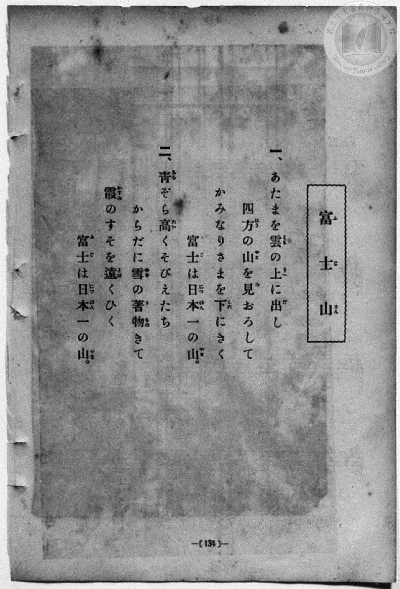
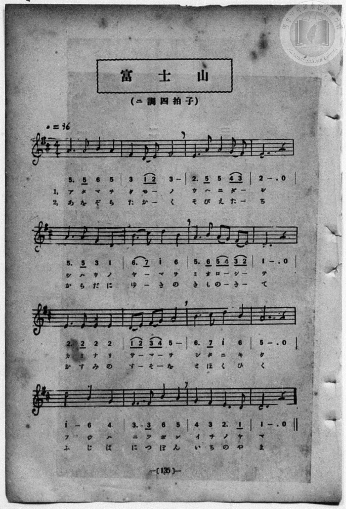

# 富士山

> Re:Shōka 使用 AI 協助辨識與重建樂譜，可能會有錯誤。歡迎回報。

<audio controls src="fujisan.mp3"></audio>

- 一條慎三郎 編《新編 小學校・公學校 唱歌教材集》（大正十二年十二月，索書號 0725-41）
- 文部省《尋常小學唱歌》
- 臺灣總督府《公學校唱歌集》（大正四年三月，索書號 0725 26）

## 說明

原書資訊與歌詞全文（對應 P072.jpg–P073.jpg，第五學年 pp. 66–67）：
調性與拍號：ニ長調（D 大調）4/4 拍，速度 ♩=96


## 跨冊／重複收錄參照

> 同曲＋同名異曲（《公學校唱歌》第三學年、《公學校唱歌集》與《新定兒童唱歌》第二學年為文部省『尋常小學唱歌』「あたまを雲の上に出し…」同曲；《公學校唱歌》第二學年〈フヂサン〉為低學年別曲）

- **[同曲]** 《公學校唱歌》第二學年用（昭和11年／1936）：[**〈フジサン（富士山）〉**](../../../kogakko_shoka/grade_2/8_fujisan/index.md)（`D` / `4/4` — [原始 TMD](../../../kogakko_shoka/grade_2/8_fujisan/fujisan.tmd)）
- **[同曲]** 《公學校唱歌集》（大正4年／1915，國臺圖 0725 26）：[**〈富士山〉**](../../../kogakko_shokashu_1915/5_02_fujisan/index.md)（`D` / `4/4` — [原始 TMD](../../../kogakko_shokashu_1915/5_02_fujisan/fujisan.tmd)）
- **[同名異曲]** 《共益商社唱歌教科書》卷四・教師用（明治33年／1900）：[**〈富士山〉**](../../../kyoeki_shoka/kan_4_854865/6_fujisan/index.md)（`E,` / `4/4` — [原始 TMD](../../../kyoeki_shoka/kan_4_854865/6_fujisan/fujisan.tmd)）
- **[同曲]** 《新定兒童唱歌》尋常科第二學年用（2020.006.0847.0002）：[**〈ふじ山〉**](../../../shintei_jido_shoka/grade_2_2020.006.0847.0002/4_14_fujisan/index.md)（`D` / `4/4` — [原始 TMD](../../../shintei_jido_shoka/grade_2_2020.006.0847.0002/4_14_fujisan/fujisan.tmd)）
- 總表：[跨冊重複與同名歌曲總索引](../../../duplicate_songs.md)

## 歌詞

```text
一、あたまを雲（くも）の上（うへ）に出（だ）し、
四方（しはう）の山（やま）を見（み）おろして、
かみなりさまを下（した）にきく、
富士（ふじ）は日本一（にっぽんいち）の山（やま）。

二、青（あを）ぞら高（たか）くそびえたち、
からだに雪（ゆき）の著物（きもの）きて、
霞（かすみ）のすそを遠（とほ）くひく、
富士（ふじ）は日本一（にっぽんいち）の山（やま）。
```

## ABC

```abc
X:1
T:富士山
M:4/4
L:1/16
Q:1/4=96
K:D
V:V1 name="Piano" snm="Pia"
[V:V1]
A6 A2 B4 A4 | F4 D2 E2 F8 | E6 A2 A4 G2 F2 | E12 z4 |
w: 1.~あ た ま を | く も _ の | う へ に だ _ | し
w: 2.~あ を ぞ ら | た か _ く | そ び え た _ | ち
A6 A2 F4 D4 | B4 c2 d2 B8 | A6 B2 A2 G2 F2 E2 | D12 z4 |
w: 1.~し は う の | や _ ま を | み お ろ _ し _ | て
w: 2.~か ら だ に | ゆ _ き の | き も の _ き _ | て
E6 E2 E4 E4 | D2 E2 F2 G2 A8 | B3 c d4 B8 | A12 z4 |
w: 1.~か み な り | さ _ ま _ を | し た に き | く
w: 2.~か す み の | す _ そ _ を | と ほ く ひ | く
d8 B4 G4 | F6 F2 B4 A4 | G4 F4 E6 D2 | D12 z4 |
w: 1.~ふ じ は | に つ ぽ ん | い ち の や | ま
w: 2.~ふ じ は | に つ ぽ ん | い ち の や | ま
```

## TMD 檔案連結

- [主旋律 TMD 檔案](fujisan.tmd) [[在 TMD Studio 編輯](https://tmdlang.github.io/Tmd-TS/#tmd=s7IKdvYPcrWy4qpTUCpJTLdSSM7PyUlNLsnMz7MqzsjPTozPrsyvSsyML84ojTe0NDJWgqssy88pzU21Si9KTEmNN443QcgU55cWJadaFSdn5OfnxJekVpQk5edno8vHFySmp1oFGJoYIWQKivLLUvMS84C6C4oy80pSU8DaEQpSyzJTUkHSqSmZJflFmYk5SA5KLSoGuxtifElRYl5xclFmAcgzCFX5RSUZ-UBHF2RUWmVkFoMMSU7Mic9OzEtEKCrJSAV6LS-xpLQoFV20ICcxGSiopaXwdH3P08Wrn27cqKClxaVoq2BpxmVvq-DCZWOib2IH0vVkR8OzRXOftfY92dH5srlP4fn2FY8bup5N2wBkKDzd0P907Y5nCxY-bt79tHUNhK3wdMrGZ2t7nk2d-WzuhJez2x43dL_f0_F0yfJnaxc_7W18sqvn6c4tEMazOR3v9_Q837Lo2ewdL2bOVzAwNzLVNTF8v6cT7OJn09pfNq94PqcRaOPTDd1Pd-yAWAixAGguWNWL9l3PGxc_37H3-dzFT3fNAamFOQWiEN0Ns2cDHQD0DjbbFYzMwLZz6Wsp2FILcCkoKDztmw-yZnP7ixVdLzragc56sXLe09YVQD-CXLah91l7p0IA0Al6WQXpjxomA5nGICbIhWvWPNk1BeTvnVsUCgr0FMzMgArMzIEOfb9nFsjwF6v2P2tYDjK2uxfoE6Do4-bul1O3A8WBhrsoAD0OZnYCY1UBqAZo6MuG-U93LVN4NHOlLTDOQYYAY_pxQ-PjxqbHjfMfN-573DTp5exNQO2PG_sfNzUBNT9uXPdkRxdYpO1x4w6wyOqn7bvAIgvA3OlAE8C-nT372bSdYInpjxvXAzVA9AMTGkiwqQVoAUikadKLZaCYedwIct3jxq7HTb1gLcugBj1u7AbKPW5c9bip63HjVIi7nuyA6AGqA_oV5IrHjUBt_TDLwWkarGLr48YZYBXrn01f-mzOGqAfweJADYsfN-593DT5cSPQLQuxu66hCRIwu4BprfHl3ElgrU1AB4CVz3vc1PlyNdB4oCAwwIBOAgr2P26c-7hx8-NGiOBCJG80AaUXAK1-OXsV2BZgGAIjAmTvi4nTn3euBBvUCwxqoAhYHOglWDC8nDMPLA0MjJmwsFoHZs8FxRMo9IGyKx437oa5YhNtwgNoHOX5AQoUtPS5uNxKszKLE_OsAjIT8_IdagxqqkF2KNhYaNmBGdjyoQIoR-xoeLGwR0HDBFQIPV_foAPPPJpYNABtAhlWo2CqoAuEpgpmYFIXKGIMJA0VjMA0CNYA2RA1IHkToDhMBAINQGrApvkY1gAjtgksCoxtIN4HYjVNApsCDH8wDyQPDEu46cC8ANWxA4hXg1kLoDLTkeyJR9hjhGQP0HRg0gOzOqG65oPN6AaTIDth9syF2rMZiDugboTILMSwB39Y7-qhJKwhIQyyGRTq5gqGcWAGxJkQRWZAGhTURkARkFJcgQ0JIGDyhQYjJGCBMk0tUJl90AiABcJ-qHgXULwXzAKZAZJZhiewQYEJCWJI5EAiCmQPLPJ60SIVZDYkuiHiEBHs9hBI2J3kBDYkiRqBaRAGhSMoUZtAQxgkogEJdnNNVQ1dXU1QPIBCHjUmsIc7NDyAoQksisH-7IL6bio01GEJH2oTIqrma8KTOSSMEJmDQOg3zoTGHzyWgSIgHihho9m2AqplN8g2cMZr3ITXNrxxAKy-yIkDcIBCkjOo5ICVLrpAElHegMRBopAIMySQ4LdCxYHlNphcD_UQKEBB_CVAvBccHJOhMqCMAMnhsAQKyhwgGVAk4Qpy2tpTy8Wla6cALeoVgExlLgA)]
- [鋼琴伴奏 TMD 檔案](fujisan_piano.tmd) [[在 TMD Studio 編輯](https://tmdlang.github.io/Tmd-TS/#tmd=s7IKdvYPcrWy4qpTUCpJTLdSSM7PyUlNLsnMz7MqzsjPTozPrsyvSsyML84ojTe0NDJWgqssy88pzU21Si9KTEmNN443QcgU55cWJadaFSdn5OfnxJekVpQk5edno8vHFySmp1oFGJoYIWQKivLLUvMS84C6C4oy80pSU8DaEQpSyzJTUkHSqSmZJflFmYk5SA5KLSoGuxtifElRYl5xclFmAcgzSlxaWgpP1_c8Xbz66caN7_d0vJw981ln98vuPc8nbHmyZ8vTpf3v93QqaGlxKdoqWJpx2dsquHDZmOib2IGMf7Kj4dmiuc9a-57s6HzZ3KfwfPuKxw1dz6ZtADIUnm7of7p2x7MFCx83737augbCVng6ZeOztT3Pps58NnfCy9ltjxu6gZY-XbL82drFT3sbn-zqebpzC4TxbE7H-z09z7csejZ7x4uZ8xUMzI1MdU0Mgc4Be-3ZtPaXzSuez2kE2vh0Q_fTHTsgFkIsAJoLVvWifdfzxsXPd-x9Pnfx011zQGphToEoRHfD7NlABwC9g812BSMzsO1cbqVZmcWJeVYBmYl5-UEeDjUGNdVcCkBgY6FlB2bUKJgq6AKhqYIZmNQFihgDSUMFIzANgjVANkQNSN4EKA4TgUADkBqwaT6GNQqPG5vAoo8b5wPxPhCraRLYlMeN_WAeSP5x4zq46Y8b26A6dgDxajBrAVRmOpI98Qh7jJDsAZr-uHEemNUJ1TUfbEY3mATZCbNnLtSezUDcAXUjRGYhhj1owQMJFJBiUECZKxjGgRkQkyGKzIA0KHSMgCIgpbjCB-Knx43roT6HhAVQpqkFKrMPGmYwd--HincBxXvBLJAZIJlleMIH5H9IqEDCExK2IHtg4d2LFg8gsyExBBGHiGC3Bxo-kIRgBKZBGOR1UNIxgQYKSEQDElLmmqoaurqaoKADBRZq4GEPKqgXgAHwuHEV2GldUAdNhQYULHlBbUKE7nxNeGKCeAuRBAkEWONMaJDDIwYoAuKBkg-abSugWnaDbAMn78ZNeG2DBhs4DCCJBpSlYNlOF0giMiJIHCQKCWNDAslqK1T8ceMMMLke6gZQGID4S4B4L9gHk6EyoOQGSfqwZABKgiAZULjiCiXa2lOLVmr5YC-1DEGqow1jQaEHZpqAmCjiSExgIosH80zjQVwUDpoclEIELm4zwRaD4gjFBfhsQtIOIZGtIawRwsN0A8Rq3K7A4idc-pAMN4MYYQZ1ghFCBmo41Ak4PAWMSF07BWhcRvuAZJC4RmCuMhcA)]

## 分析

```text
================================================================================
📊 TMD Song Profile: [ 富士山 ]
================================================================================
⏱  Duration:       0:40 (40.0s), 16 measures total
🎼 Key & Tempo:    首調基準 D, != 96.0 BPM, <4/4>
   - 分析範圍：      由實際發聲的音符與和弦推測調性；播放脈絡另行呈現
🎤 人聲音域:    D4 (MIDI 62) – D5 (MIDI 74) [跨度: 12 個半音 / 1.0 個八度, 難度: easy]
   - 最低音:  D4 in [Fujisan #1 @ m.2, 0:03]
   - 最高音: D5 in [Fujisan #1 @ m.6, 0:13]
   - 適合: soprano, mezzo-soprano, contralto, tenor, baritone, bass
🏛  結構:      Fujisan (40.0s)
⚡ 編曲密度:        Peak 1 軌道同時演奏
🗝  調性診斷：       D 大調（純淨自然大調，未偵測到可信轉調）
   - 風格氣質:    純淨自然大調（陽光明朗、易唱易記，無明顯調外色彩）
   - 轉調歷程:    全曲維持單一推測調性（未偵測到可信轉調）
   - 核心骨幹音:  A, D, E, B, F#
   - 調性數值:    D 大調 [相關度: 0.85, 穩定度: Moderate, 自然音純度: 100.0%]
   - 候選調性 (K-S): D 大調 (0.85), A 大調 (0.80), B 小調 (0.62)
   - 五度圈歷程:   +2
   - 各段落調性細節:
     • [Fujisan #1]: D 大調 (r: 0.85, 自然音純度: 100.0%)

  [ 五度圈游移軌跡 ]
               C  
         F            G  
      Bb              [D ]*
      Eb               A  
         Ab           E  
            Db       B  
               F# 
     (* = active key center)

  [ 十二半音累積音高分佈 ]
     C  :                            0.0%
     C# : █                          1.2%
     D  : ████████████████████      20.0%
     D# :                            0.0%
     E  : ███████████████████       19.2%
     F  :                            0.0%
     F# : ██████████████            14.2%
     G  : ██████                     5.8%
     G# :                            0.0%
     A  : ████████████████████████  24.2%
     A# :                            0.0%
     B  : ███████████████           15.4%
--------------------------------------------------------------------------------
Assignment 軌道音域：
  - Piano         : D4 – D5 (12 個半音 / 1.0 個八度, 55 個音符)
================================================================================
```


## 原書掃描頁






