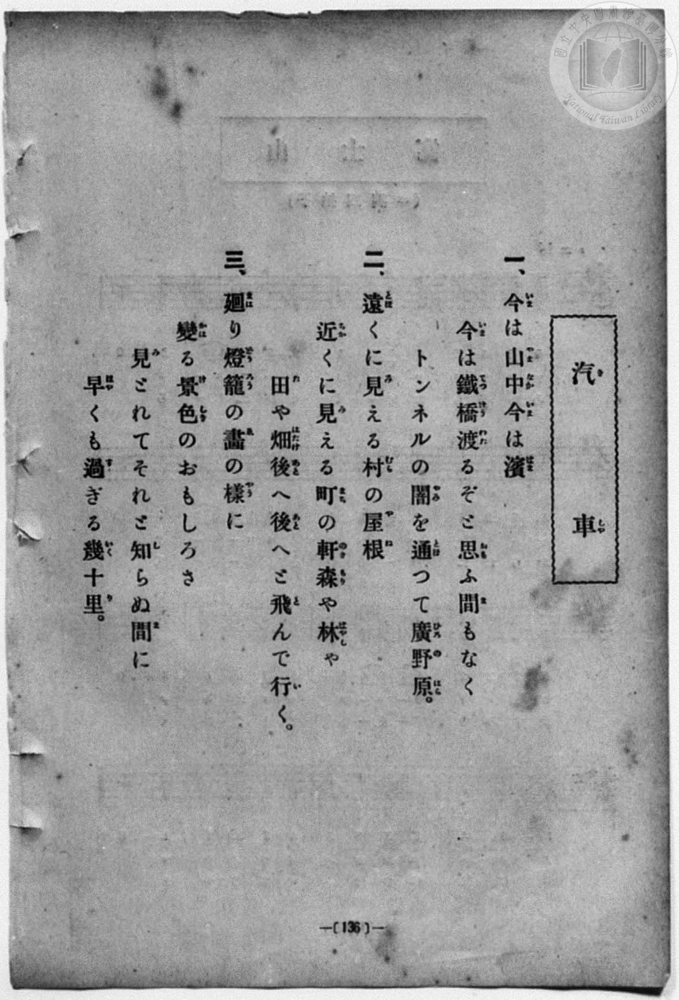
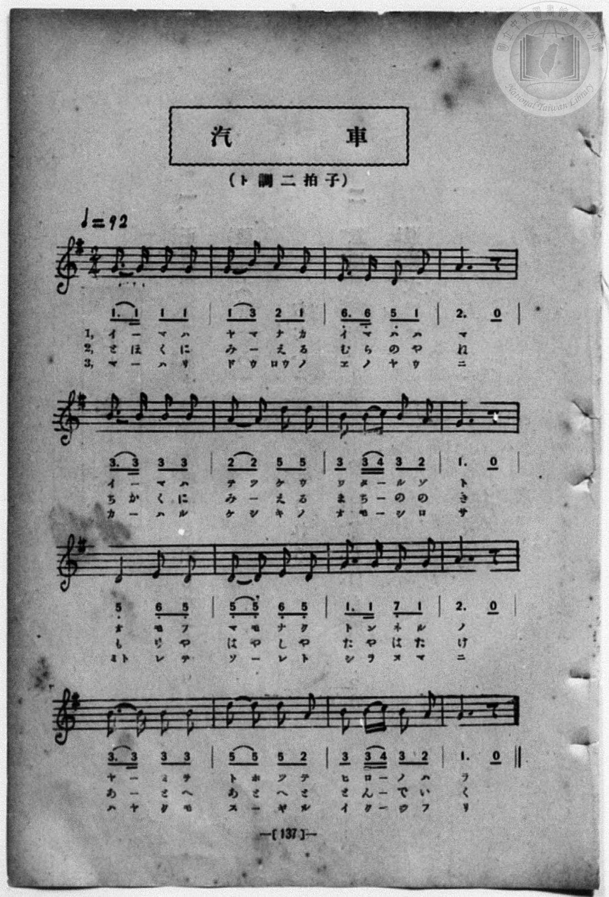

# 汽車

> Re:Shōka 使用 AI 協助辨識與重建樂譜，可能會有錯誤。歡迎回報。

<audio controls src="kisha.mp3"></audio>

- 一條慎三郎 編《新編 小學校・公學校 唱歌教材集》（大正十二年十二月，索書號 0725-41）
- 文部省《尋常小學唱歌》
- 臺灣總督府《公學校唱歌集》（大正四年三月，索書號 0725 26）

## 說明

原書資訊與歌詞全文（對應 P080.jpg–P081.jpg，第五學年 pp. 74–75）：
調性與拍號：ト長調（G 大調）2/4 拍，速度 ♩=92


## 跨冊／重複收錄參照

> 同曲＋同名異曲（《公學校唱歌》第三學年、《公學校唱歌集》與《新定兒童唱歌》三年級為大和田愛羅作曲同曲；《唱歌帖》P071 為《大正幼年唱歌》同名異曲）

- **[同曲]** 《公學校唱歌》第三學年（昭和10年／1935）：[**〈きしゃ（火車）〉**](../../../kogakko_shoka/grade_3/11_kisha/index.md)（`G` / `2/4` — [原始 TMD](../../../kogakko_shoka/grade_3/11_kisha/kisha.tmd)）
- **[同曲]** 《公學校唱歌集》（大正4年／1915，國臺圖 0725 26）：[**〈汽車〉**](../../../kogakko_shokashu_1915/5_05_kisha/index.md)（`G` / `2/4` — [原始 TMD](../../../kogakko_shokashu_1915/5_05_kisha/kisha.tmd)）
- **[同曲]** 《新定兒童唱歌》尋常科第三學年用（2020.006.0847.0003）：[**〈汽車（火車）〉**](../../../shintei_jido_shoka/grade_3_2020.006.0847.0003/2_10_kisha/index.md)（`G` / `2/4` — [原始 TMD](../../../shintei_jido_shoka/grade_3_2020.006.0847.0003/2_10_kisha/kisha.tmd)）
- **[同名異曲]** 楊金土手抄《唱歌帖》第 2 冊・II（2020.006.0843）：[**〈汽車〉**](../../../shokacho/vol_02/p071_kisha/index.md)（`C` / `2/4` — [原始 TMD](../../../shokacho/vol_02/p071_kisha/kisha.tmd)）
- 總表：[跨冊重複與同名歌曲總索引](../../../duplicate_songs.md)

## 歌詞

```text
一、今（いま）は山中（やまなか）、今（いま）は濱（はま）、
今（いま）は鐵橋（てつけう）渡（わた）るぞと
思（おも）ふ間（ま）も無（な）く、トンネルの
闇（やみ）を通（とほ）って廣野原（ひろのはら）。

二、遠（とほ）くに見（み）える村（むら）の屋根（やね）、
近（ちか）くに見（み）える町（まち）の軒（のき）、
森（もり）や林（はやし）や田（た）や畑（はたけ）、
後（あと）へ〳〵と飛（と）んで行（い）く。

三、廻（まは）り燈籠（どうろう）の畫（ゑ）の樣（やう）に
變（かは）る景色（けしき）のおもしろさ。
見（み）とれてそれと知（し）らぬ間（ま）に、
早（はや）くも過（す）ぎる幾十里（いくじふり）。
```

## ABC

```abc
X:1
T:汽車
M:2/4
L:1/16
Q:1/4=92
K:G
V:V1 name="Piano" snm="Pia"
[V:V1]
G3 G G2 G2 | G2 B2 A2 G2 | E3 E E2 G2 | A6 z2 |
w: 1.~い _ ま は | や ま な か | い ま は は | ま
w: 2.~と ほ く に | み え _ る | む ら の や | ね
w: 3.~ま _ は り | ど う ろう の | ゑ の や う | に
B3 B B2 B2 | A2 A2 d2 d2 | B2 B c B2 A2 | G6 z2 |
w: 1.~い _ ま は | て っ け う | わ た _ る ぞ | と
w: 2.~ち か く に | み え _ る | ま ち _ の の | き
w: 3.~か _ は る | け し き の | お も _ し ろ | さ
D2 D2 E2 D2 | D2 D2 E2 D2 | G3 G F2 G2 | A6 z2 |
w: 1.~お _ も ふ | ま も な く | と ん ね る | の
w: 2.~も _ り や | は や し や | た や は た | け
w: 3.~み と れ て | そ _ れ と | し ら ぬ ま | に
B3 B B2 B2 | d2 d2 B2 A2 | B2 B c B2 A2 | G6 z2 |
w: 1.~や _ み を | と ほ っ て | ひ ろ _ の は | ら
w: 2.~あ _ と へ | あ と へ と | と ん _ で い | く
w: 3.~は や く も | す ぎ _ る | い く _ じ ふ | り
```

## TMD 檔案連結

- [主旋律 TMD 檔案](kisha.tmd) [[在 TMD Studio 編輯](https://tmdlang.github.io/Tmd-TS/#tmd=s7IKdvYPcrWy4qpTUCpJTLdSSM7PyUlNLsnMz7MqzsjPTozPrsyvSsyML84ojTe0NDJWgqssy88pzU21Si9KTEmNN443QcgU55cWJadaFSdn5OfnxJekVpQk5edno8vHFySmp1oFGJog6Swoyi9LzUvMA-ouKMrMK0lNAWtHKEgty0xJBUmnpmSW5BdlJuYgOSi1qBjsbojxJUWJecXJRZkFIM8gVOUXlWTkAx1dkFFplZFZDDIkOTEnPjsxLxGhqCQjFeg1sAkFQA1KXFpaCs827n2xu0tBS4tL0VbB0ojL3lbBncvGSN_EDqTtyY6GZ4vmPmvte7Kj82Vzn8Lz7SseN3Q9m7YByFB4uqH_6dodzxYsfNy8-2nrGghb4emUjc_W9jybOvPZ3AkvZ7c9buh-v6fj6ZLlz9Yuftrb-GRXz9OdWyCMZ3M63u_peb5l0bPZO17MnK9gYG5kqmti-H5PJ9jJz6a1v2xe8XxOI9DGpxu6n-7YAbEQYgHQXLCqF-27njcufr5j7_O5i5_umgNSC3MKRCG6G2bPBjoA6B1stisYmYFt59LXUrClFuBSUFB42jcfZM3m9hcrul50tAOd9WLlvKetK4B-BLlsQ--z9k6FAAMLA72sgvRHDZOBTEMQE-TCNWue7JoC8vfOLQoFBXoK5iZABeamQIe-3zMLZPiLVfufNSwHGdvdC_QJUPRxc8fLqduB4kDD3RWAHgczO4GxqgBUAzT0ZcP8p7uWKTyaudIWGOcgQ4Ax_bih8cnuLqCWx40tjxv3ATU8blz_dOPGJzvWggSbQIKPG1c9bgSGZidWxc_2bwSLrIeKNDSCjcZQ93LC1mcrQXHyuHHZ48YljxsnPm5sA0o927EQbFP_40agNzofN3U_bpz3uHEFyJRnDXPBGroeNzWBTdn6ctpksAjY0Kam5y1gzY2rwLL9QMuBwfC4efPj5t7HzasfN64DmfJyOijAwX4BhcjjpkkvG2aBta143LgbrHMx0FFPdy9-2d4HjDWw1KbHTb1A_SB_NQEDHeivJkiY7QImw8aXjQtQDQC6fvWLZRDvgS1pBFrY_WzuRLDNDVAzGtc93dj9bMFOmHOAYQwLsBf7wUobF0KDGoeJz6fsgvgfqBJi4ovdk8AiQKcCYxlm3LPF68CWND1uAkYE0M8tz-ZNh8YTyGYgGyT4fMoGsCAk5FueT4U4AhiX84ERhDDu6b4esEQT0Mtga3c8btj8uGErkPty8WxIUICNmPy4cfmLhRDFLbBIgYbcDpBpT3cDAwzigfVgHV3P2zueb4QE50pgkgCHOyhhAL30fOpqsC_ALmlc92zFYljIQRSsBofcOkhSA6YbiIndz2auf9G5CSwITGTToQEDCiFQQgKJgOyYCnIYSD9KIK943NQDTqFzwYwVz-cvBctCAgyoYA1KEmxcDQvw6SvhwQv1d1PTy8Y-sOBMsEgf0GlPd-4DFoQv26EhBI7mGcB0DY0miIsoL3-gQEFLn4vLO7M4I9EqIDMxL9-hxqCmGmSDgo2Flh2Yga3UUwCVPzsagPGooGECKvKfr2_QgRdVmlg0AO0BGVajoGGooAuEhpqqGrq6mgqGQFgDxMYKRmCWhlk8WN4sHqoAyAeJG4FFDRRqwMb4GAJVAkMHLAhUBAxrIF4PVAcMXChvFRB3g0yEqQMKg1Suh6kEqgIJx8PMNAKrXQFVuxukth-IV4PV7gfiDpBEE8TMpgaIuqZOkLp1YHtB6taimmkMNhNiEdidQNubusAqVwJxG5AHSsxgI8DGToRavw6oGOyVNrDi1XBj8cfJrh6y4sQYbLwxNMiNgRAU4kYKpkBYA-QBFZiAJEFyRuD4IjI2GpcB8WIgngjzSlM_SO18sDpgWAKLcrA6SLCjxcVCaGB044sLkG0QtdCYAAclMEtji4lu1JiA6Ae5bTpYB0xvFygqmiDqgDJNvWDRqURGwo5OciLBNB6EgMkdSKLz0DKNOa48AXI5KFyagKyt0LCB8EC5oR-SG6ApvGkyyHdr4aGwDiMGwEEATq-w1A0KM1CiBIUJSAQSk2BFLbC8NR8apuihD4m3FUClPeB0ARKZC9YK4q-AmDYdOVetAbufhOQPbMZRLfmDkj4ksROX_IHhAU9aQI82TYIma2BJAs0CEC9vAqkFpk1YYoUUWp3Ykj8o9KEmgszZAdYPikwIDxJoIBJo4mSIuuVADImqfmzJfz1yZAEzFDCCQWpnAnEfUoZqAakFGgBSNQOWlIDJAGZiLReXrp0CuNpQADKUuQA)]
- [鋼琴伴奏 TMD 檔案](kisha_piano.tmd) [[在 TMD Studio 編輯](https://tmdlang.github.io/Tmd-TS/#tmd=s7IKdvYPcrWy4qpTUCpJTLdSSM7PyUlNLsnMz7MqzsjPTozPrsyvSsyML84ojTe0NDJWgqssy88pzU21Si9KTEmNN443QcgU55cWJadaFSdn5OfnxJekVpQk5edno8vHFySmp1oFGJog6Swoyi9LzUvMA-ouKMrMK0lNAWtHKEgty0xJBUmnpmSW5BdlJuYgOSi1qBjsbojxJUWJecXJRZkFIM8ocWlpKTzbuPfF7q73ezpezp75rLP7Zfee5xO2PNmz5enS_vd7OhW0tLgUbRUsjbjsbRXcuWyM9E3sQGY_2dHwbNHcZ619T3Z0vmzuU3i-fcXjhq5n0zYAGQpPN_Q_Xbvj2YKFj5t3P21dA2ErPJ2y8dnanmdTZz6bO-Hl7LbHDd1AS58uWf5s7eKnvY1PdvU83bkFwng2p-P9np7nWxY9m73jxcz5CgbmRqa6JoZA54D99Wxa-8vmFc_nNAJtfLqh--mOHRALIRYAzQWretG-63nj4uc79j6fu_jprjkgtTCnQBSiu2H2bKADgN7BZruCkRnYdi7PvJKifKuAzMS8_CAPhxqDmmouBSCwsdCyAzNqFDSMFXSB0FhTVUNXV1PBGAhrFEyB0FjBCMgyBikwAUmC5EAihmD1Bgo1XLUo5vtgN98wXiHaMFbBFEIBjQYyTCF8IIUij8wHYagd3pnFGYl4_KCvpWCLDhSer1kDjPMXC3sUNExAEfx8fYOOQoCBhYFeVkG6JhYNWvqwAIF40BAaIIZACPI0yPMgloZZPFjeLB6qAMgHiRvBgwVkjI8hUOXjxhawIFDR48Z9QLweqO5xUwuUtwqIu0EmwtQBhUEq18NUAlWBhONhZhqB1a6Aqt0NUtsPxKvBavcDcQdIogliZlMDRF1TJ0jdOrC9IHVrUc00BpsJsQjsTqDtTV1glSuBuA3I6wVTQCPAxk6EWr8OqBjslTaw4tVwY_HHya4esuIEWyI1AkJQQsWfSAnERuMyIF4MxBNhXmnqB6mdD1YHDMvHjfPA6iDBjhYXC6GB0Y0vLkC2QdRCYwIclI8be7HFRDdqTED0g9w2HawDprcLFBVNEHVAmaZesOhUIiNhRyc5kQDMokAETO5AEp2HlmnMceUJkMtB4dIEZG2Fhg2EB8oN_ZDcAE3hTZNBvlsLD4V1GDEADgJweoWlblCYgRIlKExAIpCYBCtqgeWt-dAwRQ99SLytACrtAacLkMhcsFYQfwXEtOnIuWoN2P0kJH9goU215E9cGY1I_sDwgCctoEebJkGTNbAkgWYBiJc3gdQC0yYssUIKrU5syR8U-lATQebsAOsHRSaEBwk0EAk0cTJE3XIghkRVP7bkvx45soAZChjBILUzgbgPKUO1gNQCDQCpmgFLSsBkADMRtdYgsmZC5wPTdrRZbiycRq67YEFLdv0GpBBmQCWNYGrQ-bjtoNgdSPWsrp0CuDoHGwjkgEMw2scwFk3ACF3AGC6gzAUA)]

## 分析

```text
================================================================================
📊 TMD Song Profile: [ 汽車 ]
================================================================================
⏱  Duration:       0:20 (20.9s), 16 measures total
🎼 Key & Tempo:    首調基準 G, != 92.0 BPM, <2/4>
   - 分析範圍：      由實際發聲的音符與和弦推測調性；播放脈絡另行呈現
🎤 人聲音域:    D4 (MIDI 62) – D5 (MIDI 74) [跨度: 12 個半音 / 1.0 個八度, 難度: easy]
   - 最低音:  D4 in [Kisha #1 @ m.9, 0:10]
   - 最高音: D5 in [Kisha #1 @ m.6, 0:07]
   - 適合: soprano, mezzo-soprano, contralto, tenor, baritone, bass
🏛  結構:      Kisha (20.9s)
⚡ 編曲密度:        Peak 1 軌道同時演奏
🗝  調性診斷：       G 大調（純淨自然大調，未偵測到可信轉調）
   - 風格氣質:    純淨自然大調（陽光明朗、易唱易記，無明顯調外色彩）
   - 轉調歷程:    全曲維持單一推測調性（未偵測到可信轉調）
   - 核心骨幹音:  G, B, A, D, E
   - 調性數值:    G 大調 [相關度: 0.83, 穩定度: High, 自然音純度: 100.0%]
   - 候選調性 (K-S): G 大調 (0.83), D 大調 (0.66), B 小調 (0.65)
   - 五度圈歷程:   +1
   - 各段落調性細節:
     • [Kisha #1]: G 大調 (r: 0.83, 自然音純度: 100.0%)

  [ 五度圈游移軌跡 ]
               C  
         F           [G ]*
      Bb               D  
      Eb               A  
         Ab           E  
            Db       B  
               F# 
     (* = active key center)

  [ 十二半音累積音高分佈 ]
     C  : ██                         1.7%
     C# :                            0.0%
     D  : ███████████████           16.7%
     D# :                            0.0%
     E  : ████████                   8.3%
     F  :                            0.0%
     F# : ██                         1.7%
     G  : ████████████████████████  26.7%
     G# :                            0.0%
     A  : ██████████████████        20.0%
     A# :                            0.0%
     B  : ███████████████████████   25.0%
--------------------------------------------------------------------------------
Assignment 軌道音域：
  - Piano         : D4 – D5 (12 個半音 / 1.0 個八度, 54 個音符)
================================================================================
```


## 原書掃描頁






