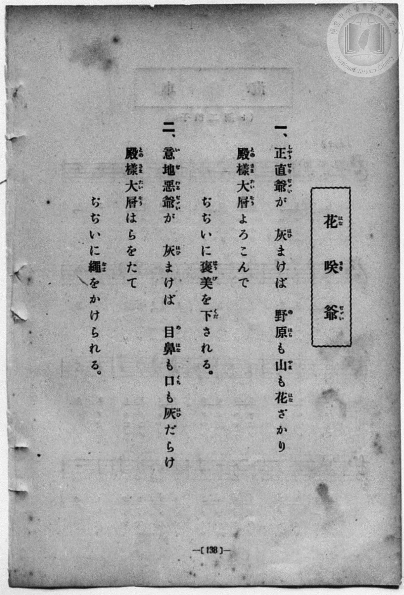
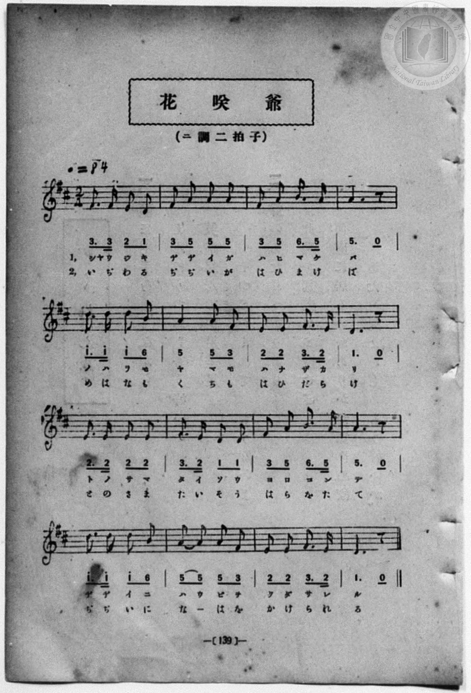

# 花咲爺

> Re:Shōka 使用 AI 協助辨識與重建樂譜，可能會有錯誤。歡迎回報。

<audio controls src="hanasaka_jijii.mp3"></audio>

- 一條慎三郎 編《新編 小學校・公學校 唱歌教材集》（大正十二年十二月，索書號 0725-41）
- 文部省《尋常小學唱歌》
- 臺灣總督府《公學校唱歌集》（大正四年三月，索書號 0725 26）

## 說明

原書資訊與歌詞全文（對應 P052.jpg–P053.jpg，原書 p. 46–47，第三學年第 7 首）：
出處原曲：文部省編纂《尋常小學唱歌》第一學年〈花咲爺〉（明治 44 年／1911 年）
調性與拍號：ニ長調 2/4 拍子，♩= 84


## 跨冊／重複收錄參照

> 同曲＋同名異曲（《公學校唱歌集》、《新定兒童唱歌》、《新編 小學校・公學校 唱歌教材集》跨冊對照曲目）

- **[同曲]** 《公學校唱歌集》（大正4年／1915，國臺圖 0725 26）：[**〈花咲爺〉**](../../../kogakko_shokashu_1915/3_07_hanasaka_jijii/index.md)（`D` / `2/4` — [原始 TMD](../../../kogakko_shokashu_1915/3_07_hanasaka_jijii/hanasaka_jijii.tmd)）
- **[同名異曲]** 《新定兒童唱歌》尋常科第二學年用（2020.006.0847.0002）：[**〈花さかぢぢい〉**](../../../shintei_jido_shoka/grade_2_2020.006.0847.0002/3_07_hanasaka_jijii/index.md)（`G` / `2/4` — [原始 TMD](../../../shintei_jido_shoka/grade_2_2020.006.0847.0002/3_07_hanasaka_jijii/hanasaka_jijii.tmd)）
- **[同名異曲]** 《新編小公學校唱歌教材集》第一、二學年（大正12年／1923，國臺圖 0725-41）：[**〈花咲爺〉**](../../grade_1_2/28_hanasaka_jijii/index.md)（`G` / `2/4` — [原始 TMD](../../grade_1_2/28_hanasaka_jijii/hanasaka_jijii.tmd)）
- 總表：[跨冊重複與同名歌曲總索引](../../../duplicate_songs.md)

## 歌詞

```text
一、正直爺（しやうぢきぢぢい）が　灰（はひ）まけば、
野原（のはら）も山（やま）も　花（はな）ざかり。
殿樣（とのさま）大層（たいそう）　よろこんで、
ぢぢいに褒美（はうび）を　下（くだ）される。

二、意地惡爺（いぢわるぢぢい）が　灰（はひ）まけば、
目鼻（めはな）も口（くち）も　灰（はひ）だらけ。
殿樣（とのさま）大層（たいそう）　はらを立（た）て、
ぢぢいに繩（なは）を　かけられる。
```

## ABC

```abc
X:1
T:花咲爺
M:2/4
L:1/16
Q:1/4=84
K:D
V:V1 name="Piano" snm="Pia"
[V:V1]
F3 F E2 D2 | F2 A2 A2 A2 | F2 A2 B3 A | A6 z2 |
w: 1.~しゃ う ぢ き | ぢ ぢ い が | は ひ ま け | ば
w: 2.~い ぢ わ る | ぢ ぢ い が | は ひ ま け | ば
d3 d d2 B2 | A4 A2 F2 | E2 E2 F3 E | D6 z2 |
w: 1.~の は ら も | や ま も | は な ざ か | り
w: 2.~め は な も | く ち も | は ひ だ ら | け
E3 E E2 E2 | F3 E D2 E2 | F2 A2 B3 A | A6 z2 |
w: 1.~と の さ ま | た い そ う | よ ろ こ ん | で
w: 2.~と の さ ま | た い そ う | は ら を た | て
d3 d d2 B2 | A2 A2 A2 F2 | E2 E2 F3 E | D6 z2 |
w: 1.~ぢ ぢ い に | は う び を | く だ さ れ | る
w: 2.~ぢ ぢ い に | な _ は を | か け ら れ | る
```

## TMD 檔案連結

- [主旋律 TMD 檔案](hanasaka_jijii.tmd) [[在 TMD Studio 編輯](https://tmdlang.github.io/Tmd-TS/#tmd=s7IKdvYPcrWy4qpTUCpJTLdSSM7PyUlNLsnMz7MqzsjPTozPrsyvSsyML84ojTe0NDJWgqssy88pzU21Si9KTEmNN443QcgU55cWJadaFSdn5OfnxJekVpQk5edno8vHFySmp1oFGJqYIWQKivLLUvMS84C6C4oy80pSU8DaEQpSyzJTUkHSqSmZJflFmYk5SA5KLSoGuxtifElRYl5xclFmAcgzCFX5RSUZ-UBHF2RUWmVkFoMMSU7Mic9OzEtEKCrJSAV6LS0_JzsnvyhViUtLS-FF18ankzY979iloKXFpWirYGHCZW-r4MJlY6RvYgfS-GRHw7NFc5-19j3Z0fmyuU_h-fYVjxu6nk3bAGQoPN3Q_3TtjmcLFj5u3v20dQ2ErfB0ysZna3ueTZ35bO6El7PbHjd0v9_T8XTJ8mdrFz_tbXyyq-fpzi0QxrM5He_39DzfsujZ7B0vZs5XMDA3MtU1MXy_pxPs6GfT2l82r3g-pxFo49MN3U937IBYCLEAaC5Y1Yv2Xc8bFz_fsff53MVPd80BqYU5BaIQ3Q2zZwMdAPQONtsVjMzAtnPpaynYUgtwKSgoPO2bD7Jmc_uLFV0vOtqBznqxct7T1hVAP4JctqH3WXunQoCBqZFeVkH6o4bJQKYxiAl0IUSrQoGegokZUMbEHOTqNWuAPgCFxc4tQLaCucLLZdOALn-_ZxbYtvZdL2ZOBWvcBBSCByQw0p7vasIVnGBDGyCGPm7ogKeNxw1Aczuezeh7tmm3gomJAlD6_Z5-Q0tDQwizE2Tli1X7nzUsB3mtuxcYmkBbHzd3v5y6HSiuAExMCkDhp2snAJ3-aOZKcDoDaQJa97ihERgpz2dvAVoEtOVx4_THTS2PG9seNy563NgLJoGoBWjL40agIxueN24AK1v_uBHoNaDgvseNEx83bgCaAzLxZXsf0NtgFetAipqATu983NT0dONGkCDI6H0QEaBZQB_CzFoFNmva48bux01djxuaQGY9W7f_2YrFYBUrwMZNhWgGpqOnG5eAxecDnfa4cS7QvSD9DQ2Pm4B2AF09-XHT5MeNy6GOgvvicePqF0smPd_XB7MW6M3NYOdMAmp-sgOUSh839j9uXAB2ztTHTT2Pm7pBzgGH1i5gADQ-a-l_OmfDs-aFsAADmrrocVM_SCGpofV89rqXe3aDA6YREQzA0OqHeBvokoXw0MIwawEwdEHGkR9a4AgCev75aojPgREHNHEZlmB7vnMlWMUqoB54gIFiC2g_yAhYOAG1UZ5hoUBBS5-LywNYhBYnZid6ZWZlZloFZCbm5TvUGNRUg2xSsDE007IDs7CVFwqQDPViYY-CBjDXbOh_vr5BB57JNbFoAFoIMqxGwVhBFwiNFYyApCEQQ0RMkTBCxAys1hQoAuLBoAFIDdg0H8MaYFACs1UzWAIY-qCQBbN6wQbBeBCyBUz2QGXWg3mbwOQ-qP6JYJkNSJbFIywzAsmBzICYCEyYIFZTN1Vtwh_ku3rICXLDOLAFQArMAoUqIkRBNCi8a8AxAsKQGDICacQT6uugHlkPDIJOcEA0QbzbBAkimGfh4tBgWAUmp0FVdIN1dOEO8KZGhD0QvXDzQMEPkVuIxR5IcC-AqAC6ECQzkcTg3tFJTnCDwhAUfrDwhKV5I3B4IkSIT-EroP5cB8RT4SELkpkPlWkB4rlgVhs0FjrA_gZlA2CZDQ2FyWA9y3GHNjk2QcIbmgYmQVXNB8ssIy28ge0XqiZvGCYneYPyMTSfQ3PzamTvgj0PrOHgnoYlSEiSgwQeSK4HHBmgMgJXkOO2CZTcYYkf2R6QaZDEDAl2fPbUcnHp2imgFPUKQAFlLgA)]
- [鋼琴伴奏 TMD 檔案](hanasaka_jijii_piano.tmd) [[在 TMD Studio 編輯](https://tmdlang.github.io/Tmd-TS/#tmd=s7IKdvYPcrWy4qpTUCpJTLdSSM7PyUlNLsnMz7MqzsjPTozPrsyvSsyML84ojTe0NDJWgqssy88pzU21Si9KTEmNN443QcgU55cWJadaFSdn5OfnxJekVpQk5edno8vHFySmp1oFGJqYIWQKivLLUvMS84C6C4oy80pSU8DaEQpSyzJTUkHSqSmZJflFmYk5SA5KLSoGuxtifElRYl5xclFmAcgzSlxaWgovujY-nbTpeceu93s6Xs6e-ayz-2X3nucTtjzZs-Xp0v73ezoVtLS4FG0VLEy47G0VXLhsjPRN7EDGP9nR8GzR3GetfU92dL5s7lN4vn3F44auZ9M2ABkKTzf0P12749mChY-bdz9tXQNhKzydsvHZ2p5nU2c-mzvh5ey2xw3dQEufLln-bO3ip72NT3b1PN25BcJ4Nqfj_Z6e51sWPZu948XM-QoG5kamuiaGQOeAvfZsWvvL5hXP5zQCbXy6ofvpjh0QCyEWAM0Fq3rRvut54-LnO_Y-n7v46a45ILUwp0AUorth9mygA4DewWa7gpEZ2HYuj8S8xOLE7ESvzKzMTKuAzMS8_CAPhxqDmmouBSCwMTTTsgOz9LUUbNGBwvM1a4AB92Jhj4KGCSiUnq9v0FEIMDA10ssqSNfEokFLH2xYjYKxgi4QGisYAUlDIIaImCJhhIgZWK0pUATEg0EDkBqwaT6GNQqPG6c_bmoGSzxubAPiRWBWL9ggGA9CtoDJHqjMejBvE5jcB9U_ESyzAcmyeIRlRiA5kBkQEx839YNYTd1UtQl_kO_qISfIDePAFgApMAsUqogQBdGg8K4BxwgIQ2LICKQRT6ivg3pkPTAIOsEB0QTxbhMkiGCehYtDg2EVmJwGVdEN1tGFO8CbGhH2QPTCzQMFP0RuIRZ7IMG9AKIC6EKQzEQSg3tHJznBDQpDUPjBwhOW5o3A4YkQIT6Fr4D6cx0QT4WHLEhmPlSmBYjngllt0FjoAPsblA0eN06GhsJksJ7luEObHJsg4Q1NA5OgquaDZZaRFt7AgouqyRuGyUneoHwMzefQ3Lwa2btgzz9u3Az3NCxBQpIcJPBAcj3gyACVEbiCHLdNoOQOS_zI9oBMgyRmSLDjs6cWa0nvg1zSm0ALemCAxCtEG8aiM0xADNP4eGAYQdxdo2ACE4YrBMlHm8ZDxRAqUcUpNhToHV07BRQfRfsA1WIKGoEFlbkA)]

## 分析

```text
================================================================================
📊 TMD Song Profile: [ 花咲爺 ]
================================================================================
⏱  Duration:       0:22 (22.9s), 16 measures total
🎼 Key & Tempo:    首調基準 D, != 84.0 BPM, <2/4>
   - 分析範圍：      由實際發聲的音符與和弦推測調性；播放脈絡另行呈現
🎤 人聲音域:    D4 (MIDI 62) – D5 (MIDI 74) [跨度: 12 個半音 / 1.0 個八度, 難度: easy]
   - 最低音:  D4 in [HanasakaJijii #1 @ m.1, 0:01]
   - 最高音: D5 in [HanasakaJijii #1 @ m.5, 0:05]
   - 適合: soprano, mezzo-soprano, contralto, tenor, baritone, bass
🏛  結構:      HanasakaJijii (22.9s)
⚡ 編曲密度:        Peak 1 軌道同時演奏
🗝  調性診斷：       D 調性不明確（純淨自然大調，未偵測到可信轉調）
   - 風格氣質:    純淨自然大調（陽光明朗、易唱易記，無明顯調外色彩）
   - 轉調歷程:    全曲維持單一推測調性（未偵測到可信轉調）
   - 核心骨幹音:  A, D, E, F#, B
   - 調性數值:    D 調性不明確 [相關度: 0.83, 穩定度: Ambiguous, 自然音純度: 100.0%]
   - 候選調性 (K-S): D 大調 (0.83), A 大調 (0.83), F# 小調 (0.65)
   - 五度圈歷程:   +2
   - 各段落調性細節:
     • [HanasakaJijii #1]: D 調性不明確 (r: 0.83, 自然音純度: 100.0%)

  [ 五度圈游移軌跡 ]
               C  
         F            G  
      Bb              [D ]*
      Eb               A  
         Ab           E  
            Db       B  
               F# 
     (* = active key center)

  [ 十二半音累積音高分佈 ]
     C  :                            0.0%
     C# :                            0.0%
     D  : ███████████████████       23.3%
     D# :                            0.0%
     E  : ███████████████           19.2%
     F  :                            0.0%
     F# : ███████████████           19.2%
     G  :                            0.0%
     G# :                            0.0%
     A  : ████████████████████████  30.0%
     A# :                            0.0%
     B  : ███████                    8.3%
--------------------------------------------------------------------------------
Assignment 軌道音域：
  - Piano         : D4 – D5 (12 個半音 / 1.0 個八度, 51 個音符)
================================================================================
```


## 原書掃描頁






