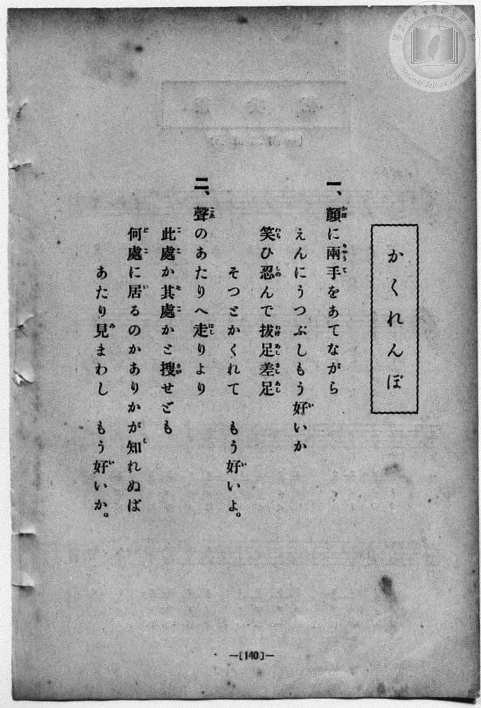
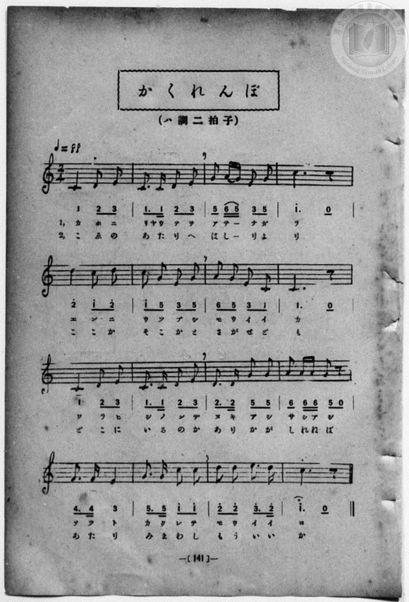

# かくれんぼ

> Re:Shōka 使用 AI 協助辨識與重建樂譜，可能會有錯誤。歡迎回報。

- **NEUTRINO 歌聲合成版**：<br><audio controls src="kakurenbo_neutrino.mp3"></audio>
- **鋼琴伴奏版**：<br><audio controls src="kakurenbo.mp3"></audio>


- book: 新編 小學校・公學校 唱歌教材集（尋常科三・四學年用）
- 一條慎三郎 編《新編 小學校・公學校 唱歌教材集》（大正十二年十二月，索書號 0725-41）
- 文部省《尋常小學唱歌》（明治四十四年・第三學年）

## 說明

> [!NOTE]
> **原書資訊與歌詞全文**（對應 `P148.jpg`–`P149.jpg`，原書 p. 140–141，尋常科三・四學年第 10 首）：
> - **調性與拍號**：ハ調二拍子（C 大調 2/4 拍），♩= 88
> - **出處原曲**：文部省編纂《尋常小學唱歌》第三學年〈かくれんぼ〉（明治 44 年／1911 年）
>
> **一、**
> 顏（かほ）に兩手（りやうて）をあてながら
> えんにうつぶしもう好（い）いか
> 笑（わら）ひ忍（しの）んで拔足差足（ぬきあしさしあし）
> そつとかくれて　もう好（い）いよ。
>
> **二、**
> 聲（こゑ）のあたりへ走（はし）りより
> 此處（ここ）か其處（そこ）かと搜（さが）せども
> 何處（どこ）に居（ゐ）るのかありかが知（し）れねば
> あたり見（み）まわし　もう好（い）いか。


## 歌詞

```text
（TMD 檔案未包含歌詞註解）
```

## ABC

```abc
X:1
T:かくれんぼ
M:2/4
L:1/16
Q:1/4=88
K:C
V:V1 name="Piano" snm="Pia"
[V:V1]
C4 D2 E2 | C3 C D2 E2 | G2 A G E2 G2 | c6 z2 |
w: 1.~カ ホ ニ | リヤ ウ テ ヲ | ア テ _ ナ ガ | ラ
w: 2.~こ ゑ の | あ た り へ | は し _ り よ | り
d4 c2 d2 | c2 G2 E2 G2 | A2 G2 E2 C2 | C6 z2 |
w: 1.~エ ン ニ | ウ ツ ブ シ | モ ウ イ イ | カ
w: 2.~こ こ か | そ こ か と | さ が せ ど | も
C4 D2 E2 | C3 C D2 E2 | D3 D G2 G2 | A2 A A G2 z2 |
w: 1.~ワ ラ ヒ | シ ノ ン デ | ヌ キ ア シ | サ シ ア シ
w: 2.~ど こ に | ゐ る の か | あ り か が | し れ ね ば
F3 F E4 | G3 G c2 c2 | d2 d2 e3 d | c6 z2 |
w: 1.~ソ ツ ト | カ ク レ テ | モ ウ イ イ | ヨ
w: 2.~あ た り | み ま わ し | も う い い | か
C4 D2 E2 | C3 C D2 E2 | G2 A G E2 G2 | c6 z2 |
w: 1.~カ ホ ニ | リヤ ウ テ ヲ | ア テ _ ナ ガ | ラ
w: 2.~こ ゑ の | あ た り へ | は し _ り よ | り
d4 c2 d2 | c2 G2 E2 G2 | A2 G2 E2 C2 | C6 z2 |
w: 1.~エ ン ニ | ウ ツ ブ シ | モ ウ イ イ | カ
w: 2.~こ こ か | そ こ か と | さ が せ ど | も
C4 D2 E2 | C3 C D2 E2 | D3 D G2 G2 | A2 A A G2 z2 |
w: 1.~ワ ラ ヒ | シ ノ ン デ | ヌ キ ア シ | サ シ ア シ
w: 2.~ど こ に | ゐ る の か | あ り か が | し れ ね ば
F3 F E4 | G3 G c2 c2 | d2 d2 e3 d | c6 z2 |
w: 1.~ソ ツ ト | カ ク レ テ | モ ウ イ イ | ヨ
w: 2.~あ た り | み ま わ し | も う い い | か
```

## TMD 檔案連結

- [主旋律 TMD 檔案](kakurenbo.tmd) [[在 TMD Studio 編輯](https://tmdlang.github.io/Tmd-TS/#tmd=s7IKdvYPcrWy4qpTUCpJTLdSSM7PyUlNLsnMz7MqzsjPTozPrsyvSsyML84ojTe0NDJWgqssy88pzU21Si9KTEmNN443QcgU55cWJadaFSdn5OfnxJekVpQk5edno8vHFySmp1oFGJpYIGQKivLLUvMS84C6C4oy80pSU8DaEQpSyzJTUkHSxcmJefFlqUWZaZmpKUiOSi0qBrsdYkVJUWJecXJRZgHIQwhV-UUlGflAhxdkVFplZBaX5BdlJifmxGcn5iUiFJVkpAK9V5CTWImsMTM9M88qNz8vqRQYPEpcWloKjxu7Hzf2P27qedw0-XHjHgUtLS5FWwULCy57WwVnLhsjfRM7kH5QEFgpPJu24fn2FQpPN_Q_Xbvj2YKFj5t3P21dA2ErPJ2y8dnanmdTZz6bO-Hl7Lb3ezqebuh-umPH8-UTn-zoBCmdPRuo9OnOLc-nrHi_pxPsric7Gp4tmvustQ-o5GVznwLQ-McNXaTY87ihG2TVkuXP1i5-2tv4ZFcP0AYI49mcjvd7ep5vWfRs9o4XM-crGJgbmeqaGMLsfjat_WXziudzGoE2QpwKsRBiAcTcZzP6nm0Cu7y3EUTu3AJ0y_M1a4DOhfgFbBiXvpaCLbUAl4KCgp1CtKKff4hrLISjpfW0bz7IE5vbX6zoetHRDnTfi5XznrauAPpBSwsc1L3P2jsVEkAJUi-rID3hUcNkEMcSzAGGAsQAhQI9BUMTA6CkISgcenDG0Jo1CoYGCi-XTQP67_2eWRBn6AId8mLV_mcNy0FO6O4FhinI8lmPm_uBwqAA7-59unYC0DnOCsAIAYopANOPAlAUbErPo5krwUkLbtjT9l0vZk4FO20T2CR4lACj__muJlwRgxwBjxs60NLw4wagZdCYUzAxUQDHUr-hpaEhhNkJdgAsZIEp8HFDIzDZg_kvF_YD9YIN3A1U-bhx9dPWlc86QUnhcVPX46aWx41tjxuXgaSaJj1ubAKyHzeuetwItBpiLDBDAVUCnbEarHLJ48ZtjxunP24Cqmx7unQv2PAWsMlAo7ohWp6vmQg2H-gFoMuBUpue7gcGGVDl9MeN68B2AQ1c_qx7yottm59uXwckwbJrHjf2gt0AVDYVTILYMA8CXTIX7IAViPABurahAbtjmjoeNzShhswuYFjDQ-ZF4yaw-smPm4CuBWpZB7ZuPihYGne82LoBLLse4gBwWIFCDKL32dolwHiGam-cDNbe_bR1G0wQ6E6oINC1zybMAQsCfdQDFpz9uHEl0M0Qo57snQrTtRKma_XTja3gAAQmPaDVQEOAbgOSTWC3ARk9z-cvhYQnWAEwHNY-btwACyWoL14sA8dy436wmftA0QEMUlzBBTQWElyUZ3goUNDS5-LyTswuLUrNS8q3CshMzMt3qDGoUagGWaNgY2imBY4aBWyFDTANAbNEw4uFPQoawBS_of_5-gYdBVgBoIlFA9A2kGE1CobArAiCRkBsDMQwEUMkEVMgaQYkQTwQG6gmDqoNBA1AQmDjfAxrFB43rYaKP26eDSa7wVoeN6963LwEItG0DMhtA0tugkg2LQLzIGJdYDVroNpWIlkVj7DKCCjXOBlmVdNEENm4DqKnsQki2jgfKAM2rXEHVGY9mDcdrAdiTwfUBSAeqj34w3tXDznhbQQLOXAQgnnQ4ASFLCKEzZBEQDGCiClsQb4CHuSbkYMcGM4gXguYnAb27XZoqILDGyLfBIoVCIkcfXjDG8wCZgNoqM5FEwNmZKjMVDCvB0yCk0MjKD5B9kDiiPjw3tFJq_QNYoFUgMIbEfpm4DSPEdbNoBQECWuQTx43T4L6BxSyIH4fPBbaoWEN8j0ohNfC0jksFpq2QnkgcYgoeojDUj8sdEGxA9I5AWpmNzTVI-ICmvaB6RkWFyD7QTKQVN8DZAFd0riBuHAHtgrICXcTsCtMwCEMgpBSBBS-4MQOJqC5AUwYQ_IFkE2gdNkLDeYWIAZlXYjhsGT7uGk9UBxUdEAKE2xJHUKDZGDZBltSRy9CoPY07oeK7wOK94NZoGCFJWhgXQEmQVkOQoP0gKIB1Z5aLi5dOwV4ea-AzlHmAgA)]
- [鋼琴伴奏 TMD 檔案](kakurenbo_piano.tmd) [[在 TMD Studio 編輯](https://tmdlang.github.io/Tmd-TS/#tmd=s7IKdvYPcrWy4qpTUCpJTLdSSM7PyUlNLsnMz7MqzsjPTozPrsyvSsyML84ojTe0NDJWgqssy88pzU21Si9KTEmNN443QcgU55cWJadaFSdn5OfnxJekVpQk5edno8vHFySmp1oFGJpYIGQKivLLUvMS84C6C4oy80pSU8DaEQpSyzJTUkHSxcmJefFlqUWZaZmpKUiOSi0qBrsdYkVJUWJecXJRZgHIQwhV-UUlGflAhxdkVFplZBaX5BdlJifmxGcn5iUiFCUWATWnp-am5pVYFWQm5uXHJyYn5-cWJOZlgsQQCksygIqsCnISK5W4tLQUHjd2P27sf9zU87hp8uPGPe_3dLycPfNZZ_fL7j3PJ2x5smfL06X97_d0KmhpcSnaKlhYcNnbKjhz2Rjpm9iBjAQFlZXCs2kbnm9fofB0Q__TtTueLVj4uHn309Y1ELbC0ykbn63teTZ15rO5E17ObgPa8HRD99MdO54vn_hkRydI6ezZQKVPd255PmUF0CqwU5_saHi2aO6z1j6gkpfNfQpA4x83dJFiz-OGbpBVS5Y_W7v4aW_jk109QBsgjGdzOt7v6Xm-ZdGz2TtezJyvYGBuZKprYgiz-9m09pfNK57PaQTaCHEqxEKIBRBzn83oe7YJ7PLeRhC5cwvQLc_XrAE6F-IXsGFc3onZpUWpeUn5VgGgOAnycKgxqFGo5lIAAhtDMy07MEtfS8EWHSiADWt4sbBHQcME5OPn6xt0FIDpz1IvqyBdE4sGLX2wYTUKhgq6YGgExMZADBMxRBIxBZJmQBLEA7GBauKg2kDQACQENs7HsEbhcdNqqPjj5tlgshus5XHzqsfNSyASTcuA3Daw5CaIZNMiMA8i1gVWswaqbSWSVfEIq4yAco2TYVY1TQSRjesgehqbIKKN84EyYNMad0Bl1oN508F6IPZ0QF0A4qHagz-8d_WQE95GsJADByGYBw1OUMgiQtgMSQQUI4iYwhbkK-BBvhk5yIHhDOK1gMlpYN9uh4YqOLwh8k2gWIGQyNGHN7zBLGBxAA3VuWhijxtBLgLJTAXzesAkODk0guITZA8kjogP7x2dtErfIBZIBSi8EaFvBk7zGGHdDEpBkLAG-eRx8ySof0AhC-L3wWOhHRrWIN-DQngtLJ3DYqFpK5QHEoeIooc4LPXDQhcUOyCdE6BmdkNTPSIuoGkfmJ5hcQGyHyQDSfU9QBbQJY0biAt3YIFFTribgF1hAg5hEISUIqDwBSd2MAHNDWDCGJIvgGwCpcteaDC3ADEo60IMhyXbx03rgeKgogNSmGBL6hAaJAPLNtiSOnoRArWncT9UfB9QvB_MAgUrLEE_bgQXYY2gLAehQXpA0YBqTy1Gce-DUtybQEt7YGDEK0QbxuJiGEDdDAzeeAx5E6wKMc0BazWNh2oBCsOUIhuAoRRqKNAnunYKcM9E-wDVoQoYgQWUuQA)]

## 分析

```text
================================================================================
📊 TMD Song Profile: [ かくれんぼ ]
================================================================================
⏱  Duration:       0:43 (43.6s), 32 measures total
🎼 Key & Tempo:    首調基準 C, != 88.0 BPM, <2/4>
   - 分析範圍：      由實際發聲的音符與和弦推測調性；播放脈絡另行呈現
🎤 人聲音域:    C4 (MIDI 60) – E5 (MIDI 76) [跨度: 16 個半音 / 1.3 個八度, 難度: moderate]
   - 最低音:  C4 in [Kakurenbo #1 @ m.1, 0:00]
   - 最高音: E5 in [Kakurenbo #1 @ m.15, 0:19]
   - 適合: soprano, mezzo-soprano, contralto, tenor, baritone, bass
🏛  結構:      Kakurenbo (21.8s) -> Kakurenbo (21.8s)
⚡ 編曲密度:        Peak 1 軌道同時演奏
🗝  調性診斷：       C 大調（純淨自然大調，未偵測到可信轉調）
   - 風格氣質:    純淨自然大調（陽光明朗、易唱易記，無明顯調外色彩）
   - 轉調歷程:    全曲維持單一推測調性（未偵測到可信轉調）
   - 核心骨幹音:  C, D, E, G, A
   - 調性數值:    C 大調 [相關度: 0.90, 穩定度: High, 自然音純度: 100.0%]
   - 候選調性 (K-S): C 大調 (0.90), G 大調 (0.61), A 小調 (0.55)
   - 五度圈歷程:   +0 -> +0
   - 各段落調性細節:
     • [Kakurenbo #1]: C 大調 (r: 0.90, 自然音純度: 100.0%)
     • [Kakurenbo #2]: C 大調 (r: 0.90, 自然音純度: 100.0%)

  [ 五度圈游移軌跡 ]
              [C ]*
         F            G  
      Bb               D  
      Eb               A  
         Ab           E  
            Db       B  
               F# 
     (* = active key center)

  [ 十二半音累積音高分佈 ]
     C  : ████████████████████████  36.7%
     C# :                            0.0%
     D  : █████████████             19.2%
     D# :                            0.0%
     E  : ███████████               17.5%
     F  : ██                         3.3%
     F# :                            0.0%
     G  : ███████████               17.5%
     G# :                            0.0%
     A  : ████                       5.8%
     A# :                            0.0%
     B  :                            0.0%
--------------------------------------------------------------------------------
Assignment 軌道音域：
  - Piano         : C4 – E5 (16 個半音 / 1.3 個八度, 104 個音符)
================================================================================
```


## 原書掃描頁






