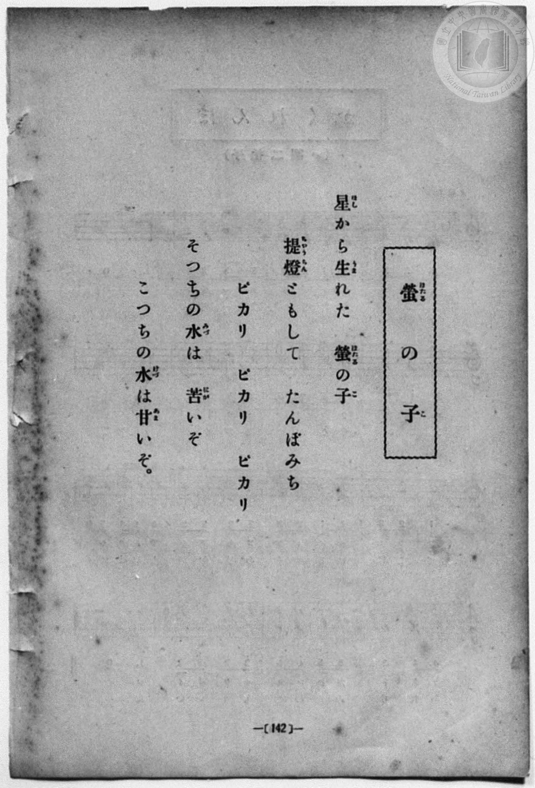
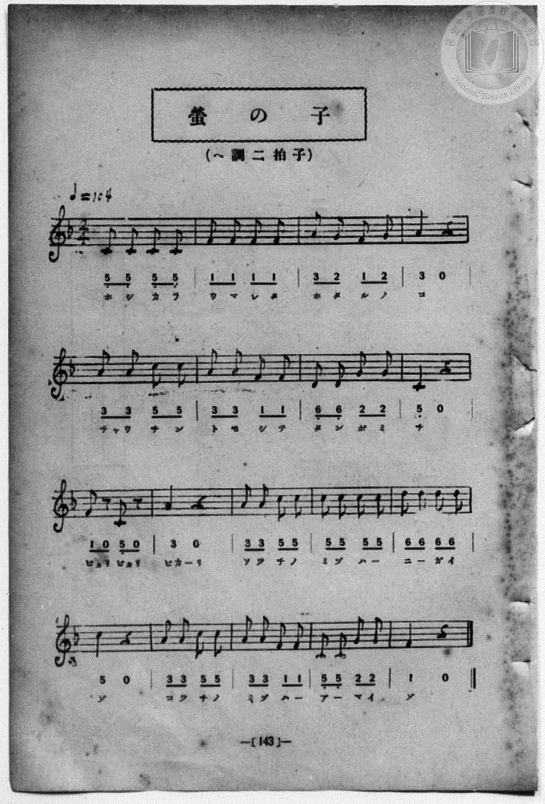

# 螢の子

> Re:Shōka 使用 AI 協助辨識與重建樂譜，可能會有錯誤。歡迎回報。

<audio controls src="hotaru_no_ko.mp3"></audio>

- book: 新編 小學校・公學校 唱歌教材集（尋常科三・四學年用）
- 一條慎三郎 編《新編 小學校・公學校 唱歌教材集》（大正十二年十二月，索書號 0725-41）

## 說明

> [!NOTE]
> **原書資訊與歌詞全文**（對應 `P150.jpg`–`P151.jpg`，原書 p. 142–143，尋常科三・四學年第 11 首）：
> - **調性與拍號**：ヘ調二拍子（F 大調 2/4 拍），♩= 104
> - **樂曲結構**：單段全曲共 18 小節（前兩行各 4 小節，後兩行各 5 小節）。第 9 小節「ピカリピカリ」於八分音符與八分休止符間閃爍跳躍（`1 0 5_ 0`），生動描繪螢火蟲點燈飛舞與民間呼螢歌謠「あっちの水は苦いぞ、こっちの水は甘いぞ」。
>
> 星（ほし）から生（うま）れた　螢（ほたる）の子（こ）
> 提燈（ちやうちん）ともして　たんぼみち
> ピカリ　ピカリ　ピカリ
> そつちの水（みづ）は　苦（にが）いぞ
> こつちの水（みづ）は甘（あま）いぞ。


## 歌詞

```text
（TMD 檔案未包含歌詞註解）
```

## ABC

```abc
X:1
T:螢の子
M:2/4
L:1/16
Q:1/4=104
K:F
V:V1 name="Piano" snm="Pia"
[V:V1]
C2 C2 C2 C2 | F2 F2 F2 F2 | A2 G2 F2 G2 | A6 z2 |
w: ホ シ カ ラ | ウ マ レ タ | ホ タ ル ノ | コ
A2 A2 C2 C2 | A2 A2 F2 F2 | D2 D2 G2 G2 | C6 z2 |
w: チヤ ウ チ ン | ト モ シ テ | タ ン ボ ミ | チ
F2 z2 C2 z2 | A6 z2 | A2 A2 C2 C2 | C2 C2 C2 C2 |
w: ピカリ ピカリ | ピカー | ソ ツ チ ノ | ミ ヅ ハ _
D2 D2 D2 D2 | C6 z2 | A2 A2 C2 C2 | A2 A2 F2 F2 |
w: ニ _ ガ イ | ゾ | コ ツ チ ノ | ミ ヅ ハ _
C2 C2 G2 G2 | F6 z2 |
w: ア _ マ イ | ゾ
```

## TMD 檔案連結

- [主旋律 TMD 檔案](hotaru_no_ko.tmd) [[在 TMD Studio 編輯](https://tmdlang.github.io/Tmd-TS/#tmd=s7IKdvYPcrWy4qpTUCpJTLdSSM7PyUlNLsnMz7MqzsjPTozPrsyvSsyML84ojTe0NDJWgqssy88pzU21Si9KTEmNN443QcgU55cWJadaFSdn5OfnxJekVpQk5edno8vHFySmp1oFGJoaIGQKivLLUvMS84C6C4oy80pSU8DaEQpSyzJTUkHSxcmJefFlqUWZaZmpKUiOSi0qBrsdYkVJUWJecXJRZgHIQwhV-UUlGflAhxdkVFplZBaX5BdlJifmxGcn5iUiFJVkpAK9l5iXmZuYo8SlpaXwYt6ix43rnq6doKClxaVoq2BoYMJlb6vgxmVjpG9iB9IH8qaVwrNpG55vX6HwdEP_07U7ni1Y-Lh599PWNRC2wtMpG5-t7Xk2deazuRNezm57v6fj6Ybupzt2PF8-8cmOTpDS2bOBSp_u3PJ8yor3ezrB7nmyo-HZornPWvuASl429ykAjX_c0EWKPY8bukFWLVn-bO3ip72NT3b1AG2AMJ7N6Xi_p-f5lkXPZu94MXO-goG5kamuiSHYbi59LQVbagEuBQUFO4VoRT__ENdYCEdL62nffJC9m9tfrOh60dEOdPOLlfOetq54Nq1dSwscOr3P2jsVEkDpRC-rID3hUcNkEMcQzAE6HGKAQoGegqGJEVDS0MQYJIorUNesUTA0VHi5bBrQf-_3zII4QxfokBer9j9rWA5yQncvMBhAls963DwDKAwKo-5eYLwDneOmAAxDoJgCMMoVgKJgU3oezVwJSQ5w056taHo2e9PzrROeLe8GG_V02rpn67aCPDZ709PWjQqGFqCIe76-AeTHzt6nrStfLOx5OqFFwQQu3vN0Xw9C3BQu3vm4oQnkD0uoyOOGnsfNUx43rX7cvArBaOh9Nm3P09bVTzvaXs7f_HzNMqDXINwneyY-W7sIKPJy2uSX05qfd_S-2L75xS6gXzoSDBUMFEzjFQyAIQvy2PMp8592T33W3_985ypg8n_euPrF_E0vd8973t7xcvHsFx3zQOG1YSLQoKcT9wAVgKJvzQKQgxqbHjcufty4EJhjnm3Y8rhx_YvuZY8bWx43znvc0Pi4cTKa7PMpM2CyvUDvgQMSEprPZswHOuxx4-7HjdNBfm_sftzUCXQXWLDtceM-kGAT0ML5jxsagE6AKZ7_uAmY5IHqQTkWLDgZyIWa2T8B6AOw4MLHTUBrgeYAGSAFjxtXPG4Cun3648ZlQAPB5gAdu-dx436gGoh2pEBuwMqGKmuc-7hxCdyXYOuAhiwF27Ie5NruZWDB1Y8be8CCoACA6QVailMvMLTAIkB3gr0PDTlwsFGeT6FAQUufi8sjvySxqNQv3zvfKiAzMS_focagRqEaZI-CjYUWOIoUsJURCsAECiy1gGlXQQOWonUUYPlWE4sGoG0gw2pAyQ-OahQMobBGwVjBCEgbgVm6QGigUAPW4VMDjJDZCo-btgPxaiB7JVDJ46ZlQNY8IF4DZO8HiYDV7AfSIDV9YDWbwQYBreHC75FdPeR4xBgIYd4AsSHeMIsHISOwR4BSGD5pfNy8BOr8RiDeDHZ6BxAvgnixuQ3sdJBHNgPxHCCeD1bTSKRndnSCPQMrT4j0DKxgQA5-FB-iRhvElxCE5Dlo_gC6EpmNkNkDNBgu1rQXyG6BhgM4woA-fdzcCsT9QHUgfjdIfRMoipcQ8jewCiDH34gowhGfEBFIfBpiRGfTPlisgJMbAf80LQL7H5hsQf5B1s1Vy8Wla6eAyI4KQJ4yFwA)]
- [鋼琴伴奏 TMD 檔案](hotaru_no_ko_piano.tmd) [[在 TMD Studio 編輯](https://tmdlang.github.io/Tmd-TS/#tmd=s7IKdvYPcrWy4qpTUCpJTLdSSM7PyUlNLsnMz7MqzsjPTozPrsyvSsyML84ojTe0NDJWgqssy88pzU21Si9KTEmNN443QcgU55cWJadaFSdn5OfnxJekVpQk5edno8vHFySmp1oFGJoaIGQKivLLUvMS84C6C4oy80pSU8DaEQpSyzJTUkHSxcmJefFlqUWZaZmpKUiOSi0qBrsdYkVJUWJecXJRZgHIQwhV-UUlGflAhxdkVFplZBaX5BdlJifmxGcn5iUiFCUWATWnp-am5pVYFWQm5uXHJyYn5-cWJOZlgsQQCksygIqsQMKJOUpcWloKL-Ytety47unaCe_3dLycPfNZZ_fL7j3PJ2x5smfL06X97_d0KmhpcSnaKhgamHDZ2yq4cdkY6ZvYgcwDhZOVwrNpG55vX6HwdEP_07U7ni1Y-Lh599PWNRC2wtMpG5-t7Xk2deazuRNezm4DWvF0Q_fTHTueL5_4ZEcnSOns2UClT3dueT5lBdAusDuf7Gh4tmjus9Y-oJKXzX0KQOMfN3SRYs_jhm6QVUuWP1u7-Glv45NdPUAbIIxnczre7-l5vmXRs9k7Xsycr2BgbmSqa2IItpvLI78ksajUL9873yoAFIhBHg41BjUK1VwKQGBjoWUHZuhrKdiiA4Xna9YA3f1iYY-ChgnIkc_XN-goANOLoV5WQbomFg1a-mDDahRM4xGoRsEQCmsUjBWMgLQRmKULhAYKNWAdPjUKj5tnKzxu2g7Eq4HslUAlj5uWAVnzgHgNkL0fJAJWsx9Ig9T0gdVsBhsEtIYLv0d29ZDjEWMghHkDxIZ4wywehIzAHgFKYfik8XHzEqjzG4F4M9jpHUC8COLF5jaw00Ee2QzEc4B4PlhNI5Ge2dEJ9owpaZ4xBLoS6FygUxHBj-JD1GiD-BKCkDw3BRhDj5tXAV2JzEbI7AEaDBdr2gtkt0DDARxhQJ8-bm4F4n6gOhC_G6S-CRTFSwj5G5izyPE3IopwxCdEBBKfhhjR2bQPFivg5EbAP02LwP4HJluQf5B1c9Vi5kYflNxoAs2NIBfFK0SbxseCHARkGYIYYDEwCygEcyCSPJxhAmQYxefC9KAoBQnADEAzGmIdSLMJkIHkEBSl2PRA3QP0n66dAsKLCkCeMhcA)]

## 分析

```text
================================================================================
📊 TMD Song Profile: [ 螢の子 ]
================================================================================
⏱  Duration:       0:20 (20.8s), 18 measures total
🎼 Key & Tempo:    首調基準 F, != 104.0 BPM, <2/4>
   - 分析範圍：      由實際發聲的音符與和弦推測調性；播放脈絡另行呈現
🎤 人聲音域:    C4 (MIDI 60) – A4 (MIDI 69) [跨度: 9 個半音 / 0.8 個八度, 難度: easy]
   - 最低音:  C4 in [HotaruNoKo #1 @ m.1, 0:00]
   - 最高音: A4 in [HotaruNoKo #1 @ m.3, 0:02]
   - 適合: soprano, mezzo-soprano, contralto, tenor, baritone, bass
🏛  結構:      HotaruNoKo (20.8s)
⚡ 編曲密度:        Peak 1 軌道同時演奏
🗝  調性診斷：       F 調性不明確（純淨自然大調，未偵測到可信轉調）
   - 風格氣質:    純淨自然大調（陽光明朗、易唱易記，無明顯調外色彩）
   - 轉調歷程:    全曲維持單一推測調性（未偵測到可信轉調）
   - 核心骨幹音:  C, A, F, D, G
   - 調性數值:    F 調性不明確 [相關度: 0.80, 穩定度: Ambiguous, 自然音純度: 100.0%]
   - 候選調性 (K-S): F 大調 (0.80), A 小調 (0.78), C 大調 (0.75)
   - 五度圈歷程:   -1
   - 各段落調性細節:
     • [HotaruNoKo #1]: F 調性不明確 (r: 0.80, 自然音純度: 100.0%)

  [ 五度圈游移軌跡 ]
               C  
        [F ]*          G  
      Bb               D  
      Eb               A  
         Ab           E  
            Db       B  
               F# 
     (* = active key center)

  [ 十二半音累積音高分佈 ]
     C  : ████████████████████████  35.4%
     C# :                            0.0%
     D  : ██████                     9.2%
     D# :                            0.0%
     E  :                            0.0%
     F  : ██████████████            20.0%
     F# :                            0.0%
     G  : ██████                     9.2%
     G# :                            0.0%
     A  : ██████████████████        26.2%
     A# :                            0.0%
     B  :                            0.0%
--------------------------------------------------------------------------------
Assignment 軌道音域：
  - Piano         : C4 – A4 (9 個半音 / 0.8 個八度, 55 個音符)
================================================================================
```


## 原書掃描頁






