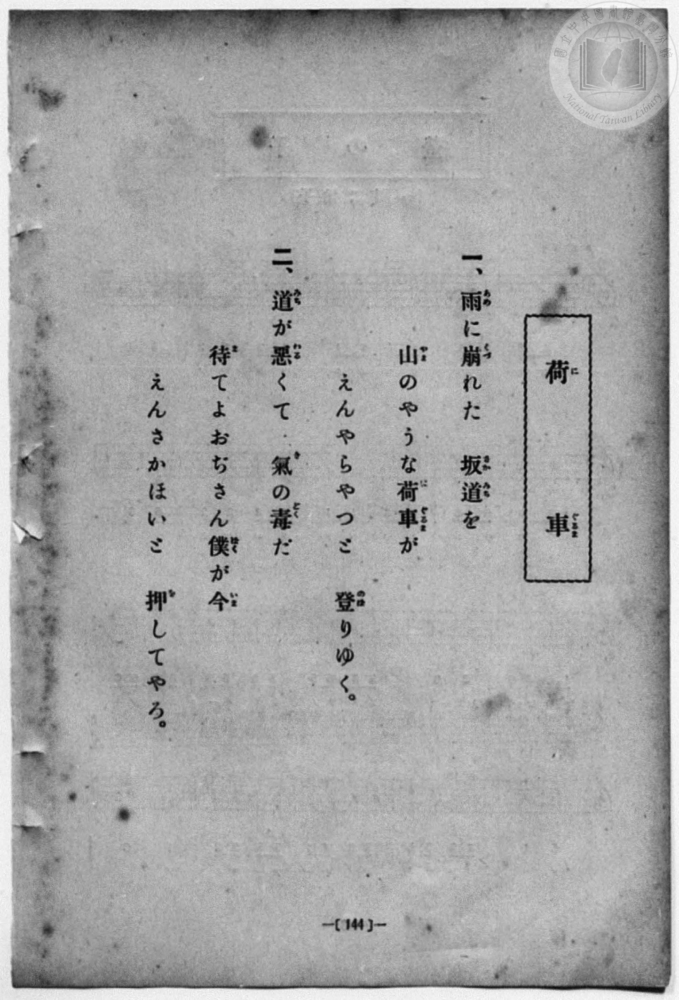
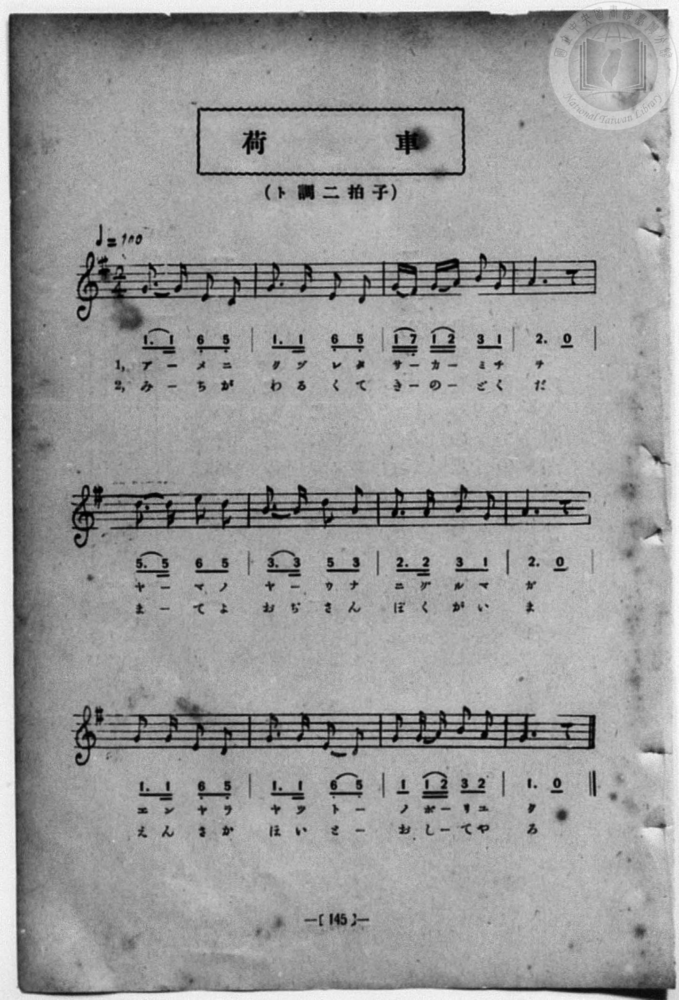

# 荷車

> Re:Shōka 使用 AI 協助辨識與重建樂譜，可能會有錯誤。歡迎回報。

<audio controls src="niguruma.mp3"></audio>

- 詞：吉丸一昌
- 曲：大和田愛羅
- book: 新編 小學校・公學校 唱歌教材集（尋常科三・四學年用）
- 一條慎三郎 編《新編 小學校・公學校 唱歌教材集》（大正十二年十二月，索書號 0725-41）
- 臺灣教育會公認《新定兒童唱歌》尋常科第二學年用（2020.006.0847.0002）

## 說明

> [!NOTE]
> **原書資訊與歌詞全文**（對應 `P152.jpg`–`P153.jpg`，原書 p. 144–145，尋常科三・四學年第 12 首）：
> - **調性與拍號**：ト調二拍子（G 大調 2/4 拍），♩= 100
> - **作詞・作曲**：吉丸一昌 作詞、大和田愛羅 作曲（原載《新作唱歌》第二集及《新定兒童唱歌》尋常科第二學年）
> - **原譜對照註記**：第 1、5、6、10 小節在本書中印為附點八分音符＋十六分音符（`1. 1 6_ 5_`、`5. 5 6 5`、`3. 3 5 3`、`1. 1 6_ 5_`），附有圓滑線以適配單音節長音與雙音節詞句（如「アーメニ／みーちが」「ヤーマノ／まーてよ」「ヤーウナ／おぢさん」「ヤツトー／ほいとー」）。
>
> **一、**
> 雨（あめ）に崩（くづ）れた　坂道（さかみち）を
> 山（やま）のやうな荷車（にぐるま）が
> えんやらやつと　登（のぼ）りゆく。
>
> **二、**
> 道（みち）が惡（わる）くて　氣（き）の毒（どく）だ
> 待（ま）てよおぢさん僕（ぼく）が今（いま）
> えんさかほいと　押（お）してやろ。


## 歌詞

```text
（TMD 檔案未包含歌詞註解）
```

## ABC

```abc
X:1
T:荷車
C:曲：大和田愛羅
M:2/4
L:1/16
Q:1/4=100
K:G
V:V1 name="Piano" snm="Pia"
[V:V1]
G3 G E2 D2 | G3 G E2 D2 | G F G A B2 G2 | A6 z2 |
w: 1.~ア _ メ ニ | ク ヅ レ タ | サ _ カ _ ミ チ | ヲ
w: 2.~み _ ち が | わ る く て | き _ の _ ど く | だ
d3 d e2 d2 | B3 B d2 B2 | A3 A B2 G2 | A6 z2 |
w: 1.~ヤ _ マ ノ | ヤ _ ウ ナ | ニ グ ル マ | ガ
w: 2.~ま _ て よ | お ぢ さ ん | ぼ く が い | ま
G3 G E2 D2 | G3 G E2 D2 | G2 G A B2 A2 | G6 z2 |
w: 1.~エ ン ヤ ラ | ヤ ツ ト _ | ノ ボ _ リ ユ | ク
w: 2.~え ん さ か | ほ い と _ | お し _ て や | ろ
G3 G E2 D2 | G3 G E2 D2 | G F G A B2 G2 | A6 z2 |
w: 1.~ア _ メ ニ | ク ヅ レ タ | サ _ カ _ ミ チ | ヲ
w: 2.~み _ ち が | わ る く て | き _ の _ ど く | だ
d3 d e2 d2 | B3 B d2 B2 | A3 A B2 G2 | A6 z2 |
w: 1.~ヤ _ マ ノ | ヤ _ ウ ナ | ニ グ ル マ | ガ
w: 2.~ま _ て よ | お ぢ さ ん | ぼ く が い | ま
G3 G E2 D2 | G3 G E2 D2 | G2 G A B2 A2 | G6 z2 |
w: 1.~エ ン ヤ ラ | ヤ ツ ト _ | ノ ボ _ リ ユ | ク
w: 2.~え ん さ か | ほ い と _ | お し _ て や | ろ
```

## TMD 檔案連結

- [主旋律 TMD 檔案](niguruma.tmd) [[在 TMD Studio 編輯](https://tmdlang.github.io/Tmd-TS/#tmd=s7IKdvYPcrWy4qpTUCpJTLdSSM7PyUlNLsnMz7MqzsjPTozPrsyvSsyML84ojTe0NDJWgqssy88pzU21Si9KTEmNN443QcgU55cWJadaFSdn5OfnxJekVpQk5edno8vHFySmp1oFGJoaIWQKivLLUvMS84C6C4oy80pSU8DaEQpSyzJTUkHSxcmJefFlqUWZaZmpKUiOSi0qBrsdYkVJUWJecXJRZgHIQwhV-UUlGflAhxdkVFplZBaX5BdlJifmxGcn5iUiFJVkpAK9BzahAKgBXSI3vygxR4lLS0vhRe_2F7u7FLS0uBRtFQwNDLjsbRXcuWyM9E3sQHpAfrdSeDZtw_PtKxSebuh_unbHswULHzfvftq6BsJWeDpl47O1Pc-mznw2d8LL2W3v93Q83dD9dMeO58snPtnRCVI6ezZQ6dOdW55PWfF-TyfYLU92NDxbNPdZax9QycvmPgWg8Y8bukix53FDN8iqJcufrV38tLfxya4eoA0QxrM5He_39DzfsujZ7B0vZs5XMDA3MtU1MYTZ_aJ91_PGxUCDXjRtejanGWjDi1W9ENufrpv1tHXS89VLIZYB7YD75fmaNSA7EB7pMDIwMtAzMDDTM7AwMQcyDIzgNqyc937PrKcTOp_s2AHy6YwesPCz2ZtAwkuWP53U83zKhmcts5_va1Xi4tLXUrClFuBSUFCwU4hW9PMPcY2FcLS0nvbNBwXF5vYXK7pedLQDfQZ04dPWFc-mtWtpgSOs91l7p0ICKD3rZRWkJzxqmAziGIM5wLCEGKBQoKdgaGIClDQ0MQWJ4ornNWsUDI0UXi6bBgwQoI8hztAFOuTFqv3PGpaDnNDdC4wZkOWzHjd3AIVB0dbd-3TtBKBz3BWAYQQUUwCmQgWgKNiUnkczV0JSKNy0J3vnAP0BtBnIAIYt2DTkQFeAKmhoRAtzkAQ4MjqAHnuxpxMS-UBBeLRDYhuYzJ72d5GUNIBuRTgQZPraOcDQfd66_MWK3S9WzAC7ERw-QFeZArEZEBsagJL88_UNT-eseDZnDTCkn-xY-7R3w_OmXS9ntrzcDYyq1U872l7O3_x8zbL3e7qBqfxp61okkY4EQ2DMKJjFK5jGJwANTDDVUzBVMFMwBXOM9RSMgVxjMAdJISRYgTY8m9P5dM7kZ7snPt8-68nupS8bV75s7X06bR3I-PUNL6duBzKAcfZy9kyICCjx9C8Fhd6ypscNPY-bFj1u3vO4GZhdgVmy_3HjfhC3ceHjRmAoATNWz-PmJWAFwKjqAyvYB1aw7HFTB4qCpmWPm7vACroeNy563Dj1cdNkJAUtwJQCVAZWsPtxY8vjxhUgXQ2g9PG4oQkc7LAUD0wAQN8CSzUw_-VsUH593Nj0uKkRpLhx9dMtK8EiQKOAHul83NTzuHH-44aGp3ObXjZOBktNfdzYDfJL40KwgkkQo55u3AiSbQLavg9s1Dowu-1x4ypIUQrWu_px44THTUDtEDU9EL2PG4EaJ4PUNwENBOpaAvJCQ8PzmbvButY9bgT6DijV9bgJaGA_hqd2AQMU4SmoO2EubOx51gxkAK3oB1oNFgH6bhnQ_GcbFoNVggOqcd2z9ZPA3JVABWCRBVCv7WsFi0PcDI4dpIh42jwVLAuMOIiunidQz0KDAsWP0NCDRRPQDV1Ar4EMBOudDjYfGA7AyAX7kfKCDwoUtPS5uPwy00uLSnMTrQIyE_PyHWoMaqpBlijYGJppgUNTAVuRqwDKxzsaXizsUdAwgeZIHQVYMaiJRQPQLpBhNcAspQuE4IylC8xaQAKXmHk8kDACZkiQFEjICKwMAg1AImAjfQxrFID5CioOzFtgshus43HTeqhoKxCvAbGa9kNltoJ5q8Gy88FkI0SmeROSPWDHQOwxAso1gnSDTWwE29PYAzWtHyLa1A0UA7GBsQaRaewF89aByZVgEiQPklmAYQ_-AN_VQ06Am4LNB5VxIBJkMyhEdcEFHYhEhCyRYd28BB7W88BkHzTc4OJNIL8DCyioOCguQKIbgGxIeIP0gUINFCO4QnofPKTBpjV1QEMNZCpIdBEQTwXLTIbK7IHK9EPjBZijoDIws4gN6R2dtE3aIBFIaIPCGaYKe8peAQ3rzdAQftwMSkWI8AaW9kAMCh0QBImD4uNx8xwwuQpMQtMiNDdgD2-ICaDQhIZrIzQPNe6GhivQnkaIaxAxASygkOIIGt5NoDSPak8tF5eunQKstFFAYytzAQA)]
- [鋼琴伴奏 TMD 檔案](niguruma_piano.tmd) [[在 TMD Studio 編輯](https://tmdlang.github.io/Tmd-TS/#tmd=s7IKdvYPcrWy4qpTUCpJTLdSSM7PyUlNLsnMz7MqzsjPTozPrsyvSsyML84ojTe0NDJWgqssy88pzU21Si9KTEmNN443QcgU55cWJadaFSdn5OfnxJekVpQk5edno8vHFySmp1oFGJoaIWQKivLLUvMS84C6C4oy80pSU8DaEQpSyzJTUkHSxcmJefFlqUWZaZmpKUiOSi0qBrsdYkVJUWJecXJRZgHIQwhV-UUlGflAhxdkVFplZBaX5BdlJifmxGcn5iUiFCUWATWnp-am5pVYFWQm5uXHJyYn5-cWJOZlgsQQCksygIqswFYVAE1Gl8jNL0rMUeLS0lJ40bv9xe6u93s6Xs6e-ayz-2X3nucTtjzZs-Xp0v73ezoVtLS4FG0VDA0MuOxtFdy5bIz0TexAZoECz0rh2bQNz7evUHi6of_p2h3PFix83Lz7aesaCFvh6ZSNz9b2PJs689ncCS9ntwGteLqh--mOHc-XT3yyoxOkdPZsoNKnO7c8n7ICaBfYjU92NDxbNPdZax9QycvmPgWg8Y8bukix53FDN8iqJcufrV38tLfxya4eoA0QxrM5He_39DzfsujZ7B0vZs5XMDA3MtU1MYTZ_aJ91_PGxUCDXjRtejanGWjDi1W9ENufrpv1tHXS89VLIZYB7YD75fmaNSA7EB7pMDIwMtAzMDDTM7AwMQcyDIzgNqyc937PrKcTOp_s2AHy6YwesPCz2ZtAwkuWP53U83zKhmcts5_va1Xi4vLLTC8tKs1NtAoARXWQh0ONQU01lwIQ2BiaadmBWfpaCrboQAHkph0NLxb2KGiYgELt-foGHQVgqjbWyypI18SiQUsfbFiNgqGCLhAaKpjFAylTEIFLzDweSBgpGIOlQEJGYGUQaAASARvpY1ij8LhpEVT8cfNCMNkN1vG4aT1UtBWI14BYTfuhMlvBvNVg2flgshEi07wJyR6wYyD2GAHlGkG6wSY2gu1p7IGa1g8RbeoGioHYjxuXQWQae8G8dWByJZgEyYNkFmDYgz_Ad_WQE-CmYPNNFczAJMhmUIjqAkkQD8SGhSyRYd28BB7W88BkHzTc4OJNIL8_bu6CioPiAiS6AciGhDdIHyjUQDGCK6T3wUMabFpTBzTUQKaCRBcB8VSwzGSozB6oTD80Xh43tkBlYGYRG9I7OmmbtEEikNAGhTNMFfaUvQIa1puhIfy4GZSKEOH9uLkFiEGhA4IgcVB8PG6eAyZXgUloWoTmBuzhDTEBFJrQcG2E5qHG3dBwBdrTCHENIiYeN05HiiNoeDeB0jyqPbXohY0P1sIGGBQg9dGGsaAwQjBxi5vGg3mm8fhloBQicAezTUgcFKNRZCAkxBpg6OraKcACONoHJIXMNwLzlbkA)]

## 分析

```text
================================================================================
📊 TMD Song Profile: [ 荷車 ]
================================================================================
⏱  Duration:       0:28 (28.8s), 24 measures total
🎼 Key & Tempo:    首調基準 G, != 100.0 BPM, <2/4>
   - 分析範圍：      由實際發聲的音符與和弦推測調性；播放脈絡另行呈現
🎤 人聲音域:    D4 (MIDI 62) – E5 (MIDI 76) [跨度: 14 個半音 / 1.2 個八度, 難度: moderate]
   - 最低音:  D4 in [Niguruma #1 @ m.1, 0:00]
   - 最高音: E5 in [Niguruma #1 @ m.5, 0:05]
   - 適合: soprano, mezzo-soprano, contralto, tenor, baritone, bass
🏛  結構:      Niguruma (14.4s) -> Niguruma (14.4s)
⚡ 編曲密度:        Peak 1 軌道同時演奏
🗝  調性診斷：       G 大調（純淨自然大調，未偵測到可信轉調）
   - 風格氣質:    純淨自然大調（陽光明朗、易唱易記，無明顯調外色彩）
   - 轉調歷程:    全曲維持單一推測調性（未偵測到可信轉調）
   - 核心骨幹音:  G, A, D, B, E
   - 調性數值:    G 大調 [相關度: 0.85, 穩定度: High, 自然音純度: 100.0%]
   - 候選調性 (K-S): G 大調 (0.85), D 大調 (0.68), E 小調 (0.59)
   - 五度圈歷程:   +1 -> +1
   - 各段落調性細節:
     • [Niguruma #1]: G 大調 (r: 0.85, 自然音純度: 100.0%)
     • [Niguruma #2]: G 大調 (r: 0.85, 自然音純度: 100.0%)

  [ 五度圈游移軌跡 ]
               C  
         F           [G ]*
      Bb               D  
      Eb               A  
         Ab           E  
            Db       B  
               F# 
     (* = active key center)

  [ 十二半音累積音高分佈 ]
     C  :                            0.0%
     C# :                            0.0%
     D  : ████████████              17.8%
     D# :                            0.0%
     E  : ████████                  11.1%
     F  :                            0.0%
     F# : █                          1.1%
     G  : ████████████████████████  34.4%
     G# :                            0.0%
     A  : ███████████████           22.2%
     A# :                            0.0%
     B  : █████████                 13.3%
--------------------------------------------------------------------------------
Assignment 軌道音域：
  - Piano         : D4 – E5 (14 個半音 / 1.2 個八度, 84 個音符)
================================================================================
```


## 原書掃描頁






