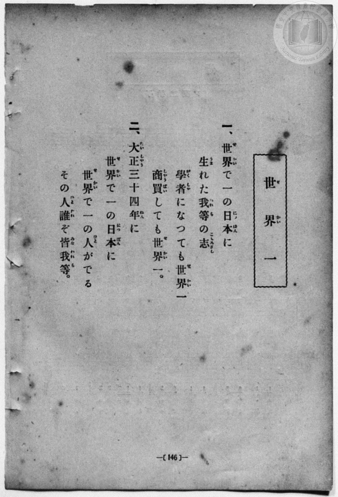
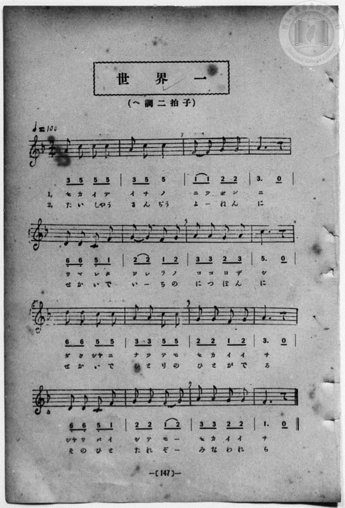

# 世界一

> Re:Shōka 使用 AI 協助辨識與重建樂譜，可能會有錯誤。歡迎回報。

<audio controls src="sekaiichi.mp3"></audio>

- book: 新編 小學校・公學校 唱歌教材集（尋常科三・四學年用）
- 一條慎三郎 編《新編 小學校・公學校 唱歌教材集》（大正十二年十二月，索書號 0725-41）

## 說明

> [!NOTE]
> **原書資訊與歌詞全文**（對應 `P154.jpg`–`P155.jpg`，原書 p. 146–147，尋常科三・四學年第 13 首）：
> - **調性與拍號**：ヘ調二拍子（F 大調 2/4 拍），♩= 100
> - **時代背景**：第二段歌詞出現「大正三十四年に（大正 34 年＝西元 1945 年，即本書大正 12 年出版時的 22 年後，當屆三、四年級學童約三十歲壯年之時）」，期許學童未來成為世界第一的人物。
>
> **一、**
> 世界（せかい）で一（いち）の日本（につぽん）に
> 生（うま）れた我等（われら）の志（こころざし）
> 學者（がくしや）になつても世界一（せかいち）
> 商買（しやうばい）しても世界一（せかいち）。
>
> **二、**
> 大正三十四年（たいしやうさんじうよねん）に
> 世界（せかい）で一（いち）の日本（につぽん）に
> 世界（せかい）で一（いち）の人（ひと）がでる
> その人誰（ひとたれ）ぞ皆我等（みなわれら）。


## 歌詞

```text
（TMD 檔案未包含歌詞註解）
```

## ABC

```abc
X:1
T:世界一
M:2/4
L:1/16
Q:1/4=100
K:F
V:V1 name="Piano" snm="Pia"
[V:V1]
A2 c2 c2 c2 | A2 c2 c4 | F2 F2 G2 G2 | A6 z2 |
w: セ カ イ デ | イ チ ノ | ニ ツ ポ ン | ニ
D2 D2 C2 F2 | G2 G2 F2 G2 | A2 A2 G2 A2 | c6 z2 |
w: ウ マ レ タ | ワ レ ラ ノ | コ コ ロ ザ | シ
d2 d2 c2 c2 | A2 A2 c2 c2 | G2 G2 F2 G2 | A6 z2 |
w: ガ ク シヤ ニ | ナ ツ テ モ | セ カ イ イ | チ
D2 D2 C2 F2 | G2 G2 F2 G2 | A2 A2 G2 G2 | F6 z2 |
w: シヤ ウ バ イ | シ テ モ _ | セ カ イ イ | チ
A2 c2 c2 c2 | A2 c2 c4 | F2 F2 G2 G2 | A6 z2 |
w: た い しや う | さ ん ぢう | よ _ ね ん | に
D2 D2 C2 F2 | G2 G2 F2 G2 | A2 A2 G2 A2 | c6 z2 |
w: せ か い で | い _ ち の | に つ ぽ ん | に
d2 d2 c2 c2 | A2 A2 c2 c2 | G2 G2 F2 G2 | A6 z2 |
w: せ か い で | い ち の _ | ひ と が で | る
D2 D2 C2 F2 | G2 G2 F2 G2 | A2 A2 G2 G2 | F6 z2 |
w: そ の ひ と | た れ ぞ _ | み な わ れ | ら
```

## TMD 檔案連結

- [主旋律 TMD 檔案](sekaiichi.tmd) [[在 TMD Studio 編輯](https://tmdlang.github.io/Tmd-TS/#tmd=s7IKdvYPcrWy4qpTUCpJTLdSSM7PyUlNLsnMz7MqzsjPTozPrsyvSsyML84ojTe0NDJWgqssy88pzU21Si9KTEmNN443QcgU55cWJadaFSdn5OfnxJekVpQk5edno8vHFySmp1oFGJoi6Swoyi9LzUvMA-ouKMrMK0lNAWtHKEgty0xJBUkXJyfmxZelFmWmZaamIDkqtagY7HaIFSVFiXnFyUWZBSAPIVTlF5Vk5AMdXpBRaZWRWVySX5SZnJgTn52Yl4hQVJKRCvRebn5RYo4Sl5aWwpMd055P7Xmyo0FBS4tL0VbB0MCAy95WwY3LxkjfxA6kDeRLK4Vn0zY8375C4emG_qdrdzxbsPBx8-6nrWsgbIWnUzY-W9vzbOrMZ3MnvJzd9n5Px9MN3U937Hi-fOKTHZ0gpbNnA5U-3bnl-ZQV7_d0gp0DtPPZornPWvuASl429ykAjX_c0EWKPY8bukFWLVn-bO3ip72NT3b1AG2AMJ7N6Xi_p-f5lkXPZu94MXO-goG5kamuiSHYbi59LQVbagEuBQUFO4VoRT__ENdYCEdL62nffJC9m9tfrOh60dEOdPOLlfOetq54Nq1dSwscOr3P2jsVEkDJRC-rID3hUcNkEMcUzAE6HGKAQoGegqGJGVDS0MQcJIorUNesUTA0Vni5bBrQf-_3zII4QxfokBer9j9rWA5yQncvMBhAls963DwDKAwKo-7ep2snAJ3jpgAMQ6CYAjDKFYCiYFN6Hs1cCUkOcNOezWx6snvxi-aeZzPXg40CWgwyZ91WqA_bdz3v3_e4oQcSJUBXAiMD5MqdWx43roZHlYKxiQJQ6P2euS-W7n_a2qxgaGliChHpedq7-dmcNUC_Q5UaGoEkQAZ3dgCtfz6rRcEIIrSvBxTBU7c93dgGCo4GqEXPt8wCBsrz1Uufb2mBOODZ2k1PF68HSj3Z2Q00Aui5xw1ALwKTyPwXKzZCFD-bs-rJvrZnHROeN-2C5AiQ13Y0AO17sgto98rHDU3gcIDFMFAOaCUwy4D5EC1ADz5unP24sftxYwvIlsblQFVgwZbHjQvBIuueTQfatQYsuPpx45LHjXsfN00GS62GGPV8ynywbNvjxn0g8aaex43zn3VMfL4WGCcdj5v6QSJNQDbItKf7p4MVTwahpt7HjdMeNwJFOiFGAb32oqEVrABoSD9Q6nETxGFAq1eBbV_2uKkJXgIgux_iYKg5U9tebNoOlgWZAHbbBpgfpxM0BCPodvUgBR1mUgGbMB-sHW7dVGAoPW6cAWI3AWXXogUaFcOfeKOACQMssulxI6hMAwfy8sdN3RBzHjfOhah5sWoDXBnIX01Aw4GK5z2fBUxvsGht3A-KEeTIhQQa5eUTFCho6XNxBadmJ2ZmJmdkWgVkJublO9QY1ChUg6xRsLHQAsePAraiUQGSF14s7FHQAObcDf3P1zfoKMCKK00sGoCWgQyrUTBWMAVDGEsXyDIEQiMgBInpAqGBQg1YtY9hjcLjpt1AvBqIlyg8bm4HqoGwGoG4D6z7cXM3ELcA8Vwg3gwVAZkTDzPHCCjWOB-IgarASQhItYEUNk4FGjcZSC8CCYBNa-oA0sAEBZYAKVkNNwt_eOzqISc8zOJByDQeGAQ14EAABQUoIIyBtDGQBQoi9CBZBvTiPCBeA2TvB3t4PYTXvBIcLCA1myG4GeSRbWCR7VgCZTYQA4MPHDDLwd5tAXt_IRCvg3ofmCuAeC_JAbKjk6wAAUJYAoEkEdRwwQwNUCgA_d-0_XEzKGV0gwOkC5om2oB4Edj7SOkIiEFqGokMEFhwgNNH4yYgXgHEPTAVTYjUhjdAgIUZ1VMIiGWIJUwgYQFOKBNg_gUmAFh4QFI6cSECzFVAv8P8Dc1JTSDfz4OGyH4gXgUU6weLg0zuhJtTy8Wla6cAL2eifQxjFVAFjMACylwA)]
- [鋼琴伴奏 TMD 檔案](sekaiichi_piano.tmd) [[在 TMD Studio 編輯](https://tmdlang.github.io/Tmd-TS/#tmd=s7IKdvYPcrWy4qpTUCpJTLdSSM7PyUlNLsnMz7MqzsjPTozPrsyvSsyML84ojTe0NDJWgqssy88pzU21Si9KTEmNN443QcgU55cWJadaFSdn5OfnxJekVpQk5edno8vHFySmp1oFGJoi6Swoyi9LzUvMA-ouKMrMK0lNAWtHKEgty0xJBUkXJyfmxZelFmWmZaamIDkqtagY7HaIFSVFiXnFyUWZBSAPIVTlF5Vk5AMdXpBRaZWRWVySX5SZnJgTn52Yl4hQlFgE1JyempuaV2JVkJmYlx-fmJycn1uQmJcJEkMoLMkAKrLKzS9KzFHi0tJSeLJj2vOpPU92NLzf0_Fy9sxnnd0vu_c8n7DlyZ4tT5f2v9_TqaClxaVoq2BoYMBlb6vgxmVjpG9iBzIOFExWCs-mbXi-fYXC0w39T9fueLZg4ePm3U9b10DYCk-nbHy2tufZ1JnP5k54ObsNaMXTDd1Pd-x4vnzikx2dIKWzZwOVPt255fmUFUC7wM4EuuXZornPWvuASl429ykAjX_c0EWKPY8bukFWLVn-bO3ip72NT3b1AG2AMJ7N6Xi_p-f5lkXPZu94MXO-goG5kamuiSHYbq7g1OzEzMzkjEyrAFAQBnk41BjUKFRzKQCBjYWWHZihr6Vgiw4Unq9ZA3T2i4U9ChomIDc-X9-gowBMLaZ6WQXpmlg0aOmDDatRMFYwBUMYSxfIMgRCIyAEiekCoYFCDVi1j2GNwuOm3UC8GoiXKDxubgeqgbAagbgPrPtxczcQtwDxXCDeDBUBmRMPM8cIKNY4H4iBqhqnP24CUW0ghY1TgcZNBtKLQAJg05o6gPTjxrVgCZCS1XCz8IfHrh5ywsMsHoRM44FBUAMOBFBQgALCGEgbA1mgIEIPkmVAL84D4jVA9n6wh9dDeM0rwcECUrMZgptBHtkGFtmOJVBmAzEw-MABsxzs3Raw9xcC8Tqo9x83AgO8cS_JAbKjk6wAAUJYAoEkEdRwwQwNUCgA_d-0_XEzKGV0gwOkC5om2oB4Edj7SOkIiEFqGokMEFhwgNNH4yYgXgHEPTAVTYjUhjdAgJmf6ikExDLEEiaQsAAnlAkw_wITACw8ICmduBAB5iqg32H-huakJpDv50FDZD8QrwKK9YPFQSZ3ws2pxShmfFCKGRNoMQP0RrxCtGEsOsM0HsqC-a9GwQQmbxqPoQUkhEUlijxciKCRKJYDfaJrpwD3TLQPUBmqgBFYQJkLAA)]

## 分析

```text
================================================================================
📊 TMD Song Profile: [ 世界一 ]
================================================================================
⏱  Duration:       0:38 (38.4s), 32 measures total
🎼 Key & Tempo:    首調基準 F, != 100.0 BPM, <2/4>
   - 分析範圍：      由實際發聲的音符與和弦推測調性；播放脈絡另行呈現
🎤 人聲音域:    C4 (MIDI 60) – D5 (MIDI 74) [跨度: 14 個半音 / 1.2 個八度, 難度: moderate]
   - 最低音:  C4 in [Sekaiichi[L1] #1 @ m.5, 0:05]
   - 最高音: D5 in [Sekaiichi[L1] #1 @ m.9, 0:09]
   - 適合: soprano, mezzo-soprano, contralto, tenor, baritone, bass
🏛  結構:      Sekaiichi[L1] (19.2s) -> Sekaiichi[L2] (19.2s)
⚡ 編曲密度:        Peak 1 軌道同時演奏
🗝  調性診斷：       C 大調（純淨自然大調，未偵測到可信轉調）
   - 風格氣質:    純淨自然大調（陽光明朗、易唱易記，無明顯調外色彩）
   - 轉調歷程:    全曲維持單一推測調性（未偵測到可信轉調）
   - 核心骨幹音:  C, A, G, F, D
   - 調性數值:    C 大調 [相關度: 0.79, 穩定度: Moderate, 自然音純度: 100.0%]
   - 候選調性 (K-S): C 大調 (0.79), F 大調 (0.72), A 小調 (0.69)
   - 五度圈歷程:   +0 -> +0
   - 各段落調性細節:
     • [Sekaiichi[L1] #1]: C 大調 (r: 0.79, 自然音純度: 100.0%)
     • [Sekaiichi[L2] #1]: C 大調 (r: 0.79, 自然音純度: 100.0%)

  [ 五度圈游移軌跡 ]
              [C ]*
         F            G  
      Bb               D  
      Eb               A  
         Ab           E  
            Db       B  
               F# 
     (* = active key center)

  [ 十二半音累積音高分佈 ]
     C  : ████████████████████████  25.0%
     C# :                            0.0%
     D  : ██████████                10.0%
     D# :                            0.0%
     E  :                            0.0%
     F  : ████████████████          16.7%
     F# :                            0.0%
     G  : ██████████████████████    23.3%
     G# :                            0.0%
     A  : ████████████████████████  25.0%
     A# :                            0.0%
     B  :                            0.0%
--------------------------------------------------------------------------------
Assignment 軌道音域：
  - Piano         : C4 – D5 (14 個半音 / 1.2 個八度, 102 個音符)
================================================================================
```


## 原書掃描頁






