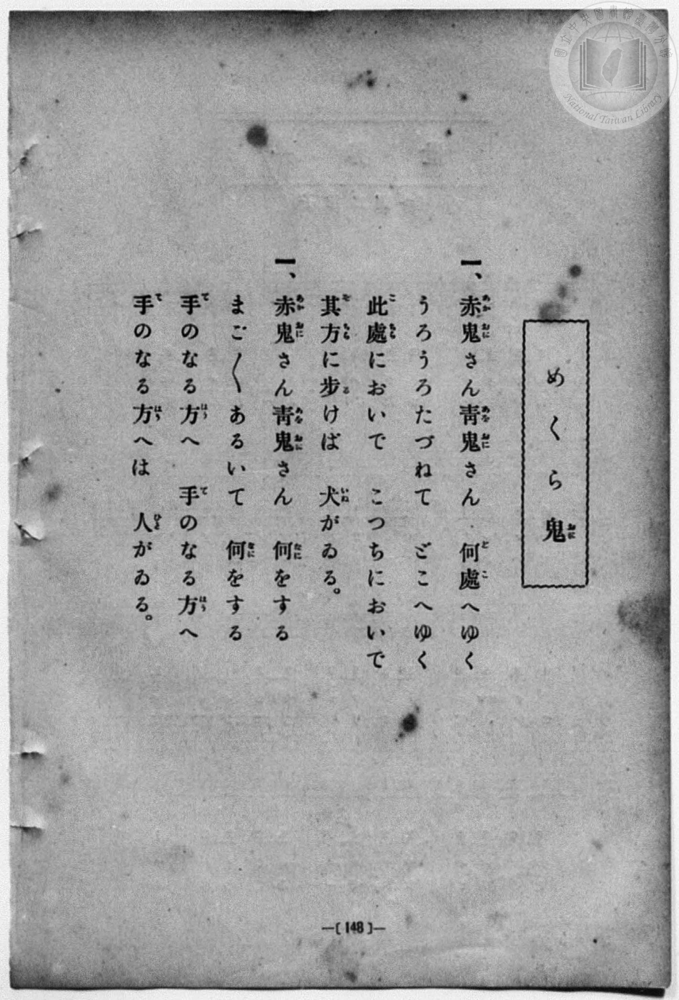
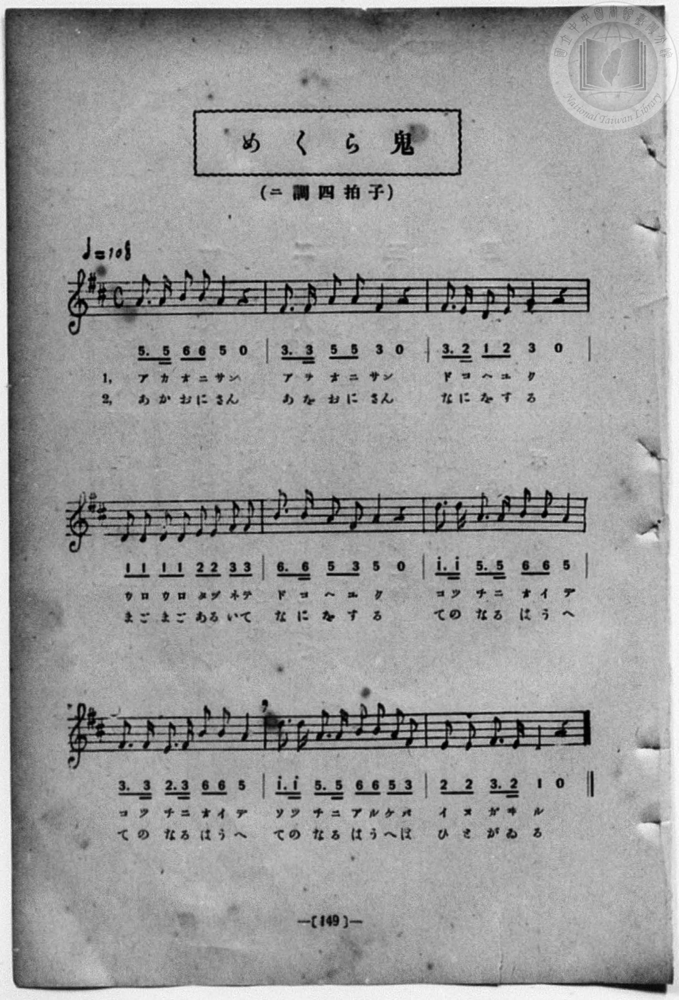

# めくら鬼

> Re:Shōka 使用 AI 協助辨識與重建樂譜，可能會有錯誤。歡迎回報。

- **NEUTRINO 歌聲合成版**：<br><audio controls src="mekura_oni_neutrino.mp3"></audio>
- **鋼琴伴奏版**：<br><audio controls src="mekura_oni.mp3"></audio>


- book: 新編 小學校・公學校 唱歌教材集（尋常科三・四學年用）
- 一條慎三郎 編《新編 小學校・公學校 唱歌教材集》（大正十二年十二月，索書號 0725-41）
- 尋常科第三、四學年用（第 148–149 頁）

## 說明

原書資訊與歌詞全文（對應 P156.jpg–P157.jpg，原書 p. 148–149，尋常科第三、四學年第 14 首）：
調性與拍號：ニ調四拍子（D 大調 4/4 拍），♩=108


## 歌詞

```text
> [!NOTE]
> **原頁歌詞全文（P156.jpg，原書 p. 148）**
>
> 一、赤鬼（あかおに）さん青鬼（あをおに）さん　何處（どこ）へゆく
> うろうろたづねて　どこへゆく
> 此處（こゝ）においで　こつちにおいで
> 其方（そちら）に歩（ある）けば　犬（いぬ）がゐる。
>
> 二、赤鬼（あかおに）さん青鬼（あをおに）さん　何（なに）をする
> まごまごあるいて　何（なに）をする
> 手（て）のなる方（はう）へ　手（て）のなる方（はう）へ
> 手（て）のなる方（はう）へは　人（ひと）がゐる。
>
> （註：原頁 P156 第二節題號印作「一、」，對照 P157 譜下標示「1,」「2,」，實為第二節；P156 第一節第 3 句作「此處（こゝ）においで　こつちにおいで」，第 4 句作「其方（そちら）に歩（ある）けば」，而 P157 譜下配字分別作「コツチニ オイデ コツチニ オイデ」與「ソツチニ アルケバ」。此處譜內 L1 依譜下實際配字記之。）
```

## ABC

```abc
X:1
T:めくら鬼
M:4/4
L:1/16
Q:1/4=108
K:D
V:V1 name="Piano" snm="Pia"
[V:V1]
A3 A B2 B2 A4 z4 | F3 F A2 A2 F4 z4 | F3 E D2 E2 F4 z4 | D2 D2 D2 D2 E2 E2 F2 F2 |
w: 1.~あ か お に さ | あ を お に さ | ど こ へ ゆ く | う ろ う ろ た づ ね て
w: 2.~あ か お に さ | あ を お に さ | な に を す る | ま ご ま ご あ る い て
B3 B A2 F2 A4 z4 | d3 d A3 A B2 B2 A4 | F3 F E3 F B2 B2 A4 | d3 d A3 A B2 B2 A2 F2 |
w: 1.~ど こ へ ゆ く | こつ ち に _ お い で | こつ ち に _ お い で | そつ ち に _ あ る け ば
w: 2.~な に を す る | て の な る は う へ | て の な る は う へ | て の な る は う へ は
E2 E2 F3 E D4 z4 | A3 A B2 B2 A4 z4 | F3 F A2 A2 F4 z4 | F3 E D2 E2 F4 z4 |
w: 1.~い ぬ が ゐ る | あ か お に さ | あ を お に さ | ど こ へ ゆ く
w: 2.~ひ と が ゐ る | あ か お に さ | あ を お に さ | な に を す る
D2 D2 D2 D2 E2 E2 F2 F2 | B3 B A2 F2 A4 z4 | d3 d A3 A B2 B2 A4 | F3 F E3 F B2 B2 A4 |
w: 1.~う ろ う ろ た づ ね て | ど こ へ ゆ く | こつ ち に _ お い で | こつ ち に _ お い で
w: 2.~ま ご ま ご あ る い て | な に を す る | て の な る は う へ | て の な る は う へ
d3 d A3 A B2 B2 A2 F2 | E2 E2 F3 E D4 z4 |
w: 1.~そつ ち に _ あ る け ば | い ぬ が ゐ る
w: 2.~て の な る は う へ は | ひ と が ゐ る
```

## TMD 檔案連結

- [主旋律 TMD 檔案](mekura_oni.tmd) [[在 TMD Studio 編輯](https://tmdlang.github.io/Tmd-TS/#tmd=s7IKdvYPcrWy4qpTUCpJTLdSSM7PyUlNLsnMz7MqzsjPTozPrsyvSsyML84ojTe0NDJWgqssy88pzU21Si9KTEmNN443QcgU55cWJadaFSdn5OfnxJekVpQk5edno8vHFySmp1oFGJqaIWQKivLLUvMS84C6C4oy80pSU8DaEQpSyzJTUkHSxcmJefFlqUWZaZmpKUiOSi0qBrsdYkVJUWJecXJRZgHIQwhV-UUlGflAhxdkVFplZBaX5BdlJifmxGcn5iUiFJVkpAK9l5KYmVMZn5OZloqsPTM9M8-qNA_klhKoC7S0FB43NT5u7H_c1PlyzR4FLS0uRVsFQwMLLntbBRcuGxN9EzuQCaCgsFJ4Nm3D8-0rFJ5u6H-6dsezBQsfN-9-2roGwlZ4OmXjs7U9z6bOfDZ3wsvZbe_3dDzd0P10x47nyyc-2dEJUjp7NlDp051bnk9Z8X5PJ9hlT3Y0PFs091lrH1DJy-Y-BaDxjxu6SLHncUM3yKoly5-tXfy0t_HJrh6gDRDGszkd7_f0PN-y6NnsHS9mzlcwMDcy1TUxhNkNd97zNWtALmxoRHVhB1BcwdDE4lHDZEMTS4WXCxrBOrn0tRRsqQW4FBQUnvbNBzlwc_uLFV0vOtqBnnuxct7T1hXPprWDA7H3WXunAijF6WUVpAMdA2Sag5hAv0G0KhToIdwJEsXjMbCXFF4umwb0y_s9s0D2v1i1_1nDcpDN3b3AYAKKPm7uBgoCNQFFnq6dAHSFiwIwhIFiCsAEoQAUBevueTRzpS0orYBMsVOIVvTzD3GNhXC0tIBuAwYZmm9g3kB3O9A8YNID6YRoB6YLoLNfbF0CTJRAbY8bmx43dj9u7HrcuBqo9HHj1MdNk1_OnYSQbZqEJvu4oeHJ3qkvZk4FK1j5uHEyWGrH46Y2YHKH2PK4se1xUy-MnP-4cenjxrWPG5cB9UK0oKl_tnYJzMDJj5vmgg1cDba35XHjcrAuoJYljxsXIotD9D5t3fZs2k6w3rkgBU3AAARpf7Z2JcwLwIQMFJn4uHED0KjnXWvA4kATgAygeM_jpglANY8bmpDDaVcPVcIJLLsKKg5SMxNoFSyQ9j1unAIjQc4EOwoUSPg1PusE5UygSrBd60DKmrphYbAeGOrQCGloIFIlacYC2UAX7toFFt_0uBFU5uAIRaCSFyt2AxM-JM2CM5sCKPPs6nm-vuHlwh5gtnjau-HJ3jmPG3ogSfNxAzAPAHNa7_PW5SD15gov1s55sqP72YqZz5fsAioz1AEqAdJGIBqkdP2y50274Ia-3zMbbsuOBqAAKGcaKzztXwqxhbykBrEKZJQJwigSUx7IhBcNPcieetkKLAamP-1oe9oBNfNx0-bHzS2PmxuBRQWwBgFGwZLHze1AFjZhoJnA0gWsay-y9KLHzasfN2183DwBHFRNED8DrXwKDFMfQ4Un--ZC7AeG3ctZsyGueLFixpOdoPgDOhkUe5SXwVCgoKXPxeWbml1alOifl2kVkJmYl-9QY1BTDbJFwcbQTAucWhSwFf_QaHyxsEdBAxiJG_qBEaoDDkFQYaeJRQPQMpBhNQqmCrpAaKpgBiRBGMLXVTCA0jXAVAGijcEyIAzhY6owUjAEk1hUgO3yMawBZuYmsAiwlADiLjBrNZicClUbDzcVrrZpEhFqV0LNnQzEO8C62sD8fnS1ELcY0dItq6DmrgarB7FmgvV2Y7gFf4zu6iEnRkGxgIxBMQKLFRCuAcczKLZhsYkZ54ZxYAaQwpU-kOMUHNJNvWCfIrPng8mlYHItmFwGDSGiYwukBljOQJUvhAY7hAeJhhYwuRzVWeDo3QeWmQImkdmgqIREBkw3zFlERxxUD0jFOoQ-oDpgsY8IBrDXiInoHZ3kRDQsY4IiF0RjRBGBaIQkBuTkAcvEKIkBKaJJiwogG1jgY9eAHAcTweQGqBaIIWvAZA80XCdgzTyImCYpLkhQDxEB6dgE5q0gwlW1XFy6dgrwglwBnaPMBQA)]
- [鋼琴伴奏 TMD 檔案](mekura_oni_piano.tmd) [[在 TMD Studio 編輯](https://tmdlang.github.io/Tmd-TS/#tmd=s7IKdvYPcrWy4qpTUCpJTLdSSM7PyUlNLsnMz7MqzsjPTozPrsyvSsyML84ojTe0NDJWgqssy88pzU21Si9KTEmNN443QcgU55cWJadaFSdn5OfnxJekVpQk5edno8vHFySmp1oFGJqaIWQKivLLUvMS84C6C4oy80pSU8DaEQpSyzJTUkHSxcmJefFlqUWZaZmpKUiOSi0qBrsdYkVJUWJecXJRZgHIQwhV-UUlGflAhxdkVFplZBaX5BdlJifmxGcn5iUiFCUWATWnp-am5pVYFWQm5uXHJyYn5-cWJOZlgsSUuLS0FB43NT5u7H_c1PlyzZ73ezpezp75rLP7Zfee5xO2PNmz5enS_vd7OhW0tLgUbRUMDSy47G0VXLhsTPRN7EC2gALFSuHZtA3Pt69QeLqh_-naHc8WLHzcvPtp6xoIW-HplI3P1vY8mzrz2dwJL2e3Aa14uqH76Y4dz5dPfLKjE6R09myg0qc7tzyfsgJoF9j1T3Y0PFs091lrH1DJy-Y-BaDxjxu6SLHncUM3yKoly5-tXfy0t_HJrh6gDRDGszkd7_f0PN-y6NnsHS9mzlcwMDcy1TUxhNkNd97zNWtALmxoRHVhB1BcwdDE4lHDZEMTS4WXCxrBOrl8U7NLixL98zKtAkBBHeThUGNQU82lAAQ2hmZadmCWvpaCLTpQAFvU8GJhj4KGMch3z9c36CgAU5W5XlZBuiYWDVr6YMNqFEwVdIHQVMEMSIIwhK-rYAClaxSMwbQxWAaEIXxMFUYKhmASiwqwXT6GNQqPG5vAIo8bu4G4C8xaDSanQtXGw02Fq22aRITalVBzJwPxDrCuNjC_H10txC1GtHTLKqi5q8HqQayZYL3dGG7BH6O7esiJUVAsIGNQjMBiBYRrwPEMim1YbGLGuWEcmAGkcKUP5DgFh3RTL9inyOz5YHIpmFwLJpdBQ4jo2AKpedy4BKp8ITTYITxINLSAyeWozgJH7z6wzBQwicwGRSUkMmC6Yc4iOuKgekAq1iH0AdU9blyPCAaw14iJ6B2d5EQ0LGOCIhdEY0QRgWiEJAbk5AHLxCiJASmiSYsKIHsuLg3IcTARTG6AaoEYsgZM9kDDdQLWzIOIaZLiggT1EBGQjk1g3goiXFWLUY77IJfjJtBiHBg58QrRhrEgygCDZxqPzEXVAJOrUTBBCCAZARVF1mUajxBGVwYxD6QCahnQA7p2CnA_RPsAVaEKGIEFlLkA)]

## 分析

```text
================================================================================
📊 TMD Song Profile: [ めくら鬼 ]
================================================================================
⏱  Duration:       0:40 (40.0s), 18 measures total
🎼 Key & Tempo:    首調基準 D, != 108.0 BPM, <4/4>
   - 分析範圍：      由實際發聲的音符與和弦推測調性；播放脈絡另行呈現
🎤 人聲音域:    D4 (MIDI 62) – D5 (MIDI 74) [跨度: 12 個半音 / 1.0 個八度, 難度: easy]
   - 最低音:  D4 in [MekuraOni #1 @ m.3, 0:05]
   - 最高音: D5 in [MekuraOni #1 @ m.6, 0:11]
   - 適合: soprano, mezzo-soprano, contralto, tenor, baritone, bass
🏛  結構:      MekuraOni (20.0s) -> MekuraOni (20.0s)
⚡ 編曲密度:        Peak 1 軌道同時演奏
🗝  調性診斷：       D 調性不明確（純淨自然大調，未偵測到可信轉調）
   - 風格氣質:    純淨自然大調（陽光明朗、易唱易記，無明顯調外色彩）
   - 轉調歷程:    全曲維持單一推測調性（未偵測到可信轉調）
   - 核心骨幹音:  A, F#, D, B, E
   - 調性數值:    D 調性不明確 [相關度: 0.78, 穩定度: Ambiguous, 自然音純度: 100.0%]
   - 候選調性 (K-S): D 大調 (0.78), F# 小調 (0.76), A 大調 (0.74)
   - 五度圈歷程:   +2 -> +2
   - 各段落調性細節:
     • [MekuraOni #1]: D 調性不明確 (r: 0.78, 自然音純度: 100.0%)
     • [MekuraOni #2]: D 調性不明確 (r: 0.78, 自然音純度: 100.0%)

  [ 五度圈游移軌跡 ]
               C  
         F            G  
      Bb              [D ]*
      Eb               A  
         Ab           E  
            Db       B  
               F# 
     (* = active key center)

  [ 十二半音累積音高分佈 ]
     C  :                            0.0%
     C# :                            0.0%
     D  : ███████████████           17.7%
     D# :                            0.0%
     E  : ██████████                12.1%
     F  :                            0.0%
     F# : █████████████████████     25.0%
     G  :                            0.0%
     G# :                            0.0%
     A  : ████████████████████████  29.0%
     A# :                            0.0%
     B  : █████████████             16.1%
--------------------------------------------------------------------------------
Assignment 軌道音域：
  - Piano         : D4 – D5 (12 個半音 / 1.0 個八度, 110 個音符)
================================================================================
```


## 原書掃描頁






