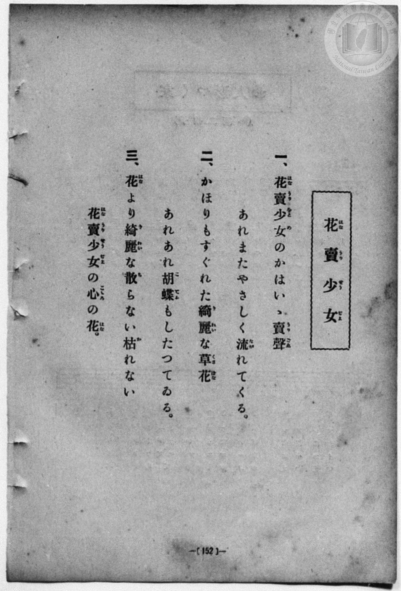
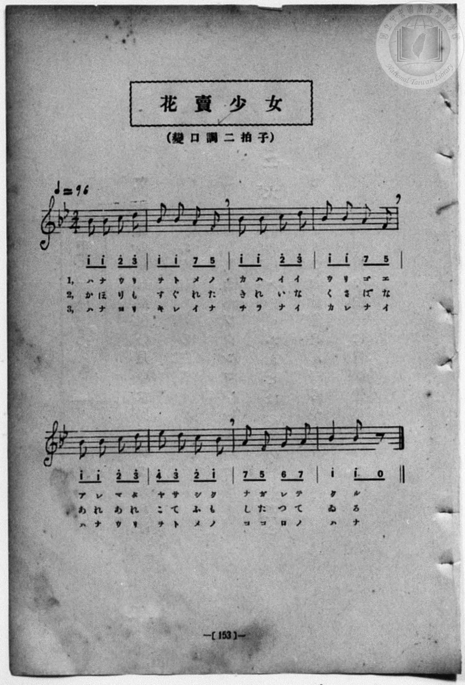

# 花賣少女

> Re:Shōka 使用 AI 協助辨識與重建樂譜，可能會有錯誤。歡迎回報。

- **NEUTRINO 歌聲合成版**：<br><audio controls src="hanauri_shojo_neutrino.mp3"></audio>
- **鋼琴伴奏版**：<br><audio controls src="hanauri_shojo.mp3"></audio>


- book: 新編 小學校・公學校 唱歌教材集（尋常科三・四學年用）
- 一條慎三郎 編《新編 小學校・公學校 唱歌教材集》（大正十二年十二月，索書號 0725-41）
- 尋常科第三、四學年用（第 152–153 頁）

## 說明

原書資訊與歌詞全文（對應 P160.jpg–P161.jpg，原書 p. 152–153，尋常科第三、四學年第 16 首）：
調性與拍號：變ロ調二拍子（B♭ 大調 2/4 拍），♩=96


## 歌詞

```text
> [!NOTE]
> **原頁歌詞全文（P160.jpg，原書 p. 152）**
>
> 一、花賣少女（はなうりをとめ）のかはいゝ賣聲（うりごゑ）
> あれまたやさしく流（なが）れてくる。
>
> 二、かほりもすぐれた綺麗（きれい）な草花（くさばな）
> あれあれ胡蝶（こてふ）もしたつてゐる。
>
> 三、花（はな）より綺麗（きれい）な散（ち）らない枯（か）れない
> 花賣少女（はなうりせうじよ）の心（こゝろ）の花（はな）。
>
> （註：P160 第三節振假名印作「花賣少女（はなうりせうじよ）」，而 P161 譜下配字作「ハナウリヲトメノ」。此處譜內 L3 依譜下實際配字記之。）
```

## ABC

```abc
X:1
T:花賣少女
M:2/4
L:1/16
Q:1/4=96
K:Bb
V:V1 name="Piano" snm="Pia"
[V:V1]
b2 b2 c'2 d'2 | b2 b2 a2 f2 | b2 b2 c'2 d'2 | b2 b2 a2 f2 |
w: 1.~は な う り | を と め の | か は い い | う り ご ゑ
w: 2.~か ほ り も | す ぐ れ た | き れ い な | く さ ば な
w: 3.~は な よ り | き れ い な | ち ら な い | か れ な い
b2 b2 c'2 d'2 | e'2 d'2 c'2 b2 | a2 f2 g2 a2 | b4 b2 z2 |
w: 1.~あ れ ま た | や さ し く | な が れ て | く る
w: 2.~あ れ あ れ | こ て ふ も | し た つ て | ゐ る
w: 3.~は な う り | を と め の | こ こ ろ の | は な
b2 b2 c'2 d'2 | b2 b2 a2 f2 | b2 b2 c'2 d'2 | b2 b2 a2 f2 |
w: 1.~は な う り | を と め の | か は い い | う り ご ゑ
w: 2.~か ほ り も | す ぐ れ た | き れ い な | く さ ば な
w: 3.~は な よ り | き れ い な | ち ら な い | か れ な い
b2 b2 c'2 d'2 | e'2 d'2 c'2 b2 | a2 f2 g2 a2 | b4 b2 z2 |
w: 1.~あ れ ま た | や さ し く | な が れ て | く る
w: 2.~あ れ あ れ | こ て ふ も | し た つ て | ゐ る
w: 3.~は な う り | を と め の | こ こ ろ の | は な
```

## TMD 檔案連結

- [主旋律 TMD 檔案](hanauri_shojo.tmd) [[在 TMD Studio 編輯](https://tmdlang.github.io/Tmd-TS/#tmd=s7IKdvYPcrWy4qpTUCpJTLdSSM7PyUlNLsnMz7MqzsjPTozPrsyvSsyML84ojTe0NDJWgqssy88pzU21Si9KTEmNN443QcgU55cWJadaFSdn5OfnxJekVpQk5edno8vHFySmp1oFGJoZIGQKivLLUvMS84C6C4oy80pSU8DaEQpSyzJTUkHSxcmJefFlqUWZaZmpKUiOSi0qBrsdYkVJUWJecXJRZgHIQwhV-UUlGflAhxdkVFplZBaX5BdlJifmxGcn5iUiFJVkpAK9l5KYmVMZn5OZloqsPTM9M8-qNA_klhKoC7S0FF50bXyxefHTDROfLt2soKXFpWirYGnGZW-r4KTDZWOkb2IHMgEUFFYKz6ZteL59hcLTDf1P1-54tmDh4-bdT1vXQNgKT6dsfLa259nUmc_mTng5u-39no6nG7qf7tjxfPnEJzs6QUpnzwYqfbpzy_MpK97v6QS77MmOhmeL5j5r7QMqedncpwA0_nFDFyn2PG7oBlm1ZPmztYuf9jY-2dUDtAHCeDan4_2enudbFj2bvePFzPkKBuZGpromhjC74c57vmYNyIUNjagu7ACKKxiaGj1qmGxoaqzwckEjWCeXvpaCLbUAl4KCwtO--SAHbm5_saLrRUc70HMvVs572rri2bR2cCD2PmvvVAClOL2sgnSgY4BMQxAT6DeIVoUCPYQ7QaJ4PAbykpnCy2XTgH55v2cWyP4Xq_Y_a1gOsrm7FxhMQNEX67oeN68FioMCsbv36doJQIc4PZq5VgEYzkBhBWCyUABKgM3oeTRzpS0wxYCMslOIVvTzD3GNhXC0tIAOBIYbmpdgfkH3ANA4YPoD6YRoByYOoNuR0ydQ8-PG9Y8bVz1ubHvc1PW4adLjxhWPm0AR87hx3ePGbrBsy-OmuUAtLxo3gdWDVTZOedw0EagMYvLjxqbHTT2PG_c9bpz_uKnlcePUx43THzf2P9sKNAqoBWh-D8hMkJplQPHHTd2PG5qQnbarB-g0sIW7wQ5petw483HjBLCO-c-37Xq5azrYpF6wSAvYgate9HYCfQMW7wfbuQEoiOEoEPmieeGLudvAKieDnbAV7BygLUBnzn_cuAQk2AS0Dt1d4OiGWQIKKbC-DqAbcTnq2dTFYMGFYJUgEaDUs3nrwYLAvAUJBZAgxAp88dE4G8RonAG0ERIlT_c3Qz3RNPdxEyjBAAXRnYfiA6DMixW7gYkQlEoUICn4-fqGZz3rnza2P53Q-7R3w5O9cx439JDgjgagxT0vGnpAuchQ4cXaOU92dL9sBabr6RCjHjf3P24GRuKyx82rHjdvetzc8bgZWOj0ATUCHfds7ZIXM6cCdT1tXa7gY6zwZN9ciBFP1y97OWs2xKAXK2Y82QmKDGh0Ul40QIGClj4XlwewjC8tygzOyM_KtwrITMzLd6gxqKkGWaRgY6EFDjoFbOUSJAAbXizsUdAwARWowKDUAQcDKANqYtEAtA5kWI2CYRwIGcUpGMfBeeYKpvhkwDp9DGuASXk9EK8C4jYFYHwAVQGzKpC3Akg3Aul1IJHGbqi6FjAGiUBUAzMrkJ4IM88IpnY3RLapCax2JhBPAPJ6gPR8sEgvlAcybxVYpB-IpwLxBogIxDxjJPc1dcDch0X3QqBIJ9QfEPcBXQFWAxUBl3m4w31XD-XhbgKmgTygWA04lM2AJFiVLogwQAn1Jqj79sHCpAnkG1AITAeHBkgNyO1ANWB1y6ChpAvkdyvEo4Q4zCwIDRKZDNYBLIvgcQAydT4QL4GZ1TQB3Szk0MabGkCmA3ETMB6gIutBZgH1gcyq5eLStVNAzgcKWPjKXAA)]
- [鋼琴伴奏 TMD 檔案](hanauri_shojo_piano.tmd) [[在 TMD Studio 編輯](https://tmdlang.github.io/Tmd-TS/#tmd=s7IKdvYPcrWy4qpTUCpJTLdSSM7PyUlNLsnMz7MqzsjPTozPrsyvSsyML84ojTe0NDJWgqssy88pzU21Si9KTEmNN443QcgU55cWJadaFSdn5OfnxJekVpQk5edno8vHFySmp1oFGJoZIGQKivLLUvMS84C6C4oy80pSU8DaEQpSyzJTUkHSxcmJefFlqUWZaZmpKUiOSi0qBrsdYkVJUWJecXJRZgHIQwhV-UUlGflAhxdkVFplZBaX5BdlJifmxGcn5iUiFCUWATWnp-am5pVYFWQm5uXHJyYn5-cWJOZlgsSUuLS0FF50bXyxefHTDROfLt38fk_Hy9kzn3V2v-ze83zClid7tjxd2v9-T6eClhaXoq2CpRmXva2Ckw6XjZG-iR3IFlCgWCk8m7bh-fYVCk839D9du-PZgoWPm3c_bV0DYSs8nbLx2dqeZ1NnPps74eXsNqAVTzd0P92x4_nyiU92dIKUzp4NVPp055bnU1YA7QK7_smOhmeL5j5r7QMqedncpwA0_nFDFyn2PG7oBlm1ZPmztYuf9jY-2dUDtAHCeDan4_2enudbFj2bvePFzPkKBuZGpromhjC74c57vmYNyIUNjagu7ACKKxiaGj1qmGxoaqzwckEjWCeXBzDoS4sygzPys_KtAkChHeThUGNQU82lAAQ2Flp2YIa-loItOlAAW9XwYmGPgoYJyH_P1zfoKADTlaFeVkG6JhYNWvpgw2oUDONAyChOwTgOzjNXMMUnA9bpY1ij8LhxPRCvAuI2hcdNXUBVj5smAXkrgHQjkF4HEmnshqprAWOQCET148YpQHoizDwjmNrdENmmJrDamUA8AcjrAdLzwSK9UB7IvFVgkX4gngrEGyAiEPOMkdzX1AFzHxbdC4EinVB_QNwHdAVYDVSEC3-47-qhPNxNwDSQBxSrAYeyGZAEq9IFEQYood4Edd8-WJg0gXwDCoHp4NAAqQG5HagGrG4ZNJR0gfxuhXiUEIeZBaFBIpPBOh43boXHAcjU-UC8BGZW0wR0s5BDG29qAJkOxE3AeICKrAeZBdQHMqsWWzbwQc4GJtBsAAwbhWjDWAhtGg9loAigqTNSiDYB0abxCA2gcAXaqWungGxttA9QA4aYERYxY7CYMhcA)]

## 分析

```text
================================================================================
📊 TMD Song Profile: [ 花賣少女 ]
================================================================================
⏱  Duration:       0:20 (20.0s), 16 measures total
🎼 Key & Tempo:    首調基準 B,, != 96.0 BPM, <2/4>
   - 分析範圍：      由實際發聲的音符與和弦推測調性；播放脈絡另行呈現
🎤 人聲音域:    F5 (MIDI 77) – D#6 (MIDI 87) [跨度: 10 個半音 / 0.8 個八度, 難度: easy]
   - 最低音:  F5 in [HanauriShojo #1 @ m.2, 0:02]
   - 最高音: D#6 in [HanauriShojo #1 @ m.6, 0:06]
🏛  結構:      HanauriShojo (10.0s) -> HanauriShojo (10.0s)
⚡ 編曲密度:        Peak 1 軌道同時演奏
🗝  調性診斷：       A# 大調（純淨自然大調，未偵測到可信轉調）
   - 風格氣質:    純淨自然大調（陽光明朗、易唱易記，無明顯調外色彩）
   - 轉調歷程:    全曲維持單一推測調性（未偵測到可信轉調）
   - 核心骨幹音:  A#, C, D, A, F
   - 調性數值:    A# 大調 [相關度: 0.82, 穩定度: High, 自然音純度: 100.0%]
   - 候選調性 (K-S): A# 大調 (0.82), A# 小調 (0.59), G 小調 (0.53)
   - 五度圈歷程:   -2 -> -2
   - 各段落調性細節:
     • [HanauriShojo #1]: A# 大調 (r: 0.82, 自然音純度: 100.0%)
     • [HanauriShojo #2]: A# 大調 (r: 0.82, 自然音純度: 100.0%)

  [ 五度圈游移軌跡 ]
               C  
         F            G  
     [Bb]*              D  
      Eb               A  
         Ab           E  
            Db       B  
               F# 
     (* = active key center)

  [ 十二半音累積音高分佈 ]
     C  : ███████                   12.9%
     C# :                            0.0%
     D  : ███████                   12.9%
     D# : ██                         3.2%
     E  :                            0.0%
     F  : █████                      9.7%
     F# :                            0.0%
     G  : ██                         3.2%
     G# :                            0.0%
     A  : ███████                   12.9%
     A# : ████████████████████████  45.2%
     B  :                            0.0%
--------------------------------------------------------------------------------
Assignment 軌道音域：
  - Piano         : F5 – D#6 (10 個半音 / 0.8 個八度, 60 個音符)
================================================================================
```


## 原書掃描頁






