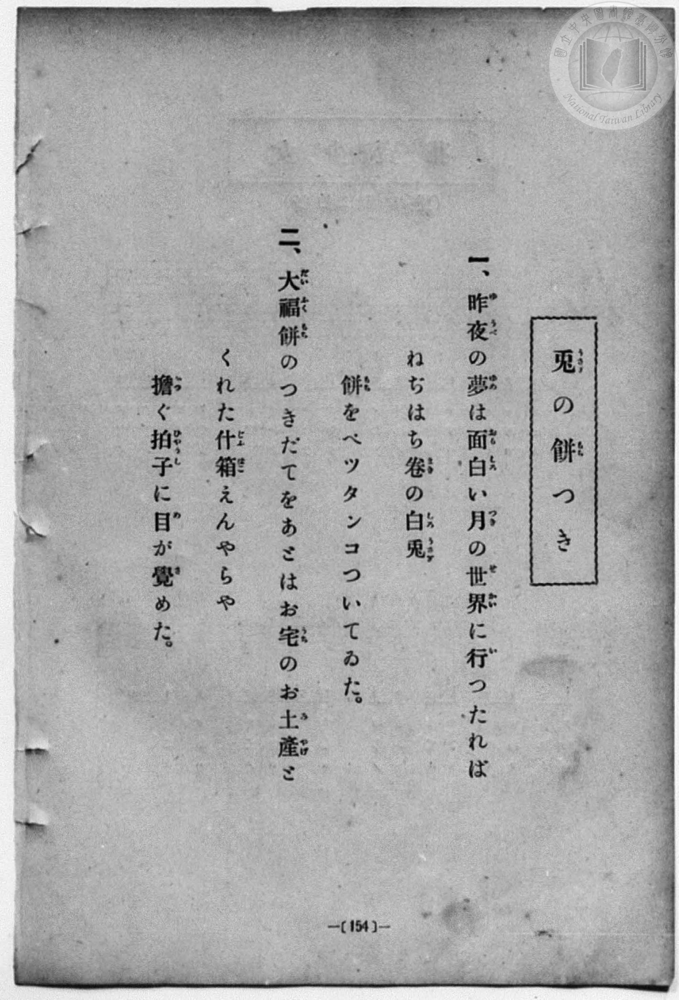
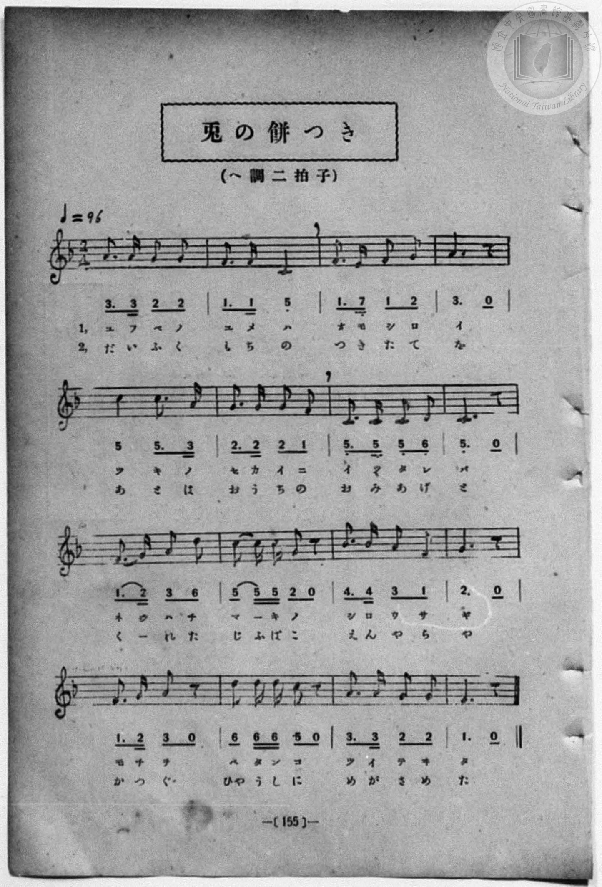

# 兎の餅つき

> Re:Shōka 使用 AI 協助辨識與重建樂譜，可能會有錯誤。歡迎回報。

<audio controls src="usagi_no_mochitsuki.mp3"></audio>

- book: 新編 小學校・公學校 唱歌教材集（尋常科三・四學年用）
- 一條慎三郎 編《新編 小學校・公學校 唱歌教材集》（大正十二年十二月，索書號 0725-41）
- 尋常科第三、四學年用（第 154–155 頁）

## 說明

原書資訊與歌詞全文（對應 P162.jpg–P163.jpg，原書 p. 154–155，尋常科第三、四學年第 17 首）：
調性與拍號：ヘ調二拍子（F 大調 2/4 拍），♩=96


## 歌詞

```text
> [!NOTE]
> **原頁歌詞全文（P162.jpg，原書 p. 154）**
>
> 一、昨夜（ゆうべ）の夢（ゆめ）は面白（おもしろ）い月（つき）の世界（せかい）に行（い）つたれば
> ねぢはち卷（まき）の白兎（しろうさぎ）
> 餅（もち）をペツタンコついてゐた。
>
> 二、大福餅（だいふくもち）のつきだてをあとはお宅（うち）のお土産（みやげ）と
> くれた什箱（じふばこ）えんやらや
> 擔（かつ）ぐ拍子（ひやうし）に目（め）が覺（さ）めた。
>
> （註：P162 第一節作「昨夜（ゆうべ）」「ペツタンコ」，第二節作「つきだて」「お土産（みやげ）」，而 P163 譜下配字分別作「ユフベ」「ペタンコ」「つきたて」「おみあげ」；又第 10 小節五線譜為一拍加兩八分音符（5 - 5 5），簡譜多印一條底線作「5 5 5」（一八分音符加兩十六分音符）。此處依五線譜與對句結構記為 5 - 5 5。）
```

## ABC

```abc
X:1
T:兎の餅つき
M:2/4
L:1/16
Q:1/4=96
K:F
V:V1 name="Piano" snm="Pia"
[V:V1]
A3 A G2 G2 | F3 F C4 | F3 E F2 G2 | A4 z4 |
w: 1.~ゆ ふ べ の | ゆ め は | お も し ろ | い
w: 2.~だ い ふ く | も ち の | つ き た て | を
c4 c3 A | G3 G G2 F2 | C3 C C2 D2 | C4 z4 |
w: 1.~つ き の | せ か い に | いつ た れ ば | _
w: 2.~あ と は | お う ち の | お み あ げ | と
F3 G A2 d2 | c2 c c G2 z2 | B3 B A2 F2 | G4 z4 |
w: 1.~ね ぢ は ち | ま _ き の | し ろ う さ | ぎ
w: 2.~く _ れ た | じ ふ ば こ | え ん や ら | や
F3 G A2 z2 | d2 d d c2 z2 | A3 A G2 G2 | F4 z4 |
w: 1.~も ち を | ぺ た ん こ | つ い て ゐ | た
w: 2.~か つ ぐ | ひや う し に | め が さ め | た
A3 A G2 G2 | F3 F C4 | F3 E F2 G2 | A4 z4 |
w: 1.~ゆ ふ べ の | ゆ め は | お も し ろ | い
w: 2.~だ い ふ く | も ち の | つ き た て | を
c4 c3 A | G3 G G2 F2 | C3 C C2 D2 | C4 z4 |
w: 1.~つ き の | せ か い に | いつ た れ ば | _
w: 2.~あ と は | お う ち の | お み あ げ | と
F3 G A2 d2 | c2 c c G2 z2 | B3 B A2 F2 | G4 z4 |
w: 1.~ね ぢ は ち | ま _ き の | し ろ う さ | ぎ
w: 2.~く _ れ た | じ ふ ば こ | え ん や ら | や
F3 G A2 z2 | d2 d d c2 z2 | A3 A G2 G2 | F4 z4 |
w: 1.~も ち を | ぺ た ん こ | つ い て ゐ | た
w: 2.~か つ ぐ | ひや う し に | め が さ め | た
```

## TMD 檔案連結

- [主旋律 TMD 檔案](usagi_no_mochitsuki.tmd) [[在 TMD Studio 編輯](https://tmdlang.github.io/Tmd-TS/#tmd=s7IKdvYPcrWy4qpTUCpJTLdSSM7PyUlNLsnMz7MqzsjPTozPrsyvSsyML84ojTe0NDJWgqssy88pzU21Si9KTEmNN443QcgU55cWJadaFSdn5OfnxJekVpQk5edno8vHFySmp1oFGJoZIWQKivLLUvMS84C6C4oy80pSU8DaEQpSyzJTUkHSxcmJefFlqUWZaZmpKUiOSi0qBrsdYkVJUWJecXJRZgHIQwhV-UUlGflAhxdkVFplZBaX5BdlJifmxGcn5iUiFJVkpAK9l5afk52TX5SqxKWlpfC0te9x47qXS1ofNy553NiroKXFpWirYGnGZW-r4MZlY6RvYgfSDvKtlcKzaRueb1-h8HRD_9O1O54tWPi4effT1jUQtsLTKRufre15NnXms7kTXs5ue7-n4-mG7qc7djxfPvHJjk6Q0tmzgUqf7tzyfMqK93s6wc56sqPh2aK5z1r7gEpeNvcpAI1_3NBFij2PG7pBVi1Z_mzt4qe9jU929QBtgDCezel4v6fn-ZZFz2bveDFzvoKBuZGprokhzG64856vWQNyYUMjqgs7gOIKhqYmjxomG5qaKrxc0AjWyaWvpWBLLcCloKDwtG8-yIGb21-s6HrR0Q703IuV8562rng2rR0ciL3P2jsVQIlKL6sgHegYINMYxAT6DaJVoUAP4U6QKB6PgbxkrvBy2TSgX97vmQWy_8Wq_c8aloNs7u4FBhNQ9HHzDKAgKAS7e5-unQB0hZsCMISBYgrABKEAFAXr7nk0c6UtMKmADLFTiFb08w9xjYVwtLSATgOGGJpnYL5AdzrQOGDCA-mEaAcmC6Crn81Y8XTJHKC2x01tjxuBaCdQHTC1Pl2yCCrYBIqSx43rX85d9HzmXpBgY9fjpqbHjdMfN4Hc-LixBZwIgOKg1A3R_mTHtOdTe8CCsx83dgPVgMVXv1gIEYRwgernP27qedy4AeKkx41rHzcuAtr1uHHh097tYJX74GYCbQfmJLAgyGqwa6c-bgSKdEK0A3MY2M1Aty0EaWma9LgZGM4tj5v2P27e_LhpM9jGlseNyx43TQBZ3dCEHB67ekCxuGT582X9UJMaF4CVb33c2I8wtXEdxKNgWaBJkx43AqVWgF3d9XQdRCPQaXDFXU_nzH8-ZTFYfP_jJqCBk8BSK2CeBhoODIP5T3Y3PF-3EaxsBtjSDY8bJ4NVAv00GaSxCeinFoiuZ5OngFUCg3YJWM0EeDp63LgJbAvQDdMhof589jpwwEBisufFsl1gZVPBgdSIERJAyRcrdgPTKCgpKYATeMPz9Q1P9s553NCDPcE09AKl0EO7ARhxPSDtu3rg2lHCDqILVwCBtb9o6AHlS2OFF2vnPNnR_bIV6MnpTzvannYshRrYvOxx89THzTMRbkByAJKN85FtBFkEirZJYFtmP-2HFEQGoPIQ5NZdU55vnwW08nnTLlDxCQzargVPW1c-bV0NtPvl_M3P1ywDOtdUQVfBVAFYHIAy6vMNC4Eani6Z9bR3A6TIfbprKtAUiDOByhRMwZZ1ACWRzYGa3Nv4tHUtkuFA_zc9W7vkxcypT_bNhbsHWIIAC6un_Uufb53wbHn3ixUzgC4EGg12B1AHNC9QXmhCgYKWPhdXaHFieqZfvm9-ckZmSXFpdqZVQGZiXr5DjUFNNcg2BRtDMy1w2lHAVm5DUxAw6ytomEADWAccqaBiShOLBqClIMNqFIyBHtMFkkZAEoRrFAzBIoYKpvFgBkLIPB7MgKiC6NNVMIApApvnY1ijAEy1YBFgBgPinWDWOrAeuExTI1BsPdx4YGqBijcB2dPBrF6oTAtUFdwxEHuMQHILoPa0gO0Csfqh9jRBZRZC7YbZswQq3gvE88GsZVAdkzDswR_au3rICW1QMgJBCG0MFAGFJihMQTQodIFqIE4AUmCWGYiAi2INcKi3IB6D0OvA3p0N5XVDAxJYUMGCFREW84G-7wGzNoAlYRZhC3FIuILUroDS65Hjr7ENHOZIMQ6X2Q_VDSwQoDIQE4gP8R2d5IQ4JOkagdOrGSQkweFvCg5xUGDWKJiA1ZiA1UDiABIr2AN7LdRHi6BpGOJjkMw-eCRA_A-JOUiKhqRpUAiBVEyFyvThCWtQWobog8QOKL2CxGeAeaC8tQGIJyPZ0wFVPxmIwdHd1AmRAfNICGtgQ4vSsIaELCjEzYAQFOYQEVzlDfaSBCkfg3MozKe7oCEC9itKGMBSNahMAOVtYDsEKgMKP1xh3Q3VtQSIQephpoGqebAEKGFPh-YfqCSwEINo6oFGKEQEu1W1XFy6dgoYxbwCLkFlLgA)]
- [鋼琴伴奏 TMD 檔案](usagi_no_mochitsuki_piano.tmd) [[在 TMD Studio 編輯](https://tmdlang.github.io/Tmd-TS/#tmd=s7IKdvYPcrWy4qpTUCpJTLdSSM7PyUlNLsnMz7MqzsjPTozPrsyvSsyML84ojTe0NDJWgqssy88pzU21Si9KTEmNN443QcgU55cWJadaFSdn5OfnxJekVpQk5edno8vHFySmp1oFGJoZIWQKivLLUvMS84C6C4oy80pSU8DaEQpSyzJTUkHSxcmJefFlqUWZaZmpKUiOSi0qBrsdYkVJUWJecXJRZgHIQwhV-UUlGflAhxdkVFplZBaX5BdlJifmxGcn5iUiFCUWATWnp-am5pVYFWQm5uXHJyYn5-cWJOZlgsSUuLS0FJ629j1uXPdySevjxiWPG3vf7-l4OXvms87ul917nk_Y8mTPlqdL-9_v6VTQ0uJStFWwNOOyt1Vw47Ix0jexA9kDChYrhWfTNjzfvkLh6Yb-p2t3PFuw8HHz7qetayBshadTNj5b2_Ns6sxncye8nN0GtOHphu6nO3Y8Xz7xyY5OkNLZs4FKn-7c8nzKCqBVYPc_2dHwbNHcZ619QCUvm_sUgMY_bugixZ7HDd0gq5Ysf7Z28dPexie7eoA2QBjP5nS839PzfMuiZ7N3vJg5X8HA3MhU18QQZjfcec_XrAG5sKER1YUdQHEFQ1OTRw2TDU1NFV4uaATr5AotTkzP9Mv3zU_OyCwpLs3OtAoABXqQh0ONQU01lwIQ2BiaadmBWfpaCrboQAFsYcOLhT0KGiYgXz5f36CjAExfxnpZBemaWDRo6YMNq1EwVtAFQmMFIyAJwjUKhmARQwXTeDADIWQeD2ZAVEH06SoYwBSBzfMxrFF43NQGFnncuBWId4JZ68B64DJNjUCx9XDjHzd2QcWbgOzpYFYvVKYFqgruGIg9RiC5BVB7WsB2gVj9UHuaoDILoXbD7FkCFe8F4vlg1jKojkkY9uAP7V095IS2KdR0CG0MFAGFJihMQTQodIFqIE4AUmCWGYiAi2INcKi3IB6D0OvA3p0N5XVDA_Jx42pYsCLCYj7Q9z1g1gawJMwibCEOCVeQ2hVQej1y_DW2gcMcKcbhMvuhuh83gkIaJAMxgfgQ39FJTohDkq4ROL2aQUISHP6m4BAHBWaNgglYjQlYDSQOILGCPbDXQn20CJqGIT4GyeyDRwLE_5CYg6RoSJoGhRBIxVSoTB-esAalZYg-SOyA0itIfAaYB8pbG4B4MpI9HVD1k4EYHN1NnRAZMI-EsAYWW5SGNSRkQSFuBoSgMIeI4CpvsJckSPkYnENhPt0FDRGwX1HCAJaqQWUCKG8_bpoAlQGFH66w7obqWgLEIPUw0zZBAxKcsKdD8w9UEliIQTT1QCMUIoLdqlqcpbwPcilvAi3kgaESrxBtGIvMMI1HEjKAOh-rPJhlGg9j4lILUWGCLIZFKVweJALRArUf6CddOwUMb0X7AJVjlzACSyhzAQA)]

## 分析

```text
================================================================================
📊 TMD Song Profile: [ 兎の餅つき ]
================================================================================
⏱  Duration:       0:40 (40.0s), 32 measures total
🎼 Key & Tempo:    首調基準 F, != 96.0 BPM, <2/4>
   - 分析範圍：      由實際發聲的音符與和弦推測調性；播放脈絡另行呈現
🎤 人聲音域:    C4 (MIDI 60) – D5 (MIDI 74) [跨度: 14 個半音 / 1.2 個八度, 難度: moderate]
   - 最低音:  C4 in [UsagiNoMochitsuki #1 @ m.2, 0:01]
   - 最高音: D5 in [UsagiNoMochitsuki #1 @ m.9, 0:10]
   - 適合: soprano, mezzo-soprano, contralto, tenor, baritone, bass
🏛  結構:      UsagiNoMochitsuki (20.0s) -> UsagiNoMochitsuki (20.0s)
⚡ 編曲密度:        Peak 1 軌道同時演奏
🗝  調性診斷：       F 調性不明確（純淨自然大調，未偵測到可信轉調）
   - 風格氣質:    純淨自然大調（陽光明朗、易唱易記，無明顯調外色彩）
   - 轉調歷程:    全曲維持單一推測調性（未偵測到可信轉調）
   - 核心骨幹音:  C, G, F, A, D
   - 調性數值:    F 調性不明確 [相關度: 0.83, 穩定度: Ambiguous, 自然音純度: 100.0%]
   - 候選調性 (K-S): F 大調 (0.83), C 大調 (0.82), A 小調 (0.60)
   - 五度圈歷程:   -1 -> -1
   - 各段落調性細節:
     • [UsagiNoMochitsuki #1]: F 調性不明確 (r: 0.83, 自然音純度: 100.0%)
     • [UsagiNoMochitsuki #2]: F 調性不明確 (r: 0.83, 自然音純度: 100.0%)

  [ 五度圈游移軌跡 ]
               C  
        [F ]*          G  
      Bb               D  
      Eb               A  
         Ab           E  
            Db       B  
               F# 
     (* = active key center)

  [ 十二半音累積音高分佈 ]
     C  : ████████████████████████  25.5%
     C# :                            0.0%
     D  : ███████                    7.5%
     D# :                            0.0%
     E  : █                          0.9%
     F  : ████████████████████      21.7%
     F# :                            0.0%
     G  : █████████████████████     22.6%
     G# :                            0.0%
     A  : █████████████████         17.9%
     A# : ████                       3.8%
     B  :                            0.0%
--------------------------------------------------------------------------------
Assignment 軌道音域：
  - Piano         : C4 – D5 (14 個半音 / 1.2 個八度, 98 個音符)
================================================================================
```


## 原書掃描頁






