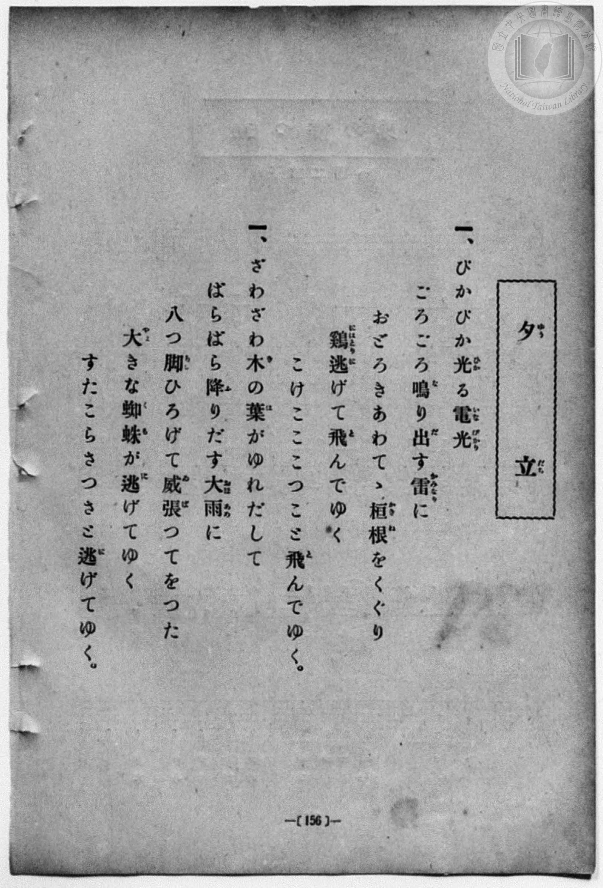
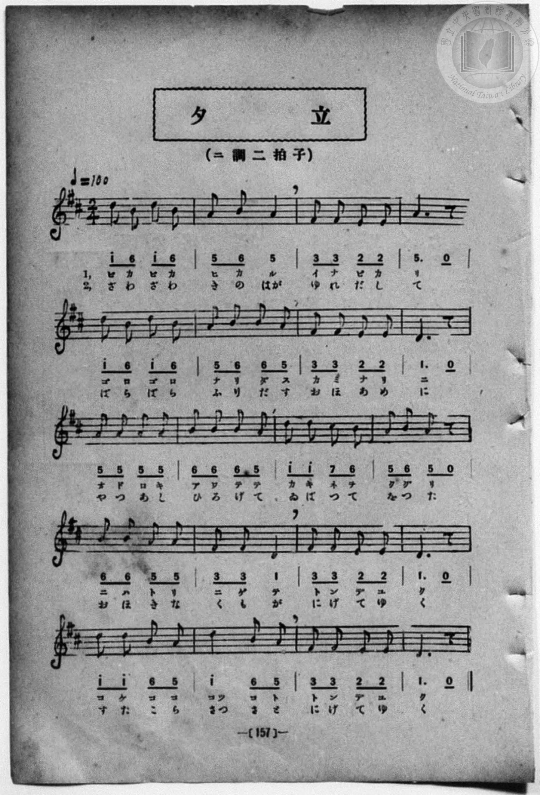

# 夕立

> Re:Shōka 使用 AI 協助辨識與重建樂譜，可能會有錯誤。歡迎回報。

- **鋼琴伴奏版**：<br><audio controls src="yudachi.mp3"></audio>
- **NEUTRINO 歌聲合成版**：<br><audio controls src="yudachi_neutrino.mp3"></audio>

- book: 新編 小學校・公學校 唱歌教材集（尋常科三・四學年用）
- 一條慎三郎 編《新編 小學校・公學校 唱歌教材集》（大正十二年十二月，索書號 0725-41）
- 尋常科第三、四學年用（第 156–157 頁）

## 說明

原書資訊與歌詞全文（對應 P164.jpg–P165.jpg，原書 p. 156–157，尋常科第三、四學年第 18 首）：
調性與拍號：ニ調二拍子（D 大調 2/4 拍），♩=100


## 歌詞

```text
> [!NOTE]
> **原頁歌詞全文（P164.jpg，原書 p. 156）**
>
> 一、ぴかぴか光（ひか）る電光（いなびかり）
> ごろごろ鳴（な）り出（だ）す雷（かみなり）に
> おどろきあわてゝ垣根（かきね）をくぐり
> 鷄（にはとり）逃（に）げて飛（と）んでゆく
> こけこここつこと飛（と）んでゆく。
>
> 二、ざわざわ木（き）の葉（は）がゆれだして
> ばらばら降（ふ）りだす大雨（おほあめ）に
> 八つ脚（あし）ひろげて威張（ゐば）つてをつた
> 大（おほ）きな蜘蛛（くも）が逃（に）げてゆく
> すたこらさつさと逃（に）げてゆく。
>
> （註：原頁 P164 第二節題號印作「一、」，對照 P165 譜下標示「1,」「2,」，實為第二節；P164 第一節作「電光（いなびかり）」，而 P165 譜下配字無濁點作「イナビカリ」或「イナピカ」之「イナビカリ」。）
```

## ABC

<div class="abc-score" data-abc-src="yudachi.abc" aria-label="五線譜載入中"></div>

[下載 ABC 原始檔](yudachi.abc)

## TMD 檔案連結

- [主旋律 TMD 檔案](yudachi.tmd) [[在 TMD Studio 編輯](https://tmdlang.github.io/Tmd-TS/#tmd=s7IKdvYPcrWy4qpTUCpJTLdSSM7PyUlNLsnMz7MqzsjPTozPrsyvSsyML84ojTe0NDJWgqssy88pzU21Si9KTEmNN443QcgU55cWJadaFSdn5OfnxJekVpQk5edno8vHFySmp1oFGJoh6Swoyi9LzUvMA-ouKMrMK0lNAWtHKEgty0xJBUkXJyfmxZelFmWmZaamIDkqtagY7HaIFSVFiXnFyUWZBSAPIVTlF5Vk5AMdXpBRaZWRWVySX5SZnJgTn52Yl4hQVJKRCvReXmJJaVEqstbM9Mw8q5LEzHKgA_LT0jKTMxNzlLi0tBSeLpn6fHW3gpYWl6KtgqGBAZe9rYILl42RvokdSDsoDKwUnk3b8Hz7CoWnG_qfrt3xbMHCx827n7augbAVnk7Z-Gxtz7OpM5_NnfBydtv7PR1PN3Q_3bHj-fKJT3Z0gpTOng1U-nTnludTVrzf0wl21pMdDc8WzX3W2gdU8rK5TwFo_OOGLlLsedzQDbJqyfJnaxc_7W18sqsHaAOE8WxOx_s9Pc-3LHo2e8eLmfMVDMyNTHVNDGF2w533fM0akAsbGlFd2AEUVzA0NXvUMNnQ1Fzh5YJGsE4ufS0FW2oBLgUFhad980EO3Nz-YkXXi452oOderJz3tHXFs2nt4EDsfdbeqQBKanpZBelAxwCZpiAm0G8QrQoFegh3gkTxeAzkJQuFl8umAf3yfs8skP0vVu1_1rAcZHN3LzCYgKKPm7uBgqAQ7O59unYC0BUuwASyHCimAEwQCkBRsO6eRzNX2oLSCsgUO4VoRT__ENdYCEdLC-g2YJCh-QbmDXS3A80DJj2QToh2YLoAOvtx45bHjd0Q8mkr0MaOx42bgGyg6sdN3S9nA1MFRLDlceOqx42bQYqbuoCyEEMeN0553NQLIV9u3gJWuQqst-tp-y4wdwGI2zjz5eztYC7Qrv0go8CGPG5cDTOn63HjSrBRQNT0uKn_ceOyx01zn85b_GzBTphGoNRasOGTHjcCFUwAGgLR_nJ7C1jN6seN6x83roAY_rKhGSIItgioZdnLxbPBIqC88bhp8uPG5Y-b2oBGwdwAFJkIJiFoCZhcgUvX44Ym5ODc1QMOzmlgt4PIZ3NAKRzoarD9615MhATkejC3B2RGUw8weB43Tgc6DeaEDY-bgLIg8uVMoEag-q2Q4ASrnAlMIi9nQ4wFiuwGBxUoz8AD8mkrMAyWvGiZBVbTBDQcLLsJHLSgMHi6ovHpHqCZHY-bJgAtAssCPQoMbKAskDEfas6S5XBbwGqA2le9mDPjxWxIYPQ_bmqCeAQzmFEDdSbQTFBAgvw1FWwFkFyBSxdqoAKVvFgBtH8WJKWDs6gCKMvt6nm-vuHlwh5gZnrau-HJ3jmPG3qgCboBGGzA_Nn7vHU5SL2pwou1c57s6H62YubzJbuAygx1gEqAtBGIBildv-x50y64oe_3zIbbsqMBKAAxHE9OgBjzoqEH2bqXrcBsPf15y8Jn-xtf7p4HMeRx05LHzV2Pm4GBsfpx8yqgxmcd05DEgbloNVDwyc5urIqBYQPNeJSXilCgoKXPxRVZmpKYnJFpFZCZmJfvUGNQUw2yQ8HGQgscDQrYSmNo-LxY2KOgYQKqRoAhpQMOAFDZo4lFA9AmkGE1CoZxCmYQokbBFEiaKugCWcZAaASEIDFdBQOQGFi9j2ENMBFtAeJuOA0S2QQRaeoG6wbGChCvAuLNMBVNXUCZeIQ5RiBV04Di_XAaJNILxOuAGFhu9ECMamoD4h6g0AIgng5WtAxuFP4A2dVDjQABBQlygBhiCZApQDeCnA6hQSJAzwO9DHH1TLAIKMD2w2VAIquxBMkGoGwnnAaJbMUwCcTbDcRNQJlGNJMIJJFOckLEFAprwKEBCQ9gAAGROVKyMUAJEZAbV0JDBRIiINeCInsZGMNCBCS_FigzCSwCkp8A9m88cqg0gZLTEogZ0DQATHBgsyfBTGsC6gOFGlgdRAQkB-LNB5uGN2SA7QVyQgYSGrD0AUoZhFLKalDiBuIVSKkA5gtI1gHJTAbSy8FpHxIqmOkElgZAYbAKFnZNoPCB5hskczHNIZBvppCZb8C5Bpo6dInKOCCPToTSk8GOBNX0QEUQoRUkhMhMcEyD9UFzDqh-Axs1FW4UvkCp5eLStVOAFr8KqExlLgA)]
- [鋼琴伴奏 TMD 檔案](yudachi_piano.tmd) [[在 TMD Studio 編輯](https://tmdlang.github.io/Tmd-TS/#tmd=s7IKdvYPcrWy4qpTUCpJTLdSSM7PyUlNLsnMz7MqzsjPTozPrsyvSsyML84ojTe0NDJWgqssy88pzU21Si9KTEmNN443QcgU55cWJadaFSdn5OfnxJekVpQk5edno8vHFySmp1oFGJoh6Swoyi9LzUvMA-ouKMrMK0lNAWtHKEgty0xJBUkXJyfmxZelFmWmZaamIDkqtagY7HaIFSVFiXnFyUWZBSAPIVTlF5Vk5AMdXpBRaZWRWVySX5SZnJgTn52Yl4hQlFgE1JyempuaV2JVkJmYlx-fmJycn1uQmJcJElPi0tJSeLpk6vPV3e_3dLycPfNZZ_fL7j3PJ2x5smfL06X97_d0KmhpcSnaKhgaGHDZ2yq4cNkY6ZvYgcwHBYeVwrNpG55vX6HwdEP_07U7ni1Y-Lh599PWNRC2wtMpG5-t7Xk2deazuRNezm4DWvF0Q_fTHTueL5_4ZEcnSOns2UClT3dueT5lBdAusLuf7Gh4tmjus9Y-oJKXzX0KQOMfN3SRYs_jBpBvni5Z_mzt4qe9jU929QBtgDCezel4v6fn-ZZFz2bveDFzvoKBuZGprokhzG64856vWQNyYUMjqgs7gOIKhqZmjxomG5qaK7xc0AjWyRVZmpKYnJFpFQAK4iAPhxqDmmouBSCwsdCyAzP0tRRs0YEC2JaGFwt7FDRMQF57vr5BRwGYmEz1sgrSNbFo0NIHG1ajYBinYAYhahRMgaSpgi6QZQyERkAIEtNVMACJgdX7GNYoPG7cAsTdcBoksgki0tQN1v24sQWIVwHxZpiKpi6gTDzCHCOQqmlA8X44DRLpBeJ1QLz-cWMPxKimNiDuAQotAOLpYEXL4EbhD5BdPdQIEFCQIAeIIZYAmQJ0I8jpEBokAvQ80MsQV88Ei4ACbD9cBiSyGkuQbADKdsJpkMhWDJNAvN1A3ASUaUQziUAS6SQnREyhsAYcGpDwAAYQEJkjJRsDlBABuXElNFQgIQJyLSiyl4ExLERA8muBMpPAIiD5CWD_xiOHShMoOS2BmAFNA8AEBzZ7Esy0JqA-UKiB1UFEQHIg3nywaXhDBpg5yQkZSGjA0gcoZRBKKatBiRuIVyClApgvIFkHJDMZSC8Hp31IqGCmE1gaAIXBKljYNYHCB5pvkMzFNIdAvplCZr4B5xpo6tAlKuOAPDoRSk8GO3IyKM50oUIrSAiRmeCYBuuD5pypMKOmwo3CFyi1aKWvD3LpawItfYHeiFeINoxFZ5jGg1im8fHwfIBfJZCFRaEJAYUo8oRMNIHJwxkoCoHe1bVTgPo42gdoGjLXCMxV5gIA)]

## 分析

```text
================================================================================
📊 TMD Song Profile: [ 夕立 ]
================================================================================
⏱  Duration:       0:48 (48.0s), 40 measures total
🎼 Key & Tempo:    首調基準 D, != 100.0 BPM, <2/4>
   - 分析範圍：      由實際發聲的音符與和弦推測調性；播放脈絡另行呈現
🎤 人聲音域:    D4 (MIDI 62) – D5 (MIDI 74) [跨度: 12 個半音 / 1.0 個八度, 難度: easy]
   - 最低音:  D4 in [Yudachi #1 @ m.8, 0:08]
   - 最高音: D5 in [Yudachi #1 @ m.1, 0:00]
   - 適合: soprano, mezzo-soprano, contralto, tenor, baritone, bass
🏛  結構:      Yudachi (24.0s) -> Yudachi (24.0s)
⚡ 編曲密度:        Peak 1 軌道同時演奏
🗝  調性診斷：       D 大調（純淨自然大調，未偵測到可信轉調）
   - 風格氣質:    純淨自然大調（陽光明朗、易唱易記，無明顯調外色彩）
   - 轉調歷程:    全曲維持單一推測調性（未偵測到可信轉調）
   - 核心骨幹音:  D, A, B, F#, E
   - 調性數值:    D 大調 [相關度: 0.84, 穩定度: Moderate, 自然音純度: 100.0%]
   - 候選調性 (K-S): D 大調 (0.84), B 小調 (0.73), A 大調 (0.71)
   - 五度圈歷程:   +2 -> +2
   - 各段落調性細節:
     • [Yudachi #1]: D 大調 (r: 0.84, 自然音純度: 100.0%)
     • [Yudachi #2]: D 大調 (r: 0.84, 自然音純度: 100.0%)

  [ 五度圈游移軌跡 ]
               C  
         F            G  
      Bb              [D ]*
      Eb               A  
         Ab           E  
            Db       B  
               F# 
     (* = active key center)

  [ 十二半音累積音高分佈 ]
     C  :                            0.0%
     C# : █                          1.4%
     D  : ████████████████████████  25.4%
     D# :                            0.0%
     E  : ███████████               11.3%
     F  :                            0.0%
     F# : █████████████             14.1%
     G  :                            0.0%
     G# :                            0.0%
     A  : ████████████████████████  25.4%
     A# :                            0.0%
     B  : █████████████████████     22.5%
--------------------------------------------------------------------------------
Assignment 軌道音域：
  - Piano         : D4 – D5 (12 個半音 / 1.0 個八度, 128 個音符)
================================================================================
```


## 原書掃描頁






