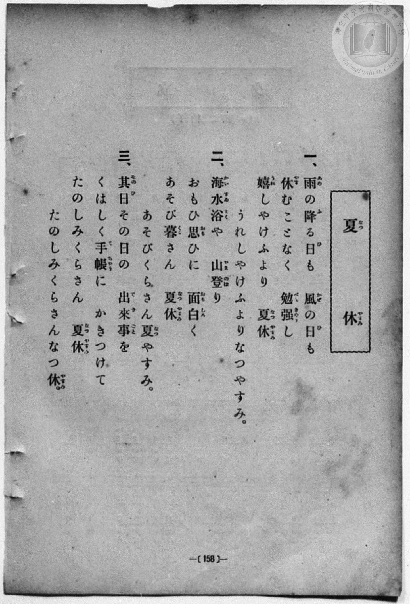
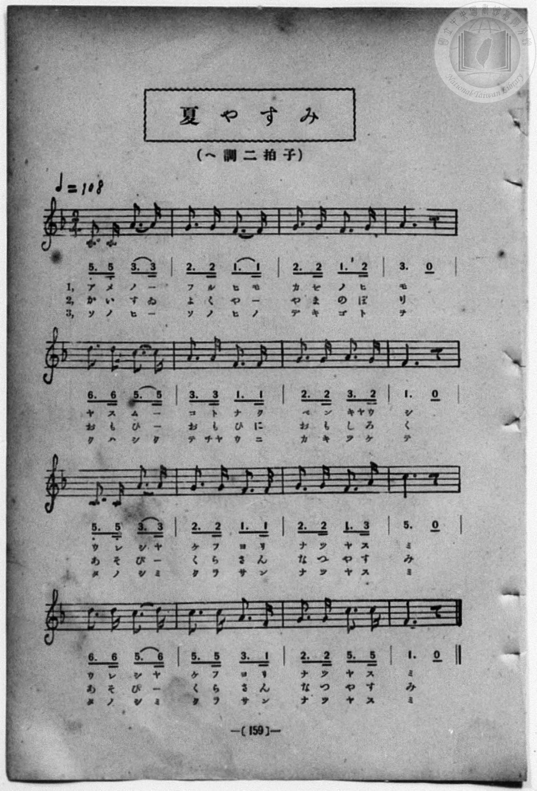

# 夏休

> Re:Shōka 使用 AI 協助辨識與重建樂譜，可能會有錯誤。歡迎回報。

- **鋼琴伴奏版**：<br><audio controls src="natsuyasumi.mp3"></audio>
- **NEUTRINO 歌聲合成版**：<br><audio controls src="natsuyasumi_neutrino.mp3"></audio>

- book: 新編 小學校・公學校 唱歌教材集（尋常科三・四學年用）
- 一條慎三郎 編《新編 小學校・公學校 唱歌教材集》（大正十二年十二月，索書號 0725-41）
- 尋常科第三、四學年用（第 158–159 頁）
- 文部省《尋常小學唱歌》（明治四十四年）

## 說明

原書資訊與歌詞全文（對應 P166.jpg–P167.jpg，原書 p. 158–159，尋常科第三、四學年第 19 首）：
調性與拍號：ヘ調二拍子（F 大調 2/4 拍），♩=108
註：原頁 P166 標題作「夏休」，P167 標題作「夏やすみ」。


## 歌詞

```text
> [!NOTE]
> **原頁歌詞全文（P166.jpg，原書 p. 158）**
>
> 一、雨（あめ）の降（ふ）る日（ひ）も　風（かぜ）の日（ひ）も
> 休（やす）むことなく　勉強（べんきやう）し
> 嬉（うれ）しやけふより　夏休（なつやすみ）
> うれしやけふよりなつやすみ。
>
> 二、海水浴（かいすゐよく）や　山登（やまのぼ）り
> おもひ思（おも）ひに　面白（おもしろ）く
> あそび暮（くら）さん　夏休（なつやすみ）
> あそびくらさん夏（なつ）やすみ。
>
> 三、其日（そのひ）その日の　出來事（できごと）を
> くはしく手帳（てちやう）に　かきつけて
> たのしみくらさん　夏休（なつやすみ）
> たのしみくらさんなつ休（やすみ）。
```

## ABC

<div class="abc-score" data-abc-src="natsuyasumi.abc" aria-label="五線譜載入中"></div>

[下載 ABC 原始檔](natsuyasumi.abc)

## TMD 檔案連結

- [主旋律 TMD 檔案](natsuyasumi.tmd) [[在 TMD Studio 編輯](https://tmdlang.github.io/Tmd-TS/#tmd=s7IKdvYPcrWy4qpTUCpJTLdSSM7PyUlNLsnMz7MqzsjPTozPrsyvSsyML84ojTe0NDJWgqssy88pzU21Si9KTEmNN443QcgU55cWJadaFSdn5OfnxJekVpQk5edno8vHFySmp1oFGJqZIWQKivLLUvMS84C6C4oy80pSU8DaEQpSyzJTUkHSxcmJefFlqUWZaZmpKUiOSi0qBrsdYkVJUWJecXJRZgHIQwhV-UUlGflAhxdkVFplZBaX5BdlJifmxGcn5iUiFJVkpAK9B_VETmZaKrL-zPTMPKvc_LykUmAoKXFpaSk8XdL_ZM9EBS0tLkVbBUMDCy57WwU3LhsjfRM7kD5QCFgpPJu24fn2FQpPN_Q_Xbvj2YKFj5t3P21dA2ErPJ2y8dnanmdTZz6bO-Hl7Lb3ezqebuh-umPH8-UTn-zoBCmdPRuo9OnOLc-nrHi_pxPsnic7Gp4tmvustQ-o5GVznwLQ-McNXaTY87ihG2TVkuXP1i5-2tv4ZFcP0AYI49mcjvd7ep5vWfRs9o4XM-crGJgbmeqaGMLshjvv-Zo1IBc2NKK6sAMormBoavGoYbKhqaXCywWNMJ3PprW_bF7xfE4j0K0QUyBOhTgN4qJnM_qebQL7uRds7s4tYN1c-loKttQCXAoKCk_75oO8t7n9xYquFx3tQPtfrJz3tHUF0I3gKOh91t6pAEqmelkF6UCvAJnmICYwZCBaFQr0EL4EieIJFlCAAENi2TSgX97vmQWy_8Wq_c8aloNs7u4FBjJQ9HHzDKAgKPy7e5-unQB0hRsweS0HiikAk5MCUBSsu-fRzJW2oJQGMmTFbqBGoHuAgQx2rMKzFTNfLux5snfO44YeSNp83ADU1wNyPrrk46aWx40zHzfuByp53NDEBTLRTiFa0c8_xDUWwtHSghiOFjywcEEPDKADgTkBpBOiHZhMgeHwcjYoVTxubHrcBEoKjxvXvZwJdBNQZCuI29T9bPpSMHcTmNv0uKHh5SKIlu7HjXMgWtDUQM3fMxEkCPYHWLzhcePkx40rHjeuetzYDzTnaXfn0z3bwRp3Pm4CSvWCFQNzGdDM6RBDnq4BhipQQdvjph6IOFjNRKDzHjcBDe8CmQMOSrAyoMlL4CEHVA8xBKIdi15U9aBgRgqeXcBE3_hs6_ZnG7Y82wpM6BAfg9U2TQAZ0NgP9lYLyAkbNz6fCYxuiHf3AYPkceMesGwXzAldoMBr3PSsYS7YKBAX7KFNjxtXgwJ17qLnM_fCpcCOBaUpoC0wE4CCcx83bn42ax1YGTCJAMMGqGAqKPCICgaoCRC9EI1AXXAtUO9gCwxInmndBotpoDFAL4LjG8wGioNEgK5o3_VkX9uTXaDi4nHjclCkNk4BxjrY7Ekwh_Q_blwP8mJj_7NOYM7cDFa87HHjQqQUAAoVcJADTVgCjrZlMO3zwbYDte9H9gpxYYBDL1g9cpKF6IIGA-XFGhQoaOlzcfkllhSXViYWl-ZmWgVkJublO9QY1FSD7FGwMTTTAoe5ArYyVQFcfDW8WNijoGECqkqer2_QAZUt4NJPE4sGoHUgw2oUTOMVdIEQSBmDGcZAMSMwy0jBEEwbYogYAUUgqnUVDKB0Ddg8H8MaUHICiwALDiB7HUweyN4KFe8GsjdB2U1gmW4Ir3EOXAdIBVAGKA_RD3Em3B4jZF0tQDwTat4EsK4OqEw_kN2CcAGUDcyJSPbsAct0YbfHGGTPXKjKdXB3Q_yDKQ5ig2SWQ3m9QDwFyl4BtmcShj34Y3VXDzmxagY220zBFEybwuPLGEucQmRAcQqRwxqn8JCbCWQ3IIXBZLjvgFkFHuogmZ3QGJkMCgeEAW1gyenYgxscrZCoAEU9anBjigMLAwwZiMnAQhIs04_dHnC0QuSAJQ5CF9Tpy6A8ULEDdTTCMliqA8XtEih7IpI24uN2Rye9cixIDSQtYM-xIP-BAq0HKQBbwH6aCPXhVkSuAuYVkAwstpegpA6QzH7sgQ6OXGjZAMw7wAoHJo-IjKZOIHsqlD2ZPHvAkTsfqhKUN2GRu5-KNuGNWWAjkvJcawaPM1NoTCPHKyJn48m1o_FKsk21XFy6dgpINbECJleZCwA)]
- [鋼琴伴奏 TMD 檔案](natsuyasumi_piano.tmd) [[在 TMD Studio 編輯](https://tmdlang.github.io/Tmd-TS/#tmd=s7IKdvYPcrWy4qpTUCpJTLdSSM7PyUlNLsnMz7MqzsjPTozPrsyvSsyML84ojTe0NDJWgqssy88pzU21Si9KTEmNN443QcgU55cWJadaFSdn5OfnxJekVpQk5edno8vHFySmp1oFGJqZIWQKivLLUvMS84C6C4oy80pSU8DaEQpSyzJTUkHSxcmJefFlqUWZaZmpKUiOSi0qBrsdYkVJUWJecXJRZgHIQwhV-UUlGflAhxdkVFplZBaX5BdlJifmxGcn5iUiFCUWATWnp-am5pVYFWQm5uXHJyYn5-cWJOZlgsSUuLS0FJ4u6X-yZ-L7PR0vZ8981tn9snvP8wlbnuzZ8nRp__s9nQpaWlyKtgqGBhZc9rYKblw2RvomdiDzQcFhpfBs2obn21coPN3Q_3TtjmcLFj5u3v20dQ2ErfB0ysZna3ueTZ35bO6El7PbgFY83dD9dMeO58snPtnRCVI6ezZQ6dOdW55PWQG0C-zuJzsani2a-6y1D6jkZXOfAtD4xw1dpNjzuKEbZNWS5c_WLn7a2_hkVw_QBgjj2ZyO93t6nm9Z9Gz2jhcz5ysYmBuZ6poYwuyGO-_5mjUgFzY0orqwAyiuYGhq8ahhsqGppcLLBY0wnc-mtb9sXvF8TiPQrRBTIE6FOA3iomcz-p5tAvu5F2zuzi1g3Vx-iSXFpZWJxaW5mVYBoEgK8nCoMaip5lIAAhtDMy07MEtfS8EWHSiAHdrwYmGPgoYJKHSer2_QUQCmR3O9rIJ0TSwatPTBhtUomMYr6AIhkDIGM4yBYkZglpGCIZg2xBAxAopAVOsqGEDpGrB5PoY1Co8bm8Aij5sagex1MHkgeytUvBvI3gRlN4FluiG8xjlwHSAVQBmgPEQ_xJlwe4yQdbUA8UyoeRPAujqgMv1AdgvCBVD248Z9SPbsAct0YbfHGGTPXKjKdXB3Q_yDKQ5ig2SWQ3m9QDwFyl4BtmcShj34Y3VXDzmxagY220zBFEybwuPLGEucQmRAcQqRwxqn8JCbCWQ3IIXBZLjvHjeugoc6SGYnNEYmg8IBYUAbWHI69uAGRyskKkBRjxrcmOKPG1djyEBMftzUC5bpx24POFohco8b1yN0QZ2-DMpbCHE2yNEIy2CpDhS3S6DsiUjaiI_bHZ30yrEgNZC0gD3HgvwHCrQepABsAftpItSHWxG5CphXQDKw2F6CkjpAMvuxBzo4cqFlAzDvPG7cDJNHREZTJ5A9FcqeTJ494MidD1UJypuwyN1PRZvwxiywWKc815rB48wUGtPI8YrI2Xhy7Wi8kmxTLZaK2Ae5IjaB1sPAgI9XiDaMBedITBZQ0gDq8BoFEyRRJIWm8RgqqWsm0DO6dgpI_on2AapEFzLCFDIGCylzAQA)]

## 分析

```text
================================================================================
📊 TMD Song Profile: [ 夏休 ]
================================================================================
⏱  Duration:       0:35 (35.6s), 32 measures total
🎼 Key & Tempo:    首調基準 F, != 108.0 BPM, <2/4>
   - 分析範圍：      由實際發聲的音符與和弦推測調性；播放脈絡另行呈現
🎤 人聲音域:    C4 (MIDI 60) – D5 (MIDI 74) [跨度: 14 個半音 / 1.2 個八度, 難度: moderate]
   - 最低音:  C4 in [Natsuyasumi #1 @ m.1, 0:00]
   - 最高音: D5 in [Natsuyasumi #1 @ m.5, 0:04]
   - 適合: soprano, mezzo-soprano, contralto, tenor, baritone, bass
🏛  結構:      Natsuyasumi (17.8s) -> Natsuyasumi (17.8s)
⚡ 編曲密度:        Peak 1 軌道同時演奏
🗝  調性診斷：       F 調性不明確（純淨自然大調，未偵測到可信轉調）
   - 風格氣質:    純淨自然大調（陽光明朗、易唱易記，無明顯調外色彩）
   - 轉調歷程:    全曲維持單一推測調性（未偵測到可信轉調）
   - 核心骨幹音:  C, F, G, A, D
   - 調性數值:    F 調性不明確 [相關度: 0.81, 穩定度: Ambiguous, 自然音純度: 100.0%]
   - 候選調性 (K-S): F 大調 (0.81), C 大調 (0.79), A 小調 (0.62)
   - 五度圈歷程:   -1 -> -1
   - 各段落調性細節:
     • [Natsuyasumi #1]: F 調性不明確 (r: 0.81, 自然音純度: 100.0%)
     • [Natsuyasumi #2]: F 調性不明確 (r: 0.81, 自然音純度: 100.0%)

  [ 五度圈游移軌跡 ]
               C  
        [F ]*          G  
      Bb               D  
      Eb               A  
         Ab           E  
            Db       B  
               F# 
     (* = active key center)

  [ 十二半音累積音高分佈 ]
     C  : ████████████████████████  24.1%
     C# :                            0.0%
     D  : ████████                   8.0%
     D# :                            0.0%
     E  :                            0.0%
     F  : ████████████████████████  24.1%
     F# :                            0.0%
     G  : ███████████████████████   23.2%
     G# :                            0.0%
     A  : ████████████████████      20.5%
     A# :                            0.0%
     B  :                            0.0%
--------------------------------------------------------------------------------
Assignment 軌道音域：
  - Piano         : C4 – D5 (14 個半音 / 1.2 個八度, 104 個音符)
================================================================================
```


## 原書掃描頁






