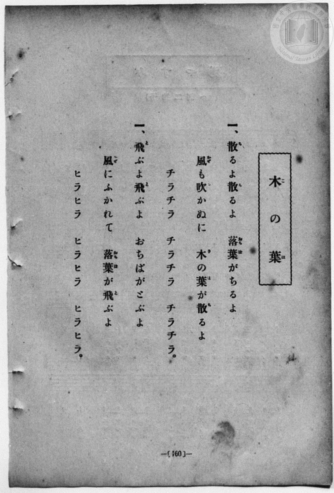
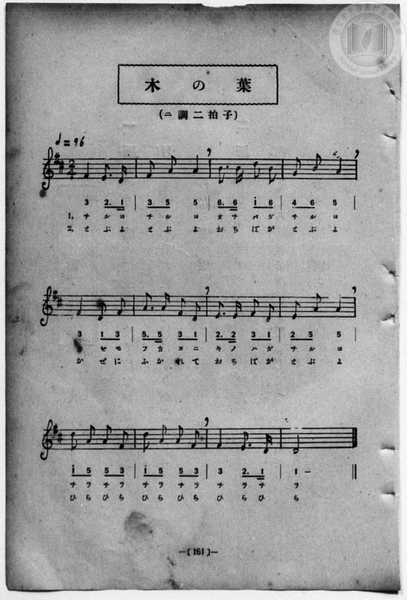

# 木の葉

> Re:Shōka 使用 AI 協助辨識與重建樂譜，可能會有錯誤。歡迎回報。

- **鋼琴伴奏版**：<br><audio controls src="ki_no_ha.mp3"></audio>
- **NEUTRINO 歌聲合成版**：<br><audio controls src="ki_no_ha_neutrino.mp3"></audio>

- 詞：吉丸一昌
- 曲：梁田貞
- book: 新編 小學校・公學校 唱歌教材集（尋常科三・四學年用）
- 一條慎三郎 編《新編 小學校・公學校 唱歌教材集》（大正十二年十二月，索書號 0725-41）
- 尋常科第三、四學年用（第 160–161 頁）

## 說明

原書資訊與歌詞全文（對應 P168.jpg–P169.jpg，原書 p. 160–161，尋常科第三、四學年第 20 首）：
調性與拍號：ニ調二拍子（D 大調 2/4 拍），♩=96


## 歌詞

```text
> [!NOTE]
> **原頁歌詞全文（P168.jpg，原書 p. 160）**
>
> 一、散（ち）るよ散（ち）るよ　落葉（おちば）がちるよ
> 風（かぜ）も吹（ふ）かぬに　木（き）の葉（は）が散（ち）るよ
> チラチラ　チラチラ　チラチラ。
>
> 二、飛（と）ぶよ飛（と）ぶよ　おちばがとぶよ
> 風（かぜ）にふかれて　落葉（おちば）が飛（と）ぶよ
> ヒラヒラ　ヒラヒラ　ヒラヒラ。
>
> （註：原頁 P168 第二節題號印作「一、」，對照 P169 譜下標示「1,」「2,」，實為第二節。）
```

## ABC

```abc
X:1
T:木の葉
C:曲：梁田貞
M:2/4
L:1/16
Q:1/4=96
K:D
V:V1 name="Piano" snm="Pia"
[V:V1]
F4 E3 D | F2 A2 A4 | B3 B d2 B2 | G2 B2 A4 |
w: 1.~ち る よ | ち る よ | お ち ば が | ち る よ
w: 2.~と ぶ よ | と ぶ よ | お ち ば が | と ぶ よ
F4 D2 F2 | A3 A F2 D2 | E3 E F2 D2 | E2 A2 A4 |
w: 1.~か ぜ も | ふ か ぬ に | き の は が | ち る よ
w: 2.~か ぜ に | ふ か れ て | お ち ば が | と ぶ よ
d2 A2 A2 F2 | d2 A2 A2 F2 | F4 E3 D | D8 |
w: 1.~ち ら ち ら | ち ら ち ら | ち ら ち | ら
w: 2.~ひ ら ひ ら | ひ ら ひ ら | ひ ら ひ | ら
F4 E3 D | F2 A2 A4 | B3 B d2 B2 | G2 B2 A4 |
w: 1.~ち る よ | ち る よ | お ち ば が | ち る よ
w: 2.~と ぶ よ | と ぶ よ | お ち ば が | と ぶ よ
F4 D2 F2 | A3 A F2 D2 | E3 E F2 D2 | E2 A2 A4 |
w: 1.~か ぜ も | ふ か ぬ に | き の は が | ち る よ
w: 2.~か ぜ に | ふ か れ て | お ち ば が | と ぶ よ
d2 A2 A2 F2 | d2 A2 A2 F2 | F4 E3 D | D8 |
w: 1.~ち ら ち ら | ち ら ち ら | ち ら ち | ら
w: 2.~ひ ら ひ ら | ひ ら ひ ら | ひ ら ひ | ら
```

## TMD 檔案連結

- [主旋律 TMD 檔案](ki_no_ha.tmd) [[在 TMD Studio 編輯](https://tmdlang.github.io/Tmd-TS/#tmd=s7IKdvYPcrWy4qpTUCpJTLdSSM7PyUlNLsnMz7MqzsjPTozPrsyvSsyML84ojTe0NDJWgqssy88pzU21Si9KTEmNN443QcgU55cWJadaFSdn5OfnxJekVpQk5edno8vHFySmp1oFGJpZIGQKivLLUvMS84C6C4oy80pSU8DaEQpSyzJTUkHSxcmJefFlqUWZaZmpKUiOSi0qBrsdYkVJUWJecXJRZgHIQwhV-UUlGflAhxdkVFplZBaX5BdlJifmxGcn5iUiFJVkpAK9l5dYUlqUiqw1Mz0zz6okMRMYPMBQyS9PjM9NzMzLScwDOkNLS-HZnBWPG9e9mNipoKXFpWirYGnGZW-r4MJlY6RvYgcyBhQWVgrPpm14vn2FwtMN_U_X7ni2YOHj5t1PW9dA2ApPp2x8trbn2dSZz-ZOeDm77f2ejqcbup_u2PF8-cQnOzpBSmfPBip9unPL8ykr3u_pBDvvyY6GZ4vmPmvtAyp52dynADT-cUMXKfY8bugGWbVk-bO1i5_2Nj7Z1QO0AcJ4Nqfj_Z6e51sWPZu948XM-QoG5kamuiaGMLvhznu-Zg3IhQ2NqC7sAIorGJoZPGqYbGhmqPByQSNM54uV897vmfV0QueTHTtAPpjRAxZ-NnsTUPjZosbnUza82DRPiYtLX0vBllqAS0FB4WnffJBfNre_WNH1oqMdGA5ApzxtXfFsWjs4vHuftXcqgFKnXlZBOtDdQKYliAkMBohWhQI9hJdAonjCAOh7IwOFl8umAb0N9BfI_her9j9rWA6yubsXGKJA0cfN3UBBUGB39z5dOwHoChcFYGQAxRSAaUcBKArW3fNo5kpbYKoCGWKnEK3o5x_iGgvhaGkBnQYMXDTPwHyB7nSgccA0CtIJ0Q4Mf6Crn01dDNTzuHEhUPpxU_fjpg5MkccNDS8m7AUmcrB4F1DqceMGkGxjD4gNVgMx8-UiUPQ_bux-3DgHrL3p6YSdYJGtYPVA8TWPG1cDDQRmHLA4yJeQHATmrocYi-kGiPmPmxsfN6-Ekg0NeLlNyH7d1QP068vFs8GmgjLR48ZtQFMxRUDGwLwI9h8wf4PEsfsP6JXGrSBuE1DlMjzhhGkRzEOTwE4GkyAf4OEiewho2IsVu0F5CZwEwElXAZQUd_U8X9_wcmEPMJE97d3wZO-cxw09kJh-3AAMa2C67X3euhyk3lLhxdo5T3Z0P1sx8_mSXUBlhjpAJUDaCESDlK5f9rxpF9xQoAOAjgdZT3mWhAIFLX0uLu9Mv3yPRKuAzMS8fIcag5pqkBUKNoZmWmC_KmArCsBe3dHwYmGPgoYJqLgDuk8H7ClQytfEogFoE8iwGgVjBV0wNAKThlARUygGwRoFMzBtpmAYB6ZAQiZQFlwR2DgfwxoFYDRDxYApFUp3AHVAxCFiIBGY4cCUAVEFlAemDzCrByqDVQfEJiOQ_AqYTY3bUGwCiUPEiLUJqw5wKYM7wHf1UBLghkAMYtdAw9AUzAOJ1kAjwwhNBCVSkMIbEsog988Bu78J6qetUNFuIF4DZq2GyvRCZdYB8XqSQhzNLriJSHY1gcwCZn-ahPmOTnLCHJxwYcEHCXQsQphZART2yBA9lT9u6oT6DcYmLANJpyARiDxQHMrDsAcc4puQTEOwCcug2rMJhz21XFy6dgqQMkcBhaXMBQA)]
- [鋼琴伴奏 TMD 檔案](ki_no_ha_piano.tmd) [[在 TMD Studio 編輯](https://tmdlang.github.io/Tmd-TS/#tmd=s7IKdvYPcrWy4qpTUCpJTLdSSM7PyUlNLsnMz7MqzsjPTozPrsyvSsyML84ojTe0NDJWgqssy88pzU21Si9KTEmNN443QcgU55cWJadaFSdn5OfnxJekVpQk5edno8vHFySmp1oFGJpZIGQKivLLUvMS84C6C4oy80pSU8DaEQpSyzJTUkHSxcmJefFlqUWZaZmpKUiOSi0qBrsdYkVJUWJecXJRZgHIQwhV-UUlGflAhxdkVFplZBaX5BdlJifmxGcn5iUiFCUWATWnp-am5pVYFWQm5uXHJyYn5-cWJOZlgsSUuLS0FJ7NWfG4cd2LiZ3v93S8nD3zWWf3y-49zydsebJny9Ol_e_3dCpoaXEp2ipYmnHZ2yq4cNkY6ZvYgWwABYiVwrNpG55vX6HwdEP_07U7ni1Y-Lh599PWNRC2wtMpG5-t7Xk2deazuRNezm4D2vB0Q_fTHTueL5_4ZEcnSOns2UClT3dueT5lBdAqsMuf7Gh4tmjus9Y-oJKXzX0KQOMfN3SRYs_jhm6QVUuWP1u7-Glv45NdPUAbIIxnczre7-l5vmXRs9k7Xsycr2BgbmSqa2IIsxvuvOdr1oBc2NCI6sIOoLiCoZnBo4bJhmaGCi8XNMJ0vlg57_2eWU8ndD7ZsQPkgxk9YOFnszcBhZ8tanw-ZcOLTfOUuLi8M_3yPRKtAkDREeThUGNQU82lAAQ2hmZadmCWvpaCLTpQADuo4cXCHgUNE1AoPF_foKMATHmWelkF6ZpYNGjpgw2rUTBW0AVDIzBpCBUxhWIQrFEwA9NmCoZxYAokZAJlwRWBjfMxrFF43LgQKva4qRtKdwB1QMQhYiARmOGPG7sgqoDyjxs3gFk9UBmsOiA2GYHkV8BsatyGYhNIHCJGrE1YdXDhD_BdPZQEuCEQg9g10DA0BfNAojXQyDBCE0GJFKTwhoQyyP1zwO5vgvppK1S0G4jXgFmroTK9UJl1QLyepBBHswtuIpJdTSCzHjcuo0mY7-gkJ8zBCRcWfJBAxyKEmRVAYY8M0VP546ZOqN9gbMIykHQKEoHIA8WhPAx7wCG-Cck0BJuwDKo9m3DYU4ta5PggFzkm0BIHGA7xCtGGscgMEyDDBFkEp0rTeBSWaTxxioFCBhD36dopQJwY7QOUQeIZgXnKXAA)]

## 分析

```text
================================================================================
📊 TMD Song Profile: [ 木の葉 ]
================================================================================
⏱  Duration:       0:30 (30.0s), 24 measures total
🎼 Key & Tempo:    首調基準 D, != 96.0 BPM, <2/4>
   - 分析範圍：      由實際發聲的音符與和弦推測調性；播放脈絡另行呈現
🎤 人聲音域:    D4 (MIDI 62) – D5 (MIDI 74) [跨度: 12 個半音 / 1.0 個八度, 難度: easy]
   - 最低音:  D4 in [KiNoHa #1 @ m.1, 0:01]
   - 最高音: D5 in [KiNoHa #1 @ m.3, 0:03]
   - 適合: soprano, mezzo-soprano, contralto, tenor, baritone, bass
🏛  結構:      KiNoHa (15.0s) -> KiNoHa (15.0s)
⚡ 編曲密度:        Peak 1 軌道同時演奏
🗝  調性診斷：       D 大調（純淨自然大調，未偵測到可信轉調）
   - 風格氣質:    純淨自然大調（陽光明朗、易唱易記，無明顯調外色彩）
   - 轉調歷程:    全曲維持單一推測調性（未偵測到可信轉調）
   - 核心骨幹音:  A, F#, D, E, B
   - 調性數值:    D 大調 [相關度: 0.86, 穩定度: Moderate, 自然音純度: 100.0%]
   - 候選調性 (K-S): D 大調 (0.86), F# 小調 (0.75), A 大調 (0.74)
   - 五度圈歷程:   +2 -> +2
   - 各段落調性細節:
     • [KiNoHa #1]: D 大調 (r: 0.86, 自然音純度: 100.0%)
     • [KiNoHa #2]: D 大調 (r: 0.86, 自然音純度: 100.0%)

  [ 五度圈游移軌跡 ]
               C  
         F            G  
      Bb              [D ]*
      Eb               A  
         Ab           E  
            Db       B  
               F# 
     (* = active key center)

  [ 十二半音累積音高分佈 ]
     C  :                            0.0%
     C# :                            0.0%
     D  : ███████████████████       22.9%
     D# :                            0.0%
     E  : ██████████                12.5%
     F  :                            0.0%
     F# : █████████████████████     25.0%
     G  : ██                         2.1%
     G# :                            0.0%
     A  : ████████████████████████  29.2%
     A# :                            0.0%
     B  : ███████                    8.3%
--------------------------------------------------------------------------------
Assignment 軌道音域：
  - Piano         : D4 – D5 (12 個半音 / 1.0 個八度, 78 個音符)
================================================================================
```


## 原書掃描頁






