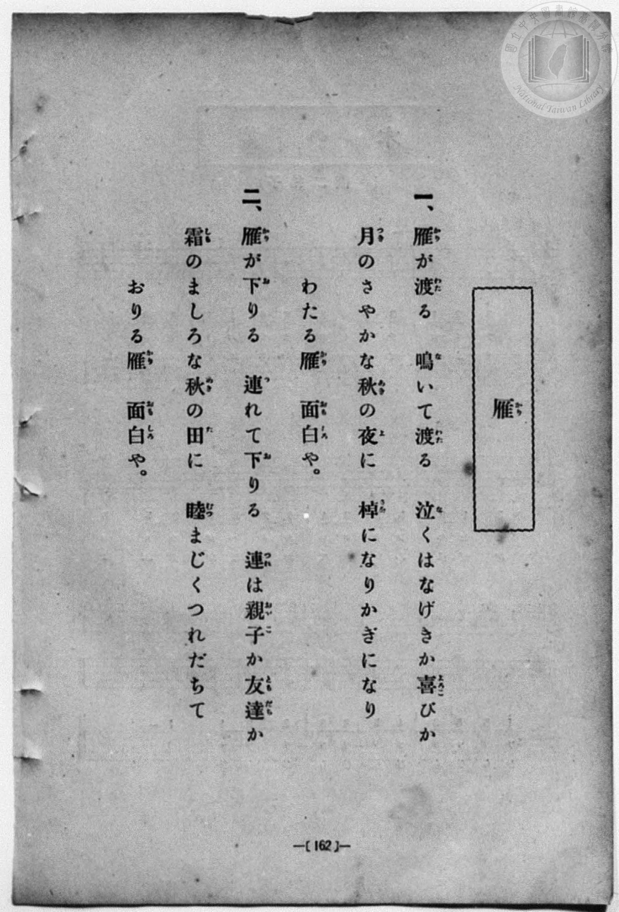
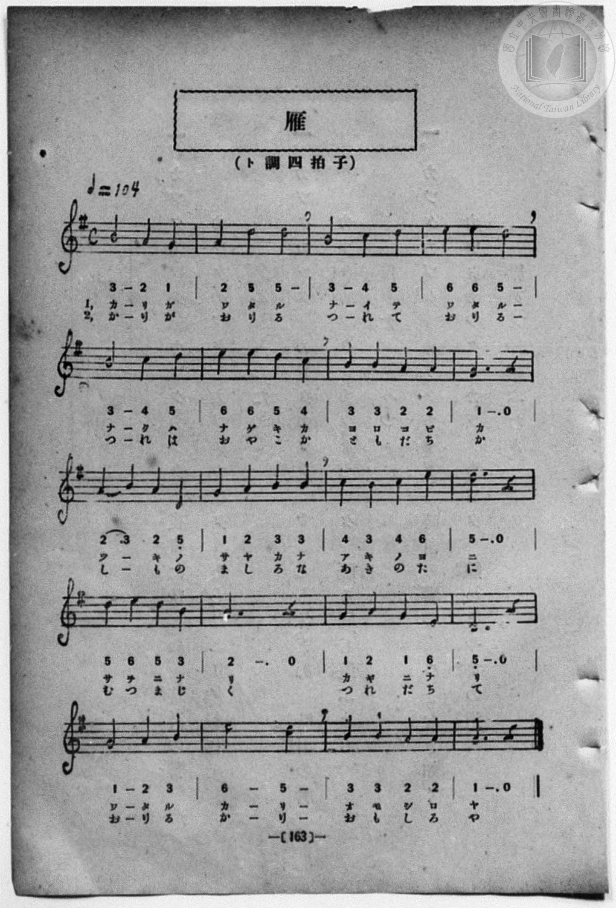

# 雁

> Re:Shōka 使用 AI 協助辨識與重建樂譜，可能會有錯誤。歡迎回報。

- **鋼琴伴奏版**：<br><audio controls src="kari.mp3"></audio>
- **NEUTRINO 歌聲合成版**：<br><audio controls src="kari_neutrino.mp3"></audio>

- book: 新編 小學校・公學校 唱歌教材集（尋常科三・四學年用）
- 一條慎三郎 編《新編 小學校・公學校 唱歌教材集》（大正十二年十二月，索書號 0725-41）
- 尋常科第三、四學年用（第 162–163 頁）
- 文部省《尋常小學唱歌》（明治四十四年）

## 說明

原書資訊與歌詞全文（對應 P170.jpg–P171.jpg，原書 p. 162–163，尋常科第三、四學年第 21 首）：
調性與拍號：ト調四拍子（G 大調 4/4 拍），♩=104


## 歌詞

```text
> [!NOTE]
> **原頁歌詞全文（P170.jpg，原書 p. 162）**
>
> 一、雁（かり）が渡（わた）る　鳴（な）いて渡（わた）る
> 泣（な）くはなげきか喜（よろこ）びか
> 月（つき）のさやかな秋（あき）の夜（よ）に
> 棹（さを）になりかぎになり
> わたる雁（かり）　面白（おもしろ）や。
>
> 二、雁（かり）が下（お）りる　連（つ）れて下（お）りる
> 連（つれ）は親子（おやこ）か友達（ともだち）か
> 霜（しも）のましろな秋（あき）の田（た）に
> 睦（むつ）まじくつれだちて
> おりる雁（かり）　面白（おもしろ）や。
```

## ABC

```abc
X:1
T:雁
M:4/4
L:1/16
Q:1/4=104
K:G
V:V1 name="Piano" snm="Pia"
[V:V1]
B8 A4 G4 | A4 d4 d8 | B8 c4 d4 | e4 e4 d8 |
w: 1.~か り が | わ た る | な い て | わ た る
w: 2.~か り が | お り る | つ れ て | お り る
B8 c4 d4 | e4 e4 d4 c4 | B4 B4 A4 A4 | G12 z4 |
w: 1.~な く は | な げ き か | よ ろ こ び | か
w: 2.~つ れ は | お や こ か | と も だ ち | か
A4 B4 A4 D4 | G4 A4 B4 B4 | c4 B4 c4 e4 | d12 z4 |
w: 1.~つ _ き の | さ や か な | あ き の よ | に
w: 2.~し _ も の | ま し ろ な | あ き の た | に
d4 e4 d4 B4 | A12 z4 | G4 A4 G4 E4 | D12 z4 |
w: 1.~さ を に な | り | か ぎ に な | り
w: 2.~む つ ま じ | く | つ れ だ ち | て
G8 A4 B4 | e8 d8 | B4 B4 A4 A4 | G12 z4 |
w: 1.~わ た る | か り | お も し ろ | や
w: 2.~お り る | か り | お も し ろ | や
B8 A4 G4 | A4 d4 d8 | B8 c4 d4 | e4 e4 d8 |
w: 1.~か り が | わ た る | な い て | わ た る
w: 2.~か り が | お り る | つ れ て | お り る
B8 c4 d4 | e4 e4 d4 c4 | B4 B4 A4 A4 | G12 z4 |
w: 1.~な く は | な げ き か | よ ろ こ び | か
w: 2.~つ れ は | お や こ か | と も だ ち | か
A4 B4 A4 D4 | G4 A4 B4 B4 | c4 B4 c4 e4 | d12 z4 |
w: 1.~つ _ き の | さ や か な | あ き の よ | に
w: 2.~し _ も の | ま し ろ な | あ き の た | に
d4 e4 d4 B4 | A12 z4 | G4 A4 G4 E4 | D12 z4 |
w: 1.~さ を に な | り | か ぎ に な | り
w: 2.~む つ ま じ | く | つ れ だ ち | て
G8 A4 B4 | e8 d8 | B4 B4 A4 A4 | G12 z4 |
w: 1.~わ た る | か り | お も し ろ | や
w: 2.~お り る | か り | お も し ろ | や
```

## TMD 檔案連結

- [主旋律 TMD 檔案](kari.tmd) [[在 TMD Studio 編輯](https://tmdlang.github.io/Tmd-TS/#tmd=s7IKdvYPcrWy4qpTUCpJTLdSSM7PyUlNLsnMz7MqzsjPTozPrsyvSsyML84ojTe0NDJWgqssy88pzU21Si9KTEmNN443QcgU55cWJadaFSdn5OfnxJekVpQk5edno8vHFySmp1oFGJobIGQKivLLUvMS84C6C4oy80pSU8DaEQpSyzJTUkHSxcmJefFlqUWZaZmpKUiOSi0qBrsdYkVJUWJecXJRZgHIQwhV-UUlGflAhxdkVFplZBaX5BdlJifmxGcn5iUiFJVkpAK9l5iXmZuYg6w1Mz0zzyo3Py-pFBhASlxaWgovZzcqaGlxKdoqGBqYcNnbKrhz2Zjom9iBNIF8bqXwbNqG59tXKDzd0P907Y5nCxY-bt79tHUNhK3wdMrGZ2t7nk2d-WzuhJez297v6Xi6ofvpjh3Pl098sqMTpHT2bKDSpzu3PJ-y4v2eTrBjnuxoeLZo7rPWPqCSl819CkDjHzd0kWLP44ZukFVLlj9bu_hpb-OTXT1AGyCMZ3M63u_peb5l0bPZO17MnK9gYG5kqmtiCLMb7rzna9aAXNjQiOrCDqC4gqGZ0aOGyYZmxgovFzTCdD6b1v6yecXzOY1At0JMgTgV4jSIi57N6Hu2CeznXrC5O7eAdXPpaynYUgtwKSgoPO2bD_Le5vYXK7pedLQD7X-xct7T1hVAN4KjoPdZe6cCKHnqZRWkA70CZBqCmMCQgWhVKNBD-BIkiidYgAFiZKjwctk0oF_e75kFsv_Fqv3PGpaDbO7uBQYyUPRxcwdQEKgJKPJ07QSgK9wVgPEDFFMAJicFoChYd8-jmSttQSkNZIqdQrSin3-IayyEo6UFdBswwNF8A_MGutuB5gETLkgnRDswVQGdDUzPQD2PG7sfN3UBVTxu7Hm2YyFIpKn_cSPQoZ2Pm7ofNzS83AyMGaCyVWA1LY8bl2Eqgxj7bPNiJJVA2fVA9uPGSY8be4G2PJ02B6wLiIDcyWA1m4HiUL2gtAjUuwSoGCy17nHj1MdNQOu6gYY8Xw5KMo8bm-CyT5dATQNzV0MNWbwTrAyocRJEHOSApi6wIX1wLkQxxP1Ax6OHA9DLcxc9n7kXLNj1uAlo6XSgm8E-bXnc0IQckLuAqRlLQD7ZAXEvmAu0HxKQDZDgWQIW7AEGJKYyiLFwlUBlYAPXv1i2CpJUwC4Chgok_Lqf9ne_bJwCFl8BdumCx43AyAFJQY2aAw4nkA-aYOG6D-IhrOH6fMoGsAg4YmHh-nzuMnBgN0AdDzJhBjiGQS6EWAr0DjRcQS4E-YWccKU8z0OBgpY-F5d3YlGmVUBmYl6-Q41BTTXIAgUbEy1w5ClgK2gUwHm64cXCHgUNE1D5-nx9gw6odAAXCZpYNACtARlWo2CsoKtgpGAIZBkpmAKhLlTMBMiuUTADQrAYWLWPYQ0wmLqBfGDQAFk9QBXA5AhkzQfSIHGQ_CqQfGMLEC_DlIeYY4TFnEYgC8SDm7MELN8DMwdVHly64A6LXT3khgWyv03AYsbAkDECsgyBsroKBihhAfEryIfroX4HlhtA3Av2H8j3HUAM4k0G4s1gNSD36yrEo4QFwq8Qc0D-BIUgSBfYnMYVQJEmIL0AiBeimUMgXXSSExZGYH-bAo0HehzEMQayTICkCTBoasCJAj0wwJ4Ae30d2IFToZ7oBgcMSATkAYg8KGBAIquxBMZ0cGCA1ELM2QcWgwQjhjnApIVqDt7AANZe5ASGKTg5gELACOZvcKgYKpiBAggYSpihAfI9KCmshrkamHihboSGSR92WURINDWAQxUSAjPA-vqRzADKgJMMIkksIzJJ7JpCTiiAMgAoJYCyhy68qMCTPYBZH5QiIJkfOctDMjgokYNiEhK3IPUtWFIDSDUs45NmRi0Xl66dAqgwVUCilbkA)]
- [鋼琴伴奏 TMD 檔案](kari_piano.tmd) [[在 TMD Studio 編輯](https://tmdlang.github.io/Tmd-TS/#tmd=s7IKdvYPcrWy4qpTUCpJTLdSSM7PyUlNLsnMz7MqzsjPTozPrsyvSsyML84ojTe0NDJWgqssy88pzU21Si9KTEmNN443QcgU55cWJadaFSdn5OfnxJekVpQk5edno8vHFySmp1oFGJobIGQKivLLUvMS84C6C4oy80pSU8DaEQpSyzJTUkHSxcmJefFlqUWZaZmpKUiOSi0qBrsdYkVJUWJecXJRZgHIQwhV-UUlGflAhxdkVFplZBaX5BdlJifmxGcn5iUiFCUWATWnp-am5pVYFWQm5uXHJyYn5-cWJOZlgsSUuLS0FF7Obny_p-Pl7JnPOrtfdu95PmHLkz1bni7tf7-nU0FLi0vRVsHQwITL3lbBncvGRN_EDmQ4KCysFJ5N2_B8-wqFpxv6n67d8WzBwsfNu5-2roGwFZ5O2fhsbc-zqTOfzZ3wcnYb0IqnG7qf7tjxfPnEJzs6QUpnzwYqfbpzy_MpK4B2gR39ZEfDs0Vzn7X2AZW8bO5TABr_uKGLFHseN3SDrFqy_NnaxU97G5_s6gHaAGE8m9Pxfk_P8y2Lns3e8WLmfAUDcyNTXRNDmN1w5z1fswbkwoZGVBd2AMUVDM2MHjVMNjQzVni5ABhsEJ3PprW_bF7xfE4j0K0QUyBOhTgN4qJnM_qebQL7uRds7s4tYN1c3olFmVYBoKgJ8nCoMaip5lIAAhsTLTswQ19LwRYdKIAd2PBiYY-ChgkoVJ6vb9BRACZCQ72sgnRNLBq09MGG1SgYK-gqGCkYAllGCqZAqAsVMwGyaxTMgBAsBlbtY1ij8LixG8h_3NQFZPUAVTxu6gey5gNpkDhIfhVIvrEFiJdhykPMMcJiTiOQBeLBzVkClu-BmYMqz4U_LHb1kBsWyP42AYsZA0PGCMgyBMrqKhighAXEryAfrof6_XHjJCDuBfsP5PsOIAbxJgPxZrAakPt1FeJRwgLhV4g5IH-CQhCkC2xO4wqgSBOQXgDEC9HMIZAuOskJCyOwv02BxgM9DuIYA1kmQNIEGDQ14ESBHhhgT4C9vg7swKlQT3SDAwYkAvIARB4UMCCR1VgCYzo4MEBqIebsA4tBghHDHGDSQjUHb2AA8xk5gWEKTg6gEDCC-RscKoYKZqAAAoYSZmiAfA9KCqthrgYmXqgboWHSh10WERJNDeBQhYTADLC-fiQzgDLgJINIEsuITBK7ppATCqAMAEoJoOyhCy8q8GQPYNYHpQhI5kfO8pAMDkrkoJiExC1IfQuW1ABSDcv4pJlRi1yW-mArS4GujleINowFxiCEBsUlkGUaHwuTwaLEBMgwQSjAZRKSMiCFqgBkAVwESMGCDcl-rOoQJgMZUAtQTEYYhK4JxWBwAkYzBV0BEf7CCB9s_gJGg66dAigmon2AonC2EZitzAUA)]

## 分析

```text
================================================================================
📊 TMD Song Profile: [ 雁 ]
================================================================================
⏱  Duration:       1:32 (92.3s), 40 measures total
🎼 Key & Tempo:    首調基準 G, != 104.0 BPM, <4/4>
   - 分析範圍：      由實際發聲的音符與和弦推測調性；播放脈絡另行呈現
🎤 人聲音域:    D4 (MIDI 62) – E5 (MIDI 76) [跨度: 14 個半音 / 1.2 個八度, 難度: moderate]
   - 最低音:  D4 in [Kari #1 @ m.9, 0:20]
   - 最高音: E5 in [Kari #1 @ m.4, 0:06]
   - 適合: soprano, mezzo-soprano, contralto, tenor, baritone, bass
🏛  結構:      Kari (46.2s) -> Kari (46.2s)
⚡ 編曲密度:        Peak 1 軌道同時演奏
🗝  調性診斷：       G 大調（純淨自然大調，未偵測到可信轉調）
   - 風格氣質:    純淨自然大調（陽光明朗、易唱易記，無明顯調外色彩）
   - 轉調歷程:    全曲維持單一推測調性（未偵測到可信轉調）
   - 核心骨幹音:  D, B, A, G, E
   - 調性數值:    G 大調 [相關度: 0.80, 穩定度: Moderate, 自然音純度: 100.0%]
   - 候選調性 (K-S): G 大調 (0.80), D 大調 (0.77), B 小調 (0.67)
   - 五度圈歷程:   +1 -> +1
   - 各段落調性細節:
     • [Kari #1]: G 大調 (r: 0.80, 自然音純度: 100.0%)
     • [Kari #2]: G 大調 (r: 0.80, 自然音純度: 100.0%)

  [ 五度圈游移軌跡 ]
               C  
         F           [G ]*
      Bb               D  
      Eb               A  
         Ab           E  
            Db       B  
               F# 
     (* = active key center)

  [ 十二半音累積音高分佈 ]
     C  : ██████                     6.7%
     C# :                            0.0%
     D  : ████████████████████████  25.3%
     D# :                            0.0%
     E  : ███████████               12.0%
     F  :                            0.0%
     F# :                            0.0%
     G  : ███████████████           16.0%
     G# :                            0.0%
     A  : ██████████████████        18.7%
     A# :                            0.0%
     B  : ████████████████████      21.3%
--------------------------------------------------------------------------------
Assignment 軌道音域：
  - Piano         : D4 – E5 (14 個半音 / 1.2 個八度, 114 個音符)
================================================================================
```


## 原書掃描頁






