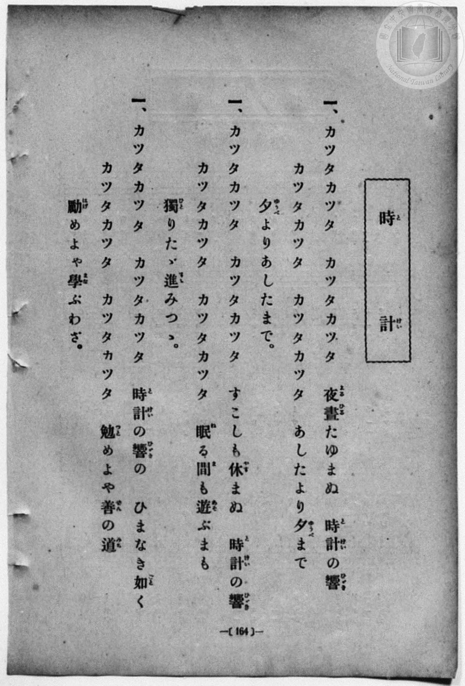
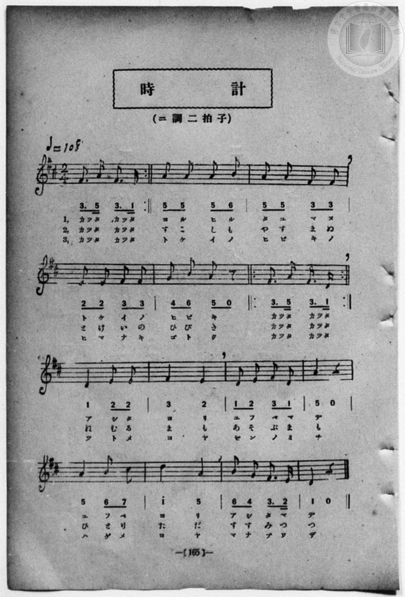

# 時計

> Re:Shōka 使用 AI 協助辨識與重建樂譜，可能會有錯誤。歡迎回報。

<audio controls src="tokei.mp3"></audio>

- book: 新編 小學校・公學校 唱歌教材集（尋常科三・四學年用）
- 一條慎三郎 編《新編 小學校・公學校 唱歌教材集》（大正十二年十二月，索書號 0725-41）
- 尋常科第三、四學年用（第 164–165 頁）
- 文部省《尋常小學唱歌》（明治四十四年）

## 說明

原書資訊與歌詞全文（對應 P172.jpg–P173.jpg，原書 p. 164–165，尋常科第三、四學年第 22 首）：
調性與拍號：ニ調二拍子（D 大調 2/4 拍），♩=108


## 歌詞

```text
> [!NOTE]
> **原頁歌詞全文（P172.jpg，原書 p. 164）**
>
> 一、カツタカツタ　カツタカツタ
> 夜晝（よるひる）たゆまぬ　時計（とけい）の響（ひゞき）
> カツタカツタ　カツタカツタ
> あしたより夕（ゆうべ）まで
> 夕（ゆうべ）よりあしたまで。
>
> 二、カツタカツタ　カツタカツタ
> すこしも休（やす）まぬ　時計（とけい）の響（ひゞき）
> カツタカツタ　カツタカツタ
> 眠（ねむ）る間（ま）も遊（あそ）ぶまも
> 獨（ひと）りたゞ進（すゝ）みつゝ。
>
> 三、カツタカツタ　カツタカツタ
> 時計（とけい）の響（ひゞき）の　ひまなき如（ごと）く
> カツタカツタ　カツタカツタ
> 勉（つと）めよや善（ぜん）の道（みち）
> 勵（はげ）めよや學（まな）ぶわざ。
>
> （註：原頁 P172 第二、三節題號皆印作「一、」，對照 P173 譜下標示「1,」「2,」「3,」，實為第一、二、三節；P173 第 1 小節及第 6 小節前後皆印有反覆記號 `:|`，對照 P172 歌詞每處唱兩次「カツタカツタ　カツタカツタ」，故於譜中展開為 2 小節。）
```

## ABC

```abc
X:1
T:時計
M:2/4
L:1/16
Q:1/4=108
K:D
V:V1 name="Piano" snm="Pia"
[V:V1]
F3 A F3 D | F3 A F3 D | A2 A2 A2 B2 | A2 A2 F2 F2 |
w: かっ た かっ た | かっ た かっ た | よ る ひ る | た ゆ ま ぬ
E2 E2 F2 F2 | G2 B2 A2 z2 | F3 A F3 D | F3 A F3 D |
w: と け い の | ひ び き | かっ た かっ た | かっ た かっ た
D4 E2 E2 | F4 E4 | D2 E2 F2 D2 | A2 z6 |
w: あ し た | よ り | ゆ ふ べ ま | で
A4 B2 c2 | d4 A4 | B2 G2 F3 E | D2 z6 |
w: ゆ ふ べ | よ り | あ し た ま | で
F3 A F3 D | F3 A F3 D | A2 A2 A2 B2 | A2 A2 F2 F2 |
w: かっ た かっ た | かっ た かっ た | す こ し も | や す ま ぬ
E2 E2 F2 F2 | G2 B2 A2 z2 | F3 A F3 D | F3 A F3 D |
w: と け い の | ひ び き | かっ た かっ た | かっ た かっ た
D4 E2 E2 | F4 E4 | D2 E2 F2 D2 | A2 z6 |
w: ね む る | ま も | あ そ ぶ ま | も
A4 B2 c2 | d4 A4 | B2 G2 F3 E | D2 z6 |
w: ひ と り | た だ | す す み つ | つ
F3 A F3 D | F3 A F3 D | A2 A2 A2 B2 | A2 A2 F2 F2 |
w: かっ た かっ た | かっ た かっ た | と け い の | ひ び き の
E2 E2 F2 F2 | G2 B2 A2 z2 | F3 A F3 D | F3 A F3 D |
w: ひ ま な き | ご と く | かっ た かっ た | かっ た かっ た
D4 E2 E2 | F4 E4 | D2 E2 F2 D2 | A2 z6 |
w: つ と め | よ や | ぜ ん の み | ち
A4 B2 c2 | d4 A4 | B2 G2 F3 E | D2 z6 |
w: は げ め | よ や | ま な ぶ わ | ざ
```

## TMD 檔案連結

- [主旋律 TMD 檔案](tokei.tmd) [[在 TMD Studio 編輯](https://tmdlang.github.io/Tmd-TS/#tmd=s7IKdvYPcrWy4qpTUCpJTLdSSM7PyUlNLsnMz7MqzsjPTozPrsyvSsyML84ojTe0NDJWgqssy88pzU21Si9KTEmNN443QcgU55cWJadaFSdn5OfnxJekVpQk5edno8vHFySmp1oFGJobIWQKivLLUvMS84C6C4oy80pSU8DaEQpSyzJTUkHSxcmJefFlqUWZaZmpKUiOSi0qBrsdYkVJUWJecXJRZgHIQwhV-UUlGflAhxdkVFplZBaX5BdlJifmxGcn5iUiFJVkpAK9l5KYmVMZn5OZlqrEpaWl8Gxm04sVHQpaWlyKtgqGBhZc9rYKLlw2RvomdiCNIH9aKTybtuH59hUKTzf0P12749mChY-bdz9tXQNhKzydsvHZ2p5nU2c-mzvh5ey293s6nm7ofrpjx_PlE5_s6AQpnT0bqPTpzi3Pp6x4v6cT7KAnOxqeLZr7rLUPqORlc58C0PjHDV2k2PO4oRtk1ZLlz9Yuftrb-GRXD9AGCOPZnI73e3qeb1n0bPaOFzPnKxiYG5nqmhjC7IY77_maNSAXNjSiurADKK5gaGbyqGGyoZmpwssFjTCdz6a1v2xe8XxOI9CtEFMgToU4DeKiZzP6nm0C-7kXbO7OLWDdXPpaCrbUAlwKCgpP--aDvLe5_cWKrhcd7UD7X6yc97R1BdCN4CjofdbeqQBKjHpZBelArwCZxiAmMGQgWhUK9BC-BIniCRZggBgZKbxcNg3ol_d7ZoHsf7Fq_7OG5SCbu3uBgQwUfdzcDRQEhX9379O1E4CucFEAxg9QTAGYnBSAomDdPY9mrrQFpTSQKXYK0Yp-_iGusRCOlhbQbcAAR_MNzBvobgeaB0y4IJ0Q7cBUBXT246bVj5tbHjftRzAaGjAFIVqeLpnzbOZcoB2Pm4Co-3HjJiAJNPdx4_zHTW2PG_c9blwD1A7JJiBljSseN0583NgCVrPu5fz9YEGgrnmPG0EehBhLkhseNzY9bpwOthHohq6nS6aC3QO0HYh2gi0COmM5zMEYsmBdCEPAih83NCEHzC5g6iQtYB43znzcOBlkZFPTkz0TwXa2AAVhzqF5qDyfswBsyNrHTQ1gX3a_nDYZLLIPzG162dgF5gL9DYxAoL3bQA5rgvhb4XkvKCuD3NAIKnXAIQQM4HkvGzaBxWc-boLo2v-4cQmQjRZg4AxAknuJDwygIMgckNOAAbkKKPh0WRNYzRSoYxv7yQiwp93A3AU0ZAnMx0D3gyLt6TSgS4Dicx43AcMP7KRGSEACvb4QHjlPu7eCBdc_bpyEon3tDkioA50KDeam_seN01ADDKjkxYrdwFIAkoHBJY8CqCQBpzxgcD5f3_ByYQ-wpHg-q-1p74Yne-c8buiBZtgGYKgAy5_e563LQRqNFV6snfNkR_ezFTOfL9kFVGaoA1QCpI2gtDGIBmlZv-x50y5weQUyB9mu93tmg00Cl-WgGgUo9rS_C8Q1g3E7e5_u64E459mczqf9vS-Wtb1YMQNUZSRY1SSguMlIAVImPVvf_2LmVGCB_7R15bM1C4GOITKOIC5-NrX12bQ9YO-tfbpx6stp3UAPKBhBXQQMUmh0UF5HQIGClj4XV0h-dmqmVUBmYl6-Q41BTTXIBgUbQzMtcOQpYKuawHG3o-HFwh4FDdQwBIUSxOkK2nCX64DjDVRGa2IxC-gGkD01CsYKukBoCqUNsYqYgvkQbAbECBGQGhCuAZvmY1gDLKSAJfZisFZg7kbnEiHf1AFiN3WDRTbB2SCd88G8NrDMPjC5BmG3ERXsbpwJZk8Gk9PBtjVB7G5qAYtB5DHsNqaG3SvA7IlgEmLbOqi_waHQuBlM9iJkwNU17qSyqwecVGDpAZg0ULIaUqohMqkYAS0FYXikK5hAEwQoKRiARYhITkhJhXgvx0PFKQpkpIQyIDaDkwnEfEgSWgW3BSQzBcyDuKyfajYTKE86wYnEhLRCwxBsPiQ1gDAsliE8EISogaUWEBtSaIBSCQwipwRQNoO4GZztwFkdVhiAxZu64CbDioCtYHInPDxB5iyHhhuaHeA4Xws3qwFMwooVkF6IOMwVMBcBmzFgchuyHWBVWOwAx-4SuD_A8djUiOEPUGqD2TEHLAIpbkDpD1j_Q2UWYtiBNx6B_QJy4hEUIyAIysPmYJsN46BCMKkasCQoo0Oi2AgatTgiEhw1kABARA_OiIQGMiLKIcFMKCJBWQg5kEEmwuoHiPgCJDsgZTaEBAUviF4ClgFFFq6IXA83axLYDvwRiZydQYkFJN8PlpmGYUctF5eunQK4ARDtYxirgOAYIXOMwRxlLgA)]
- [鋼琴伴奏 TMD 檔案](tokei_piano.tmd) [[在 TMD Studio 編輯](https://tmdlang.github.io/Tmd-TS/#tmd=s7IKdvYPcrWy4qpTUCpJTLdSSM7PyUlNLsnMz7MqzsjPTozPrsyvSsyML84ojTe0NDJWgqssy88pzU21Si9KTEmNN443QcgU55cWJadaFSdn5OfnxJekVpQk5edno8vHFySmp1oFGJobIWQKivLLUvMS84C6C4oy80pSU8DaEQpSyzJTUkHSxcmJefFlqUWZaZmpKUiOSi0qBrsdYkVJUWJecXJRZgHIQwhV-UUlGflAhxdkVFplZBaX5BdlJifmxGcn5iUiFCUWATWnp-am5pVYFWQm5uXHJyYn5-cWJOZlgsSUuLS0FJ7NbHqxouP9no6Xs2c-6-x-2b3n-YQtT_Zsebq0__2eTgUtLS5FWwVDAwsue1sFFy4bI30TO5D5oOCwUng2bcPz7SsUnm7of7p2x7MFCx83737augbCVng6ZeOztT3Pps58NnfCy9ltQCuebuh-umPH8-UTn-zoBCmdPRuo9OnOLc-nrADaBXb3kx0NzxbNfdbaB1TysrlPAWj844YuUux53NANsmrJ8mdrFz_tbXyyqwdoA4TxbA7Qoz3Ptyx6NnvHi5nzFQzMjUx1TQxhdsOd93zNGpALGxpRXdgBFFcwNDN51DDZ0MxU4eWCRpjOZ9PaXzaveD6nEehWiCkQp0KcBnHRsxl9zzaB_dwLNnfnFrBurpD87NRMqwBQ9AR5ONQY1FRzKQCBjaGZlh2Ypa-lYIsOFMBObHixsEdBA-wqUNg8X9_wtL_3xbK2pxunvpzWraCtYAQV1lEAJlJjvayCdE0sZmnpg-2pUTBW0AVCUyhtiFXEFMyHYDMgRoiA1IBwDdg0H8MahceN3Y8bF4O1Pm6cj84lQr6pA8Ru6gaLbIKzQTrng3ltYJl9YHINwm4jKtjdOBPMngwmp4Nta4LY3dQCFoPIY9htTA27V4DZE8EkxLZ1UH-DQ6FxM5jsRchw4U8qu3rASQWWHoBJA5RqzLCkGiKTihHQUhCGR7qCCTRBgJKCAViEiOSElFSI93I8VJyiQEZKKANiMziZQMyHJKFVcFtAMlPAPIjL-qlmM4HypBOcSExIKzQMweZDUgMIw2IZwgNBiBpYagGxIYUGKJXAIHJKAGUziJvB2Q6c1WGFAVi8qQtuMqwI2Aomd8LDE2TOcmi4odkBjvO1cLMawCSsWAHphYjDXAFz0ePGuWByG7IdYFVY7ADH7hK4P8Dx2NSI4Q9QaoPZMQcsAiluQOnvceN-qMxCDDvwxiOwciEnHkExAoKgPGwOttkwDioEk6oBS4IyOiSKjaBRiyMiwVEDCQBE9OCMSGggI6IcEsyEIhKUhZADGWQirH6AiC9AsgNSZkNIUPCC6CVgGVBk4YrI9XCzJoHtwB-RyNkZlFhA8v1gmWkYdtSi1P8-yPW_CbT6BwZxvEK0YSw6wwRZBBaH8TAVJvFgDhbNSIaaxsMkECywWpBWAxxKYcYjhEAqgR7RtVMA-yXaB6gEwTFC5hiDOcpcAA)]

## 分析

```text
================================================================================
📊 TMD Song Profile: [ 時計 ]
================================================================================
⏱  Duration:       0:53 (53.3s), 48 measures total
🎼 Key & Tempo:    首調基準 D, != 108.0 BPM, <2/4>
   - 分析範圍：      由實際發聲的音符與和弦推測調性；播放脈絡另行呈現
🎤 人聲音域:    D4 (MIDI 62) – D5 (MIDI 74) [跨度: 12 個半音 / 1.0 個八度, 難度: easy]
   - 最低音:  D4 in [Tokei[L1] #1 @ m.1, 0:00]
   - 最高音: D5 in [Tokei[L1] #1 @ m.14, 0:14]
   - 適合: soprano, mezzo-soprano, contralto, tenor, baritone, bass
🏛  結構:      Tokei[L1] (17.8s) -> Tokei[L2] (17.8s) -> Tokei[L3] (17.8s)
⚡ 編曲密度:        Peak 1 軌道同時演奏
🗝  調性診斷：       F# 小調（純淨自然小調，未偵測到可信轉調）
   - 風格氣質:    純淨自然小調（陰鬱抒情、旋律集中，無明顯調外色彩）
   - 轉調歷程:    全曲維持單一推測調性（未偵測到可信轉調）
   - 核心骨幹音:  F#, A, D, E, B
   - 調性數值:    F# 小調 [相關度: 0.84, 穩定度: High, 自然音純度: 96.5%]
   - 候選調性 (K-S): F# 小調 (0.84), D 大調 (0.71), A 大調 (0.60)
   - 五度圈歷程:   +6 -> +6 -> +6
   - 各段落調性細節:
     • [Tokei[L1] #1]: F# 小調 (r: 0.84, 自然音純度: 96.5%, 調外音: G)
     • [Tokei[L2] #1]: F# 小調 (r: 0.84, 自然音純度: 96.5%, 調外音: G)
     • [Tokei[L3] #1]: F# 小調 (r: 0.84, 自然音純度: 96.5%, 調外音: G)

  [ 五度圈游移軌跡 ]
               C  
         F            G  
      Bb               D  
      Eb               A  
         Ab           E  
            Db       B  
              [F#]*
     (* = active key center)

  [ 十二半音累積音高分佈 ]
     C  :                            0.0%
     C# : █                          1.8%
     D  : ███████████               15.8%
     D# :                            0.0%
     E  : █████████                 13.2%
     F  :                            0.0%
     F# : ████████████████████████  36.0%
     G  : ██                         3.5%
     G# :                            0.0%
     A  : ███████████████           22.8%
     A# :                            0.0%
     B  : █████                      7.0%
--------------------------------------------------------------------------------
Assignment 軌道音域：
  - Piano         : D4 – D5 (12 個半音 / 1.0 個八度, 153 個音符)
================================================================================
```


## 原書掃描頁






