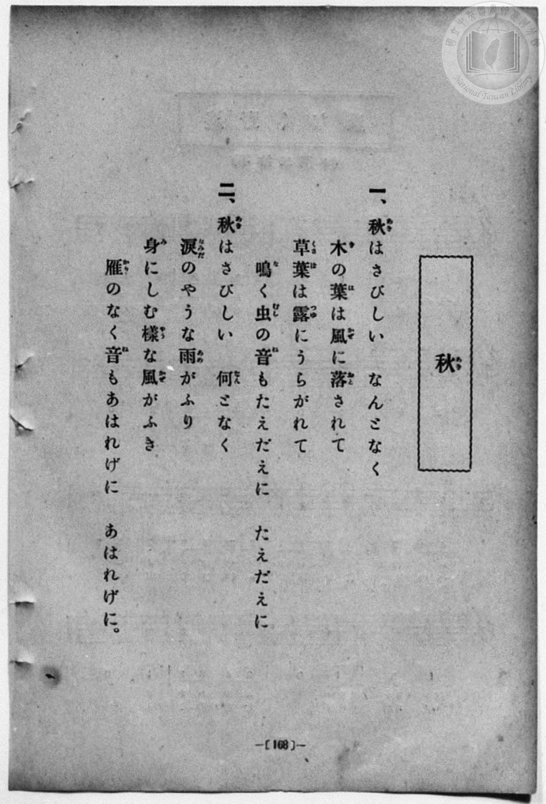
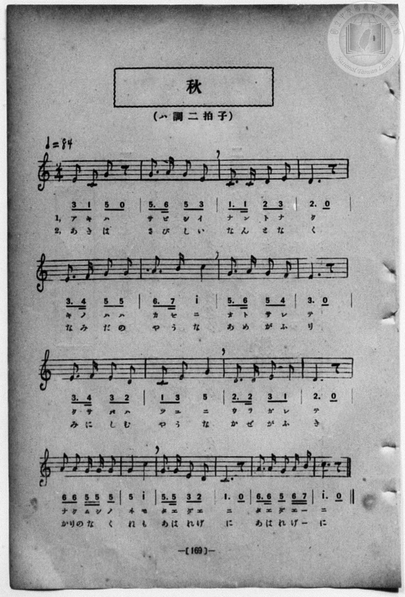

# 秋

> Re:Shōka 使用 AI 協助辨識與重建樂譜，可能會有錯誤。歡迎回報。

- **NEUTRINO 歌聲合成版**：<br><audio controls src="aki_neutrino.mp3"></audio>
- **鋼琴伴奏版**：<br><audio controls src="aki.mp3"></audio>


- book: 新編 小學校・公學校 唱歌教材集（尋常科三・四學年用）
- 一條慎三郎 編《新編 小學校・公學校 唱歌教材集》（大正十二年十二月，索書號 0725-41）
- 尋常科第三、四學年用（第 168–169 頁）

## 說明

原書資訊與歌詞全文（對應 P176.jpg–P177.jpg，原書 p. 168–169，尋常科第三、四學年第 24 首）：
調性與拍號：ハ調二拍子（C 大調 2/4 拍），♩=84


## 歌詞

```text
> [!NOTE]
> **原頁歌詞全文（P176.jpg，原書 p. 168）**
>
> 一、秋（あき）はさびしい　なんとなく
> 木（き）の葉（は）は風（かぜ）に落（おと）されて
> 草葉（くさば）は露（つゆ）にうらがれて
> 鳴（な）く虫（むし）の音（ね）もたえだえに　たえだえに
>
> 二、秋（あき）はさびしい　何（なん）となく
> 涙（なみだ）のやうな雨（あめ）がふり
> 身（み）にしむ様（やう）な風（かぜ）がふき
> 雁（かり）のなく音（ね）もあはれげに　あはれげに。
```

## ABC

```abc
X:1
T:秋
M:2/4
L:1/16
Q:1/4=84
K:C
V:V1 name="Piano" snm="Pia"
[V:V1]
E2 C2 G2 z2 | G3 A G2 E2 | C3 C D2 E2 | D4 z4 |
w: 1.~あ き は | さ び し い | な ん と な | く
w: 2.~あ き は | さ び し い | な ん と な | く
E3 F G2 G2 | A3 B c4 | G3 A G2 F2 | E4 z4 |
w: 1.~き の は は | か ぜ に | お と さ れ | て
w: 2.~な み だ の | や う な | あ め が ふ | り
E3 F E2 D2 | C2 E2 G4 | D3 D E2 C2 | D4 z4 |
w: 1.~く さ ば は | つ ゆ に | う ら が れ | て
w: 2.~み に し む | や う な | か ぜ が ふ | き
A2 A2 G G G2 | G4 c4 | G3 G E2 D2 | C4 z4 |
w: 1.~な く む し の | ね も | た え だ え | に
w: 2.~かり の な _ く | ね も | あ は れ げ | に
A3 A G2 A B | c4 z4 | E2 C2 G2 z2 | G3 A G2 E2 |
w: 1.~た え だ え _ | に | あ き は | さ び し い
w: 2.~あ は れ げ _ | に | あ き は | さ び し い
C3 C D2 E2 | D4 z4 | E3 F G2 G2 | A3 B c4 |
w: 1.~な ん と な | く | き の は は | か ぜ に
w: 2.~な ん と な | く | な み だ の | や う な
G3 A G2 F2 | E4 z4 | E3 F E2 D2 | C2 E2 G4 |
w: 1.~お と さ れ | て | く さ ば は | つ ゆ に
w: 2.~あ め が ふ | り | み に し む | や う な
D3 D E2 C2 | D4 z4 | A2 A2 G G G2 | G4 c4 |
w: 1.~う ら が れ | て | な く む し の | ね も
w: 2.~か ぜ が ふ | き | かり の な _ く | ね も
G3 G E2 D2 | C4 z4 | A3 A G2 A B | c4 z4 |
w: 1.~た え だ え | に | た え だ え _ | に
w: 2.~あ は れ げ | に | あ は れ げ _ | に
```

## TMD 檔案連結

- [主旋律 TMD 檔案](aki.tmd) [[在 TMD Studio 編輯](https://tmdlang.github.io/Tmd-TS/#tmd=s7IKdvYPcrWy4qpTUCpJTLdSSM7PyUlNLsnMz7MqzsjPTozPrsyvSsyML84ojTe0NDJWgqssy88pzU21Si9KTEmNN443QcgU55cWJadaFSdn5OfnxJekVpQk5edno8vHFySmp1oFGJqbIWQKivLLUvMS84C6C4oy80pSU8DaEQpSyzJTUkHSxcmJefFlqUWZaZmpKUiOSi0qBrsdYkVJUWJecXJRZgHIQwhV-UUlGflAhxdkVFplZBaX5BdlJifmxGcn5iUiFJVkpAK9V5yaWJyfV4ysNzM9M8-qNA_kkBKo9VpaCs-XdytoaXEp2ipYmHDZ2yo4c9kY6ZvYgfSBfG-l8GzahufbVyg83dD_dO2OZwsWPm7e_bR1DYSt8HTKxmdre55Nnfls7oSXs9ve7-l4uqH76Y4dz5dPfLKjE6R09myg0qc7tzyfsuL9nk6we57saHi2aO6z1j6gkpfNfQpA4x83dJFiz-OGbpBVS5Y_W7v4aW_jk109QBsgjGdzOt7v6Xm-ZdGz2TtezJyvYGBuZKprYgizG-6852vWgFzY0Ijqwg6guIKhmcWjhsmGZpYKLxc0gnVy6Wsp2FILcCkoKDztmw9y4Ob2Fyu6XnS0Az33YuW8p60rnk1rBwdi77P2TgVQItPLKkgHOgbINAcxgX6DaFUo0EO4EySKx2NALxmZKLxcNg3ol_d7ZoHsf7Fq_7OG5SCbu3uBwQQUfdzcDxQEhWB379O1E4CucFYAhjBQTAGYIBSAomDdPY9mrrQFJhWQIXYK0Yp-_iGusRCOlhbQacAQQ_MMzBfoTgcaB0x4IJ0Q7cBkAXQ1MD0C9TxubHrcCLLwceP6x41THzduftw4_XFjy-OGhseNqx43TX7cuALEaOyH6H02BxR3MC3rXkwEuhTIXQ8x4eUiiGz348Y5YJHVLybsBYt0Ac0Bi0x93NTzuHEZxLQXvZ0wE_rBtm-AmjNnE1hwyeMmYFIHmfO4se1xE5DRg6z95eYtYGWrwGr6X8xcDeI2AV0-HeK8l_M3gxWsBXGbgD6d_7gRyF0AJleD_YgighxIu3qICaQne6dCnAAMKrAC1NDaNhMq27gfaAnEUY-bWkC-aVz1cjYktJoeN4ESP8hzjVsfN3VBw2YX2DeN-2EBMB3os2fLZ4C9CDIBLL4KI8jBhjT2QkNoNtBksGxTF9R2sPMwAgaI1oODdhIsYNBEmkAGUp4loUBBS5-LyzE70yogMzEv36HGoKYaZL6CjaGZFjgCFLCVAwrgLNfwYmGPgoYJqAB7vr5BB5R5wTlWE4sGoDUgw2oUjBV0FQyB2BSIDYC4BszSVTAD0yDZGrA8SJURXATEAkGQDhCsAZvmY1ijAAwfIB8YzmByPZCMB-sAJg-wSmAaAeLpYFYLVGYVRKZpMpC9AiwDEgHJ9EPNB5mBZI8R7e3BH9a7esgNa10FE3DIgnANMJRBIuYKhnEwi1GC3wQsAtGGPbBB3gd5ZB00ECAkSKYbKjMHiFfDTQcWOFDxFdCgAiZlqMwyPIENDbrG_UC8AGojWFcTKHBB_Da4KohpoOgBmd4IZINsAOY-qA6IC4gP7B2dlAQ2iAYlV0gyBvEgIYxIxkbwTIA_YUMSCSjUgOUxSlgvAfu0DSyGHNYgEZBMJywMiArr_VB7VsMScFMDUlhDTEUNa-S4RglraPogOqyBNTY4rM1IC2tQMgZhUzBEpGJgqKInbFO0CEEJbGh-gCR-M2C-AKqBGYAtRkBhAIkXUBiBQgueLhvXQtUDS3GkkJoPDakOeDrugMrA4g0eUqSpRoo_UJ0CVgxyCrIjcTsLmlmACQqSRICVCx5nkaCaq5aLS9dOAVijKCAoZS4A)]
- [鋼琴伴奏 TMD 檔案](aki_piano.tmd) [[在 TMD Studio 編輯](https://tmdlang.github.io/Tmd-TS/#tmd=s7IKdvYPcrWy4qpTUCpJTLdSSM7PyUlNLsnMz7MqzsjPTozPrsyvSsyML84ojTe0NDJWgqssy88pzU21Si9KTEmNN443QcgU55cWJadaFSdn5OfnxJekVpQk5edno8vHFySmp1oFGJqbIWQKivLLUvMS84C6C4oy80pSU8DaEQpSyzJTUkHSxcmJefFlqUWZaZmpKUiOSi0qBrsdYkVJUWJecXJRZgHIQwhV-UUlGflAhxdkVFplZBaX5BdlJifmxGcn5iUiFCUWATWnp-am5pVYFWQm5uXHJyYn5-cWJOZlgsSUuLS0FJ4v736_p-Pl7JnPOrtfdu95PmHLkz1bni7tf7-nU0FLi0vRVsHChMveVsGZy8ZI38QOZDYoKKwUnk3b8Hz7CoWnG_qfrt3xbMHCx827n7augbAVnk7Z-Gxtz7OpM5_NnfBydhvQhqcbup_u2PF8-cQnOzpBSmfPBip9unPL8ykrgFaB3fxkR8OzRXOftfYBlbxs7lMAGv-4oYsUex43gDzzdMnyZ2sXP-1tfLKrB2gDhPFsTsf7PT3Ptyx6NnvHi5nzFQzMjUx1TQxhdsOd93zNGpALGxpRXdgBFFcwNLN41DDZ0MxS4eWCRrBOLsfsTKsAUNAGeTjUGNRUcykAgY2hmZYdmKWvpWCLDhTAVjS8WNijoGEC8tfz9Q06CsBUZK6XVZCuiUWDlj7YsBoFYwVdBUMgNgViAyCuAbN0FczANEi2BiwPUmUEFwGxQBCkAwRrwKb5GNYoPG5sAvIfN_aCyfVAMh6s43HjVLDKx42bgXg6mNUClVkFkWmaDGSvAMuAREAy_VDzQWYg2WNEe3vwh_WuHnLDWlfBBByyIFwDDGWQiLmCYRzMYpTgNwGLQLRhD2yQ90EeWQcNBAgJkumGyswB4tVw0x83dkHFV0CD6nFTD1RmGZ7AhgZd434gXgC1EayrCRS4IH4bXBXENFD0gExvBLJBNjxu3ArVAXEB8YG9o5OSwAbRoOQKScYgHiSEEcnYCJ4J8CdsSCIBhdrjxg0oYb0E7NM2sBhyWINEQDKdsDAgKqz3Q-1ZDUvATQ1IYQ0xFTWskeMaJayh6YPosAaWUOCwNiMtrEHJGIRNwRCRioGhip6wTdEiBCWwofkBkvjNgPkCqAZmALYYAYUBJF5AYQQKLXi6bFwLVf-4CZISIaLzoSHVAU_HHVAZWLzBQ4o01Ujx1w1J4hCnIDsSt7OgmQWYoCBJ5HHjJDzOIkE1Vy1SheKDXKGYQOsTYBDHK0QbxmJlmMbHAwMe4jkkYRMgwwQmH20aD9WDqhIujDAKm6EgszBtRzYTrATFEqCndO0UgP6K9gHqgDGNwExlLgA)]

## 分析

```text
================================================================================
📊 TMD Song Profile: [ 秋 ]
================================================================================
⏱  Duration:       0:51 (51.4s), 36 measures total
🎼 Key & Tempo:    首調基準 C, != 84.0 BPM, <2/4>
   - 分析範圍：      由實際發聲的音符與和弦推測調性；播放脈絡另行呈現
🎤 人聲音域:    C4 (MIDI 60) – C5 (MIDI 72) [跨度: 12 個半音 / 1.0 個八度, 難度: easy]
   - 最低音:  C4 in [Aki #1 @ m.1, 0:00]
   - 最高音: C5 in [Aki #1 @ m.6, 0:07]
   - 適合: soprano, mezzo-soprano, contralto, tenor, baritone, bass
🏛  結構:      Aki (25.7s) -> Aki (25.7s)
⚡ 編曲密度:        Peak 1 軌道同時演奏
🗝  調性診斷：       C 大調（純淨自然大調，未偵測到可信轉調）
   - 風格氣質:    純淨自然大調（陽光明朗、易唱易記，無明顯調外色彩）
   - 轉調歷程:    全曲維持單一推測調性（未偵測到可信轉調）
   - 核心骨幹音:  G, C, E, D, A
   - 調性數值:    C 大調 [相關度: 0.87, 穩定度: Moderate, 自然音純度: 100.0%]
   - 候選調性 (K-S): C 大調 (0.87), G 大調 (0.80), E 小調 (0.70)
   - 五度圈歷程:   +0 -> +0
   - 各段落調性細節:
     • [Aki #1]: C 大調 (r: 0.87, 自然音純度: 100.0%)
     • [Aki #2]: C 大調 (r: 0.87, 自然音純度: 100.0%)

  [ 五度圈游移軌跡 ]
              [C ]*
         F            G  
      Bb               D  
      Eb               A  
         Ab           E  
            Db       B  
               F# 
     (* = active key center)

  [ 十二半音累積音高分佈 ]
     C  : ██████████████████        21.3%
     C# :                            0.0%
     D  : █████████████             14.8%
     D# :                            0.0%
     E  : █████████████████         19.7%
     F  : ███                        3.3%
     F# :                            0.0%
     G  : ████████████████████████  27.9%
     G# :                            0.0%
     A  : ██████████                11.5%
     A# :                            0.0%
     B  : █                          1.6%
--------------------------------------------------------------------------------
Assignment 軌道音域：
  - Piano         : C4 – C5 (12 個半音 / 1.0 個八度, 108 個音符)
================================================================================
```


## 原書掃描頁






