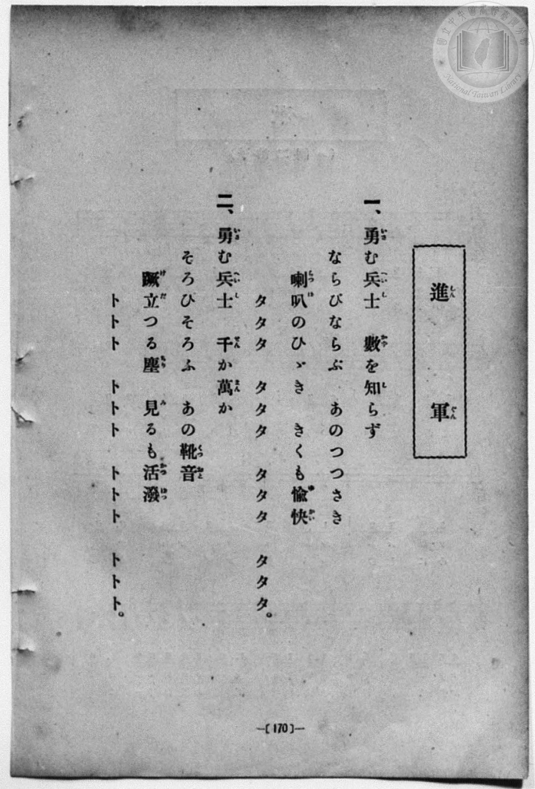
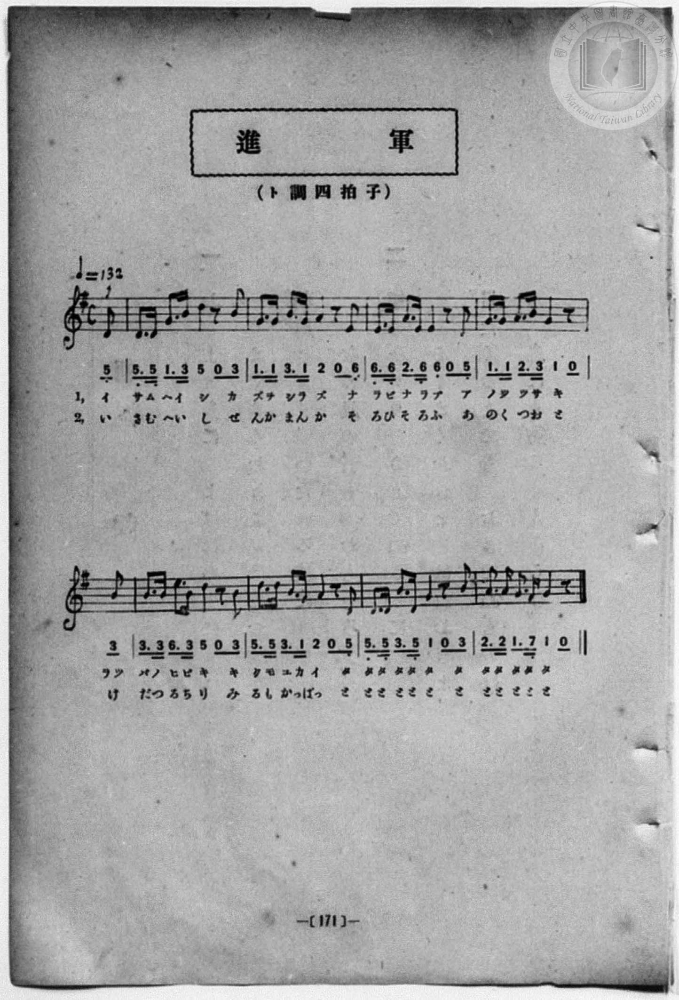

# 進軍

> Re:Shōka 使用 AI 協助辨識與重建樂譜，可能會有錯誤。歡迎回報。

<audio controls src="shingun.mp3"></audio>

- book: 新編 小學校・公學校 唱歌教材集（尋常科三・四學年用）
- 一條慎三郎 編《新編 小學校・公學校 唱歌教材集》（大正十二年十二月，索書號 0725-41）
- 尋常科第三、四學年用（第 170–171 頁）
- 出處：共益商社樂器店《唱歌教科書 生徒用 巻一》第四十～四十一頁（第二十曲）

## 說明

原書資訊與歌詞全文（對應 P178.jpg–P179.jpg，原書 p. 170–171，尋常科第三、四學年第 25 首）：
調性與拍號：ト調四拍子（G 大調 4/4 拍），♩=132，弱起半拍（八分音符）
註：全曲兩行各以八分音符弱起開始，第一行末以四分音符加八分休止符收尾（與第二行弱起合成完整小節）。


## 歌詞

```text
> [!NOTE]
> **原頁歌詞全文（P178.jpg，原書 p. 170）**
>
> 一、勇（いさ）む兵士（へいし）　數（かず）を知（し）らず
> ならびならぶ　あのつつさき
> 喇叭（らつぱ）のひゞき　きくも愉快（ゆかい）
> タタタ　タタタ　タタタ　タタタ。
>
> 二、勇（いさ）む兵士（へいし）　千（せん）か萬（まん）か
> そろひそろふ　あの靴音（くつおと）
> 蹴立（けだ）つる塵（ちり）　見（み）るも活潑（かつぱつ）
> トトト　トトト　トトト　トトト。
```

## ABC

```abc
X:1
T:進軍
M:4/4
L:1/16
Q:1/4=132
K:G
V:V1 name="Piano" snm="Pia"
[V:V1]
!f! z2 z2 z2 z2 z2 z2 z2 D2 | D3 D G3 B d2 z2 z2 B2 | G3 G B3 G A2 z2 z2 E2 | E3 E A3 E E2 z2 z2 D2 |
w: 1.~い | さ む へ い し か | ず を し ら ず な | ら び な ら ぶ あ
w: 2.~い | さ む へ い し せ | ん か ま ん か そ | ろ ひ そ ろ ふ あ
G3 G A3 B G2 z2 z2 B2 | B3 B e3 B d2 z2 z2 B2 | d3 d B3 G A2 z2 z2 d2 | d3 d B3 D G2 z2 z2 B2 |
w: 1.~の つ つ さ き らつ | ぱ の ひ び き き | く も ゆ か い た | た た た た た た
w: 2.~の く つ お と け | だ つ る ち り み | る も かつ ぱ つ と | と と と と と と
A3 A G3 F G2 z2 z2 z2 | !f! z2 z2 z2 z2 z2 z2 z2 D2 | D3 D G3 B d2 z2 z2 B2 | G3 G B3 G A2 z2 z2 E2 |
w: 1.~た た た た た | い | さ む へ い し か | ず を し ら ず な
w: 2.~と と と と と | い | さ む へ い し せ | ん か ま ん か そ
E3 E A3 E E2 z2 z2 D2 | G3 G A3 B G2 z2 z2 B2 | B3 B e3 B d2 z2 z2 B2 | d3 d B3 G A2 z2 z2 d2 |
w: 1.~ら び な ら ぶ あ | の つ つ さ き らつ | ぱ の ひ び き き | く も ゆ か い た
w: 2.~ろ ひ そ ろ ふ あ | の く つ お と け | だ つ る ち り み | る も かつ ぱ つ と
d3 d B3 D G2 z2 z2 B2 | A3 A G3 F G2 z2 z2 z2 |
w: 1.~た た た た た た | た た た た た
w: 2.~と と と と と と | と と と と と
```

## TMD 檔案連結

- [主旋律 TMD 檔案](shingun.tmd) [[在 TMD Studio 編輯](https://tmdlang.github.io/Tmd-TS/#tmd=s7IKdvYPcrWy4qpTUCpJTLdSSM7PyUlNLsnMz7MqzsjPTozPrsyvSsyML84ojTe0NDJWgqssy88pzU21Si9KTEmNN443QcgU55cWJadaFSdn5OfnxJekVpQk5edno8vHFySmp1oFGJpbIGQKivLLUvMS84C6C4oy80pSU8DaEQpSyzJTUkHSxcmJefFlqUWZaZmpKUiOSi0qBrsdYkVJUWJecXJRZgHIQwhV-UUlGflAhxdkVFplZBaX5BdlJifmxGcn5iUiFJVkpAK9l5uZk1mSWFSpxKWlpfCyYdOL3b0KWlpcirYKhsZGXPa2Cu5cNib6JnYgbSBfWik8m7bh-fYVCk839D9du-PZgoWPm3c_bV0DYSs8nbLx2dqeZ1NnPps74eXstvd7Op5u6H66Y8fz5ROf7OgEKZ09G6j06c4tz6eseL-nE-ycJzsani2a-6y1D6jkZXOfAtD4xw1dpNjzuKEbZNWS5c_WLn7a2_hkVw_QBgjj2ZyO93t6nm9Z9Gz2jhcz5ysYmBuZ6poYwuyGO-_5mjUgFzY0orqwAyiuYGhu8KhhsqG5ocLLBY1wne27Xsyc-n7PrKetG5_P7no6te35kn3PVjQ9nbni6a7pQA_A3Qg0HWi5wvMp85_umwQ0VeHp9t1APwMdDTQcZF1v4_u98yAMoDjYDpC9IG_0Nj6bvQlsJZe-loIttQCXgoLC0775oDDZ3P5iRdeLjnagW1-snPe0dcWzae3geOt91t6pAEq_elkF6UD_A5mWICYwOCFaFQr0EEEDEsUTlsBQNDJVeLlsGtAvwDAD2f9i1f5nDctBNnf3AmMGKPq4uQMoCNQEFHm6dgLQFe4KwEgFiikA06ACUBSsu-fRzJW2wOQJsnLPxhdbtz_t7QLLdTxtXf20o-3l_M3P1ywDKgXbsmI3OI5WAMPxaevKFwt7nk5oebJ7KbJSiCkvp3U_XQ5MRz1g5zcAVT6bsxqkEugJuMquBRCNT_ZMfLZ2EVDk2ZRtTzfsA9oN9AgkzkBWQJw1oeNZx4Sn64BpYAswGT9f3wB00-OGJi6Qu-wUohX9_ENcYyEcLS1gmAJjHi0WYMGPHuZAg4C5FKQToh2cnBqfdoP0PG5sedwITJidj5sanrZufbp4NVhwB1h8OtgJDc-m7gALdj9unAVWOen5_KVgEbCCpk6gOMTkx42rwNzNMMY2oPbHjU2PG9c9blwCRlMfN_ZCFD-d1v60fy3IHJBKoNRGkGkglZseN80DKgPr7X3c2P-4qelZS-fT_WC3NbWBXdICjTKgpU37oQionjC7CTkkdvWQFBJPe5vBgrMfN00GO7b7xYQ1YJF9cBFYSMx93AR0-yYYYys8JF7O3QJMH2Bd_WB_dz1uBBVvEI0vgOl_NaiAetw48XHjArCZSx43dT9duBUsuPBxUxfEMS-WQZTtB7u5GxRIW3Y_2zsRFlegEAWSiHBq7oAioEsIs8HhRHnhAQUKWvpcXMEZmXnppXlWAZmJefkONQY11SA7FGwMzbTAEaJQnVYLprGVXgrwnKagAckyCtoKJqAiH5hXdEBlD7jA0cSiE2g3yNQaBQMFXZzYNB5I1EAoMM8QzDBWMEVSZAxWA5ExBPNAtBGSCjOIMWAKzANJghlgITTbYCZBFBmD-Sh2gR3uY1ijAFKPCwOTKNg0YPoFmwNMwUD2DggbKAdMvyiqu6GqZ0FVT4KqALE7oeII1asgqoEyEPM2Q8VgqrehqG6Cmr0OqnoJGEPYU4G4F1k1OOMjvGlEXW_Ohjp8MlRFNxDvg-qcDA0GhOq5UNUgB4L4m6BiINW9QPZWvN7sR_JmFxCvQFE9Ee5HnCkbXBUoaJCYoCEp0FjBDEpjplWQCDC5YU2rIDl0FdCEj2oIJHkaQZOrOaoSEEakU2ChAw2GdeBARKQZlJgH80Cq-6FB3ATEbVDVoIgCRTVC9XyoahAN4WOyyVMNzofw5AcscaHqgOm2CZRAQOyFQHYXig37ITbAVIBcDy5yoRo2QlMDQgMoPYCMB9EQPiabPNUQD9RycenaKUALWAVUpjIXAA)]
- [鋼琴伴奏 TMD 檔案](shingun_piano.tmd) [[在 TMD Studio 編輯](https://tmdlang.github.io/Tmd-TS/#tmd=s7IKdvYPcrWy4qpTUCpJTLdSSM7PyUlNLsnMz7MqzsjPTozPrsyvSsyML84ojTe0NDJWgqssy88pzU21Si9KTEmNN443QcgU55cWJadaFSdn5OfnxJekVpQk5edno8vHFySmp1oFGJpbIGQKivLLUvMS84C6C4oy80pSU8DaEQpSyzJTUkHSxcmJefFlqUWZaZmpKUiOSi0qBrsdYkVJUWJecXJRZgHIQwhV-UUlGflAhxdkVFplZBaX5BdlJifmxGcn5iUiFCUWATWnp-am5pVYFWQm5uXHJyYn5-cWJOZlgsSUuLS0FF42bHqxu_f9no6Xs2c-6-x-2b3n-YQtT_Zsebq0__2eTgUtLS5FWwVDYyMue1sFdy4bE30TO5D5oOCwUng2bcPz7SsUnm7of7p2x7MFCx83737augbCVng6ZeOztT3Pps58NnfCy9ltQCuebuh-umPH8-UTn-zoBCmdPRuo9OnOLc-nrADaBXb3kx0NzxbNfdbaB1TysrlPAWj844YuUux53NANsmrJ8mdrFz_tbXyyqwdoA4TxbE7H-z09z7csejZ7x4uZ8xUMzI1MdU0MYXbDnfd8zRqQCxsaUV3YARRXMDQ3eNQw2dDcUOHlgka4zvZdL2ZOfb9n1tPWjc9ndz2d2vZ8yb5nK5qezlzxdNd0oAfgbgSaDrRc4fmU-U_3TQKaqvB0-26gn4GOBhoOsq638f3eeRAGUBxsB8hekDd6G5_N3gS2kis4IzMvvTTPKgAUq0EeDjUGNdVcCkBgY2imZQdmVafVgml9LQVbdKAA9mHDi4U9ChpP92x8sXW7graCCSh8n69v0FEApmhLvayCdE0sOrX0wabWKBgo6OLEpvFAogZCgXmGYIaxgimSImOwGoiMIZgHoo2QVJhBjAFTYB5IEswAC6HZBjMJosgYzEexC-xwH8MaBZB6XPhxYwvYtMeNU8HmPG5qALJ3QNhAuceN01FUd0NVz4KqngRVAWJ3QsURqldBVANlIOZthorBVG9DUd0ENXsdVPUSMIawpwJxL7Lqpk6IJNSbRtT15myowydDVXQD8T6ozsnQYECongtVDXIgiL8JKgZS3Qtkb8XrzX4kb3YB8QoU1RPhfsSZsnf1gFM2iQkakgKNFcygNGZaBYkAkxvWtAqSQ1cBTfiohkCSpxE0uZqjKgFhRDp93LgRGgzrwIGISDMoMQ_mgVT3Q4O4CYjboKpBEQWKaoTq-VDVIBrCx2STpxqcD-HJ73HjAqg6YLptAiUQEHshkN2FYsN-iA0wFSDXN3YjUsBGaGpAaAClB5DxIBrCx2STpxrigVq08tUHuXw1gRavwMT3oq_rZXvv09YdL2e3QmpMRGIyjFeINoyFURh8VFWm8UDaNB6kDs40AdImGCpJNg-7OrACo1ywuAHEx7p2ClBPR_sAVSJzjcBcZS4A)]

## 分析

```text
================================================================================
📊 TMD Song Profile: [ 進軍 ]
================================================================================
⏱  Duration:       0:32 (32.7s), 18 measures total
🎼 Key & Tempo:    首調基準 G, != 132.0 BPM, <4/4>
   - 分析範圍：      由實際發聲的音符與和弦推測調性；播放脈絡另行呈現
🎤 人聲音域:    D4 (MIDI 62) – E5 (MIDI 76) [跨度: 14 個半音 / 1.2 個八度, 難度: moderate]
   - 最低音:  D4 in [Shingun #1 @ m.1, 0:01]
   - 最高音: E5 in [Shingun #1 @ m.6, 0:09]
   - 適合: soprano, mezzo-soprano, contralto, tenor, baritone, bass
🏛  結構:      Shingun (16.4s) -> Shingun (16.4s)
⚡ 編曲密度:        Peak 1 軌道同時演奏
🗝  調性診斷：       G 大調（純淨自然大調，未偵測到可信轉調）
   - 風格氣質:    純淨自然大調（陽光明朗、易唱易記，無明顯調外色彩）
   - 轉調歷程:    全曲維持單一推測調性（未偵測到可信轉調）
   - 核心骨幹音:  B, D, G, A, E
   - 調性數值:    G 大調 [相關度: 0.84, 穩定度: Moderate, 自然音純度: 100.0%]
   - 候選調性 (K-S): G 大調 (0.84), B 小調 (0.74), D 大調 (0.73)
   - 五度圈歷程:   +1 -> +1
   - 各段落調性細節:
     • [Shingun #1]: G 大調 (r: 0.84, 自然音純度: 100.0%)
     • [Shingun #2]: G 大調 (r: 0.84, 自然音純度: 100.0%)

  [ 五度圈游移軌跡 ]
               C  
         F           [G ]*
      Bb               D  
      Eb               A  
         Ab           E  
            Db       B  
               F# 
     (* = active key center)

  [ 十二半音累積音高分佈 ]
     C  :                            0.0%
     C# :                            0.0%
     D  : ███████████████████████   24.0%
     D# :                            0.0%
     E  : ████████████              12.5%
     F  :                            0.0%
     F# : █                          1.0%
     G  : ██████████████████████    22.9%
     G# :                            0.0%
     A  : ██████████████            14.6%
     A# :                            0.0%
     B  : ████████████████████████  25.0%
--------------------------------------------------------------------------------
Assignment 軌道音域：
  - Piano         : D4 – E5 (14 個半音 / 1.2 個八度, 96 個音符)
================================================================================
```


## 原書掃描頁






