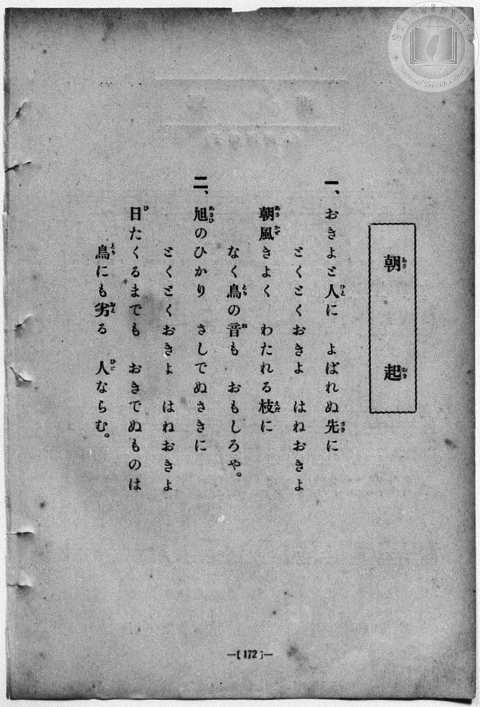
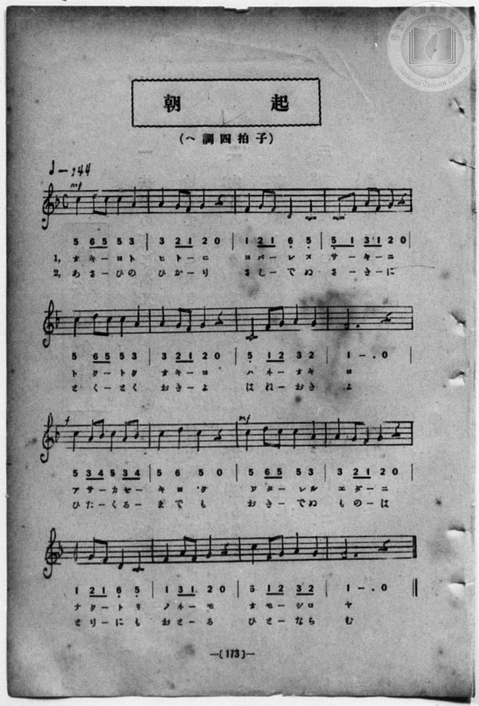

# 朝起

> Re:Shōka 使用 AI 協助辨識與重建樂譜，可能會有錯誤。歡迎回報。

- **鋼琴伴奏版**：<br><audio controls src="asaoki.mp3"></audio>
- **NEUTRINO 歌聲合成版**：<br><audio controls src="asaoki_neutrino.mp3"></audio>

- book: 新編 小學校・公學校 唱歌教材集（尋常科三・四學年用）
- 一條慎三郎 編《新編 小學校・公學校 唱歌教材集》（大正十二年十二月，索書號 0725-41）
- 出處：共益商社樂器店《唱歌教科書 生徒用 巻一》第十～十一頁（第五曲）

## 說明

> [!NOTE]
> **原書資訊與歌詞全文**（對應 `P180.jpg`–`P181.jpg`，原書 p. 172–173，尋常科三・四學年第 26 首）：
> - **調性與拍號**：ヘ調四拍子（F 大調 4/4 拍），♩= 144
> - **力度記號**：開頭標 `mf`，第 9 小節標 `f`，第 11 小節標 `mf`。
> - **版面校勘**：第 15 小節五線譜為 `5_ 1 2 3 2`（C4 四分、F4–G4 八分圓滑線、A4 四分、G4 四分），下方簡譜 `3 2` 誤加底線；第 16 小節第一段歌詞末字於本集 `P180.jpg`、`P181.jpg` 均印作「おもしろや」（「ヤ」），異於《唱歌教科書》原版之「おもしろし」。
>
> **一、**
> おきよと人（ひと）に　よばれぬ先（さき）に
> とくとくおきよ　はねおきよ
> 朝風（あさかぜ）きよく　わたれる枝（えだ）に
> なく鳥（とり）の音（ね）も　おもしろや。
>
> **二、**
> 旭（あさひ）のひかり　さしでぬさきに
> とくとくおきよ　はねおきよ
> 日（ひ）たくるまでも　おきでぬものは
> 鳥（とり）にも劣（おと）る　人（ひと）ならむ。


## 歌詞

```text
（TMD 檔案未包含歌詞註解）
```

## ABC

<div class="abc-score" data-abc-src="asaoki.abc" aria-label="五線譜載入中"></div>

[下載 ABC 原始檔](asaoki.abc)

## TMD 檔案連結

- [主旋律 TMD 檔案](asaoki.tmd) [[在 TMD Studio 編輯](https://tmdlang.github.io/Tmd-TS/#tmd=s7IKdvYPcrWy4qpTUCpJTLdSSM7PyUlNLsnMz7MqzsjPTozPrsyvSsyML84ojTe0NDJWgqssy88pzU21Si9KTEmNN443QcgU55cWJadaFSdn5OfnxJekVpQk5edno8vHFySmp1oFGFoYIGQKivLLUvMS84C6C4oy80pSU8DaEQpSyzJTUkHSxcmJefFlqUWZaZmpKUiOSi0qBrsdYkVJUWJecXJRZgHIQwhV-UUlGflAhxdkVFplZBaX5BdlJifmxGcn5iUiFJVkpAK9V5KZmxqfnxafkliJLpWYl5mbmINsamZ6Zp5VbmpmViaSr7W0FJ7Nmfti63YFLS0uRVsFQxMTLntbBTcuGxN9EzuQbpA6K4Vn0zY8375C4emG_qdrdzxbsPBx8-6nrWsgbIWnUzY-W9vzbOrMZ3MnvJzd9n5Px9MN3U937Hi-fOKTHZ0gpbNnA5U-3bnl-ZQV7_d0gl31ZEfDs0Vzn7X2AZW8bO5TABr_uKGLFHseN3SDrFqy_NnaxU97G5_s6gHaAGE8m9Pxfk_P8y2Lns3e8WLmfAUDcyNTXRNDmN1P23e9mDn1_Z5ZT1s3Pp_d9XRq2_Ml-56taHo6c8XTXdOBzoDbBPQC0AiF51PmP903Ceh6hafbdwNdDrT6-Zo1QLve750HsnFHw8sFjUDHAAWf7JrybPYmsE1c-loKttQCXAoKCnYK0Yp-_iGusRCOltbTvvkgH25uf7Gi60VHO9DNL1bOe9q64tm0di0tcDz0PmvvVEgAJWS9rIL0hEcNk0EcQzAHGEQQAxQK9BQMzY2AkobmxiBRXNG3Zo2CkZnCy2XTgP4DBh_EGbpAh7xYtf9Zw3KQE7p7gQEOsnzW4-YZQGGgZqDY07UTgM5xUwDGFlBMAZi4FICiYFN6Hs1cCUl4cNOeds1-umvZixUzYEa9nNb9csHaZytmKiTkpoHcDXKJJSiZPF_fABaGixoaIgsDVT9uaEKY_Lyz4-XcRcDE9LR7BthksBZTqBZg3D3fPuvF2jnPm3YpJJjGKxgqGCkYKxgBze5wNlEAhUMHMNk1upkAg8odKNC6GijwdM7kZ7snAjUCZRyRVIEUgNkQbz7Z0f1s2s7nGxYCzVdIAJmq8GLVkqddC57umgrU_H7PbLBbzKBuASUlYBZZtxUSqc_mrH66dvqzaXuezVkDTPtIUQq0CRGlCk_ntj_t3fBk75zHDT2PG7seNzU9bpz-uKn3cVPL4wZggHeAxJuXgNkgVz2fugFoKGaSB6ZwYNoABteTnd3oRgHJhl5YsMKSIjhXNAJLETAfpL4RaGnH48YVT3btAtnbuAnIBlr6uHH144YGsNSGx01Ak9c8bQXmViB3KlALRAHMkBWPG_thJMxAoN7G9Y8b18JFIIqBxdjLRUDzgeYA3Qk0qvtx4xywaRBn9IMtBZozH2RpU_ezeXPBioFoAaqlq4CKX25eCpZd8bipCyy77uX8zWCRtSAuMChAzkALXrQA2dWDFCDPpgM1wt0GKh-AZoLDpBtoBdg0oPj0x43LgQECCQoyw2E6xOUQK-aDtDQBg2IfyGS4s0GGgy0CuR_ojPUQvRi-Xg1U8LRrMVgQqAscfUDTGoA5BS1OVz1uAkoBkwA4ECgv7qBAQUufi8uxODE_O9MqIDMxL9-hxqCmGmSFgo2FFjisFbCVsgqQ7PNiYY-CBjAbgnOUjgIsm2hi0QC0CGRYjUJ1blqtgimwtDADkiDaGIhrwKQRuEDQVTAAixhCRczigQxgYQESA5cZxsjKwKb6GNaAsgSQDwx6ENnUAWavAGsCBiOcBwxzIAkxDKZqA1hHD5i9BqpjKsIshA6IXUYg-SawDEQVxPR1KHZ1g80EuQhqF1TtdDC5nAi78If9rh5ywp6YYAeHNKRgBknBYgIG0QMdEqj9SAEMYmOLDlhArAeLrwWTCDWw6IBB9ACnrT0EEnonWQkdms6NFUzgNCwKgAkaHuDEZgikQEdOfeCU1jgH6mnk1A8KIFhKhwTcfLAsOKU3gfSBdEDULgCT2FI6JD2DdUKCH65zH1gMnJabQC6CBTxShKCmdLAqSE6BRA8RgQ-s4skJfGyFB0gMpewgNa2vQgQCJA2CMzhIBuIlcFrDDAqot8FZvwmWBluQ7MGa1sFmQ6IEYgIiaCHyoGiA2YNcwIFd2dQJtacBw55aLi5dOwVIoa-AwlLmAgA)]
- [鋼琴伴奏 TMD 檔案](asaoki_piano.tmd) [[在 TMD Studio 編輯](https://tmdlang.github.io/Tmd-TS/#tmd=s7IKdvYPcrWy4qpTUCpJTLdSSM7PyUlNLsnMz7MqzsjPTozPrsyvSsyML84ojTe0NDJWgqssy88pzU21Si9KTEmNN443QcgU55cWJadaFSdn5OfnxJekVpQk5edno8vHFySmp1oFGFoYIGQKivLLUvMS84C6C4oy80pSU8DaEQpSyzJTUkHSxcmJefFlqUWZaZmpKUiOSi0qBrsdYkVJUWJecXJRZgHIQwhV-UUlGflAhxdkVFplZBaX5BdlJifmxGcn5iUqcWlpKTybM_fF1u3v93S8nD3zWWf3y-49zydsebJny9Ol_e_3dCpoaXEp2ioYmphw2dsquHHZmOib2IHMBvnSSuHZtA3Pt69QeLqh_-naHc8WLHzcvPtp6xoIW-HplI3P1vY8mzrz2dwJL2e3Aa14uqH76Y4dz5dPfLKjE6R09myg0qc7tzyfsgJoF9jNT3Y0PFs091lrH1DJy-Y-BaDxjxu6SLHncUM3yKoly5-tXfy0t_HJrh6gDRDGszkd7_f0PN-y6NnsHS9mzlcwMDcy1TUxhNn9tH3Xi5lT3--Z9bR14_PZXU-ntj1fsu_ZiqanM1c83TUd6Ay4TUAvAI1QeD5l_tN9k4CuV3i6fTfQ5UCrn69ZA7Tr_d55IBt3NLxc0Ah0DFDwya4pz2ZvAtvE5VicmJ-daRWQmZiXH-ThUGNQU82lAAQ2Flp2YIa-loItOlAAGbKj4cXCHgUNE1BIPF_foKMATFKGelkF6ZpYNGjpgw2rUajOTatVMFXQVTADkiDaGIhrwKSRgiEQ6yoYgEUMoSJm8UCGKYioAVGGQKVIysCm-hjWKDxu7ALyHzf2gsimDjB7BVjT48ZNcN7jxtVAEmIYTNUGsI4eMHsNVMdUhFkIHRC7jEDyTWAZiCqI6etQ7OoGmwlyEdQuqNrpYHI5EXbhD_tdPeSEPTHBDg5pkABEChYTMIge6JBA7UcKYBAbW3TAAmI9WHwtmESogUUHDKIHOG3tIZDQO8lK6NB0bqxgAqdhUQBM0PAAJzZDIAU6cuoDp7TGOVBPI6d-UADBUjok4OaDZcEpvQmkD6QDonYBmMSW0iHpGawTEvxwnfvAYuC03ARyESzgkSIENaWDVUFyCiR6iAh8YLFMTuBjKzxAYihlB6lpfRUiECBpEJzBQTIQL4HTGmZQQL0NzvpNsDTYgmQP1rQONhsSJRATEEELkQdFA8we5AIO7MqmTqg9DRj21KKW-T7IZb4Josx_0df1sr33aeuOl7NbITUwInRN4hWiTWIVDIGUYSw4HIEs0_hYBANJDKoYGLQQ5Qg1JJiGoRcmAtOFaha6nXA-EXbBykrC7sfrKgNIUOvaKUBCO9oHKI7EMwLzlLkA)]

## 分析

```text
================================================================================
📊 TMD Song Profile: [ 朝起 ]
================================================================================
⏱  Duration:       0:53 (53.3s), 32 measures total
🎼 Key & Tempo:    首調基準 F, != 144.0 BPM, <4/4>
   - 分析範圍：      由實際發聲的音符與和弦推測調性；播放脈絡另行呈現
🎤 人聲音域:    C4 (MIDI 60) – D5 (MIDI 74) [跨度: 14 個半音 / 1.2 個八度, 難度: moderate]
   - 最低音:  C4 in [Asaoki #1 @ m.3, 0:04]
   - 最高音: D5 in [Asaoki #1 @ m.1, 0:00]
   - 適合: soprano, mezzo-soprano, contralto, tenor, baritone, bass
🏛  結構:      Asaoki (26.7s) -> Asaoki (26.7s)
⚡ 編曲密度:        Peak 1 軌道同時演奏
🗝  調性診斷：       F 大調（純淨自然大調，未偵測到可信轉調）
   - 風格氣質:    純淨自然大調（陽光明朗、易唱易記，無明顯調外色彩）
   - 轉調歷程:    全曲維持單一推測調性（未偵測到可信轉調）
   - 核心骨幹音:  C, F, G, A, D
   - 調性數值:    F 大調 [相關度: 0.87, 穩定度: Moderate, 自然音純度: 100.0%]
   - 候選調性 (K-S): F 大調 (0.87), C 大調 (0.81), A 小調 (0.62)
   - 五度圈歷程:   -1 -> -1
   - 各段落調性細節:
     • [Asaoki #1]: F 大調 (r: 0.87, 自然音純度: 100.0%)
     • [Asaoki #2]: F 大調 (r: 0.87, 自然音純度: 100.0%)

  [ 五度圈游移軌跡 ]
               C  
        [F ]*          G  
      Bb               D  
      Eb               A  
         Ab           E  
            Db       B  
               F# 
     (* = active key center)

  [ 十二半音累積音高分佈 ]
     C  : ████████████████████████  28.6%
     C# :                            0.0%
     D  : ███████                    8.0%
     D# :                            0.0%
     E  :                            0.0%
     F  : █████████████████████     25.0%
     F# :                            0.0%
     G  : ████████████████          18.7%
     G# :                            0.0%
     A  : ███████████████           17.9%
     A# : ██                         1.8%
     B  :                            0.0%
--------------------------------------------------------------------------------
Assignment 軌道音域：
  - Piano         : C4 – D5 (14 個半音 / 1.2 個八度, 134 個音符)
================================================================================
```


## 原書掃描頁






